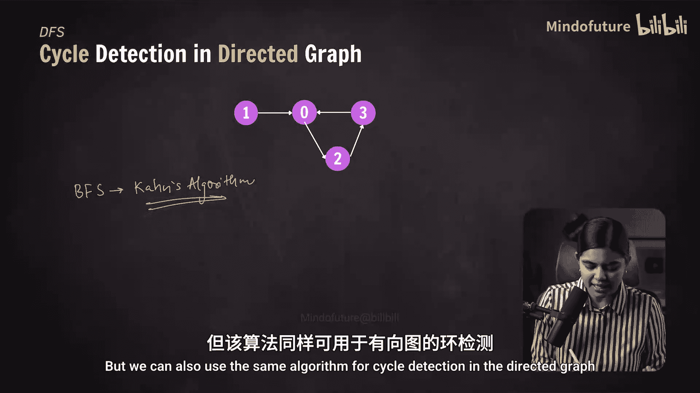

# C++-DSA课程-｜-数据结构-｜-leetcode-｜-Apna-College-｜--Complete-C++-Dsa-Course-p116-P118_使用DFS检测有向图中的环-第116讲--BV18oUGBkEmV_p116-

Iru and recruit the complete DS series， and today were going to learn about cycle detection in a directed graph using D I already cycle detection in undirected graphcom complete I Also there is a link for a company D sheet in the description box to startmi problem we are given this directed graph we have some directed edges example this is a graph cycle and3 and all of these edges are forming a cycle or a loop in this graph directed whose true return and cycle nameham false returnna basically Iip undirected graphander cycle detection So there was a concept that we learned about which was the concept of a back edge。

😊，Back edge is basically that edge cycle example3 and three v said this is what is called a back back basicallyf is isdirect but undirected graph back because undirect directed even thoughdirect if you want a detailed video on why the undirect doesn't work for a directed you can let me know in the。

😊，But that will be different from the undirected approaches Basically or if the。

Said this is our if condition。 This is our for loop。

 and this is our DS code depth first search D back edge back E basically the logic that we follow traverse node for example。

 we thecur with this node and which is equal to2 next2 co2 and is going to bear。😊。

And recur3 up3 ks may up0 and03 k iscur visited which is already visited and this is basically the condition for in is loop that exists in our basically look for a note is plus it in for example。

 we have a graph， which looks like this which is going to0。😊。

and logic suppose we start and equal then and。the main function and and we will not find a single condition and exist important step will get a wrong answer basically and co co and and delete which is already visited and it is part ofcur even though there is no in graph let's make some changes in our existing basically what exactly is this recur basically。

hamseko visited Jeako visited visited Boolean Eriander overallcom visitedp re visited we are going to create another Booleanri this is also a Booleanri。

😊，And Jesie， H kisssy be。Function called Kandarrangi， Ver say he recurgent path。

For current node go Hammark her as true。 And case at merijo condition here the condition。

Is basically else if the Agar Koibbin Nor visited Hojahiya， Koibbi neighbour visited Hojahi。 Plus。

 it is part of the recurrengent path。 Key， if the recurrengent path。😊，Of we is true。

 Those case may Hamya he say he return Guingy true value go。Plus， Ikiatme。

 A girlhammnikii unvisited Nebukili callathan， Vaassei Aappa true return Oatha for a cycle。

 Those case may hummi be true return Knaai。 The yper let us minimize this a bit。😊，And Ugar。

 if we make a call for our neighbourhood。And Vahai Ahamparu return Hohararat to Yahasebi Ham Tru vluo returned Gerhenay。

 and after everything， after checking for the backage condition。

 after making calls for the unvisited neighbours， Agartbi Hamipparu return Hokaat to last me Ham Yahasi return Guhenay false vluo Ki there is no cycle which exists。

😊，Plus， I important step herera backting step performander falls。😊。

Recursion path say if we are returning a false value。

 Ham upni current Nordco mark Kingi Vapa say as false。

 So this is the entire logic of tracking a cycle in a director graph。

 is called Iran Ca Cargi Dranka process is very， very simple。 Hammi simply upni。

 though Erisco create Kne。 Let us suppose ye a Kra visited Ehem。😊，This is visited0，1，2 and3 and I。

 which is So this is alsoolean for visited values will be true which is equal to2 the next call visited Now we make a call fors which is equal to next call and which is0 is already visited and it is。

So part of the recursion path true return true return and true value plus there is an additional function for all the connected that are connected but this is the entire logic Now let us write the for is the class that we have already created function detection let us call this boole are going to get。

A vector。Of Booleion， which is visited plus a vector of Booleion。

 which is going to be the recursion path。Totirii visited Ma Kingi Ani Kko。

 though it is going to be true。 Sakaase recurgenin Pa Kander add Kingi。

Though this is also going to be true。 Sari Sari neighbours for Lui to Hamriju Graki implementation here。

 Ome all of the neighbor values are going to be list of current to y current k Sari neighbourski valuesari Paa。

 If you have any other implementation of graph to upni according Hamme simply Sari Nebsle Lui to Sari Neki Kque in teacher V。

In list of current cur them。 So this is each neighbor。If the neighbor is unvisited。

 though visited of v Agar falsehe thosem call for the same function is cycle and that there is a cycle that exist in the future neighbors。

 Those case return true is already plus is part of the of v is true true and false value。

 So this is the overall v plus E equalbi going to visit all of the nodes of the graph plus I is basically。

😊，Just can their code logic a per Kkiari graph can their connected components be used at time just say for example。

 if we take an example of this graph to a， lets suppose a hyper cycle existing in Ka。😊。

Jesse As gras directionta there was no cycle。 But let's suppose one vi X y and vpa to Zru to S8 set of node traversene set of noderu already visited N we are going to create another function。

 which is boan is cycle Ko parameters N simplyha subse Boion。😊，Visited C Karingi。

 just Cassi Ogavi and initialized with false values。Similarly。

 we are going to have a recursgenion path。And Hamic Lochlangi。

 sarigiari notes per of the entire graph。 I plus less Koibi note Ugar unvisited he， not visited of。I。

Those kiss me。H up me is function go call getting it。Bypasing， I visited and recursgent path。

And Kahibi Agaham made true value miier。Those case may we are also going to return a true value or in name those case may hum up me false value go return K。

 So this is the function just per hum main function I call laange。

 And this is the helper D F is function justco call J The y。 Let's see out G dot is cycle。

Abimaari Graf can the cycle Johevo exist Kaier。 This case， may amaippas answer。

 had that should be equal to1。😊，But Agarham Cyka edge remove Kim。 Jes， for example， Yahapper。

 if I remove this edge， which is going from 3 to 0。

Those case mayspa this case may we are going to get0 we perform cycle detection in a directed graph using D directed graph the cycle detectionip but is generally the more intuitive algorithm for a lot of programmers is which is called series topological top sorting cycle detection in directed graph but generally detection successfully completed today's lecture we can mark our attendance themi can also share a progress with me on Twitter description Mil lecture can learning and keep exploring。

😊。

