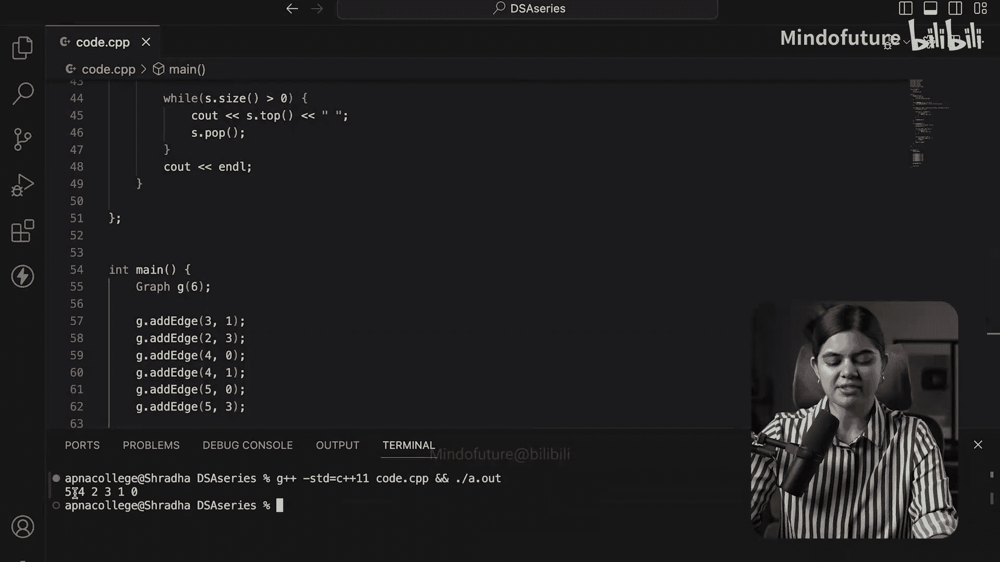

# C++-DSA课程-｜-数据结构-｜-leetcode-｜-Apna-College-｜--Complete-C++-Dsa-Course-p117-P119_图中的拓扑排序-使用DFS-第117讲--BV18oUGBkEmV_p117-

Hi run reckon to the complete series。 and today we're going to learn about topological sorting in graphs there is a list for compromise in the box are going to learn about topological sorting topological sorting top top directed which are called directed plus those graphs should be undirect top sorting topological sorting directed and what exactly does that mean basically。

😊，cycle exists in graph direction exists plus cycle exists in graph topological sorting linear ordering of all ver ver nodes such that every directed edge ja u linear order top sorting will come before Now what exactly does that mean basicallyham is second4 third second2 third is31 and next is this basically v topological sorting order ver。

😊，values as compared to  plus0212 and top top。ascing or descending order topological possible top solve dependency dependrequisient programmingrequis。

Cours so that we are able to complete all of the courses in a given order The v problems solve graph create or topological sorting use operating system depend software dependency problems top dependencyul top sorting top topological sorting perform function usean visited。

😊，Tni Kin Norko visited Markarhi， Oskeba theniar Nord kem。Sriari neighbors tra。

 So this is we and these are all of our neighbors。bi。

 which is not visited is and our visitedole for loop and this isological topological or but generally tra If this directed E exists to generally tra or is tra。

😊，and and solve problem。last and use a answer basically am trying to top。

And this is the staticg data structure， G C Hammni function can there。Pascur volume。

 So this will basically be a stack of inteion numbers。

 and Ja Ja were current Norkomi stack can the push kina。

 And as the re stack can the order niliga that will be a topological sorted order。

 But sitna simples a change ageisco curium topological sorting。

 Let us look at the dry and anucil logic orders are the clear yogaga。😊，Let us minimize this a bit。

And let's suppose。 This is the us as as simply0 next ascending order23 in the ascending order ofari visited if we also consider a use visited we have2。

3，4 and。😊，Thisrines0 Ko already visited Ma Kea1 per am。

 This is already visited1 visit Car I true K and kari1 kbi Ko Ksei directed Ni to one Kobi simply K and next2 up2 khi2 Kom visited K。

😊，And2s kggka a， which is equal to 3。m called tokine neighbours co visit Karinggi。

 the twomus next neighbour co visit Ka， which is equal to 3。 Je33 visitedbi3s3 k neighbour。

 which is equal to1， but one is already visited Agar already visited。😊。

3 say is already visited to and and。Kingper we visited58 Ne0 already visited。

 second neighbour who already visited。 These are dependents of5。

 you already visited him to finally have5 push。 and we revert back to the main function。

 This Seari notes visited O andaripa answer this is our final answer Ab valuescopaja。

 Then we are going to have4。 Then we are going to have2。😊，tり。

1 and sequence this is how perform top function equal let convert logic into。😊。

graph that we have already created is karam listsco use K near J listsco roll Kle and this is the add edge function directed edgeco use s Vi kari graph can the add just graph here see same graph company already create K Yaha。

😊，Hm up the main a DFSological li。 So let's call this void DFs。😊，D F S Kander。

 basically Hampaari current node him。 We have a Boolean visited vector。hamco visit Kagi。

 plus we have a stack of integer values。 values Atko visitedgi plusari to kjus they are stored in a list at the current index。

 though is implementation kariri， If you have a different implementation of graphi accordingri the。😊。

If a neighbour is not visited， Matler visited of V is false。

 Those case may Hammna D F S co call la Caringay for we visited and stack。

 And last me Ja Jae am simply stack Ken P Kingay。Upne k Nor。

 is not simple here Jo D physical logic and per a core function create Kringe。

 which we are going to call topological sort。Yeah， in fact。

 let's simply call it toppper sort Ikanderpa coi para Yahise Hamm dicogi toomic Ve Boolean C Kleta visited Gise initialize Kingham with false values。

😊，Plus， extract la of integer values， S。Ame Lo Chilani I equals 0 siliica V tu I plus plus Chepsriri Noari visited Nja Kobi nodaer unvisited he to visited of I Kile Im calledi to the D F S function。

 Ka Koas Kainggi visited kpa Karinggi。 This current is basically our I Ananicompaka Jse Sari function calls Kamogiari Staanderrajo topological sorted orderhoga those orderkori Kava。

😊，Jept， our stack size is greater than 0。T tu， we are going to see out S dot top perjubi element here with some space and stack say pop Kingap any values go and finally see out Kdi end offline。

 let's save this code and Yahase main function say Im topper sort function go call Kringgi。

Let's save this and run。To same order print ok54，2。

310 So this is how we do topological sorting for a graph time to same Df logic use time that is same as our D algorithm which is big of V plus topological sorting particular key implementation So if we have successfully completed today's lecture then we can mark n down the can also share our progress with me on calling lecture can key learning and keep exploring。

😊。

