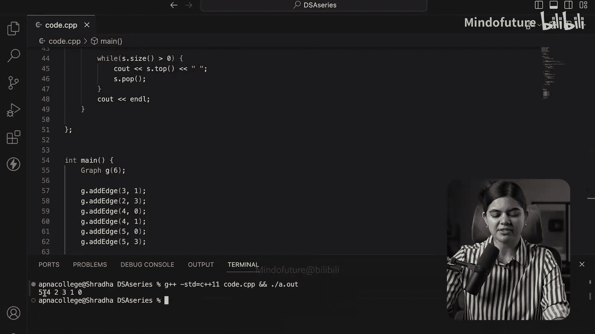

# C++ 数据结构与算法课程：117：图中的拓扑排序（使用DFS） 🗺️


在本节课中，我们将学习图论中的一个重要概念——拓扑排序。我们将了解它的定义、应用场景，并重点学习如何使用深度优先搜索算法来实现它。

## 概述

拓扑排序是一种针对**有向无环图**的线性排序算法。它要求图中不能存在环。这种排序的结果是，对于图中的每一条有向边 `(u, v)`，节点 `u` 在排序中都出现在节点 `v` 之前。拓扑排序常用于解决具有依赖关系的问题，例如课程安排、软件包安装顺序等。

## 核心概念与算法

拓扑排序的核心在于处理节点间的依赖关系。以下是使用DFS实现拓扑排序的关键步骤：

1.  **数据结构**：我们需要一个图（通常用邻接表表示）、一个记录节点访问状态的布尔数组（`visited`）和一个栈（`stack`）来存储最终排序结果。
2.  **DFS遍历**：从任意一个未访问的节点开始，进行深度优先搜索。
3.  **后序处理**：在DFS递归函数从某个节点返回时，将该节点压入栈中。
4.  **输出结果**：当所有节点都被访问后，栈中从栈顶到栈底的顺序就是拓扑排序的结果。

其核心逻辑可以用以下伪代码描述：

```cpp
void DFS(int node, vector<bool>& visited, stack<int>& st, vector<int> adj[]) {
    visited[node] = true;
    for (int neighbor : adj[node]) {
        if (!visited[neighbor]) {
            DFS(neighbor, visited, st, adj);
        }
    }
    st.push(node); // 关键步骤：在递归返回时压栈
}

vector<int> topologicalSort(int V, vector<int> adj[]) {
    vector<bool> visited(V, false);
    stack<int> st;
    for (int i = 0; i < V; i++) {
        if (!visited[i]) {
            DFS(i, visited, st, adj);
        }
    }
    vector<int> result;
    while (!st.empty()) {
        result.push_back(st.top());
        st.pop();
    }
    return result;
}
```

## 算法执行过程示例

为了更清晰地理解，让我们通过一个简单的例子来逐步分析算法的执行过程。

假设我们有一个包含5个节点（0到4）的有向无环图，其边为：`0->1`, `0->2`, `1->3`, `2->3`, `3->4`。

以下是算法执行的步骤分解：

1.  初始化所有节点为未访问状态。栈为空。
2.  从节点0开始DFS。标记节点0为已访问。
3.  遍历节点0的邻居：节点1和节点2。
4.  首先访问节点1，标记为已访问。节点1的邻居是节点3。
5.  访问节点3，标记为已访问。节点3的邻居是节点4。
6.  访问节点4，标记为已访问。节点4没有出边，DFS递归开始返回。
7.  返回到节点4的调用处，将节点4压入栈中。
8.  返回到节点3的调用处，将节点3压入栈中。
9.  返回到节点1的调用处，将节点1压入栈中。
10. 回到节点0的调用处，继续处理下一个邻居节点2。
11. 访问节点2，发现其邻居节点3已被访问，因此不再递归。从节点2返回，将节点2压入栈中。
12. 最后，从节点0返回，将节点0压入栈中。
13. 此时栈中内容（从栈顶到栈底）为：`[0, 2, 1, 3, 4]`。
14. 依次弹出栈中元素，得到的拓扑排序顺序为：`0 -> 2 -> 1 -> 3 -> 4`。检查所有边，均满足“起点在终点之前”的条件。

## 代码实现要点

上一节我们通过示例理解了算法的流程，现在来看看如何将其转化为具体的C++代码。以下是实现时需要注意的几个关键点。

*   **图的表示**：通常使用邻接表（`vector<int> adj[]` 或 `vector<vector<int>>`）来存储图结构，可以高效地访问每个节点的邻居。
*   **访问数组**：`visited`数组用于防止重复访问节点，这是DFS算法的基础。
*   **栈的使用**：栈（`stack<int>`）用于在递归返回时收集节点，从而自然形成逆后的排序顺序。最终输出时需要反转。
*   **驱动函数**：`topologicalSort`函数负责初始化访问数组，并循环调用DFS以确保所有连通分量都被处理。

## 总结



本节课中，我们一起学习了拓扑排序。我们首先明确了拓扑排序只适用于**有向无环图**，其结果是满足所有边方向的一个线性序列。接着，我们深入探讨了如何利用**深度优先搜索**的后序遍历特性来实现拓扑排序，并通过示例逐步演示了算法的执行过程。最后，我们总结了代码实现的核心数据结构和关键步骤。掌握拓扑排序对于解决任务调度、依赖解析等实际问题非常有帮助。