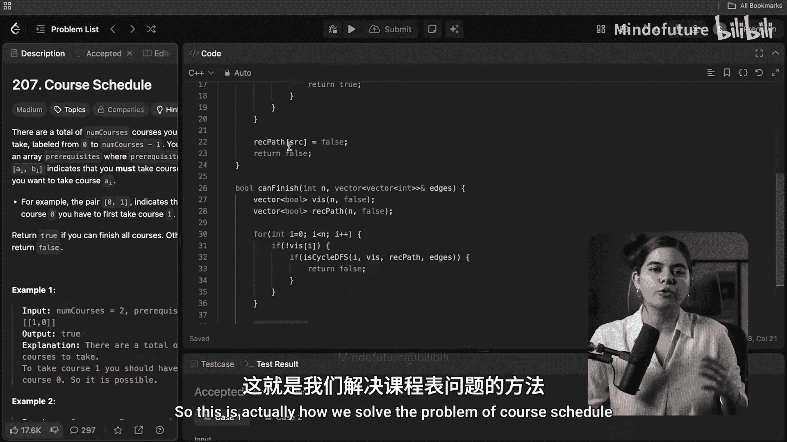

# C++-DSA课程-｜-数据结构-｜-leetcode-｜-Apna-College-｜--Complete-C++-Dsa-Course-p118-P120_课程表问题-使用图拓扑排序--BV18oUGBkEmV_p118-

I run and welcome the complete series and today we're going to solve one more classical E problem。

 which is called course Also the is link for company in the description box this problem is called course and this is also problem 27 on course key information given n is given as this variable nu courses given subjectsdi English math subjects here course plus these course have some prerequisite information prerequisite informations suppose this is my prerequisite according to this informationju course is acting as。

😊，Depenency for the a course Kaiva colleges canas subject So which are a dependency for the other subjects all subject subject prerequisite for example。

 computer science in my programming course in Java that we actually had to study this course before we could study another course which was oops which was object toed programming prerequisite situation just this course is a prerequisite for this course And in other words。

 we can say that this course is a dependency for this course the information a and B though courses where B is the dependency for a course a student prerequisite dependency called course enroll if it is possible to enroll in all of the courses then we have to return true value and if its not。

Possible those case may false return Lets look at an example。

 Ki situation work basicallyipas course information given here。

 and this is the prerequisites suppose courses 0，1。

2 and3 courses different dependencyrequisites given given1 and00 is dependency course1 enroll second dependency is for 0 and2 enroll can it like third dependency is for3 and1 complete enroll enroll en whose situation in this situation complete and in this situation complete next2 finish。

😊，there is this dependency， which is also there as a coursena and basically this is what the courses what the prerequisite information looks like and is diagram information is actually a graph and this is a graph problem classical and last important concept which was called topological top and is actually very related to topological top top dependency and when we talk about courses when we talk aboutrequisites is actually a dependency problem。

😊，Basically， dependencies top and that is exactly the same problem solve basically enroll on prerequisrequis depend solve start with top is a valid sorted order which exists。

😊，Our alternative a is0 say palelium2 co visit kine for one coine for three cocaine。

 and this is also a valid topological sorting order Tommyki prerequisitejoki information here in sa courses go actually in kar enroll Kna possible here and in donno sequences k course k enroll kiumki is particular example kjo answer return K that is going to be truemni example earlier let us also take an example of a false scenario。

😊，Let us suppose and prerequisite 0 to1 and120 is it possible for this is particular dependency and dependency also has is going towards is topologicalg or top sortrequisite dependency conditionsrequisite。

😊，ham return Kingi Aniek false value。 now， if we look at the general pattern of solving these problems。

 basicallyni ye figure outki Ki Kibi G k。In fact， prerequisite information given total number of verrequisrequi is top dependency top order top。

😊，way be a possible wages courses can enroll or own cases can return cycle false non and non topological sorting possible topological sorting simply false return topological sorting So this graph problem is actually a problem of detection in to topological sorting which is called topological sorting but is particular even though the concept is related to topological sorting this problem is actually a problem of。

😊，Cycle detection in directed graph and cycle detection in directed graphq problem here Usco Al lecture can the solve DFS cycle detection already para from y same DfS code is particular graphpa apply。

 let's revise the general concept of cycle detection in directed graph and concept directly problem apply directed graph can the cycle detectionne。

😊，Basically D function called Im using Df D node we have something called the recur path recur path is also a boolean recur exist if you have not studied detection in dedicated lecture including the logic detection and everything recur function is actually a detection function function node let's mark as and we also added to the recurcur source node。

😊，ariss assume in a variable called And if we is not is false visited and forcur and So this is the first case second is plus it is also part ofcur or。

we can check for the actual condition。 neighbor visited is also part of thecur is also true and value So this is what the entire is like us minimize false and false is in detection directed So this is the function that we have to complete。

Under Hamarias numb courses key information here， let us increase this a bit。

 Plus Hamas prerequisite key information here for the sake of simplicity。

 I am just going to call this variable n keyhamari number of verses And as you prerequisite。

 you basicallyari directed edges co graph we is co directed edges key information。

 we ca thember subelto， we have to create a vector of Boolean values。

 well call it to visit it visited coham initialize Kinge with all the false values。

 plus a core vector create Kringi， which will be recursgenion path。😊。

Recurgenian path Ko behem initialize Kingay with false values。 Ahamic function banana。

 which is basically a boolean is cycle function。 It is a boolean is cycle function。

 Justcanander Itopa Samari source Nor Hogi Usqueme， we are going to get this vector Boion visited。😊。

With reference， and we are also going to get plus that is why we are going to plus basically stor for all the。

ss andext is information that this0 is basically our u vertex and this one is basically our v vertex v prerequisite is the information that we have So the first value is our v value and the second value are u value。

😊，Let's store this information。 V is going to be edges of。Iイコマ0。

And U is going to be edges of I comma 1 Mrer say Hamas U and weak informationer Our primary objective is that we want to find out the neighbors of the source node。

 The source node ks are make come milling Jehammaari， U Johoga， that will be equal to source。

 If the U value is equal to the source node。 those Ka La V value is the neighbor node。Nbu Yaa。

 Nebuh Kiam Callingi， if visited of we。Is false those case may Vico visit Karinggi Vico visit Kaigkala is cycle function Co。

 in fact， lets call it a cycle DFS。😊，Is function K basically D cycle D Vpa King as the new source node visitedpa recurspapa and function call true return those case return K true value。

 So this is the first case where we return the true value。

 Second cases else if Agar Ne already visitedla not visited say。

 but it is also part of the recurs path recurs path of V is true those case may be we are going to return a true value at the end of all of this A to return whose case recur path sayme source node King S false。

😊，Let's mark as false and Yahai we are going to return a false value。

 This is the entire logic to detect a cycle in this particular prerequisite graph。

 This D perform andme function we basically have to run a loop for all of the vertices Yani andja And if a vertex is not visited of I is false those case Yaham is cycle function go call ki is cycle Dfs and we are going to pass I visitedin path along with the edges and his functionham to return sub cycle exists ktea case may cycle Kt whose caseme false return Yam return false value。

 and this case may cycle inusme to return Knai Kobi exists ingi at the end of this function。😊。

We are going to return， oh。B value。So this is the entire logic of solving this problem Yaku cyclehiga function exists those case may have false return at the end we are going to return our true value。

 Let us run our code and submit it。😊，So this is actually have we solved the problem of schedule ands fancy basically problem recognize this is a graph problem recognize simply cycle detection So this is a classical problem of cycle detection in a directed graph have successfully completed today's lecture then we can mark our attendance down in the commentsgar already topological sorting detection lectures complete and I highly urge you to complete those lectures important information Megi about the fundamentals of graphs in case a graphsrum problem solving you can also share a progress with me on Twitter just description lecture learning and keep practicing。

😊。

