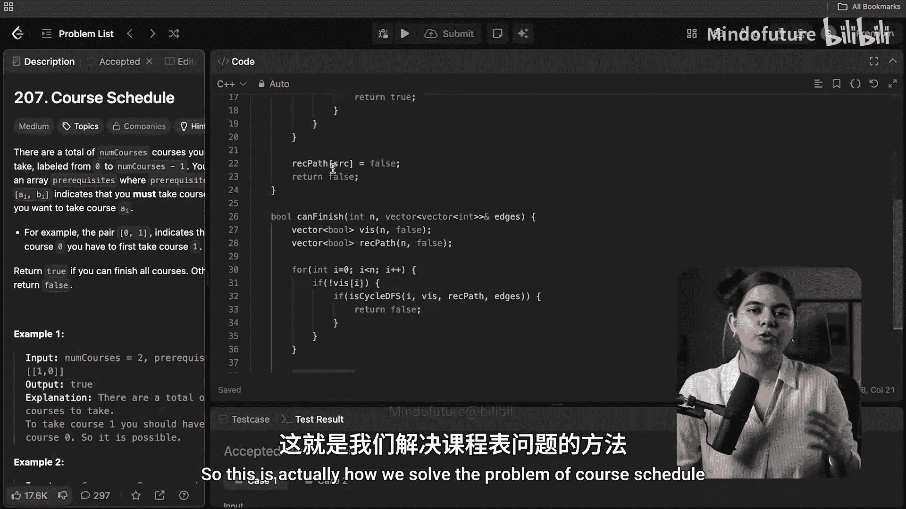

# C++ 数据结构与算法课程：118：课程表问题 - 使用图拓扑排序


## 概述
在本节课中，我们将学习如何解决一个经典的 LeetCode 问题——“课程表”。这是一个关于课程安排与先决条件依赖关系的图论问题。我们将通过检测有向图中是否存在环来判断是否能够完成所有课程的学习。

---

## 问题描述
给定一个变量 `n`，代表课程的总数（例如 0 到 n-1 门课程）。同时给定一个先决条件数组，其中每个元素 `[a, b]` 表示：要学习课程 `a`，必须先完成课程 `b`。换句话说，课程 `b` 是课程 `a` 的依赖项。

我们的任务是判断学生是否有可能完成所有课程。如果可能，返回 `true`；如果不可能（即存在循环依赖），则返回 `false`。

---

## 问题示例与理解
让我们通过一个例子来理解问题。

假设有 4 门课程：0, 1, 2, 3。
给定的先决条件是：`[[1,0], [2,0], [3,1]]`。
这表示：
*   学习课程 1 前，需先完成课程 0。
*   学习课程 2 前，需先完成课程 0。
*   学习课程 3 前，需先完成课程 1。

这种依赖关系可以构成一个有向图。在这个例子中，存在一个有效的学习顺序，例如：`0 -> 1 -> 3` 和 `0 -> 2`。因此，答案是 `true`。

---

## 何时返回 False？
现在，我们来看一个返回 `false` 的场景。

假设先决条件是：`[[0,1], [1,0]]`。
这表示：
*   学习课程 0 前，需先完成课程 1。
*   学习课程 1 前，需先完成课程 0。

这形成了一个循环依赖（0 依赖 1，1 又依赖 0），学生无法开始任何一门课程。因此，答案是 `false`。

---

## 问题本质与解决思路
通过以上分析，我们可以看出，这个问题本质上是一个**有向图的环检测**问题。

*   我们将每门课程看作图中的一个节点。
*   将一个先决条件 `[a, b]` 看作一条从节点 `b` 指向节点 `a` 的有向边（因为 `b` 是 `a` 的前提）。
*   如果在这个有向图中存在环，就意味着存在循环依赖，无法完成所有课程，返回 `false`。
*   如果图中不存在环，则意味着可以找到一个拓扑排序（即一种合理的学习顺序），返回 `true`。

因此，解决这个问题的核心算法是：**检测有向图中是否存在环**。

---

## 算法实现：深度优先搜索 (DFS) 环检测
我们将使用深度优先搜索 (DFS) 来检测图中是否存在环。关键思想是跟踪递归路径上的节点。

以下是实现步骤：

1.  **构建图**：根据先决条件列表，构建图的邻接表表示。
2.  **初始化辅助数组**：
    *   `visited`：标记节点是否被最终访问过。
    *   `recursionStack`（或 `path`）：标记节点是否在当前 DFS 的递归路径上。
3.  **定义 DFS 函数**：`bool isCycleDFS(int node, vector<bool>& visited, vector<bool>& recursionStack, vector<vector<int>>& adj)`
    *   将当前节点标记为已访问 (`visited[node] = true`) 并加入递归路径 (`recursionStack[node] = true`)。
    *   遍历当前节点的所有邻居：
        *   如果邻居未被访问过，则递归调用 `isCycleDFS`。如果递归返回 `true`，则当前路径存在环，向上返回 `true`。
        *   如果邻居已被访问过**并且**也在当前的递归路径上 (`recursionStack[neighbor] == true`)，则说明发现了一个环，返回 `true`。
    *   在从当前节点返回前，将其从递归路径中移除 (`recursionStack[node] = false`)。
    *   如果上述情况均未发生，则从当前节点出发未发现环，返回 `false`。
4.  **遍历所有节点**：对每个未被访问过的节点，调用 `isCycleDFS` 函数。
5.  **得出结果**：如果任何一次 DFS 调用检测到环，则整体返回 `false`（无法完成课程）。如果所有 DFS 都未检测到环，则返回 `true`（可以完成课程）。

以下是核心的环检测函数代码框架：

```cpp
bool isCycleDFS(int node, vector<bool>& visited, vector<bool>& recursionStack, vector<vector<int>>& adj) {
    visited[node] = true;
    recursionStack[node] = true;

    for(int neighbor : adj[node]) {
        if(!visited[neighbor]) {
            if(isCycleDFS(neighbor, visited, recursionStack, adj)) {
                return true;
            }
        } else if(recursionStack[neighbor]) {
            // 发现环
            return true;
        }
    }

    recursionStack[node] = false; // 回溯
    return false;
}
```

主函数逻辑如下：
```cpp
bool canFinish(int numCourses, vector<vector<int>>& prerequisites) {
    // 1. 构建邻接表
    vector<vector<int>> adj(numCourses);
    for(auto& pre : prerequisites) {
        // pre[1] -> pre[0]
        adj[pre[1]].push_back(pre[0]);
    }

    // 2. 初始化辅助数组
    vector<bool> visited(numCourses, false);
    vector<bool> recursionStack(numCourses, false);

    // 3. 对每个未访问节点进行DFS环检测
    for(int i = 0; i < numCourses; ++i) {
        if(!visited[i]) {
            if(isCycleDFS(i, visited, recursionStack, adj)) {
                return false; // 发现环，无法完成
            }
        }
    }
    return true; // 未发现环，可以完成
}
```

---

## 总结
本节课我们一起学习了如何解决“课程表”问题。

1.  **问题转化**：我们首先将课程和先决条件转化为有向图模型，其中节点是课程，边表示依赖关系。
2.  **核心洞察**：我们认识到，能否完成所有课程等价于判断对应的有向图中是否存在环。无环图意味着存在拓扑排序（可行的学习顺序）。
3.  **解决方案**：我们使用了基于深度优先搜索 (DFS) 的环检测算法，通过维护一个递归栈 (`recursionStack`) 来跟踪当前的搜索路径，从而高效地判断环的存在。
4.  **算法实现**：我们实现了 `canFinish` 函数，它构建图，初始化状态数组，并遍历所有节点进行 DFS 检测，最终返回是否存在环的布尔值。



掌握这个问题的解法，不仅解决了“课程表”这一特定问题，也巩固了**有向图环检测**这一重要的图论基础算法，它是理解拓扑排序和解决许多依赖关系问题的基础。