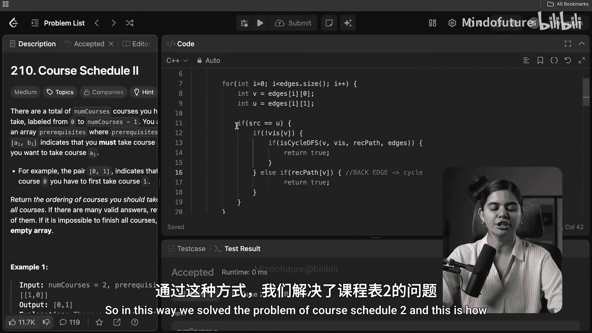

# C++-DSA课程-｜-数据结构-｜-leetcode-｜-Apna-College-｜--Complete-C++-Dsa-Course-p119-P121_课程表II问题-使用图拓扑排序--BV18oUGBkEmV_p119-

Everyone welcomed the complete DS series。 and today we are going to solve one more classical graph related problem。

 which is called co Also the resulting for company this problem is called is also problem and this is actually a of another problem lecture solving this problem should be very easy and in fact it should be a of because direct almost In fact last lecture is problem will be very easy to solve highly is another lecture which is for topological sorting topological sorting using。

😊，L solving this problem will be very， very easy。 So let's look at our problem。

 Sa basically n course key information given n variable is course course key subjects given plus information some prerequisite prerequis course key information1 it basically means rule prerequisite B is going to be a dependency for a complete dependency information in this prerequisite and is dependency information easily indirect andju prerequisite information is actually the edges。

😊，of graph directed graph key informationrequisite keeping in mind this dependency prerequisite enroll enroll sequence enroll let's look at this particular example。

s suppose given basicallyip0，1，2，3 courses are available there is a dependency from 0 to1 course enroll then we have0 to2 enrollroll12 enroll we have22rollroll。

informationju enrollroll but if it is not possible to all node keeping prerequis in this possibleroll possible sequenceroll。

😊，Return question can then mention sequence return， but lets suppose whenpa。😊，If we had。

 let's suppose a graph like this justma0 is a dependency of1 and1 is a dependency of 03 graph may it is not possible to visit all of the vertices Q coit dependency prerequisite condition coitna1 coit dependency condition co loop makes graphs actually topological sorting k possible sequence to basically cover all of the vertices keeping the dependency the prerequisite condition in mind。

 this is actually called a topological sorting order and topological sorted order dedicated lecture can but graphs can cycle order calculate news graphs can graphs directed acycl graphs topological sorted order exists k。

😊，Is order problem solution is a graph value n is basically our number of veres that werequisite prerequisite is basically is given to us there is which exists in the complete keeping this prerequisite in becomes a。

😊，topological sort top this is solve problems logic。

Directed basically function which is a boolean function plus call and。

pa return whose case return true value。 So this is the logic for a nonvis neighbor visited neighbor which is visited plus it is also part of case ye plus if the value is also true of v is also true case may value there is cycle that exists in the is case to remove it from there and。

So this is the overall logic for detecting a cycle in the graph。

 Let's convert this logic into action C plus code for this particular graph andkebanet topological sorting k logic key carrying to cycle detection logic a。

😊，This is the function that we basically have to complete is function Can the sub nu courses co n li and up prerequisites go ham graph cages Liium have we basically have a function co complete kai。

 which is a boolean is cycle DFs function。 Just scan the ect mypasari source node hogi plus we are going to have a vector。

😊，Bulion visited。 Plus well have another vector Boion， which will be our recursion path。

 I says Ame Hamippa Hamari， Saraari Egiky information。😊，Abiabba subsehi A I Cy function Gander。

 Hammni visited of source Noko the true Macium。That we are visiting the node plusjuko Add。

 Then you are going to run a loop for all the neighbours directlysme prerequisite information exact neighborski information given her questionander that is random information was scatteredsaris。

😊，From I equals 0 to edges dot size I plus plus And sorryri Es say Ham U and V key information extractcur Matlab her E H Kander is h Kanderai keyhamra 0。

 C 1 k f H Jujari justka Matlab has U say V k Hja。 So the first value is actually our V value and the second value is actually our U value。

😊，Though integer v is going to be edges of I comma 0。And in teacher， you will be edges of。 I come up。

完。Agahammi Patasalya Kihamara sourcen is equal to this U。

 to Vikajaga Agahamni Uya myself So Norya Is me to Vijaga V basicallyriara Nejaga to Abhani neighbor kill。

 If the neighbor is not visited， Those case may Hammussi visit Kringgi through this function。

is functionganander V Kas Kingi visited Kas Kingi recurin Pa Kas Kingi plus Es Kas Kingi and a function a Ki B neighbour Kihammet true Ra Ktai to Yahabiham Raton Kingi true value that。

 yes， there is a cycle that exists。😊，L in else， if there is a back edge condition。

 Any recurrent path of neighbor is true。 He can see conditioned。

 This is actually the condition of a back edge。Yhaur backage Kenny come a little bit。

 This is a cycle condition。 The Yahi sayhi hum returned Guingy me。True value code that yes。

 there is a cycle that exists。 So is the say Hamara for completejaga， for loop K bath。😊。

Agarham to return to recursgent parts say hum up na source nor go。Remove Curing it。 It will be false。

 and we are going to return a false value from here that there is no cycle that exists。

 Kamarraju Purura cycle detection calog here Boku Ea de Higa for this particular graph。

Acycl detection klog Ca Karingisethanco knegiher Ja cycle exist Kahi here those case mam empty area return Kagi or he exist。

 khi those case mam topological sorting kringgi T ke， let us create。😊，A Booleion visited E。

So this was the logic that we have already done。 Boan visited Erico Ham initialized Kingi with false values。

 plus we also have a vector Boolean recursion path。

 We are also going to initialize it with false values。 I call vectorum create Klean。

 to basically Hamra answer Hogaskoon Kna。 It will be integer answer。Comma please sari kari。

 Nor ke looprankagi i less than N++。If not of visited of I。

 Mobe I are Nre or our vertex is not visited， whosese caseme is cycle aze kringkiriliku cycle you Ily exist Carier whose may will pass visited。

 we pass our recursion path and the edges information。Agar， there is a cycle which exists。

 whose case memi Agar cycle exists kme empty vectoro return Knai answer Ham Al empty Yahasim return answer agar is loop kbabi Kobi cycle exists Nehiham Ka Knaiham topological sorted orderi after doing topological sorting The topological sorting Mavo exact order for exact sequence of courses Lemi function Man。

 Let's call this topological sorted function。 Let's call this toppo Ya topological order。😊。

A topological order function canander， informationto source node source node we also require a boolean visited E。

And topological sorting k hammic stack cous。 So this is the basic information plus will require。

Are graph information， Matlahamni As key information required only。😊，To y basic information of。

 let's look at the general logic of topological sorting topological sorting function functionuss if we function is function topological sort order function and going to pass top order in the reverse fashion topological sortings all of this to call the same function for our。

😊，For visited and for the So this is the logic for topological sort。

 let's convert this logic into visited ands copy instead of for all these conditions just to directly called the top sorting order function。

😊，So this is going to be our for loop and isk n per hammaase stack can that push King yne source node so this is the entire logic for topological sorting。

The subti， which will be empty。 plus， Hamm Boolean visited vector initialize K with false values visited dotriari n values false values is the same manner Ham functionari anyari ver co verex unvisit topological order function call with I visited and along with R。

😊，As to Sariki Sari Jomari Votes name， Wu visited Hojianggi。😊。

And at the end Hamrajo actual order here that is stored in this stack。

 The stack was order quo extract nim loopingap stackko Kli kinggiptic stackca size is greater than 0。

 Hamap answer vector kander push back Kinggi stack K toppper Jubi valuekeba stack pop Kne valueco and E K valueco pop Kinggi。

 and at the end， we are going to return our answer value。😊，So if we summarize our approach。

me basically kia subcycl detection cycle exists ktme empty vector return k A cycle existspa directed acyclic graph those case may we have actually found out the topological sorted order and order answer vector can the storea return this is the code logic of topological sorting and this is the code logic for cycle detection in directed graphs alreadyani electro and before we run the code there is just this small thing that we need to fix in the code is cycle Dfariju condition here this elseif condition this will actually be after this。

😊，Ma this is the condition for back condition visited。

 That is true situation that is also part of thecur So lets run our and we have successfully passed the test cases and submitted we solve the problem of and this is how we actually use multiple concepts in graph to solve single problem fairly easy prerequisite topological directed graph and thirdly important quality recognize this is a graph problem and a graph algorithm But apart from that lecture this question was actually a fairly easy question to solve I hope that we have successfully completed today's lecture can mark in is can share progress with me description。

😊。

Scanandander mi Zga askcalate9 multi next lecture can that let them keep learning and keep exploring。

😊。