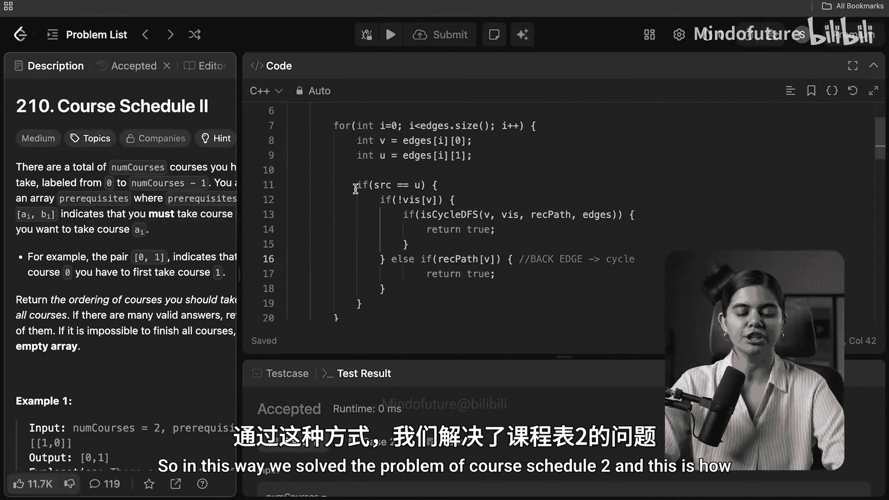

# C++数据结构与算法课程：119：课程表II问题 - 使用图拓扑排序 🗓️➡️📚


在本节课中，我们将学习如何解决一个经典的图论相关问题——课程表II。这是一个关于拓扑排序的应用问题，我们将通过检测有向图中的环并找出一个合法的课程学习顺序来求解。

---

## 概述

问题“课程表II”要求我们根据给定的课程数量和先修课程关系，找出一个可以完成所有课程的顺序。如果不可能完成所有课程（例如存在循环依赖），则返回一个空数组。这本质上是一个在有向图中寻找拓扑排序顺序的问题。

上一节我们介绍了图的基本概念，本节中我们来看看如何将课程安排问题建模为图，并使用拓扑排序算法来解决它。

---

## 问题建模

首先，我们需要理解如何将问题转化为图论问题。
*   **顶点**：每一门课程都是一个顶点。
*   **边**：先修条件 `[a, b]` 表示要学习课程 `a`，必须先完成课程 `b`。这可以建模为一条从 `b` 指向 `a` 的有向边。

因此，给定的先修条件列表就定义了一个有向图。我们的目标是找到这个图的一个拓扑排序。如果图中存在环，则拓扑排序不存在，意味着无法完成所有课程。

---

## 核心算法逻辑

解决此问题需要两个核心步骤：
1.  **检测图中是否存在环**：使用基于深度优先搜索的环检测算法。
2.  **进行拓扑排序**：如果图是无环的，则通过DFS或BFS获取拓扑排序顺序。

以下是检测有向图中环的DFS逻辑伪代码：

```
函数 isCycleDFS(当前节点, 已访问数组, 递归栈数组, 图邻接表):
    标记 当前节点 为已访问
    将 当前节点 加入递归栈

    遍历 当前节点 的每一个邻居节点：
        如果 邻居节点 未被访问：
            如果 isCycleDFS(邻居节点, ...) 返回 true：
                返回 true
        否则如果 邻居节点 已在递归栈中：
            // 发现后向边，存在环
            返回 true

    将 当前节点 移出递归栈
    返回 false
```

---

## 代码实现步骤

现在，让我们将上述逻辑转化为C++代码。以下是解决问题的整体步骤：

1.  **构建图**：根据先修条件列表构建图的邻接表表示。
2.  **初始化辅助数组**：创建 `visited` 数组记录访问状态，创建 `recStack` 数组记录当前递归路径上的节点。
3.  **环检测**：遍历每个未访问的节点，调用 `isCycleDFS` 函数。如果发现环，立即返回空数组。
4.  **拓扑排序**：如果图是无环的，则进行拓扑排序。我们使用DFS来实现，并将完成访问的节点压入一个栈中。
5.  **生成结果**：将栈中元素依次弹出，即可得到正确的课程学习顺序。

以下是关键部分的代码框架：

```cpp
class Solution {
public:
    vector<int> findOrder(int numCourses, vector<vector<int>>& prerequisites) {
        // 1. 构建邻接表
        vector<vector<int>> adj(numCourses);
        for(auto& edge : prerequisites) {
            adj[edge[1]].push_back(edge[0]); // edge[1] -> edge[0]
        }

        vector<bool> visited(numCourses, false);
        vector<bool> recStack(numCourses, false);
        vector<int> result;
        stack<int> st;

        // 2. 环检测
        for(int i = 0; i < numCourses; i++) {
            if(!visited[i]) {
                if(isCycleDFS(i, visited, recStack, adj)) {
                    return {}; // 发现环，返回空数组
                }
            }
        }

        // 3. 重置visited数组，进行拓扑排序
        fill(visited.begin(), visited.end(), false);
        for(int i = 0; i < numCourses; i++) {
            if(!visited[i]) {
                topologicalSort(i, visited, adj, st);
            }
        }

        // 4. 从栈中获取顺序
        while(!st.empty()) {
            result.push_back(st.top());
            st.pop();
        }
        return result;
    }

private:
    bool isCycleDFS(int node, vector<bool>& visited, vector<bool>& recStack, vector<vector<int>>& adj) {
        // ... 环检测DFS实现 ...
    }

    void topologicalSort(int node, vector<bool>& visited, vector<vector<int>>& adj, stack<int>& st) {
        visited[node] = true;
        for(int neighbor : adj[node]) {
            if(!visited[neighbor]) {
                topologicalSort(neighbor, visited, adj, st);
            }
        }
        st.push(node); // 在递归返回时压栈
    }
};
```

---

## 总结

本节课中我们一起学习了如何利用图论中的拓扑排序来解决“课程表II”问题。我们首先将课程和先修关系建模为有向图，然后通过DFS检测图中是否存在环。如果图是无环的，我们再次使用DFS来获取一个拓扑排序，这个排序结果就是可行的课程学习顺序。这个问题很好地融合了图建模、环检测和拓扑排序多个核心概念。



通过解决这个问题，你应该能够识别出类似依赖调度问题的图结构本质，并熟练运用拓扑排序算法。在下一讲中，我们将继续探索更多有趣的图算法应用。