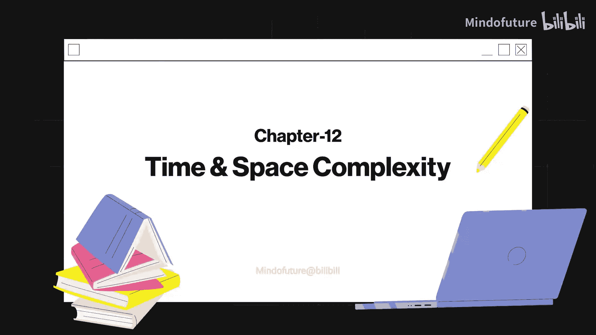
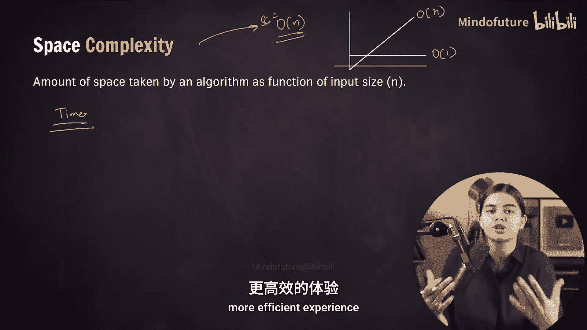
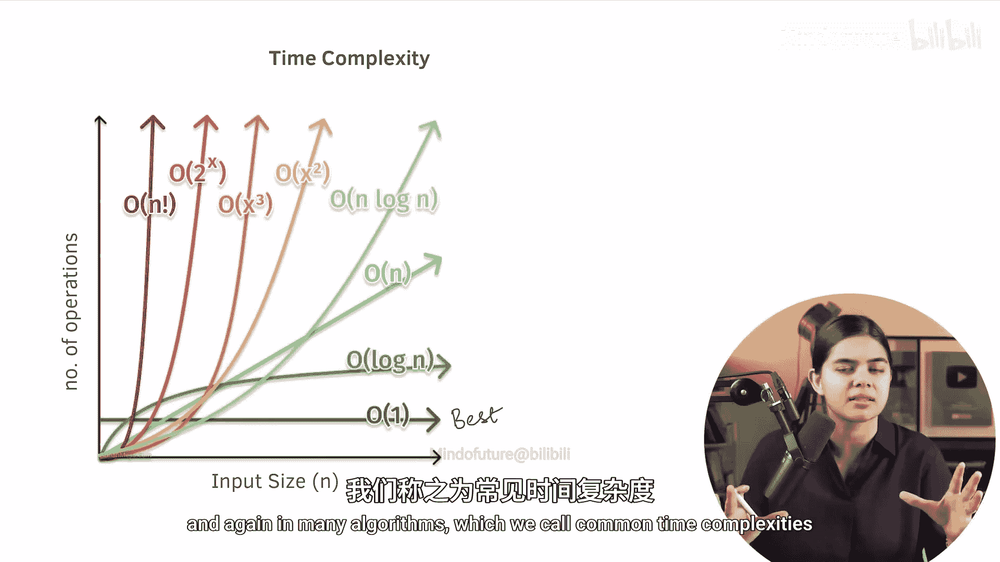
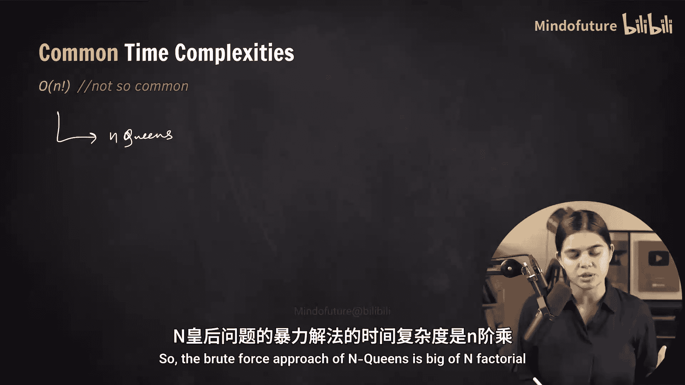
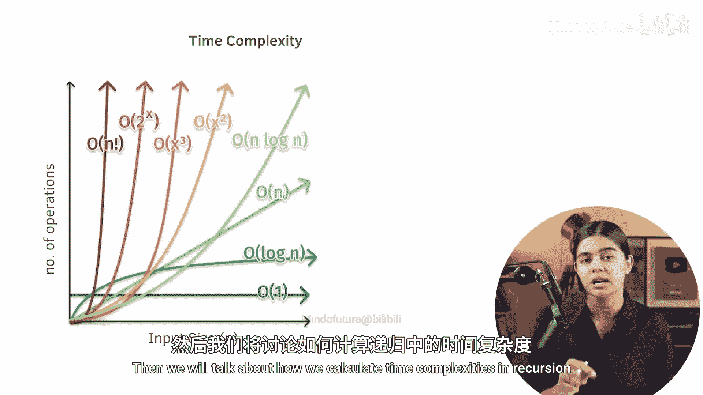
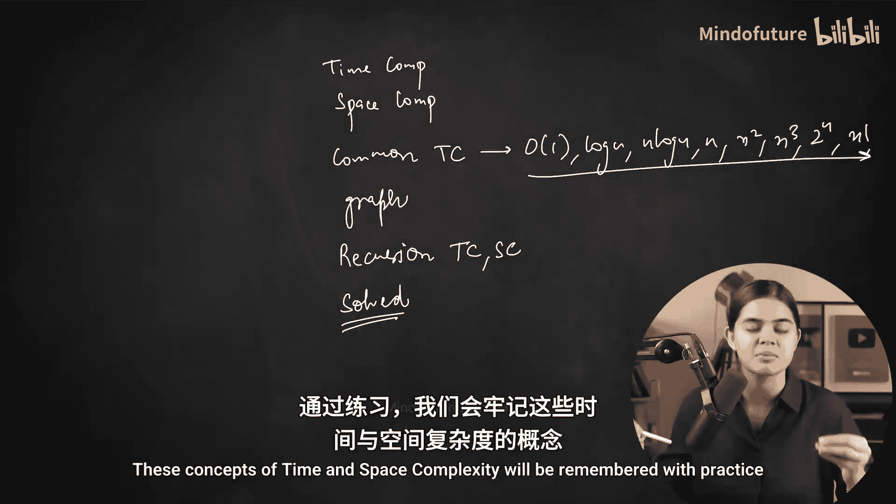

# C++-DSA课程-｜-数据结构-｜-leetcode-｜-Apna-College-｜--Complete-C++-Dsa-Course-p12-P12_时间复杂度_空间复杂度-DSA系列_由Shradha老师讲解--BV18oUGBkEmV_p12-

i everyone and welcome to the complete series about time complexity and space complexity Now we are working really hard to make this the best series on YouTube placement😊。

The practical usage part Germany last make our Kiv wasriari studentsna compulsory。

 So now let's get started。😊。

Now， let's move on to our concept of time complexity and space complexity。

 And why is it one of the most important concepts in programming。

 Basically and platform99er and complexity is one of thes。😊。

Practical approach Any placement and interview point of view say you are going to study this concept practical knowledge sub time complexity exactly sub important time complexity is not the actual time complexity or 0。

05 it is not time complexity Windows per and Linux In fact platforms pay time forces time website time machine dependent and online platforms server dependent time complexity is not the actual time taken。

😊，Time complexity youvo different machine case upset differentni Khi Hamisha Sammi Raier。

 So what is time complexity， time complexity is the amount of time taken as a function of input size。

 basically time complexity， amount of time taken Ka Yahaper， a measure cut in terms of operation。😊。

Operation Kenika atabni meam Joy statement Liname the operation for example。

 Man in teacher x is equal to 10 li ye operation Ho manic4 loop is4 loop thatni operations perform to me Ki operations perform what they he。

😊，As a function of input size， Matab input size N operation operation orho operation ye input size Ca number of operations the any amount of time taken affect change whose behavior time complexity is simple example concept。

😊，E scananderni linearar search k barme Pra。 Linear search is one of the most simple algorithms of DSSA Linear search megata linearar search me Mariipasic aotai。

given。Basically number of operations approximately 10。

loop1 times run input size operations input operations input number of operations。😊。

Graphkiform me plot Kneka Matla Aum Laing yna Y axis， A Laing ypna X axis。

 This is the y axis X axis Kham input size Ra it。Which is going to be n y axis k Uhamap in number of operations racking him A muja Patel job may pass approximately1 size to me1 operation to one Agar Yahapa Laarai。

😊，To me a8 point 한ja。Jep 10 head to 10 operations similarly。10 Yaha to mepa yejagi0 kkaavniari。

 But let's suppose 1 ytska Ya Yaha Miraja， Yaoco。😊，Combineque Kham1 Lash。

 let's suppose la and is la to Mirajo point hereku。

x number of operations straight equation equation is equal to x is equal x x is n is equal n complexity or complexity complexity complexity。

😊，input size a number of operations proportion That is why it is calledki number of operations basically always try to calculate the time complexity for the worst case scenarios case scenariosb input sizes real systems millions of billion of users who handle。

scenario。ig， let's talk in detail about this bigo Keep big Koham exactly k bigo。

 basicallyra time complexity complexity notation notation symbol to5 rupee5 y symbol n time complexity function time complexity time complexity big not verse。

😊，Case scenario case complexity I case upper bound algorithm complexity case operations operations algorithm behave case for example。

 if I have235 index in case at per function function n square plus n plus 5。😊，Mipas function。

 This is my f M。 complexityipas is function complexity constantco。😊。

Anything which is a mathematical number is a constant say4 constant3 constant constant constant ignore value that is n square plus n plus1 and for second step to consider only the largest term term n n value sub n square value value n value0 Similarlyly n value or value sub sub or complexity n square equal function sub complexity examples suppose10。

😊，Plus5 n square plus root n is the value function of n value body value 8 million value to 8 million k sub constant 5 ignore100 go we ignore00 body value constant So this is going to be1 plus n square plus under root of ni sub n value sub0 root n13 n square 10 to 21 sub term final time complexity is case maybepa of n square a complex function k B we can calculate our final time complexity notation we have two more notations。

 in fact， we have a lot of notations in math。😊，Haarijo worst case scenario key notation of the worst case time complexity。

 Vohoti hadbigo I Kohamabna upper bound B Catte。S say hereippa average casekibit andum complexity O iscom represent K。

😊，We call it theta。S best case scenario time complexity with omega we call itomega andome lower in interview coding time complexity use equationnship notations。

😊，small smallga are different different mathematical concepts placement point of calculation or complexity concept Similarly we have the concept of space complexity complexity is not actual taken by the program it is the amount of space taken by an as a function of input input input input input string or auxiliaryuxili extra space。

😊，Jo input say for example， linear search perform linear search search perform is input k or input space complexity space complexityander is auxiliary for example。

 input。😊，Or output original number of234，ili。Oruxili exactly complexity So this is complexity equal。

😊，Equal to 10 n is equal to000 n is equal to1 n is equal to1 million sum variable touxili constant function function equal complexity equal and complexity input such extra constant complexity or constant complexity straight line。

inputuxiliary this line this line represents n and different and and cases in interview mostly focus comparatively easier as compared to making an algorithm which is more efficient in terms of time use complexitys time complexitys efficient。

😊。

To complexity or majority common time programming number of。😊，time and。

to solve a lot of questions based on and recurs common constant。😊。

constant complexity complexity using n by by。Jes， for example， or2 study。😊。

Hash table canander hum unordered。Map Coere C plus a scan， I Seeika Java version with a hash map。

1 equal parallel to the x axis。A next common timeityarovov just examplear searcharhamialialga is Lu internally operation I。

constant operation。similarly programming on。linear is not a slow algorithm。 This is a good algorithm。

 This is a good Next and n cube sort algorithm optimize selection insertion are not n on n is my outer loop。

😊，Lets i is equal to0 than n n equal equal j is equal40 i is equal i is equal to condition n is equal。

me outer loop first time run those k inner loop three times run k or inner loop three times run k operations could perform k outer loop i equal to1a operations perform inner loop run or operations perform k plusb outer loop second time run inner loop run operations perform K inner loop22 k times run outer loop third time i equal to2 k inner loop a run or operations perform k k operations perform k plus12 total number of operations a total number of operations n value n arbitrary value n value n n minus k plus n minus22 plus n minus32 plus similarly is3 k2。

Plus Ipas formula merit total number of operations n total number of general operations Nik I final valuehamari valuesja n-1 plus n-2 plus n3 and2 plus1 to basically n numbers calculate n1 numbers n n1 divided by2。

😊，And this value is being multiplied with minus n minus。longong with sorting algorithms In fact。

 as problem class to calculate the possible。😊，Sub8s。

continuous part of theari complexity example common complexity basic complexity log complexity If this is log complexity。

😊，Big log complexity。is already sorted。2，3，4 or。case binary complexity basically n divided n n n x x。

n divided by x n equal to x x x x equal equal this is。fi optimized time generally beginner students。

 but this time is going to be your best friend。 that is a optimized my answer see that which is calledin sort merge。

😊，Jse Hamra quick sortka average case quick key worst case n squareier per average canander N log can cover generallyri greedy algorithm greedy algorithm can sorting login n login。

😊，To muja Patta Maryjo login time complexityhieov login ye。

 as compared to bigov Chotihoni better time complexity the dono side agame en multilyum tou me en login time complexity。

😊，Better hohi he as compared to n square time complexity to n login n set toahe per n squared se time to measure you N login time complexityku of N login G equall。

 the linear N login a coffee betterai I scaleavahamipasi call common time complexityity u Gcobarium detail megi。

 which is called exponential。😊，exponential brute and。

Basic recur all possiblemutmcur ormmmmmmutmutmialialm。Fial exist in fact。😊。

To the power N he come2 cohi multiply current， kidney bar multiply current n times。

P n factorial ga gim n co for n minus1 co multiply RNA for n minus2 co multiply current kidney bar multiply array 3 into 2 into1。

😊，😊。

equal to said less than less than equal to。equal than equal equal and that is。

So me prime number v logical loop is time complexity bigov root nco find out big of root n bigger time complexity big of n bigger time complexityto second big of root and better time complexity big of log and better time complexity thoughco homework problem in better or in better。

😊，Next of all G it is selection sort to me assumption he selection sort already So y me general code therefore selection sort selection sort can the loop chre loop y constant k operation perform loop ch is loop he is can constant ke constante constant constant loop loop constant perform outer loop outer loop 0 outer loop outer loop。

😊，N times run k。Agar outer loop， a bar rungerta， tumerra inner loop， kidney bar runger， inner loop。

 I plus1 C， njata。for example， i value n second time n1 third n n n n。

8 million message thus million message say arup colon a million cuer for eber。

 So that is why average I am n li n minus1 li say time for a muji n。😊。

Plus n-2 plus n3 isriari numbers k one n numbers sum n into n plus1 divided by2 or et barmea inner loop run k operations k constant operations perform total time complexity or value mu n square is complexity is equal to n complexity say calculate constant mu outer loop on n times inner loop outer loop loop k n times outer loop n times or bar loop n times outer loop n times loop n times or n times operations could perform this case time complexity n square dismiss a constant ignoret to the time complexity is going to be n square。

😊，practice time and space complexity section know know what have taken a simple example ofial calculation using ofial is a fairly easy example ofial multiplied byial。

😊，To calculate time complexity using a recurrence relation。

Yanniham recurnce relation equation at the Oica orusco mathematically solve k time complexity go calculate curtheme。

 and second Terika out the time complexity go calculate knea that we find out the time complexity as total number of recursion calls。

😊，Multipliied by work done in each call。 anyni recurander calls but total calls from multiply callna inhi we get the same value of time complexity generally recurnce relation value thrust as are mathematical In fact。

 kri recur recurrence relation possible Neta the generally practical cases may second I This example。

 k let's talk about thisial function Iham find outne recurrence relations recurrence relation recurrence relation upper F n is equal to constant plus f of n-1。

😊，K agar function is say n to functione constant constant multiply plus same function value n1 f N N is function f of n1 is function plus some k constant functioncur relation is basicallyial f is a measure of equation what do do f of n is going to be k f of n2 f of n f of n3 and last f of1。

😊，Is one plus f of 0。And f of 0 kilo n value 0 n value0 simply return0 constants suppose this is some other constant side value and right side is Similarlyly is equal to right right is right constant constant n equations。

😊，equations plus in terms and is going。😊，Which is finding out the total number of recurs calls or in find out by drawing a recursgen recursgent draw for this particular code。

 Let's suppose n equal n is equal to4 n is equal to4 sub f of4 f of4 f of3 f of3 f of2 f of f of1 f of f of levelgar n is equal to41。

2，3，45 n n total n plus1 in fact n plus1 n in general approximately ncur n now。😊。

U return multi multi multi24ialial2 equal total approximately n total equal multiplied by in call。😊。

E call kba thoseka H function call is function canander I if statement take a constant calm here。

 you return Gna and say multiply G， you call La y constant ca to overall a function call Gander constant camoa。

😊，The constant co K time complexity O Jov n2 k is co n equal Yaha same answer I to answer time complexity recurrence relations in Cha directs formula through。

 the answer is always going to be same。 So the time complexity of this recursive code is going to be linear time complexity with recur K space complexity calculate recurgent key and normal code key space complexity make Chotas or both interesting difference So and the differences keybi recurgen。

😊，Haaripa， it called stakoai。A factorial or complexityse complexity for example， is equal to。😊。

N is equal to 4 k called jagi n is equal to4 n is equal to 3 k calledga n is equal to 3 F2 k called to Ecor stackander memory Ogi F1 k called memory Ogi f0 calledgi to a calls memory occupygi。

 even though extra variable like in internal call stack y stack frames memory Ori space complexity may contribute cur B of space complexity the recurgenander space complexity me auxiliary space to calculate extra variables plus Umus call stackkibi memoryd and this basically becomes depth of recurgent3。

😊，Multiplied by memory occupied in each call。Yeah in fact EC see cheese code change Kque hummlic I think space complexity is equal to height of call stack。

😊，Multiplied by memory。In each call。Togen f4210 maximum maximum n or constant memory is also constant to complexity equal。

😊，complexity because of this complexity solve question based and。base case met2 n1 f3 f2 and f1。

 similarly f f1 and f  f f1 and f base case base case base case base case base case overall total callscurgen incomplete branches form balancene level completely level completely secondika time complexityne time complexity was total number of calls。

😊，Yet total calls in name careta multiplied by work done in each call。

The total number of calls Kimeari first level pay8 call a Hamari second level pay though calls a Hamari third level pay 4 calls a Similarlyly Q balance out Kari last level pay 8 calls Zgi Cam k 1 is equal to2 to the02 is equal to root to the par14 is equal to 2 to the par28 is equal to 2 to the par 3 is theari calls Jovo her level per but T Aari pass n is equal to 4 k J arbitrary n or value of n The total number of calls Ca total number of calls first level pay O2 D par 0 plus 2 to the par 1 plus 2 to the par2 plus 2 to the par 3。

😊，And last level Jota Muji n-1 calls the4 n is equal to4 to last level2 to the3 calls say last level2 to the n1 calls total number of calls total number of calls milk geometric progression geometric progression the total sum of all of the values is equal to a into r to n1 divided by R1 a starting value R difference n total number of terms search G to first value。

 which is equal to20 multiplied by r to the n common difference difference equal2 to the total number of terms0 n1 n a1 divided by21ja1 into2 the n-1 divided by1 this value becomes equal。

n1 the final value n completecur number of total number of calls n orplied complexity programming this is a very bad forbon。

interesting cheese simple1。6182 ratios。 complexity complexity。😊。

Of recurs3 height of the call stack multiplied by space or memory in each call n total level level a second level third level total n level n or function variable total complexity will be n complexity complexity using recurncebon complexitycur complexity for variable n is going to be equal to complexity of n1 plus time complexity of n2 plus of constant function complexity n function。

😊，minus function orcur complexity this is calculate and complexity which is。😊，Subipally。

Focus cut the  time complexity orty complexity is total number of calls。😊，Total number of calls。

Multiplied by work done in each call。complexity a work done ine merge functione merge merge function merge merge merge complexity merge。

😊，function vector basicallylys in and3 and 6 in manner。😊。

Temporary cos N K equal final E cos B N K equal to of fourth va stephi Y B big n times t tori merge K time complexity Hoge big of n plus n Y big of to N K equal per cuium constants who ignore kri overall mergerch step K time complexity A big of N K equal That is why the time complexity of merge step not merge sort merge step is big off N abui space complexity they them space complexity K auxiliary values quo the a to he input a auxiliary values。

😊，Input inputni I barbar Val push back， push back， push backja Tu cania。

Kki Muja N elements goes to work Kaananaha。 So N elements goes to work Karan N size came temporary memory let merge step can。

 Kki Mo sought kka time， though a later time。😊，In elements merge temporary or auxiliary equal to the complexity also becomes equal to merge space complexity merge complexity individually merge calculate complexity complexity merge n is equal to merge parts divide or back。

😊，M merge dismissham f of4 f is。To ca case first level pay2 the0 calls second level pay2 the par1 call third level pay2 the2 calls Gi is cheese co S A X thank first level pay agar me Eikais Charta to next level pay her call me Eika ha call me Eikais or halfia to agar n is equal to4 arbitrary Nta Those case may Maripata Samraam minimize Kleium。

 Let us reize this。😊，Agarku arbitrary n case meas f of n F of n f of n by2 y n2ri f of n by4 f of n by4 similarly f of n by 4 Similarlyly f of n by 4 the first level a is n level n by level byp value1 equal n is equal to2 by0 n divided by2 n divided by22 similar n divided by2 a total number of levels x level is total x level n to x value x n divided by2 to x is equal to1 is n is equal to2 x log log n is equal to x。

miippa total log n levels Z to8 to understanding Hamipas here。😊，Kihamari pass total number of levels。

 Kine recurst re， and the total number of levels is equal to login Ab Agarhammet time complexity Nikali I theriki say Agahamara recursive 3 dktahammi。

 The time complexity Nik of formulata time complexity is equal to total calls。😊。

Multiplied by work done in each call。😊，A me recur f n to a me constant constant per merge step big of n equal to a n second is f n by2 n by2 f n by2 n by overall work done on these two n equal Similarlyly next level is n by is n is n by is n by orro n by4 n big n equal recur level big n level per big n or total level total log n mera that is equal to log of n total time complexity that will be big of n multiplied by log n and this is the time complexity of the merge。

😊，complexity complexity merge merge。😊，n2 n n merge。😊。

overall just space complexity is log n log merge log is why space complexity comes programming understood should pat usage。

Yea given question the questionspa given constraintsseippa E givenmpaika constraint inmchi maximum length that is equal to 10 to the bar 5 A con in generally coding platformus。

Those coding platform Cooper 82 May KB program K 10 to the par8 operations runoffs at。😊。

8 second me platform per approximately10 to value smaller value， but on average。

10 to par8 operations take one second to execute or execution limit1 second key10 to operations second says operation says algorithm error which is called limit exceeded generally algorithm or optimize or10 to operations basically given inputju that is less than equal to 10 to5。

😊，To k 불게 불val。n algorithm is given constraint n maximum value maximum value equal000。😊。

So n login caoria submit toja those de click n login kilogram value nily to n login my 10 to the power 5 figure licking it。

 So it will be 10 to the par 5 multiplied by log of 10 to the power 5。

 This is 10 to the power 5 into log a power baharajaia log 10 y log 10。😊，Base2 value0。

 equal to 10 to multiplied by multiplied by 0。 value is less than 10 to operations。

strain greater thantraintraintrain。equal，Sal Kandar Muja recursin。

brute force equal is what practical。And space complexity exactly time complexity is complexity questions in fact in in all。

😊，complexity is not something theoretical class and complexity does it when problems was all about and hope you lecture and something new from lecture in tag on lecture and exploring。

😊。

