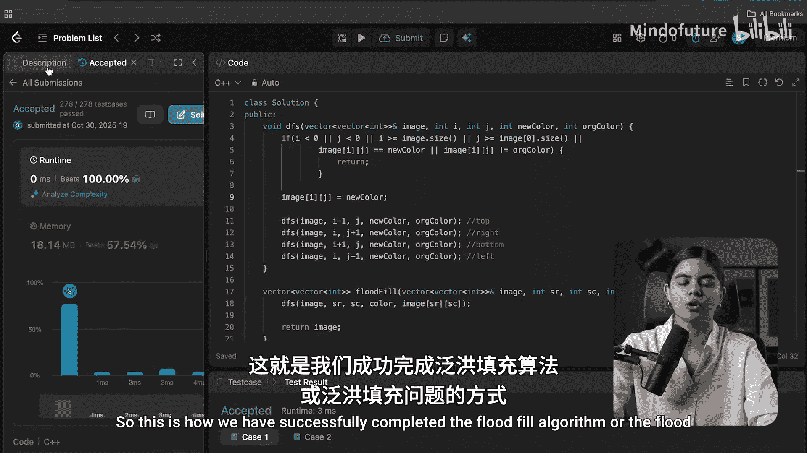

# C++-DSA课程-｜-数据结构-｜-leetcode-｜-Apna-College-｜--Complete-C++-Dsa-Course-p120-P122_洪水填充算法-图问题--BV18oUGBkEmV_p120-

I everyone and welcome to the complete D series。 and today we' are going to solve one more interesting D problem。

 which is called flood fill Also there is a link in description box is called flood fill or flood fill。

 This is also problem 733 on and this is a very simple problem In fact。

 will be very easy for us given in the form grid basicallyari in the form of grid image2 grid N cross and present0。

😊，2 in different n this is actually an image of is and vertically top and bottom and。😊。

change let's look at this example and C key exactly basically start is m cross given and that is this cell in the grid to this new color value color and verticals horizontal neighbors Now this one is matching the original color original color which is equal tos the first neighbor is this neighbor is topki right which does not match the original color replacement and。

😊，grid。わ。Cll K to chart different neighbors him who basically hamari horizontal and vertical cells him。

😊，Toro node and and we can imagine our graph to be something like this is given in the form of grid and is function。

😊，are also going to require our starting node source and source。😊。

realized actually df perform visited this is going to be a wide df function and I'm assumingsum which is pretty simple graph and this is right andverse to four different directionss original color directions。

😊，So DFS key call subseelium Lagak theyhe for our image。😊。

Top heliogram path can it will be I minus1 comma J Hamara new color。And original color。

 Teri said this will be the top call。 And easy see same Theriki say I may see same La repeat can have four different times to actually make the four different calls。

 Tserki say Maripa cha different calls Ajagi cha different directions。 Cal。 Next time。

 Hamappa K I comma J plus1。😊，Next time， my Rujaga I plus1 command。J。

And is I j-1 let us minimize this a bit。 This is basically a right call。

 This is for bottom and this is for original is or right basically out of grid is less or。😊。

J is less than0， or I is greater than equal to M or R J is greater than equal to n M and N image matrix a values co calculate K These are basically our total number of column values basics suppose change and image value is not equal to the original color value case operations image of i j is not equal to the original color value。

 This is one condition conditions write this in the next is is replace top top value existing is particular cell。

😊，right which is。😊，0a 2。U0 basically0 and0 and situation visited visited use what we do there is already a value which is equal to。

😊，Imagegar already new color value those casemed。 So these are the situations ja simply return or simply conditionsb or normally So this is the entire logic convert to this particular image let's convert this entire logic into function is function given source row and column given given additional D function。

😊，Let's create a void DFS function。 Just scan Itohampa imagevalier plus Ari values aippagi a Apni color co hammna new color variable kam and new color K A core value pass K。

 which will basically be old color Ya is cohammna original color ca subip in our image。

 let's convert this into I and this into J Ani image K A Ane particular I comma J Sper Hammni new color a value co replace K。

 Then we are going to make the calls for all different directions。

 Theippa image Ajaas I minus1 Ajaga， in fact is a I and J new color copa K and Hamm original color co Pa K So this is going to be the value for。

😊，One direction。 And is theik say'm cha different Nebu K call la Ghi I Kohamra khi top K top Kat La here。

 This will be I -1。 This will be for right direction。 right Kat La here。 This will be J plus1。

 This will be for bottom。😊，So this will be I+ 1 and Yahaari left direction Hojagi。

 just Command La Beji。-1 y per hum base case here kbibi Iq value is less than 0 or jk value is less than0。

 or I is greater than equal to Hamari image dot size or J is greater than equal to image of0 dot size。

😊，Ya A Americapas do all conditions， eh。Agahamari image of ia that value is equal to already equal to the original color image of ia j is not equal to this is equal to new color original color equal will be original color equal in cases simply going to return from here So this is the core logic function function initial I and Jarijaja plus initial original color that will be image source column color and。

😊，Q came is a by reference pass K to Sarigi Saari changes reflect Kanei and this is the entire logic system of Savansol Kagi Lets run our quote。

😊，And Oscarski at me， let's also submit it。So this is how we have successfully completed the flood fill algorithm or the flood fill question This simple DfS usecom single time visit Kaneher k matrix scanner。

 So if you have successfully completed today's lecture then you can mark it in down the comments It says me can also share your progress with me on Twitter just calling up each description box scanner Askate Mil lecture can in key learning and keep practicing。

😊。

