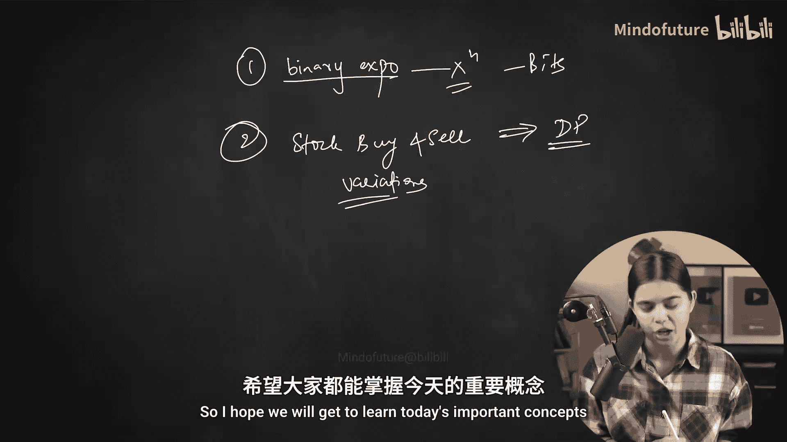

# C++-DSA课程-｜-数据结构-｜-leetcode-｜-Apna-College-｜--Complete-C++-Dsa-Course-p13-P13_买卖股票问题及Pow(X_N)_幂指数问题-Leetcode-DSA系列--BV18oUGBkEmV_p13-

Hi everyone and welcome to the complete DS series questionsin important concept concept availablename。

 So let's start with our first concept which is to compute X power n using binary exponation both important concept programming and this is also available as a standalone question question number 50 on power X basically x n calculate and important constraints。

😊。

Power minus2 the bar 31 c li plus2 the bar31 minus1 power integer value Juri integer range make。😊。

U kbibi Agarhammi X to the power n calculate K is Sky example later。

 Let's suppose we want to calculate 3 to the par 5。 thosekoan Kariga， normally Huinkoas。

times0 that is with。😊，Exponciation binary exponciation approach basically binary form calculatevockname process a important cheese Jo number n nimal numberky binary form。

😊，At most， log n base2 plus1 digit says other for example n is equal to8 or base pluson。

log complexity log process is we associate a specific number to each binary associate associate x x6 and or。

se answer which is equal to time time。😊，multip normally。😊，Is scanned the 3 to the bar 1。

3 to the bar 2，3 to the bar 4，3 to the bar8 is the sameP power goes to work around it。😊。

A first at mene Muja Pattaya andme binary form 1，0，1。equal second third equal multipl4。

To finally answer have already calculated to43 calculate binary or and2 equal and initialize or is greater thanit to answer。

😊，Multipliied equal to x or x x x multiplly equal to x x square or binary binary binary form is equal to yet divide equal to2 binary form of logic binary exponciationov login time overall logic simply sub binary form in fact long long binary form is going to be equal to n。

😊，Skiatam， double layingyepna answer。Is equal to1mi double return type co Qki return Kna Jep tu while R binary form is greater than 0。

 T T tu sub eovna last digit gal binary number k to modo to agar1 k equalta。

 Those case may answer can hum multiply King xco and xco update King to x square Sa k satap me binary form co V hum up date Kingge by dividing it t2 and finally return Kingge hum up na answer。

😊，Thoughe overall exponation number basicallyonation or less。😊，Those case me Muji。

 whose case me x co1 by x andjujo binary form he say in negative of binary form already negative3-5 to his barvo plus 5 k tocom handlenaga for negative powersriju binary form n less than0 binary form less than0gar n less than 0 to x co1 by x。

😊，And。😊，Jse Mu Agar me en value k v0 to anything x to the power 0。

 Hammia1 k equal tos casega to his condition co N Aari N value k v0 Jat Tu caseme return G 1。

0 Similarlyly Agar x value k v 0 Jt to 0 to the power something Hamisha 0 yoga Tus case return Genai0。

😊，To upper x as 0 k equalssga kbibi， those case may be can simply return 0。0。Y x X case。😊。

Those case may， we can return 1。0 and agarhamari x key value kbio to co B value a1 oier to1 key power agarham even number Kdi Tto Hamishah answer plus1 other or aic odd number Kdi whose case may answer Hammiah -1 other D I call condition Lagak thinkki Xaggar -1。

😊，And power， even him。 Those case may answer Iga plus1。

X agar1 and power odd those case may answer-1 to additional Agar x1 and if poweri and modo2 is equal to 0 even those case may1。

0 andika opposite or not equal to01。2 y basic coron cases as de negative power co positive y overall sub important logic for power exponation or for binary exponiciation。

😊，Yhaper is a binary form Klethe is overall loopki a complexityity login he。

 Yaur Kni Kara constant operations a givev constant operations to overall code login time Le Yahaper is say Klethe and double equal to and lets run it。

😊，And submit it。Tomarko successfully submit Hoge， and this is how we do binary exponiation。

 Yes individual Sa yke important concept。 next concept It is called stock buy and sell Ya the stock skip price。

 In fact， I accept It is called best time to buy and sell stock given area of price Ja price I de stock priceme example Yes stock prices and Matab de price deka。

😊，You see him。I Let's take an example of Patiumium0 stock price71 pay price equal2 pay price5 equal equal equal equal profit We want to maximize your profit by choosing single day to buy and choosing a different day in the future to sell that stock。

 Any other many is。😊，and selling second through this transaction or return for example or6。

plus5 In fact， this is the example one that we are already given output example maximum profit71536 and4。

orological and minimum and maximum minimum minimum and simply maximum minimum backward and that is why minimum and will not。

😊，Imagine every day as a selling basically logical。😊。

orsip maximum profits call compare Carring Jobium miss sub global maximum nielga Boham final answerga。

 to basically， what do we have to do， simply a variable laekname。

 Let's call this variable maximum profit。😊，Y MP maximum profit co。

 I'm trying to initialize k maximum profit0 variable called best buy best by agar per。

 Let's suppose I am standing here agar is thin per or selling price is index on minimum value is best is thin ye best byco for maximum profit7nita1 that is why3 k basically k index I。

😊，am best0 index1 minimum value minimum value index index minimum or minimum minimum  next index minimum next include6。

😊，in fact is going to is equalb is equal。😊，price equal profit price selling maximum profit is going to equal。

😊，inghammni Best bike is the best bike。Will basically become equal to minimum of Best buy。

And price of I yj Caju pricee orannajo Best buy v price Jobi minimum best buy value selling price5。😊。

Y Hamraju Phiu greater than best by he， greater than man。 Yes。

 ts come a prophet toal sec a prophet Caligga say Hadi。😊。

Profit whose conditionbj price price of a value greater than heari best by price case profit or profit will be equal to or minus best by equal less。

😊，12 k equal to ajka profit he2 already profit have 4 maximumja maximumja4 k equal best bynegiru best buy Al price k equal to best by Al6naja profit 65 k equalka profit ni5 k equal existing profit have 4 k equal to profit value5me best by best byki Al6 next index k bynaja4 profit plus 3 profit 3。

Maximum profit equal。😊，Is going to be equal to 0。And Uqueat me I best buy Liliium Johojaga prizes of0 equall。

 any first decaju price of v am best buy him。Fhamake loop Chiellai 4 integer i equals 1 i less than price is dot size。

I plus this hardin Czearleniki arch Ca price a price of I。Kia he greater than。Am best by him。

But the prophet Nial satka a prophet Niel Seai， the maximum profit is going to be equal to max profit and aka profit。

 Aka profit to Jaga price of 0 minus best by equal and Jaja dekilohige capitalita profit Nikau Ney niau。

 but k Aka then best buy vadin one secai the best buy is going to be equal to minimum of。😊。

Pest buy and to's price， which is price of5 Last Mehammaa answer is maximum profit candaagga I sayam simply ask Garriton。

 So this becomes our overall logic with a linear time complexity is may price keyjagem prices cutlay them because we are given a plural。

😊，Variable successfully programming。programming or detail concept concept you can also write it down in your notes lecture successfully complete you can me know in the comments You can also me know on Twitter lecture learning and exploring。

😊。

