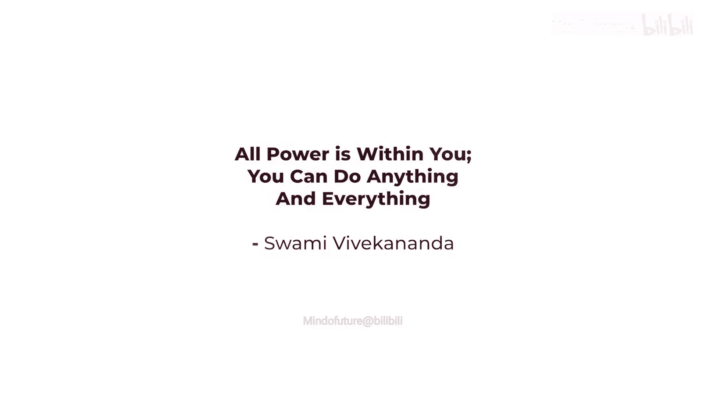
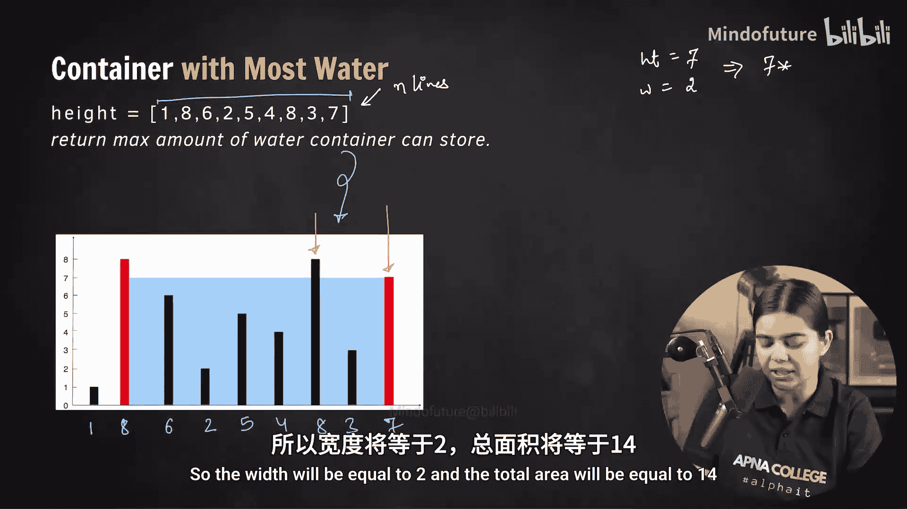
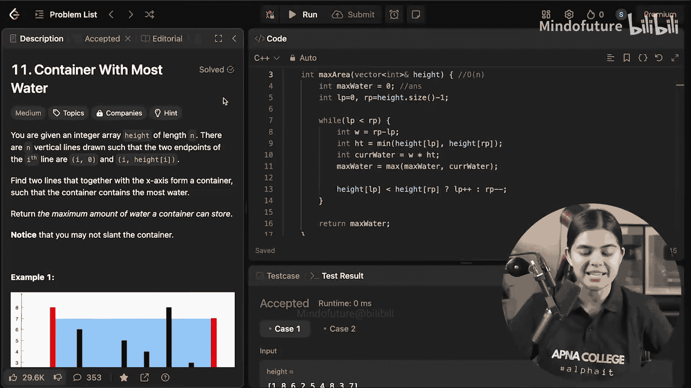

# C++-DSA课程-｜-数据结构-｜-leetcode-｜-Apna-College-｜--Complete-C++-Dsa-Course-p14-P14_盛最多水的容器问题-暴力最优解-双指针方法-Leetcode_11--BV18oUGBkEmV_p14-

Hi， everyone， and welcome to the complete D seriesjune。

 an important question called container with Most water Ab concept Cha scan availableja。

 let's start with the question questionki brute force approach and then we are going to solve this question with the most optimal approach。

 if you want to skip to the most optimal approach already bruteja directly optimal。

 The question is container with most。 or we are given an alliance。😊，Basically。

 N vertical lines car hamipas data given he or her line key specific height toipic A size n car just her a line key height givenmiai Agarjo her lines Z in container k imagine k box imagine cur to in make maximum amount of water hedge to。

 For example， Hamippa's different different lines height data am the hour。 This is height 1。

 This is height 8， Iuraura Aham is the visualized K， This is 6， This is 2，5，4，8，3 and 7。 For example。

 Hammic container byath using these two lines。😊，Ts sideja right sidejaja outne is basically and control overflow equal ande is equal to this。

 which is equal to 7。😊，The container canander heightja 7 k equal withja 2 k equal though lines k each may1 unit k with withja2 k equal and total area any Kina water container 7 into214 k equal a container is 14 k equalga n lines who use containervo container ni maximum or is particular svo container Ho container highlighted by these two red lines。

😊。

Jki vijagi Yaha Mula 1，2，3，4，5，6， and 7 kl andjagi， because this is the smaller bar。

 Johe 7 k torajo that will be equal to 7 height into 7 vi 49 khi seemsas be available here as problem number 11 container with mostipas given of intspa of length n there are n vertical lines such that0la X axis U Hamid。

 though E lines find outneink under maximum amount of water As container or Jobivo maximum amount ofse return notice the aware that you may not s the container containerranme I of straightne container imagine K。

 So this is what are problem looks like is sub brute force approach。😊。

Tome max water va maximum water va container find out or container kai k container container container right boundary or ina X axis connect given vertical lines Cho container and rightham lines pick container container simply need to pick two lines。

😊，The Qa Sari possible container k。Bte force approached the Ya Yoina Kiham Sari。

 all the possible containers kneallo。All possible containers and possible containers fill is what the brute force approach is going to look like all possibles。

different different containers Similarlyly container and fourth container right。

In last index jaga or is loop me left boundaryrigi sub loop just my I is equal to 0 s I less than N I plusjaname。

 or is May。😊，Haami Patki， Hammaara Aa Ojaga， Hamara A Hamari left boundary Ojaigi。 In fact。

 I saym simply lick the tail left。Jbhamara I Kahi Via。 let's suppose this is my eye。

 Jumei is indexper available Amer container he left boundary Ha fogi to right boundary car K Agi。

 first right boundary Yahagi， second Yahagi， third Yahagi，4 Yahagi，5hagi。

 the caic has a Tki Mirijo right boundary he。😊，This right boundary I range pluskiji right plus than en plus This is basically a right boundary possible container possible container。

😊，Yea is k right boundary。Is car index I K equal iska index J K equal is the E K Caju container。

 He is water case Kina water Gna water store parameters subse with J。😊。

Jobihama Bese Kido Beach make Kian distance He Cam k ye index is 0 he and yea index 3 or example。

 Calb。😊，Agar left boundary and right boundary1，2，3 equal。

 Can I say this3 is also equal to30 my width is always equal to j right is always equal to width width is to equal to right minus my second boundary right is my。

undAnd this is my right boundary left boundary right boundary isflow minimum minimum minimum。😊。

Height of I。And height of J。 no me just give sub minimum height Ho Vohamari waterkitoja orli the waterkajaga waterju current area is containerga that will be equal to this width multiplied by this height oraripa waterka area I compare curllingki global variable k Ya maximum water variable k Ya maximum water。

 He basicallyra answer。😊，This is our answerari basically current current container curling maximum water Jo maximum maximum water。

😊，Let us remove this to basically aja answerja maximum of answer and and maximum water maximum or finallyte container right and basically is though real life can。

😊，per the2 and is area co many compare Kat any maximum water kat Jobi final answergase returned Kjo approach。

 This approach is big of N square。Any quadratic time complexity am Mariippanini nested loop use。

 So this is definitely not the most optimum approach or cumi approach particular sal demusbar is approach called li test sub a variable bar called maximum water g initialize K isa answer Ho ver4 I equal0 ent size。

😊，Ie， plus， plus。Fhamari right， boundary co selecting a J equals。I plus 1。

 J less than height dot size， J plus plus。Subseovni Vitnialling， Hamari Jotjagi。

 that will be equal to J minus I。Haari Jo height Hojagi。

 that will be equal to minimum of Jobi Hamari left side key heighte and Jobi Hamari。

 right side key Hae U minimum， Hamaraju current area， Hojaga。Yes say current water we guess。

 B Y a particular container Ben I or Giika is makena water aceai that is equal to width into height or Hama answer kojaga。

 any max water will be maximum of max water。😊，And current water。

Youby current container can the stove。 And finally。

 last mayham return Garingpney Max Water Quaaz our final answer is code Koigbar runki then。😊。

Successfully test maximum value What is it less equal operations scenario0 0 operations10 to 1 operations10 to optimize our。

are going to use something called two pointer approach2 point approach he helps Op two。

twoer approach basically beginner is approach optimal answer and that is as beginner to come up with this solution is not very easy that is equal to width and right is equal to right minus and height is equal to minimum of。

😊，And right there minimum basically for the container discuss logical height and right right to the optimum pair And that is to in right possible in terms of width and。

😊，Nim Muja above me boundary of forward Lake a backwardari2 pointer approach k a2 pointer approach may exactly logic。

Basically， container k container k left right boundary container by the line which has minimum heightki minimum height example。

 let's suppose8 containererra right left pointer k equal right pointer6 k equal。Hari pass。

These are the lines that we have，Toka area decre maximum water minimum waterja case2。😊。

s is iss suppose the height is 12 or third case3 or minus maximum。😊。

minimum right right minimum opposite。is definitely less second case and that is what the basic logic of。

😊，Poin this is right equal。us this index J say he index a 8 k equal y index is 0 equal to total width ojagi8 k equal8 minus0。

 Similarlyly， Hamappaju height Hojagi minimum of height of left pointer and height of right pointer inokki minimum height。

 current water Kinajagaki current container Kina water storerara current container Caju water Hoah that will be width multiplied by this minimum height though it will be width multiplied by height or hamisha hamak answer isakne say initialize Kkia this answer is basically R maximum water and her barham max water co。

😊，Lailingi as maximum of max water and are。Current current container maximum calculation。

 But lets suppose equal to equal equal right right operator right right is logic using the two approach。

😊，Dy is given exampleer Dron left pointer right pointer left pointer initialize is index 0，1，2，3，4。

567 and8ari already given and max first container first container with k equal1 k equal max is equal to maximum of max and current answer k equal equaler next container is container minus7 equal and minimum of minimum7 k equal7749。

49 49 8 and7 7 minimum7 equal3 multi width7 equal4 and is container equal and1 which is equal equal to 444 and right container minimum height。

4 equal。And width5 k equal this is going to be equal to 161648 and4 is equal to4 and equal to1154 equal equal equal4 equal equal is equal4。

😊，equal49499 equal right equal。Inly2 pointer approach U Kaari cases may n square upon time complexity optimize cur linearta of again approach code cur。

😊，Hami Ani k candander。Yea nested loop hum Haam Max watercomb v rec。 This is our answer。

 Saka Sa Hamabic left pointer Je yoga and Hamic right pointer Je yoga initialized with n-1。

Pramic while luula Jeptakamara left pointer is less than our right pointer。

 subip on width niallingi width is going to be equal to right pointer minus left pointer height niallingi current container key。

 It is going to be minimum of height of left pointer。And height of。Right pointer。

 Hamraju current water， Hojaga， This is going to be equal to width to height。

 and max water will be equal to maximum of max water and。

Current water or a case to pointer bro Kaier U update Ulanco to actually change Lake any minimum to othergar。

Tary statement looks them Ugg height of left pointer， Cho T he height of right pointer say。

Those case may left pointer update curil F plus the King Neto right pointer co minus minus K thing toaririkiri turnernary statement of Jagiem update Ktia。

 And this is the entire code。 The time complexity for this code is going to be big off n any a linear time Michel code I say8 bar run cur。

😊，And let us submit it。ham was successfully submit and is2 pointer approach who use to solve this particular question called container with most water which is called trapping rainwater。

 it is a similar question， not the exact same logic but quite similar interesting question different different topics I hope regarding regarding this If you like the solution to this。

 you can let me know in the comments you can also let me know on Twitter learning and keep exploring。

😊。

