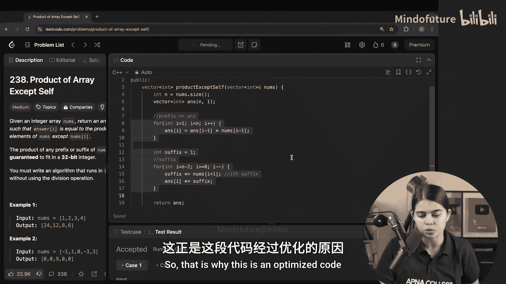

# C++-DSA课程-｜-数据结构-｜-leetcode-｜-Apna-College-｜--Complete-C++-Dsa-Course-p15-P15_除自身以外数组的乘积-从暴力到最优解-Leetcode_238--BV18oUGBkEmV_p15-

Hi everyone， and welcome to the complete D A seriesar Aju Gnival important E question。

 which is called product of E except self。 Abbiscalva Arako your DS A concept Sign Chapless available inja jak except。

 Now， the question that we are going to solve is called this。😊。

available here as problem number 238 on is givenki brute and optimal if you are already familiar with the question and the brute force directly times times optimal given equal or output in the form of except for the number index available for example is equal to that is going to be equal to is equal to this is going to be equal to 242。

😊，Similarly， is equal to2 i is equal to2 numbers product except for this i is equal to1 into equal equal answer2 equal2 equal third。

😊，2 equal2 equal allowed to contrain。im approach is concerning brute forva Hammeilyava and Hamid division operator Aludini to himselfse multiply Kakam。

 if I visualize my array like this。1，2，3，4， which is equal is equal2 equal。😊，Plus， less。

Or sari Kaari numbers of product calculate K take product variable later then。

 just initialize King1 kat product K under up numbers of Jca。😊。

Mlaaggar is index for him toje acorura loopkiri dismiss sorryari J Kauje productai except Ja mera I J K I J K equallam index is value a product numbers the Ya a condition La。

 which is。😊，K my I is not equal to j those case product numbers finally answer of is going to be equal to product using operatorplication't。

😊，Fair hum Ana outer loop pluggane I is equal to 0 silire I less than n。 In fact。

 let me just take my n value as nus dot size to Yampa Hamipas enjaga， Yapa Njaga。

 I'm trying to product Namka variablely set initialized with one。

And J equals 0 sre J less than N J plus the jaga Hamme herbame product can multiply equal to Kanahan nus of j Parit jobbhamran nus of J Kari I value J K equal。

😊，Ykijora IA index value value at Uskuhamme product can include Nika or J C value calculate Hojagihama answer of I Hojagahamari product equal and is the I。

😊，Last ma I returned Ksm answerko。 In fact， I can there be a our optimization Johanm Ksam。

That is key we don't really need to use this product variable。

 Im simply upper up my answer of I K underhi direct multiplications cut there。😊，都。😔。

Chahito Yewaa assignment B， we can remove。 and I theri say， we can run our code。

cases time complexity that is equal to n square and that is why is equal and。😊。

K output Eri Gca under her a index key value Cokiri numberspa products。

 if this is our numbers E and this is our answer Eri toander same sizeka E and a problem co k linear time solvemi division operator who use ni example Ki answer is index key value calculate K This is index2。

😊，The index2 calculate index2 value calculate number is equal to2 and right equal equal which is equal。

😊，Let's suppose Muja calculate my answer for index is equal to1 index is equal to 1 is number which is1 and right22 1212 equal or which and right right for the sake of。

😊，equal equal。s call it the sake of simplicityplicationpl second。😊，or right side rights。😊。

index is index s index next index multiplied by in fact withki anyway multilyfix of multiix last index s six will this value multiplied by equal value six is going to be value multiplied by this value which is going to equal to 12 is value multiplied by value2 equalix and prefix。

😊，A array rockery to prefix v S dega。This was prefixpa1 value have2 andba6fix sdi s I is equal to n1 n2ki n1 s suffix of n1 is going to be equal to1。

😊，N2 start carrying I greater than equal to0 I co minus minus Hamisha suffix value suffix of i is going to be suffix of i plus1 multiplied by nus i plusfix1 s for s it is going to be plus one value suffix value value and plus nu multiplication sixix is also linear complexity prefix is also prefi suffix third step co answer indexfix of i multiplied suffix simply multi suffix values。

😊，fix values first indexja 2424 equal second indexja122 equal third index equal4 equal24128 and62412 andfi calculate calculate which will n complexity complexity optimize complexity complexity complexity answer。

😊，Ok Ame， we are also going to calculate。Or create two more vectors。Called prefix and suffix。

To yehamra prefixjaga and yehamra sixjaga Ico N initialize k1 ksat isco1 value ksat subna prefix calculate Kringgi prefix k in teacher I equals1 ci start k I less than n I plus this Hammehe prefix of I is going to be prefix of I -1 multiplied by。

😊，Numbs off I -1。 Similarlyly， you see that can say hum suffix calculate curl it suffix B hampath 4 in teacherger I equals n-2。

 Qqlast index already calculated herbarne I com Kingi 。

And suffix of I is equal to suffix of B value value I plus 1。Multiplied by nus of i plus 1。

And finally， similar loop from Jalani Val Ae An Kib。😊，I loopco。

 we are going to start it from 0 answer of I is going to be equal to。

Haara prefix of I multiplied by suffix of I。And finally， Im returned Kthy answer。Though T loop。

 sum use K， prefix B， big of encallue， suffix B， big of encal looppe。

 answer calculation B big of encallue overall， big of n time complexity。

 space complexity may A don no vectors and additionally usek to space complexity B A B big of en I Ko B Eranthe。

😊，And asari cases complexity successfully complexity optimize next or sub important step complexity optimization complexity optimize Mu prex anduffix calculate index。

😊，ha Mirajo。😊，K is prefix or six mu additionally simply calculation may use mu answer of prefix of I multiplied by six mu or mufixfix mu prefi isx is prefix1 into is prefix12 is prex23fix。

😊，To규a Hamic single Lugan。prefi eventually multiplication what we instead of taking。😊，Pfix vector。

 What I can do is may a long， long int Iium， in fact。

 we can also call it in teacherger a in teacherger le than called prefix prefixco initialize K the prefix prefix calculate a single variable here。

 Now， we don't really need a vector or aeth prefix ca calculate Ieth prefix prefix is equal tona prefix carist told here。

😊，Muja Pat A mene prefixs Coda answerto Gneval， Yanni。

Aam Sif answer vveanggi is answer Erikander sub numbers of Ip forward loop gelanggi or is answer Erikander Sef prefixes cost first loop Kander。

😊，To answer ofx0 index that is multifix of multiplied by equalfix multiplied by equal。😊。

UpNext prefi calculate K toranna prefix multiplied byanni number key value。

 which is going to be equal to 6 twist of prefix muran logic value prefix is prefix code directly answer of I instead of creating a separate vector prefix calculation is directly answer any answer of Ija answer of I-1 multiplied by。

😊，Numbs off I -1。fix answer In fact，fix variable we don't really need the prefix variable or second that is the suffixfi multiuffuffix directly answerfiix。

😊，variable multis greater than equalix that is going to equal multiplied。😊，Toharbar。

 suffix Fujai가 multiply equal to。Numbs of I plus1 Ere suffix E valueier to Jobi I the suffix。

 is variable can understood him。 U say upon the answer of I Ksat。answerc directly second third。😊。

I can create an integer called suffix initialized with value1。

 or Ham herbar kar kingi up suffix of iq value calculate kringi。

 which is going to be multiply equal to nus of I plus 1 or herbar answer of I can multiply kingi y G A na suffix。

😊，s variable sixplicationplicationplication isplication complexity that is complexity is going to be optimize constant。

😊，Runari test cases logic forward suffix calculate logic is going to be very easy backward backward suffix initial first is v index suffix1 k or multip multiplication。

😊，U next index per mulaab is index per jar or is skill is suffix calculate k I index suffixjaga 1 multiplied by is Kaagla index Yi4 to suffixjaga 4 k equal or is 4 co is index multiply K the2 co4 a multiply Kring to y valuejagi 8 k equal for next index bygi is index suffix ni is index suffixjaga 4 multiplied by 3 Y G upper k Pura suffix multiplied by nu of I the4 in23。

😊，This is going to be equal to 12。 So Yahaa is value co 12 say multiply Khen Ya 12 multiply y to 12 value A fairham next index by is index class suffix Hojiga 12 multiplied by2 to 12 into2 Hoja value 24 k equal and fair is value equal 24 semi multiply K1。

24 multiply who the value 24 k equal final values khu answer again the final values v 24。😊，12。😊。

8 and 6 or Yahi answer toapura logic followmaham time complexity orri space complexity of one or is process operator use So that is why this is an optimized codeari cases I next class important concepts of interview of view learning and keep exploring。

😊。

