# C++-DSA课程-｜-数据结构-｜-leetcode-｜-Apna-College-｜--Complete-C++-Dsa-Course-p16-P16_C++中的指针-详解-DSA系列_由Shradha老师讲解--BV18oUGBkEmV_p16-

Hi everyone and welcome to the complete DSA series Justcaner Ajuni about pointers in C+ Abisscale Ahamy concept Playlistander available in Ja。

😊。

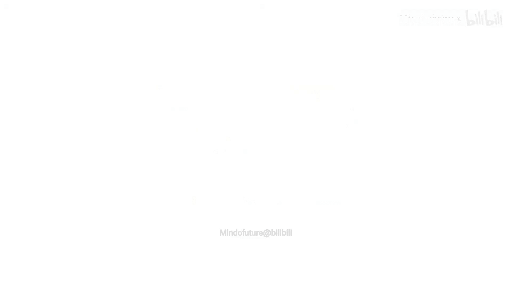

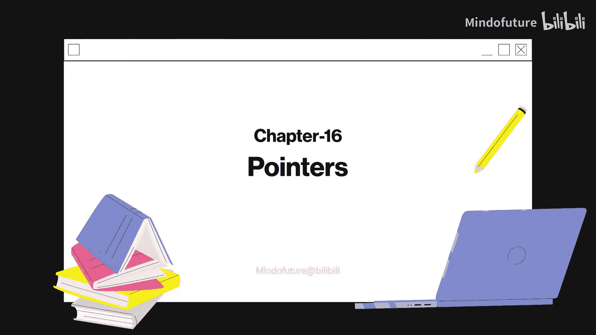

A point skipar Part。 There is one important concept that we need to cover。

 which is the concept of memory addresses。 Me address cankalabeki Jb B C plus scanander。 Yeah。

 In fact， K B language scanander K C variable could create curtheme。 For example。

 I created this variable A is equal to 10。😊，the system's memory is the address in addressimim1616 digit16 and6 you want study。

😊，But basically it is an actual number identify exact location example print operator which is called address。

Of operatorju address of operator Am understand Ampers already operators give me use andlaju Yama bit and operator Ya Al double and to Yama logical and operatorai Lincoln single and operator a。

 which is to give address of variablem simply is a k printva and a topa I address Ac printjaga。

 which is 0 x 3，63，6 example， let us create a variable a。😊。

It is going to be equal to 10 or from C out Kvak address of E A be exactly 3，6，3，6。

 Niagga perusi form Gura Matla Me exactly K address is variable car。 What different do type。😊。

So is number which starts with0 x and9 and。😊，To Hama pointes a concept Jubbath important to understand a lot of fundamentals of C pluses。

 And a scale Ava， we are also going to focus key operators K case multiple uses O a C plus scanner。😊。

A am percent operator K a bitwise operations K address operation K Iam star operator multiple Next above finally S。

 what exactly do we understand by pointers pointers C plus special variableska variables address toa。

😊，Just a， for example。Agar is the Rique a hamming computer memoryco visualize correct。

 But let's suppose howmni create here a variable in teacherger a is equal to 10 Tommaari Me kier jage Jaar。

😊，for simplicity is a called。😊，The address of a variable to another variable。

 which is a special variable called a pointer。 a pointer exactly address address float。😊。

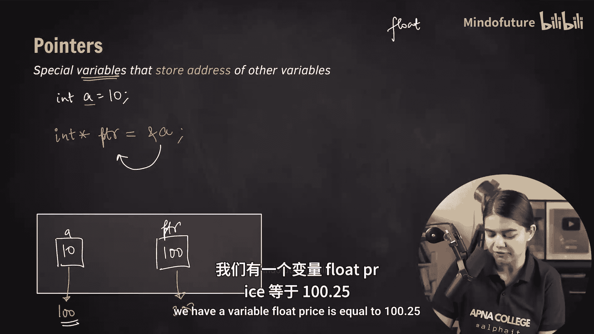

Price is equal to0。25。 Ab Agar muje is variable car pointer create Kna thosecal Yahi same type K pointer banana bur Yani float star hum I a k P R 2 or Pr2 k hum price variable car address store kac them This the hamapne pointers quo create Kte in C pluses I k bar demoam giveve created a variable A is equal to 10。

😊，Or hummock point of an an value in Pr is equal to m percent of a int star。Though in star。

 this variable is of type pointer it should star he I say in teacher case use I to variable pointer case use don no sayiga。

 I like to use the star with my data type so that I clearly understand that it's going to be a pointer。

😊，U ver value and address or address or value value we are going to get the same address0 print value print address。

😊，They Cha to address of P B printer。Which is this value。

 U value don no value same here perjuniesche value value here Y different Qki P ca dress just say upper 300th a pointer ca to pointer ca dressota lake in pointer k under key value variable ca dress So same G Hki C floating value caam Let's suppose howmney create here float price is equal to00。

25 f。😊，2cale， point of banana， float star， PTR。Is equal to address of price andyapperhamia and address of pricesco Priac them。

Let's save it and run。From Mariipas do no same values per into garage R up Jese hamic pointer create curtheme。

 verse heham a core special variable create curtheem。😊。

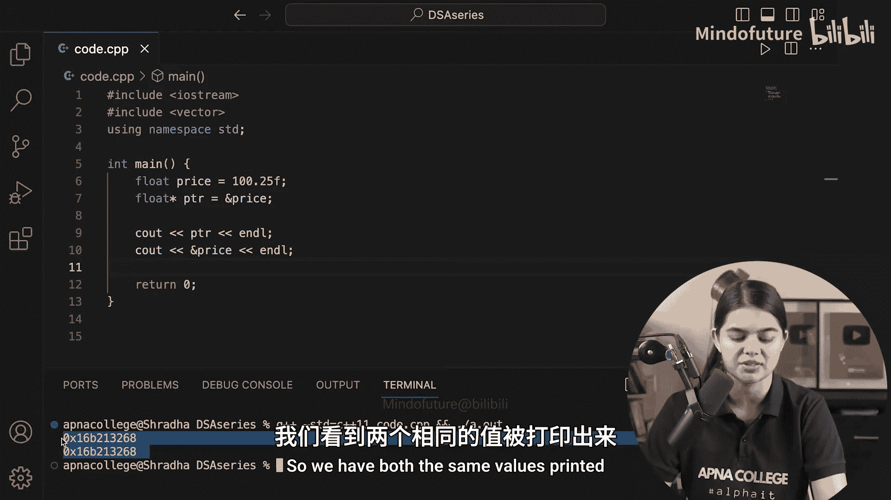

Which is called a pointer to pointer。Y interestinger variable which iss star。😊。

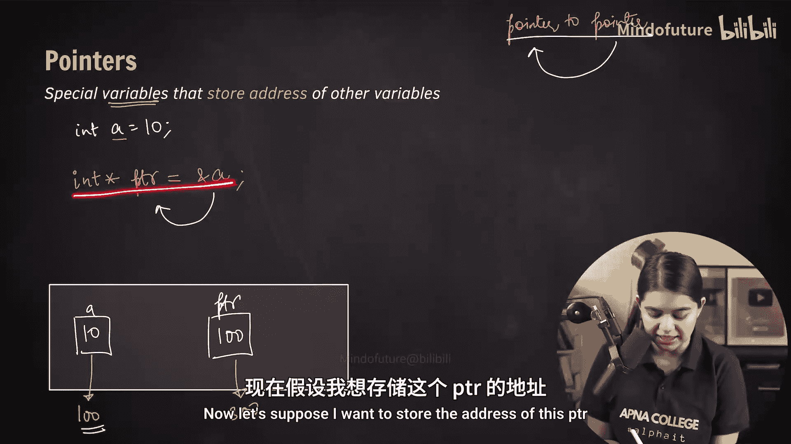

。Code can the h upna a in teacherger variable Mene a is equal to 10。

A is equal to 10 km amneusca x pointer vennaya in star Pe is equal to address of P。

Am is pointer guy call pointer bananas at there。Yanni iska address stored technically in star star Pr 2 Yasco carries a parent point of。

Parent pointer is equal to address of pointer。An y haper humy out herecttiham Eop Peiaka address out heringgi。

End of line and Dura Amso Carnevalhe。Upname parent pointer key value。To Peka address koga。

 Agar Pka address，300 k equal， the parent pointer key value kogi parent pointer key value B 300 Ogi Masabjo donno value Zprintvana donno value same hogi。

To Yahaper， we can also verify this thoughpas same value printerto。

 So is that it case a pointers scan from though level tag generally upperja Iba oral level upon usingnithe abnormal variable veratium。

 whose variable cadmic pointer can the store kac or kbi pointer cadres we store kra those pointer to pointer can the k when we talk about pointers E core operator edge Bo important to them。

 which is called the D referencing operator。😊，Isco D reference operator Ham k。

 and it is represented by the star symbol Starko already multily I D reference K D reference K reference Ka generally address or D reference Kla U Valode Hammus written D reference operator Kala have value。

😊，At address。Y D reference operator address lets suppose many say address or star0 value memory k memory address or10 k equal print1 k equal。

😊，Said Talibbi curam。 Let's suppose Hamneah C out Karaki Kshiki D reference Kque Am per a。

Let's save it。And run the Mariippa Staagga， Matla a Cajo address whose address best stored your value He value of H A E。

 which is equal to 10。 Similarly， agerhamm le came。😊。

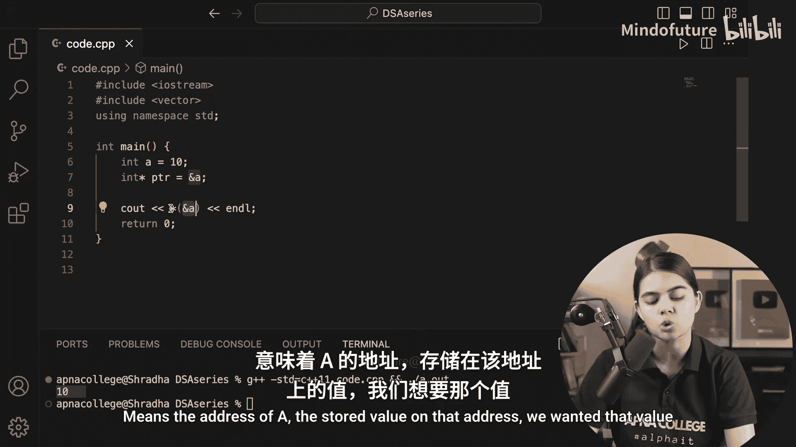

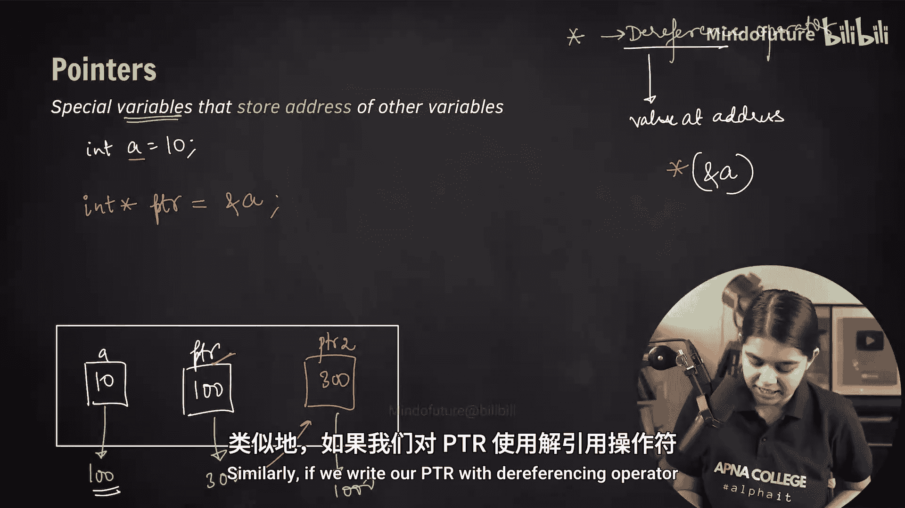

Be referencing operator Kessat Anapiia。To P， pointer K， pointic address。

Pointer address valueer address value10 k equal to00 per value0 address save and cases I logic operator or or star。

😊，Any upper petia twoki again， Let's suppose a Mariippaco parent pointerruta。

 This can the store Cartheham address of Peier。30。😊。

addressaygarham parent pointer code D reference simply p value value value P memory addresspa same memory address print。

 which is equal for PR as well as de referencing parent pointer or agarham parent pointer code D kotaka。

😊，Parent pointer code of A bar D reference curtheme。Is come at Le him。

Kejo address a con address parent pointer can their value a 300 to 300 v address U stored value Hamapas Ajagi which is 100。

😊，L or operator let us talk。😊。

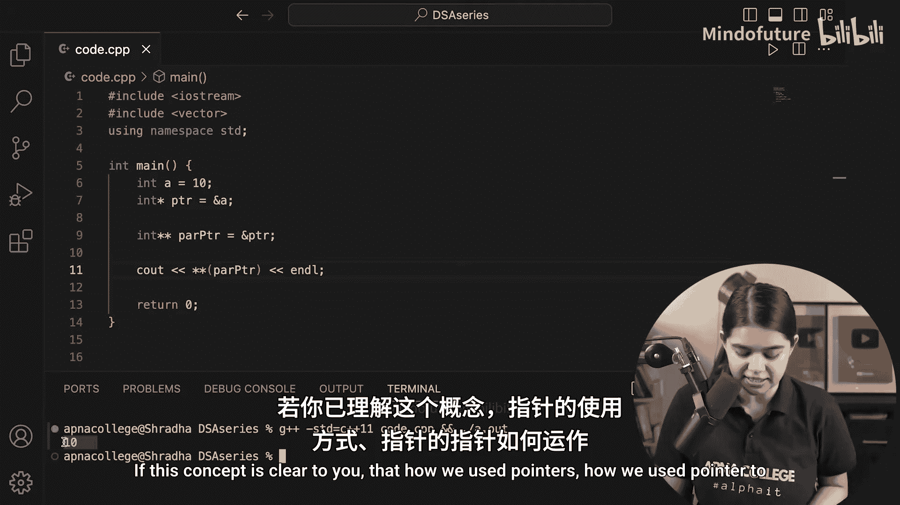

。😊，P is equal to。😊。

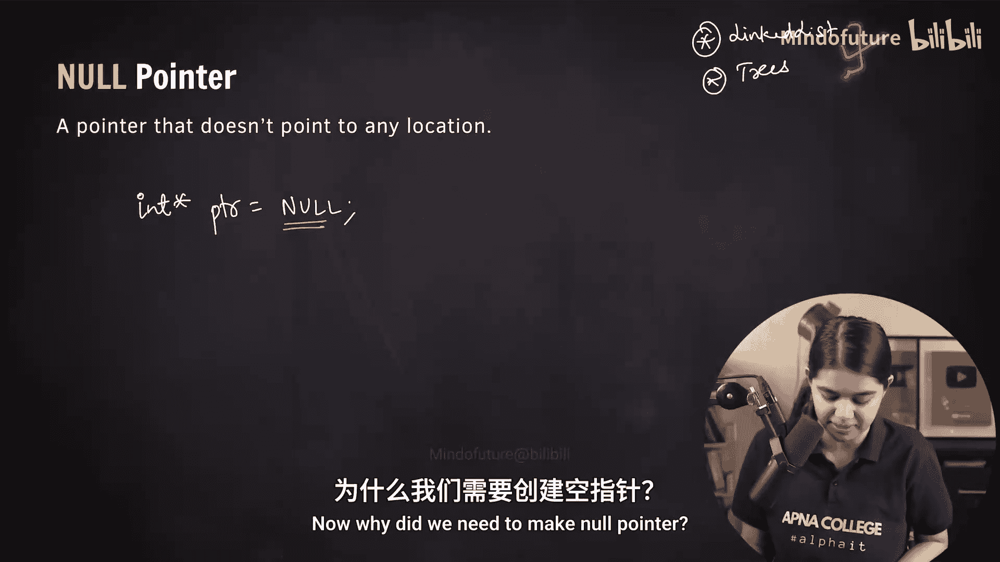

To agar is pointer Kanderhamni cobi value assign Nikki F B Agarham C out cr the value of P R。

what is it going to be is going to be a garbage memory address automatically simply null value and and segment solve based。

😊。

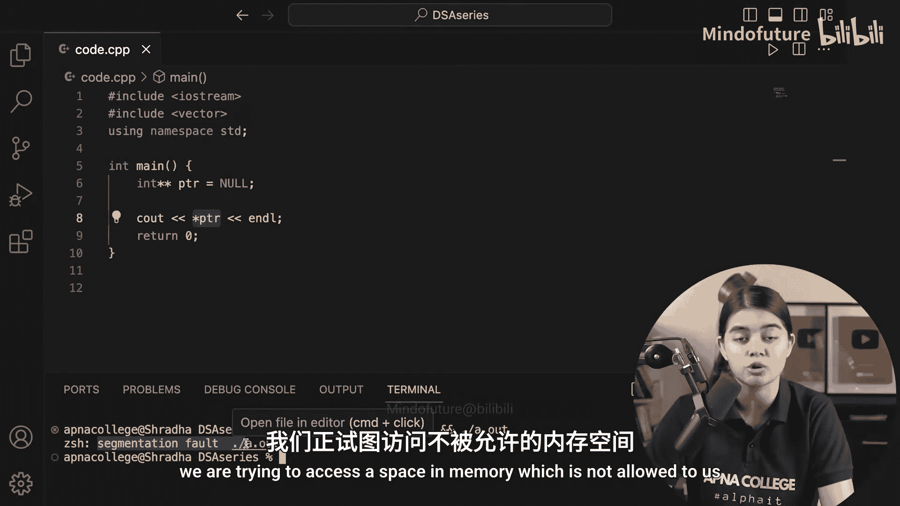

Memory candle a in teager a he5 k equall the upper5 value in teager am pointer p k equal a pointer P can a address let's suppose a address0 to p0 value P pointer address pointer to pointer double star pointer which is called Q。

😊，pointer5000 or700 equal star address address equal to。

Next statement has Star star Q to star A Q come lame。

K D referencene star star Q value Qki value Q value 500 the sub 500 value stored500 memory address value0 equal value0 or value0 memory address equal next time out P p a address simplicity0 P value is equal to 100。

😊，Andjaam cutting his star cube， star cua Matlahe Ki Q K under Jobi value him。

500 Q 500 per0 to0 equal simplicity to address is solution verify can verify in in star p as address of a and in star star Q is going to be address of p sub out star p。

😊，With end of line。A Oabbaam me see out Gna。Star star Q， Donuki valuepa 5 printipus 5 print Rajaga。

 Uskeba Agerhamm P and star Q Co Kvin。in fact， same value。

Topa Bill same values is question point to is called pass by referencebi functions pass which parameters parameters pass by parameters pass by reference pass by reference briefly and we are going to understand pass by reference in detail pass by reference。

😊，Functions canander though therique subseella Theika in the form of pointers Yaanni。

 let's suppose this is my main function。 A main function canander agarmeno integer a create k with a value10 or Muji Du function co value Pa Ke。

 Let's suppose my other function is change a to is function code a normally passoni tapto a keyusi copygi amekiko Ko create now directly I a key value Du function cander passso tokonea a theikata pass by reference Knea a the pointus make curum a pass Kne Ma a pointer pass curum ya。

😊，May Aca directly memory address pass A A memory address to memory address Uki pointer can the store Ka or pointer directly is memory address can change Let's suppose this is my main function。

ic variable He equal Ivani E function mana called white change E。😊。

Change E k Hamja Hamri pass a Ajai or E co10 km 20 value as or return Kz and change E co call Knekiba。

😊，Hmjab Si out Kainggi。Inside main function。To Hamri pass Eki value Joprint Oranji。

Would na value change the value print to any 20 equal per tuki Yahaer change age of M A value copa carrying abire Abi Hoai pass by value。

😡，This is pass by values co5 This is pass by value value 10 inside the main function。

 a pass by value value directly function address memory location directly0 address or change function address address or2 value。

😊。

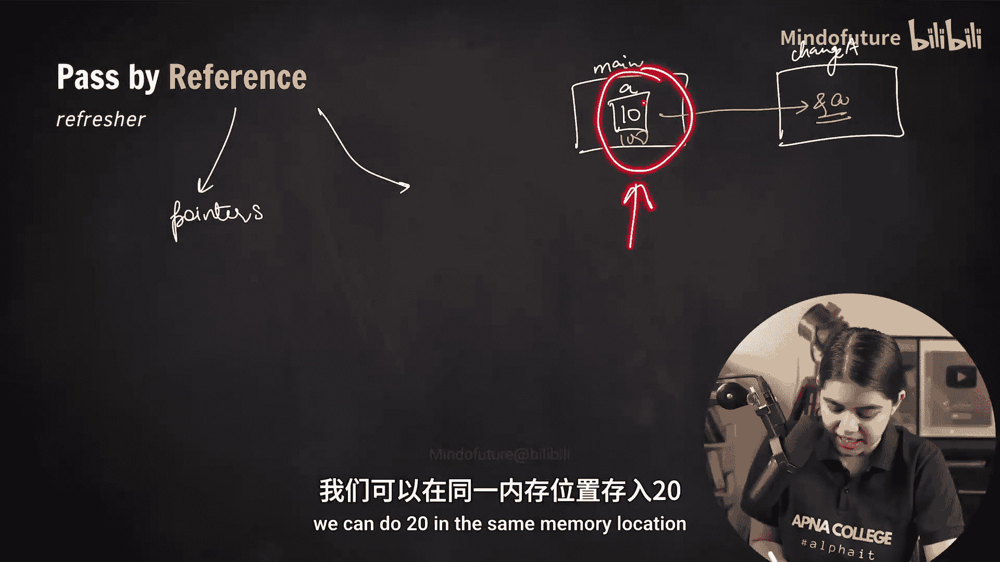

Is it orthoa better than you is a rock or theme？😊，This is our main function。

His main function can there already a exist curthhy with a value of tin。And this is a。

Change a function。Change functions suppose address address or simply which is equal to 20 address indirect main function original。

😊，I they accept。 How is it going to happen Star Pr Kihi value kham directly Kingi 20 and Iwaja company code Koran Ki tosbarhamri pass na value Prito kgi。

 which is 20 to Ibarham pass by value code change cardia to pass by reference using。😊。

Pointters to I the pointers form use a second to implement pass by reference to pass by reference Kanega E thega pointers and thusra thekae references references U。

😊，Programming gender alias， aliasani Jese， we already know Jehamm Iron Man liram， Ya Jm。

 Tuni star liram。What are we doing， We are talking about the same person tose aliasm Aliasi function Hamka as example as to B alias B and same memory address we are talking about the same memory address to to referencesse。

 even though references use references by reference using alias。😊。

The references simply a non normal variable pass variable variable receive。

 which is called per function is equal to 20 exactly or is equal to 20 main function。😊。

decided to store。😊，And。Tohamra Eander degaanderpa 1，2，3，4。

 and 5 elements stored Ab Jobi Hamra C plus resumeme Eam Aara， This Ara。

 this name is actually a special variable， and it is of T pointer。😊。

Haari Eju plus Ier or S pointer Kme0 index v element co to address addressari value1 trying to verify can an。

😊，anderham 1，2，3，4，5 the elementscho orbham outang the value of A to printang address memory address or agaham star of index value1 print lets clear this inran1er is of special category and its called a constant pointer constant C plus in in throughout the programham normaler for example normal pointer I in star p is equal to address of a and in teacherger value 15 equalham to iser。

😊，s suppose is equal to 10 This is completely normal error others must modifi modfifi constant。iser1。

2，3，4 occupy So that is why Jo constant point throughout the program change in about one more important concept calleder arithmetic Any point operations perform operationcrement and decres suppose is equal to 10。

😊。

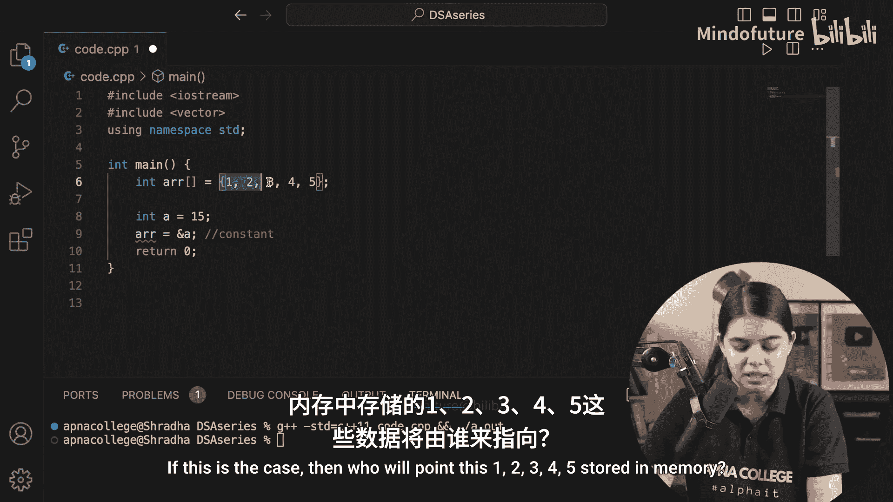

And in star p is equal to mpers a agar p plus plus plus plus p pointer basicallyb plus plus perform or0 k equal And if this is myer p value00 or suppose300 k equal p plus plus p normal variable plus plus number is number of bys for example。

 in0 k00 p plus plus plusja100 bys。😊。

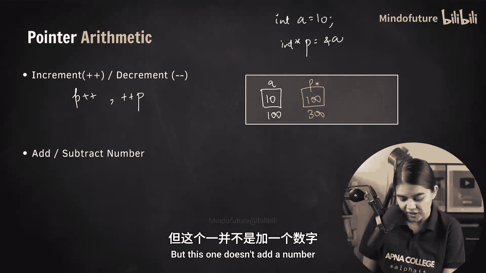

in next time1 equalcrement in Similarlyly equal or9 equal。😊。

Star P is equal to m percent cent of a A can co B value from Chinese store them sub C out the point v value Okeba a P co a minus minus plus less。

And4 verify starting pointcrement。😊，4 overall output which is equivalent to type clear。

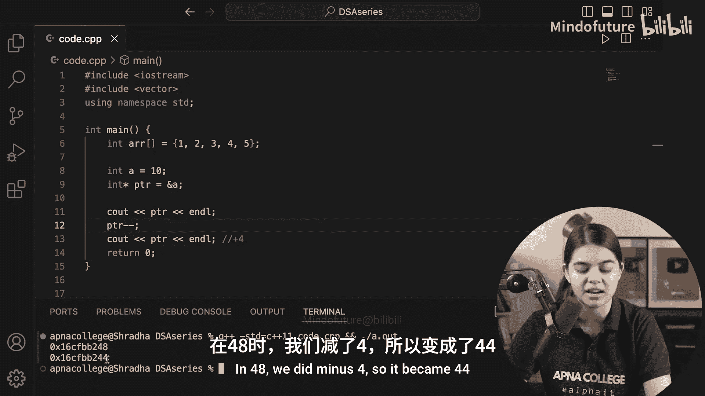

。

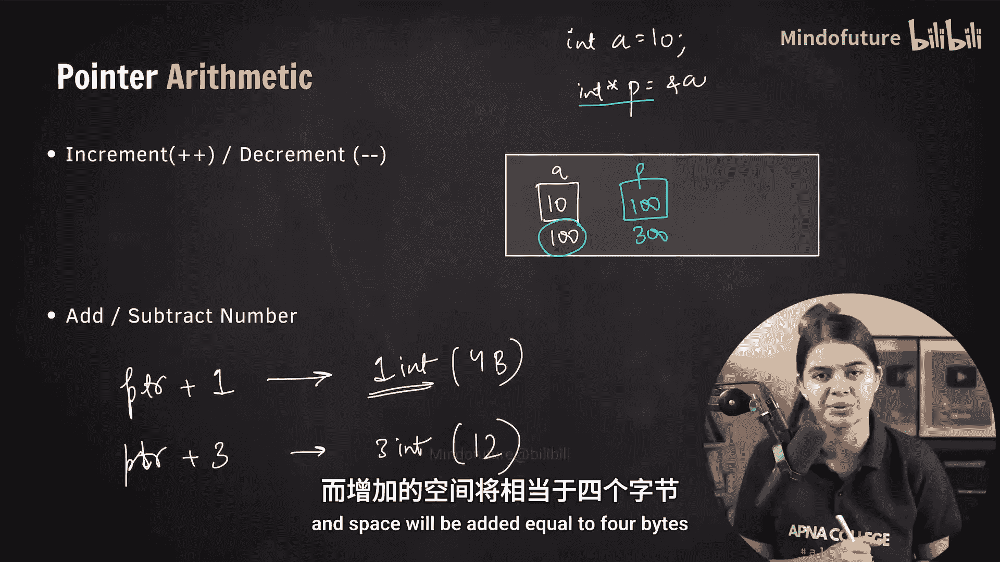

Jse， for example， pki value p by2er value addki overall， though in teacherham artsmenepa plus 8。😊。

original value48 plus4484944444 f and 5，0， this is1，2，3，4，5，6。

7 and 84 by equal number basically simply out star of。😊。

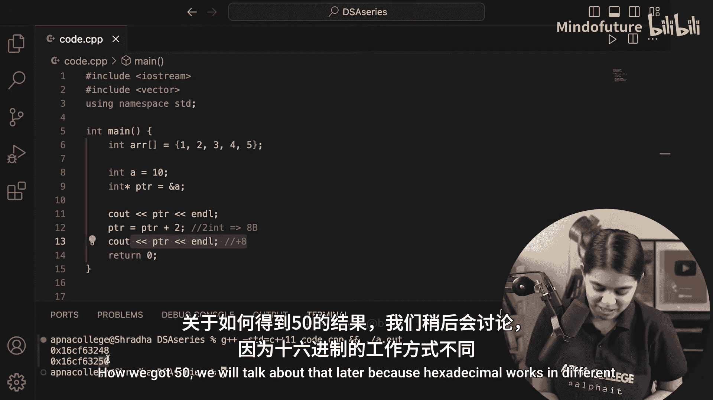

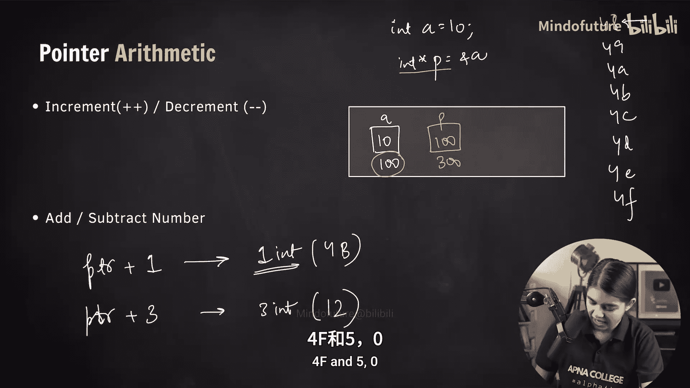

Toseme Pattayame index 0 k value megi Matabari Paio value Pritovalia。

 that is equal to1 is comm already ver culture Liin Agar， Hamme Liia。😊，Era。Plus10412162 similarly。😊。

Agarham era+ 2ingate to apa 3 printga，+ 3 kingate tomerpa 4 printtoga。

4ip valueskigu memory allocation oraririthmetic sub operation perform example we have one and second minus subtract subtract number of blocks。

😊。

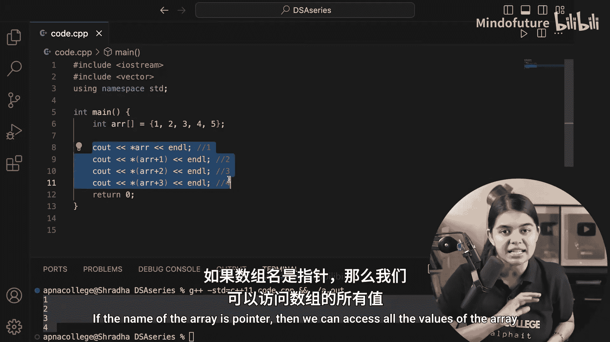

Off type。 T bi。 Joby type。1 108 or2100 or by。😊，Let's suppose。This is in fact， directly create color。

 it can teach your pointer how many create here。And。😊，Ye2 and I p1 value 2 plus2 k equal of1 P2。

 let's suppose0 p2 the numbers， though in tea in tea1 Lo 108 equalmang 1 p2。😊，Themaripasjo answer he。

 that is going to be equal to2 aris taceipas answer I2 k equal302 he actually number of bysju inju same typeeani integer Jo occupy K This that he is8 pointer couldduer pointers subtract knabi possible he。

 and though pointers quo compare Knahi possible he。 Jese for example。

 Yahaer let's create two pointers a kber in star Ptier。😊，Yeah let's call it pointer 1。

And do some mane in star。B第二 do。Agerham C out cur subse upne pointer，1 k value co。

And Uskebal see out k point2 key value co。And fair Hammei out Knahem Khama Pier 1 is less than 0er2。

So memory address compare kne Ka。😊，is less thanth。😊，To Eric quote Robbi girlle them。

HaMarippas values in 10，2030 and 40 Hamme Pattaya Hama Era Hamisha constant pointer Jomia I valueluo point Ani knaya pointer create Kia inpedia。

😊，indexham print pluss suppose this is address is 104 is 100 is112 plus Similarlyly plus plus equal orham。

😊，2 Ba So answer is going to be 20，40 and 20 is Kobi giant Abnaura liquor Amippa values the 10，20。

30 and 40 hamni Phic pointer venayya。😊，Int star pia。With the E value。Subse Peham C out Krane， PR+1co。

and is204 useen learned about and finally we talkedrithmetic operations and saw。😊。

concept operator Similarlylyply and thes have completed lecture mark in description。

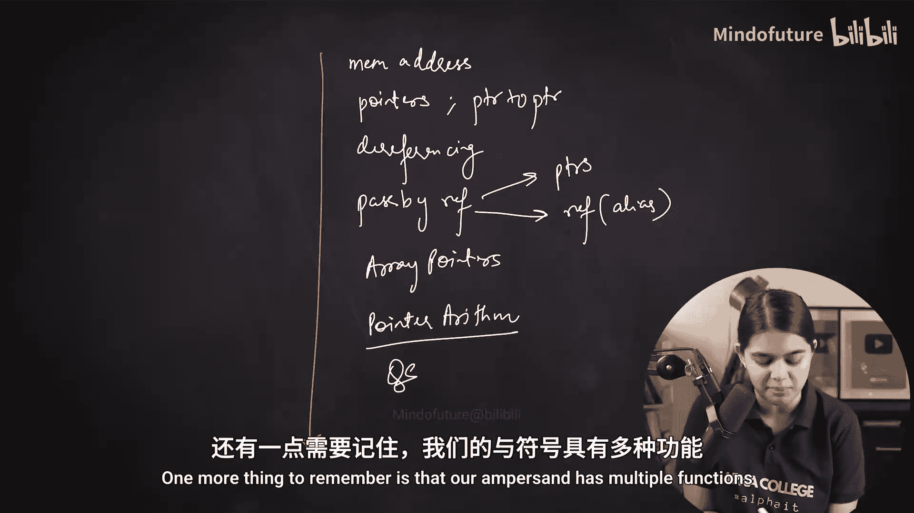

Again， that will then keep learning and keep exploring。😊。

