# C++ DSA课程：P16：C++中的指针详解


在本节课中，我们将要学习C++中一个核心且重要的概念——指针。我们将从内存地址开始，逐步理解指针的定义、创建、解引用操作，并探讨指针在数组和函数传参中的应用。课程内容设计简单直白，旨在让初学者能够轻松掌握。

## 概述：内存地址与取址运算符

上一节我们介绍了变量的基本概念，本节中我们来看看变量在计算机内存中是如何存储的。每个变量在内存中都有一个唯一的地址，用于标识其存储位置。这个地址是一个十六进制的数字。

在C++中，我们可以使用取址运算符 `&` 来获取一个变量的内存地址。请注意，单个 `&` 符号是取址运算符，而双 `&&` 符号是逻辑与运算符。

以下是一个获取变量地址的示例：
```cpp
int a = 10;
cout << "变量a的地址是: " << &a << endl;
```
执行这段代码，控制台会输出类似 `0x7ffeeb5b9a3c` 的地址值。这个以 `0x` 开头的数字就是变量 `a` 在内存中的实际位置。

理解内存地址是学习指针的基础。接下来，我们将正式引入指针的概念。

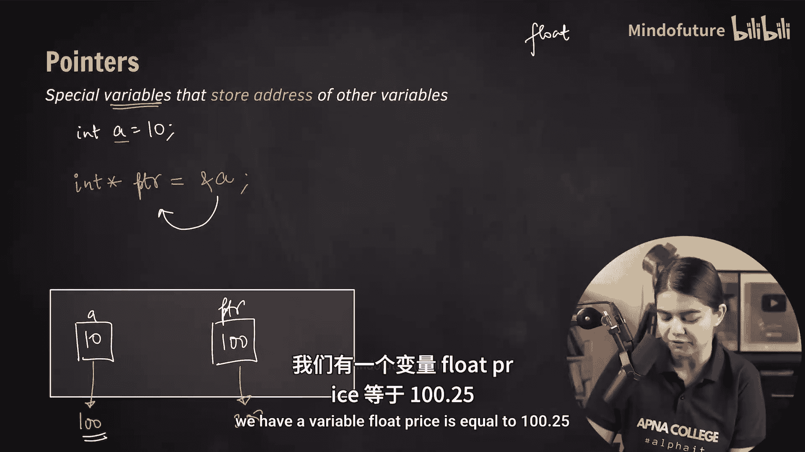

## 指针的定义与创建

指针是一种特殊的变量，它的值不是普通的数据，而是另一个变量的内存地址。你可以把指针想象成一个“地址簿”，它记录着某个数据的具体存放位置。

例如，我们有一个整型变量 `a`，其值为10。我们可以创建一个指向 `a` 的指针。

以下是创建指针的语法：
```cpp
int a = 10; // 定义一个整型变量
int* ptr;   // 声明一个指向整型的指针
ptr = &a;   // 将变量a的地址赋值给指针ptr
```
也可以将声明和初始化合并为一行：
```cpp
int* ptr = &a;
```
这里，`int*` 表示 `ptr` 是一个指向 `int` 类型数据的指针。星号 `*` 是声明指针的关键符号。

现在，指针 `ptr` 存储了变量 `a` 的地址。我们可以验证一下：
```cpp
cout << “变量a的地址 (&a): ” << &a << endl;
cout << “指针ptr存储的值 (ptr): ” << ptr << endl;
```
你会发现，这两行代码输出的地址值是相同的。

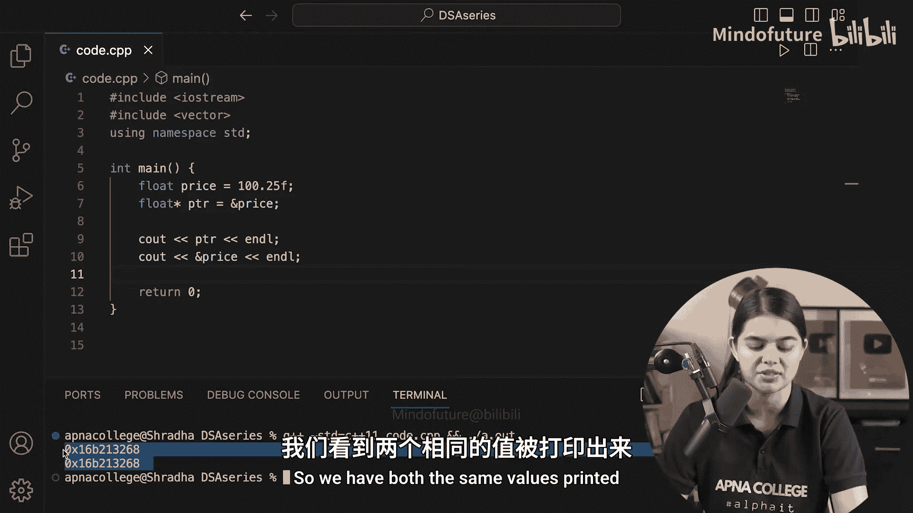

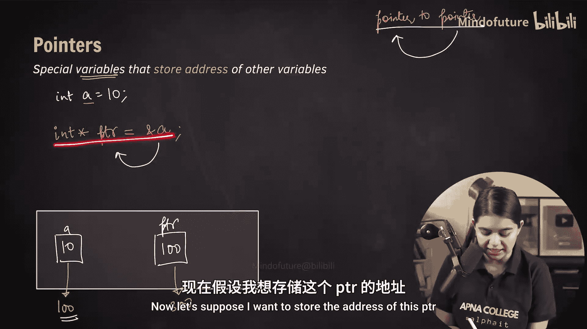

指针的类型必须与其指向的变量类型相匹配。例如，指向浮点数的指针应声明为 `float*`。
```cpp
float price = 0.25f;
float* pricePtr = &price; // 正确：类型匹配
// int* wrongPtr = &price; // 错误：类型不匹配
```

## 指针的指针（多级指针）

指针本身也是一个变量，它也有自己的内存地址。因此，我们可以创建指向指针的指针，这被称为“多级指针”或“指针的指针”。

例如，我们有一个指向整型变量 `a` 的指针 `ptr`。我们可以再创建一个指向 `ptr` 的指针 `pptr`。

以下是创建二级指针的示例：
```cpp
int a = 10;
int* ptr = &a;      // 一级指针，指向a
int** pptr = &ptr;  // 二级指针，指向ptr
```
这里，`int**` 表示 `pptr` 是一个指向 `int*` 类型（即指针）的指针。

我们可以通过多级指针来访问原始变量的值：
```cpp
cout << “a的值: ” << a << endl;
cout << “通过ptr访问a的值 (*ptr): ” << *ptr << endl;
cout << “通过pptr访问a的值 (**pptr): ” << **pptr << endl;
```
这三行代码的输出结果都是 `10`。`**pptr` 的含义是：先解引用 `pptr` 得到 `ptr`，再解引用 `ptr` 得到 `a` 的值。

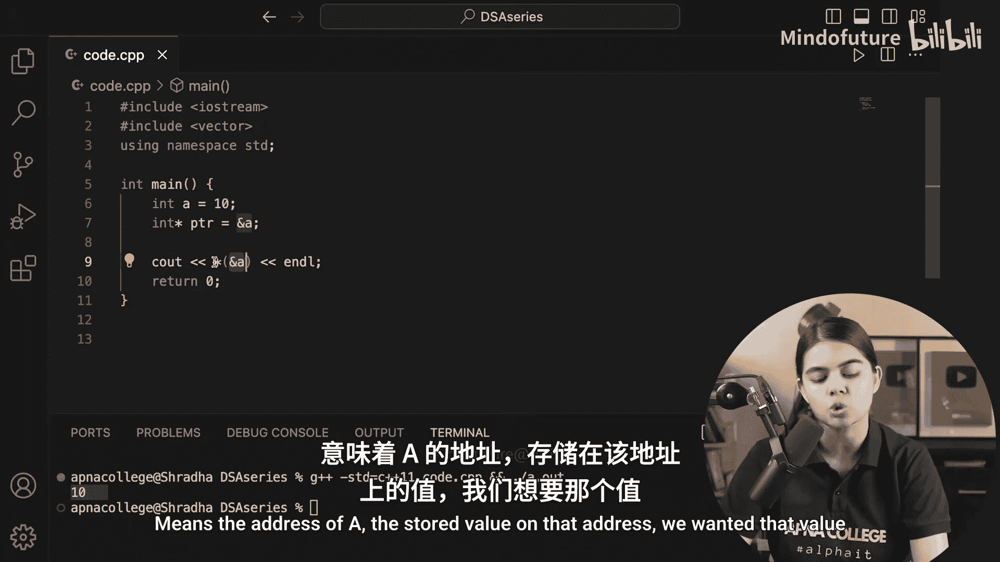

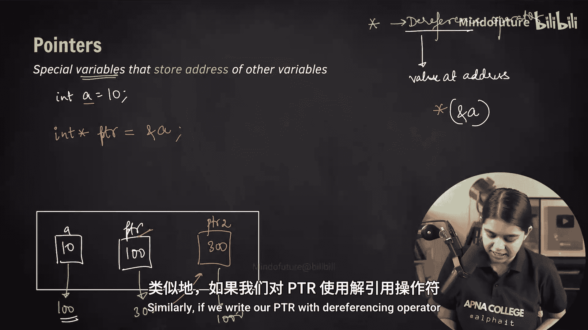

## 解引用运算符

解引用运算符 `*` 是操作指针的核心工具。它的作用是**访问指针所指向地址中存储的值**。

简单来说，如果指针保存的是一个地址，那么在该指针前加上 `*`，就能得到该地址中存放的实际数据。

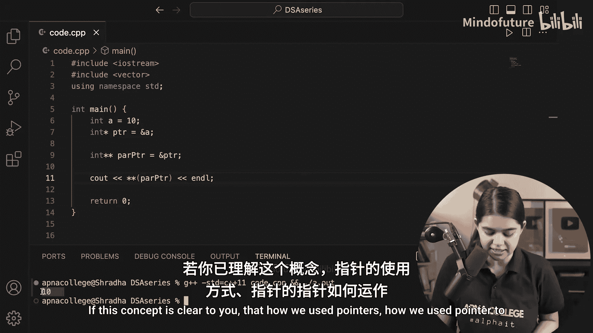


以下是解引用运算符的示例：
```cpp
int a = 10;
int* ptr = &a;

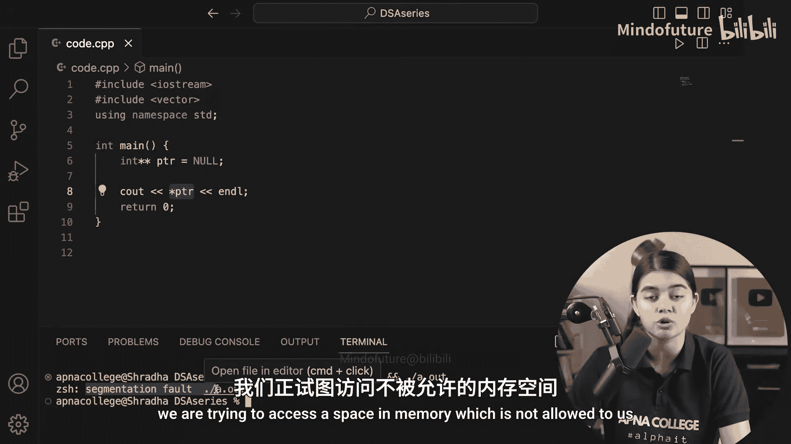

cout << “指针ptr存储的地址: ” << ptr << endl;
cout << “指针ptr指向地址中的值 (*ptr): ” << *ptr << endl; // 输出 10

// 通过指针修改其指向的值
*ptr = 20;
cout << “现在a的值是: ” << a << endl; // 输出 20
```
通过 `*ptr = 20;` 这行代码，我们直接修改了变量 `a` 的值。这展示了指针的强大能力：它允许我们间接地操作其他变量。

对于多级指针，解引用需要逐级进行：
```cpp
int a = 10;
int* ptr = &a;
int** pptr = &ptr;

cout << “**pptr 的值是: ” << **pptr << endl; // 输出 10
// **pptr 等价于 *(*pptr)，即先得到ptr，再得到a的值。
```

## 指针与数组

在C++中，数组名本身就是一个指向数组第一个元素（索引0）的**常量指针**。这意味着你可以像使用指针一样使用数组名。

以下是指针与数组关系的示例：
```cpp
int arr[5] = {1, 2, 3, 4, 5};

cout << “数组名arr的值（首地址）: ” << arr << endl;
cout << “第一个元素的地址 (&arr[0]): ” << &arr[0] << endl; // 与上一行输出相同


// 使用指针语法访问数组元素
cout << “第一个元素的值 (*arr): ” << *arr << endl; // 输出 1
cout << “第二个元素的值 (*(arr + 1)): ” << *(arr + 1) << endl; // 输出 2
```
`arr` 等价于 `&arr[0]`，`*(arr + i)` 等价于 `arr[i]`。这种等价关系是理解数组和指针运算的关键。

由于数组名是常量指针，你不能修改它的值（即不能让它指向别的地址）：
```cpp
// arr = &someOtherVariable; // 错误！数组名是常量，不能重新赋值。
```

## 指针算术运算

指针支持有限的算术运算，主要是加法和减法。这些运算的单位不是简单的数字1，而是指针所指向数据类型的大小（字节数）。

以下是常见的指针算术运算：
1.  **递增 (`++`) / 递减 (`--`)**: 指针移动到下一个/上一个同类型元素的位置。
2.  **加法 (`+ n`) / 减法 (`- n`)**: 指针向前或向后移动 n 个元素。
3.  **指针相减**: 计算两个指针之间相隔多少个元素。

以下是示例：
```cpp
int arr[5] = {10, 20, 30, 40, 50};
int* ptr = arr; // ptr指向arr[0]

ptr++; // ptr现在指向arr[1]
cout << “*ptr after ptr++: ” << *ptr << endl; // 输出 20

ptr = ptr + 2; // ptr现在指向arr[3]
cout << “*ptr after ptr+2: ” << *ptr << endl; // 输出 40

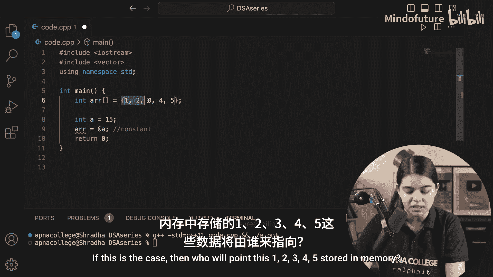

int* ptr2 = &arr[4];
cout << “两个指针之间的元素差 (ptr2 - ptr): ” << (ptr2 - ptr) << endl; // 输出 1 (因为ptr指向arr[3], ptr2指向arr[4])
```
**注意**：指针之间可以比较大小（比较地址高低），也可以相减得到元素个数，但不能进行加法、乘法等其他算术运算。

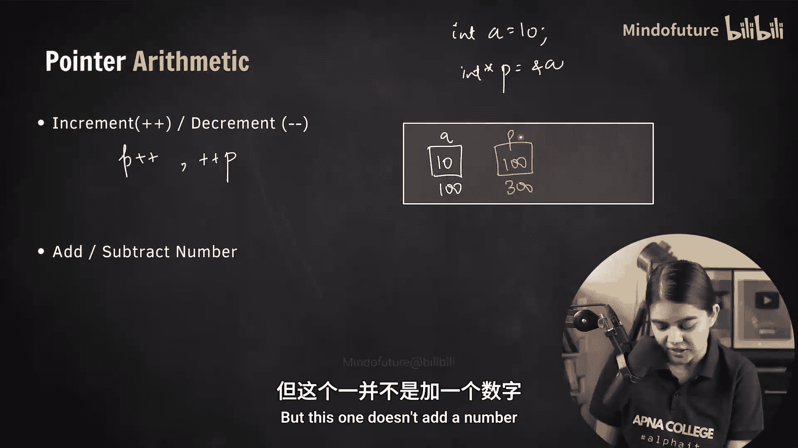

## 指针与函数（传引用调用）

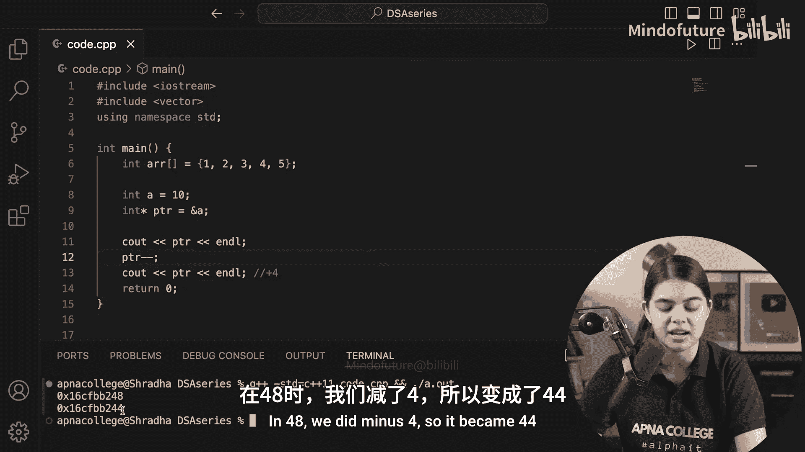

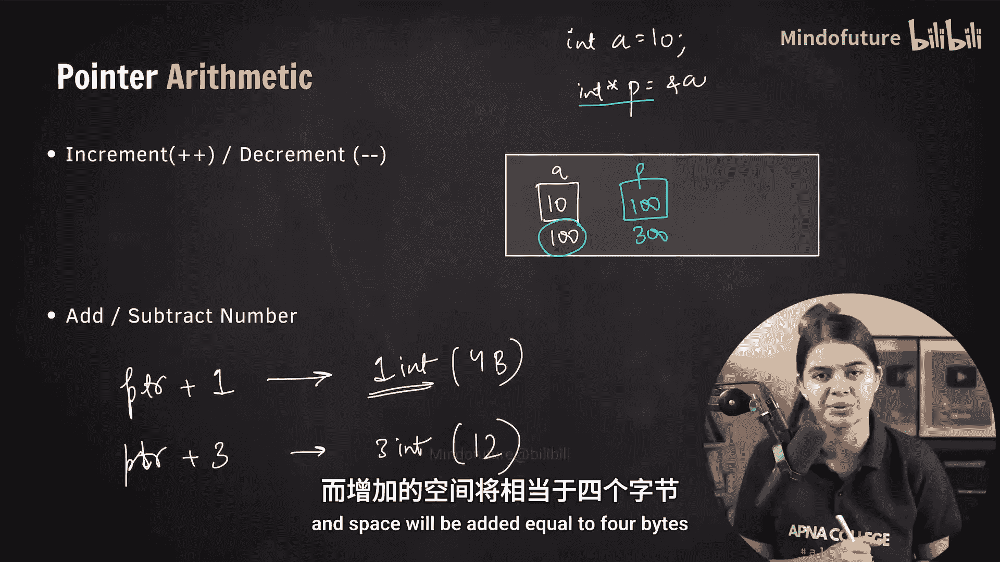

指针的一个极其重要的应用是在函数参数传递中实现“传引用调用”。这允许函数内部修改调用者传入的原始变量。

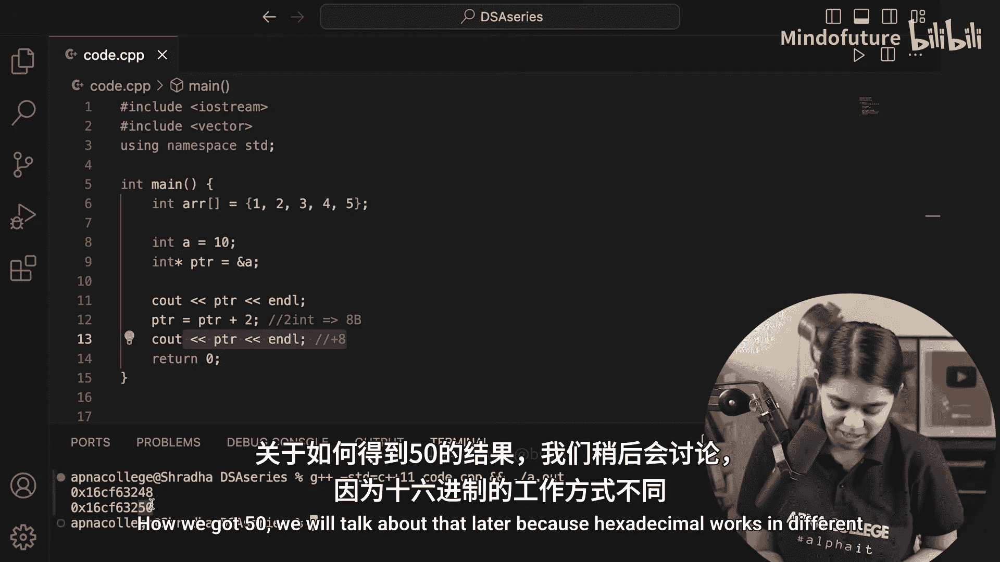

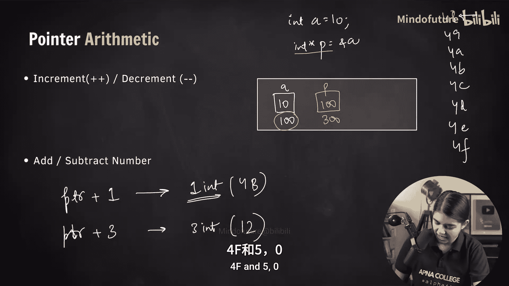

在默认的“传值调用”中，函数获得的是参数的一个副本，修改副本不影响原始值。

以下是对比示例：
```cpp
// 传值调用 - 无法修改原始值
void passByValue(int x) {
    x = 20;
}

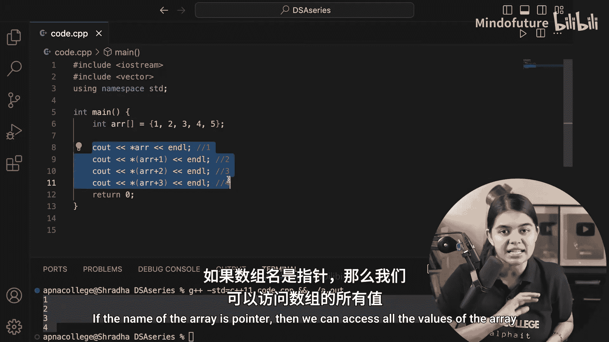

// 传引用调用（使用指针）- 可以修改原始值
void passByReference(int* xPtr) {
    *xPtr = 20;
}

int main() {
    int a = 10;

    passByValue(a);
    cout << “传值调用后 a = ” << a << endl; // 输出 10，未改变

    passByReference(&a); // 将变量a的地址传入函数
    cout << “传引用调用后 a = ” << a << endl; // 输出 20，已改变

    return 0;
}
```
在 `passByReference` 函数中，我们通过指针 `xPtr` 接收了 `a` 的地址，并通过解引用 `*xPtr` 直接修改了 `main` 函数中变量 `a` 的值。

除了指针，C++还提供了“引用”这一更简洁的语法来实现传引用调用，我们将在后续课程中学习。

## 总结

本节课中我们一起学习了C++指针的核心知识：
1.  **内存地址**：每个变量都有唯一地址，可用 `&` 运算符获取。
2.  **指针定义**：指针是存储其他变量地址的特殊变量，声明时使用 `*`（如 `int* ptr`）。
3.  **多级指针**：可以创建指向指针的指针（如 `int** pptr`）。
4.  **解引用运算符 `*`**：用于访问指针所指向地址中的值。
5.  **指针与数组**：数组名是指向首元素的常量指针，指针算术可用于遍历数组。
6.  **指针算术**：支持以数据类型大小为单位的加减运算，用于在内存中移动。
7.  **函数传引用**：通过传递指针作为参数，函数可以修改调用者的原始变量，这是实现高效编程的关键技术之一。


理解并掌握指针是深入学习C++和数据结构的基石。请务必动手练习代码示例，以巩固这些概念。