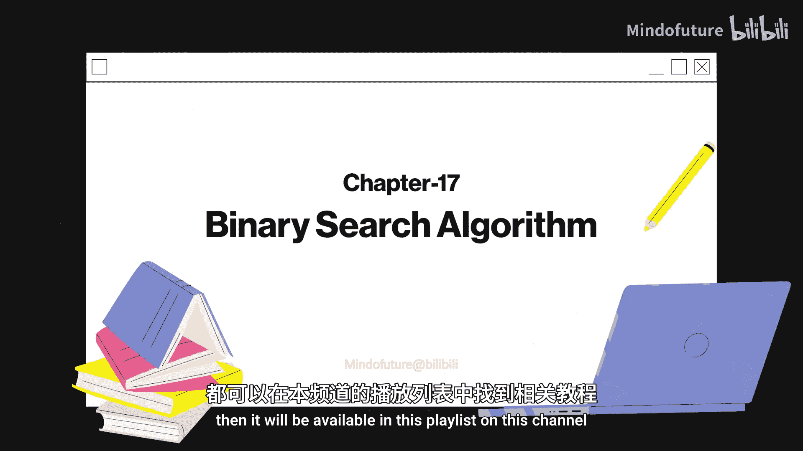
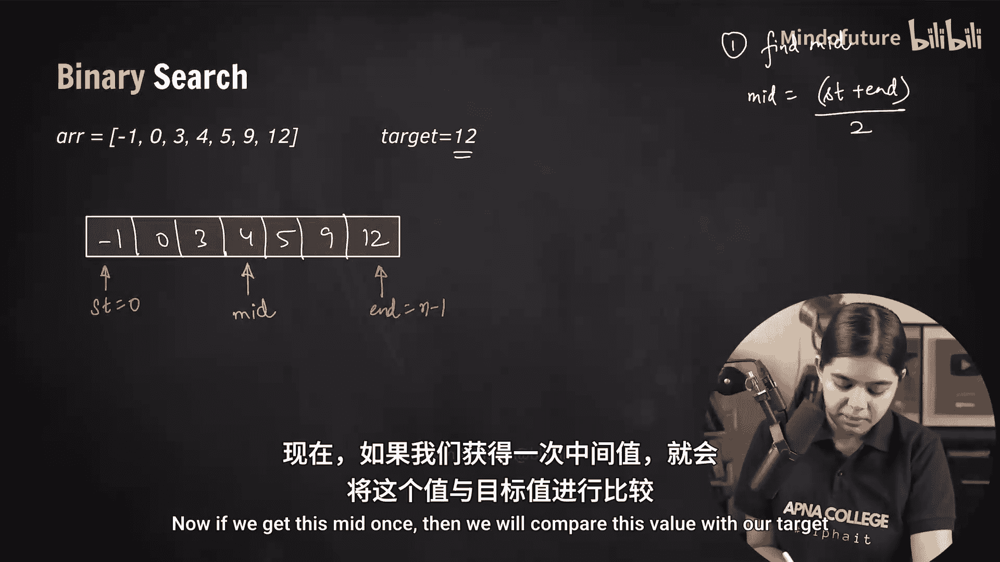
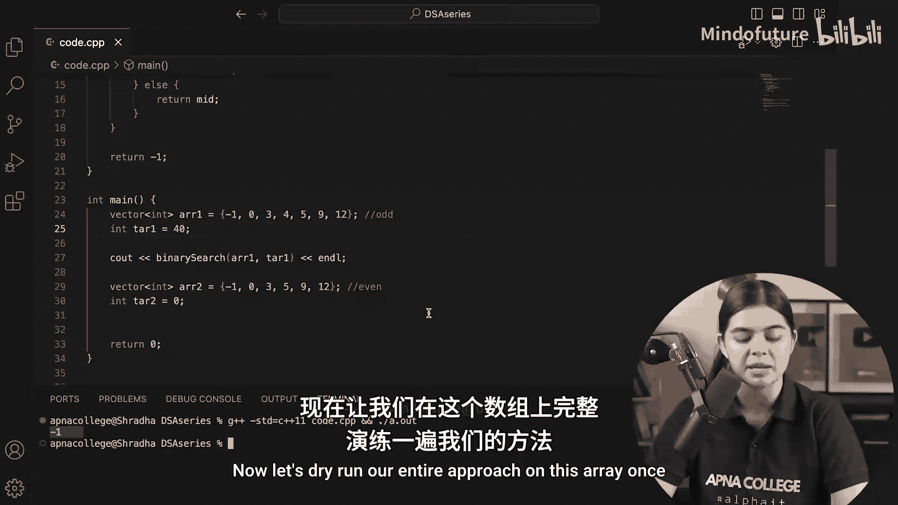
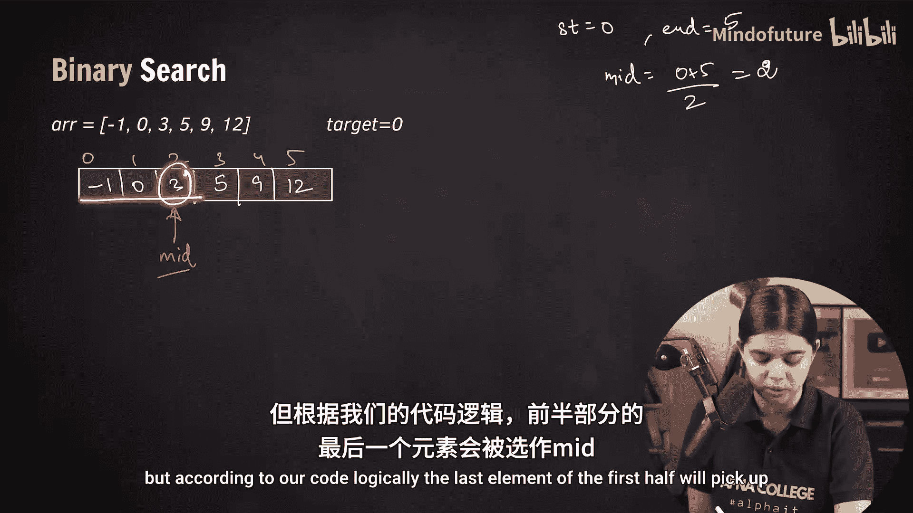
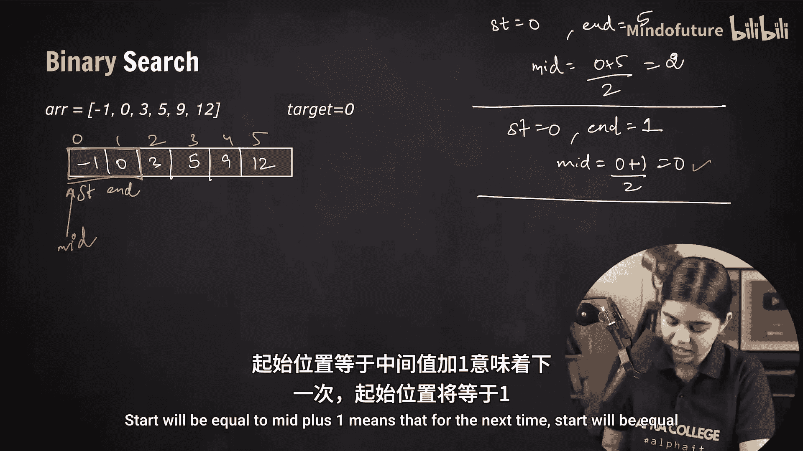
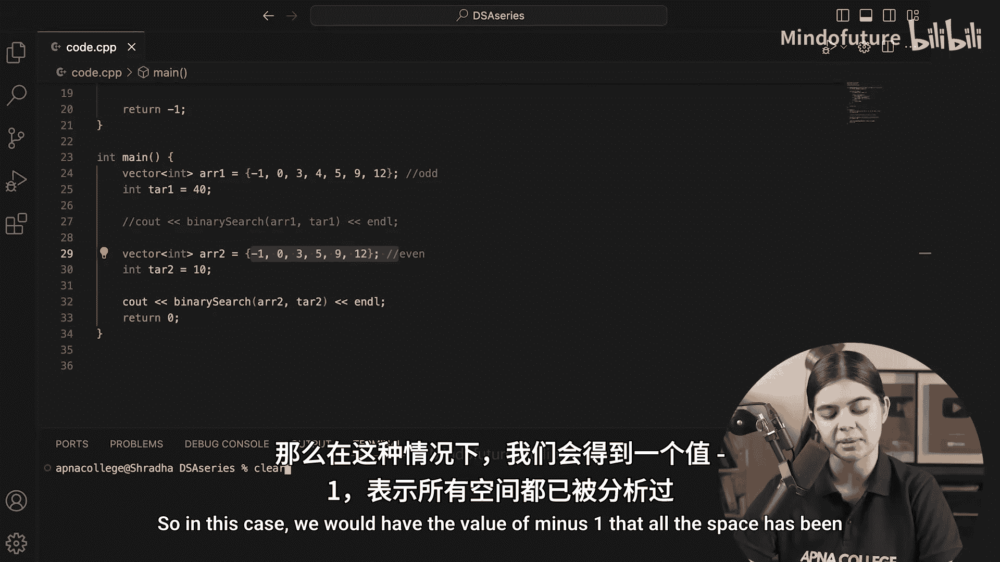
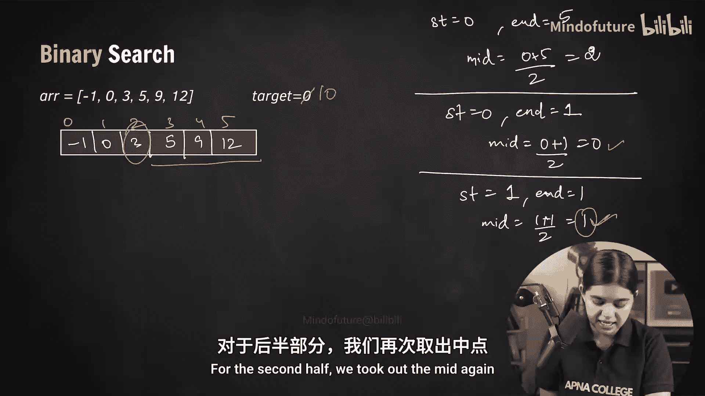
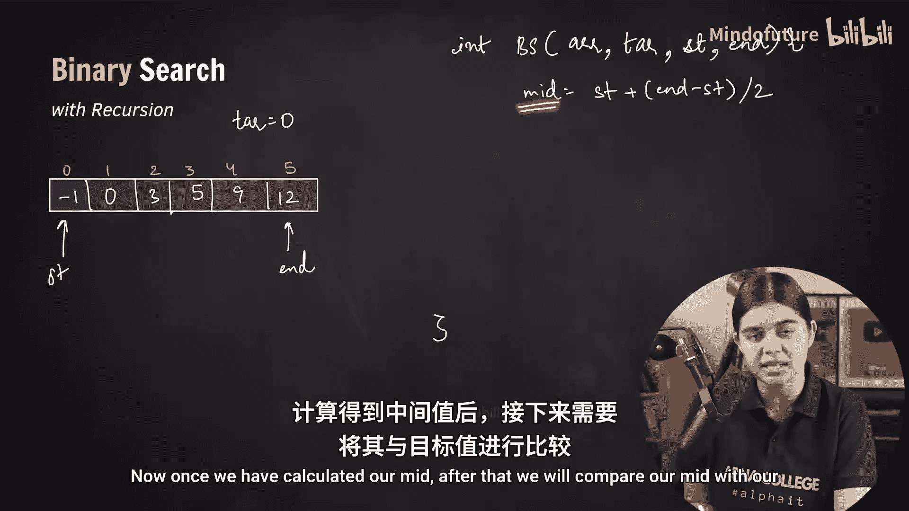
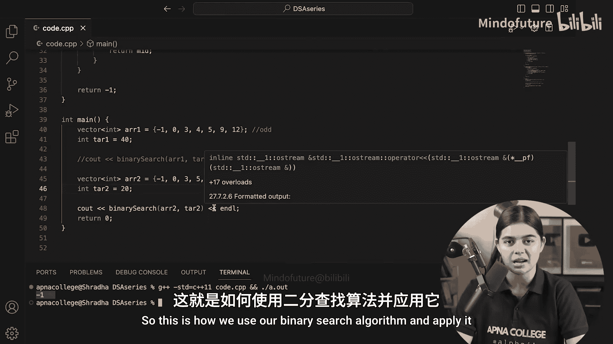
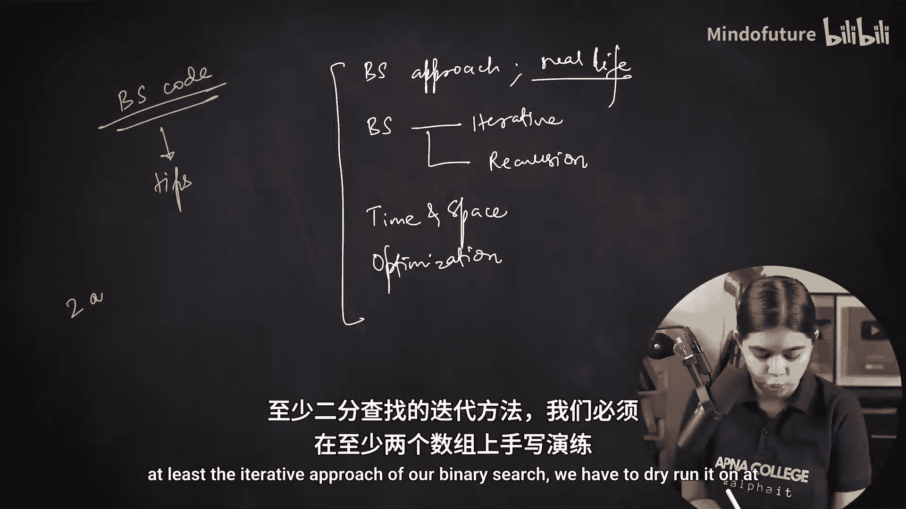

# C++-DSA课程-｜-数据结构-｜-leetcode-｜-Apna-College-｜--Complete-C++-Dsa-Course-p17-P17_二分查找算法-迭代和递归方法--理论_+_代码-附示例--BV18oUGBkEmV_p17-

Hi everyone and welcome to the complete DSA series just my Aju Pani about binary search algorithm。

 Abical DSA algorithm co your concept at Wami I channel Cooperper playless scanner available Mil Ja。

😊。

when we talk about binary search binary practically to understand the approach programming approach of and we are to analyze the and finally already know dictionary search for a words。

😊，diary we randomly open up the dictionary and diction examplectionary completely di dictionary randomly dictionary is a real life of let us talk about binary search algorithm in terms of programming。

Linear search algorithm simple algorithm linear search algorithm suppose elements10121 and5 equal suppose linear search algorithmjaja search complexity equalverse search which we call binary in terms of binary search algorithm log complexity as compared to this linear binary search linear search approach。

😊，binary search apply condition di that is binary2 and。

Moonic mono function follow monoonic function is a function which is non decreasing or non string given。

Eric K their Hamari， different， different to elements name， which is the Ri say。

And is or asc order number number and。😊，definitely and is always equal to plus n divided by asc asc。

it is greater logical。😊，A equal or values second condition case first and suppose third equal case my answer is going to equal to let us this。

😊，The logically and orbarham Iham second I。 This will be 5，9 and 12。😊，next。

is index So this is how our binary search works equal。😊，Agar ye midhe， Then this value is mid -1。

 and this value is mid plus1 to Hamraju first half he to first half Kaha Ja first half starts s Hamari mid1 Tja to Hamra of first half K B Eika Vohammia Us starts sre mid one T Ja and second half Kt Ja second half kar they came upper to second half Hammia mid plus1 sere Hamari endja y end value K the second half is always going to go from mid plus1。

😊，To the ending value or is equal similarly。Half of the array image command both key ham up and co update cur here to mid minus1 and is the re say update curvecur hamop me search space score half cur and search space code change curthe the binary search currently K is sp process quo。

😊，s01，2， and equal is is divided equal second equal and。😊。

The bar is Jaar mido calculate Kkaelbe is but start k is but start hookge 4 k equal。😊，And。

 which is equal to 6 is going to be 4 plus6 divided by equal equal equal is equal is plus equal answer equal is equal to。

😊，H join me up notice Kagiki answer find outne 1，2。

3 Thi comparisonsne area of Medi lake in agramm linear search0 comparisons a number of comparisons come Ca logically to to binary searchki approachgi binary search K andat。

 which is always equal to n minus-1。😊，than equal is equal equal。😊。

Kly checking him Agar Hamara target greater than Hojaai Hamari E of Medisi。😊。

Those case may have me second half me search kernel。

 second half me search can come at the be start to jaagon mid plus 1 k equal。😊。

else ifra targetja of those caseja mid equal or target target possible case directly return answer but lets or answer ingar is givens supposeja20 case Ni。

😊，-1 value indicating1 valid index is target is what our binary algorithm looks like。😊。

Bineary search binary search canander Iktohamna vector of integerane。

 let's call it E andmena binary searchparo and I n which is always n1 nari dothi value。

hamha value less than equal to N。 I hope equal toki less than less than equal to iskiki at the end worst case scenario value value equal Je12 orb n equalga single value。

😊，Subsy aham of to calculate callinging， which is start plus n。Divided by2。

Waskibalhamm me compard carrying it。Agarhamari target key value greater than Hojati E of Medii。

 Those case， mes second half research Kna Matlam my start is going to become equal to mid plus 1。

Else， if a target key value， Choti Ujaier array of Mii。

Those case may on my first half my search kai any end is going to be mid minus1。😊。

Or elseham third caseja or search itative test's test on this first vector out the result of binary search and target1。

😊，To end of line， though is a target2 cur there。Let's and run topa answer k equal。

 We already know this is index6 or target 12。 similarham targets suppose4 k equal case equal and 0，1。

2，3，3 v index4-1s suppose given equal let us draw this and。😊。

To yeari Erike elementzgi， ye inki index value Zzanggi and Shiwa Hamhamish Kai start is equal to 0 and is equal to n minus1 n minus1 Ya last index o 5 k equal。

😊，First step to start less than equal to is to be 0 plus divided by2。

 I understand even first is is and is is less equal divided by equal。😊。

St or equal targetgi is target target to01 target second half This is basically second half。😊。

And this is basically our first half the second half starja mid plus1 k equal start mid plus1 k equal next timeja1 k equal and end equal or end next and calculate is also going to be equal to1 is equal to which is equal to1 decide binary call。

😊。

And comment out I and let us save it and run。 So the answer is going to be equal to1ari equal to1 which equal to10 to second second0。

😊。

Bahar or Bahar to directly return Ho-1ham in valid conditionsja time complexity analyzene。

 I am going to talk about an important optimization binary basically mid calculatene I under worst case scenarioian platform to worst case scenario and to worst case scenario start in。

😊，Or endak end B in maxak Cam in teacher maximum value Kob a in teacher maximum value marry in teacherjo overflow。

😊，To inte key et capacity max maxgi casemepa overflow conditionc to problem here platform scja binary search solve for very large index valueappa wrong alternate formula use。

 which is。😊，Mid is equal to start plus n minus start divided by2 of formula e mathematically equal solve So this is going to be equal to2 plus minus divided by2 minus equal plus divided by mathematical subtract subtract overflow convert to this formula and that is how we optimize our code instead of writing this simply n minus divided by。

😊，Start and end value say aham mid calculate K tomemea is formally K instead of the normal one。

 So this is one optimization that we always have to do a big but time complexity analyze k binary k binary search time complexity analysis k。

 let's suppose a Mariip given size10 k equal。😊。

Agar is 10 size K error。😊，1 elements operations。😊，by。

La search logically at time complexity is equal to kick Ki operations Maari n value reduce hooker 1 k equals I de。

😊，N n divided by2 n by2 n divided by n divided by is n divided by is equal to n divided is equal equal n is equal。

log value k becomes equal to log n base2 and that is why the time complexity is big of log n eventually time complexity assume log and log time complexity complexity log time complexity time complexity constant time complexity of equal log time complexity。

😊，constantly time complexity and that is why it is rarely rarely optimized as compared to linear search and that is why binary concept programming can specifically thecur and。

😊，omic function inte binaryip andika and and available binary sub to always find out the mid value mid calculation plus end minus divided by2 mid target。

😊。

meari target value mid say of mid say case second theari target value of mid third caseino comparisonari value greater than of mid。

😊，Those we need to search in the second And if this is myvalue second and will be replaced mid and。😊。

second。😊，Second case。😊，case equal equal is equal to0 and equal is than equal plus equal and equal to1 next。

On next bar calculate calculate mid is going to be equal to 0 plus1 divided by20 k equal calculate is next call second start is and end equal next and mid third is going to be equal to。

😊，1 plus1 divided by。😊，lets call it and values and values is it and。😊，Those sub Hammna Clahi。

 if start is less than equal to n。A of name mid calculate current。

 which is start plus n minus start divided by2。sab of conditions go check if target is greater than。

😊，Ery of mid， Those case may have a search Knaop me。

Second half can second half can the search K Laham return King recursive binary search for a target。

 second half k La start is barja mid plus 1。😊，And in。Else。

 if v case kakga target key value less than her area of midi。 to this case。

 mayham me search K have first half can first half can the search K comela here。😊。

I a copy girl y return girl game starts ar。Mid1 value or which is to be equal to or and or and is equal and very similar to what we done with binary in of。

😊。

I the case a real life can the binary searcher algorithm co already use kt Ihi Anidiuskyia binary searchka iterative。

😊，also analyze the time and space complexity of。

was your part is the learned today's lecture。😊。