# C++ 数据结构与算法课程：P17：二分查找算法 🎯


## 概述
在本节课中，我们将要学习一种非常高效且重要的搜索算法——二分查找。我们将从理解其基本概念开始，逐步学习其工作原理、应用条件，并分别用迭代和递归两种方法来实现它。最后，我们会分析其时间复杂度和空间复杂度。

---

## 二分查找的概念与条件

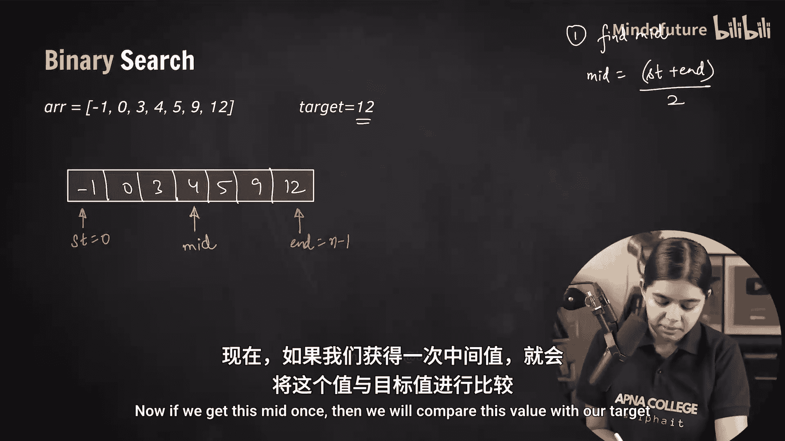

上一节我们介绍了线性搜索，本节中我们来看看二分查找。二分查找是一种在**有序数组**中查找特定元素的算法。

它的核心思想是每次比较都使搜索范围缩小一半。为了应用二分查找，数组必须满足一个关键条件：**数组必须是单调的**。单调函数是指非递减或非递增的函数。在编程中，这通常意味着数组是按升序或降序排列的。

**核心条件公式：**
`数组必须有序（升序或降序）`

---

## 二分查找的工作原理

理解了应用条件后，我们来看看算法是如何工作的。二分查找通过不断将搜索区间对半分割来工作。

以下是二分查找的基本步骤：
1.  确定当前搜索区间的起始点（`start`）和结束点（`end`）。
2.  计算中间点的索引（`mid`）。
3.  将目标值（`target`）与中间点的值（`arr[mid]`）进行比较。
4.  根据比较结果，将搜索区间缩小到左半部分或右半部分，或者直接找到目标。

**核心比较逻辑（代码描述）：**
```cpp
if (target > arr[mid]) {
    // 目标在右半部分
    start = mid + 1;
} else if (target < arr[mid]) {
    // 目标在左半部分
    end = mid - 1;
} else {
    // 找到目标，返回索引 mid
    return mid;
}
```

---

## 迭代法实现二分查找

现在，让我们用代码来实现迭代版本的二分查找。迭代法使用循环来重复执行查找步骤。

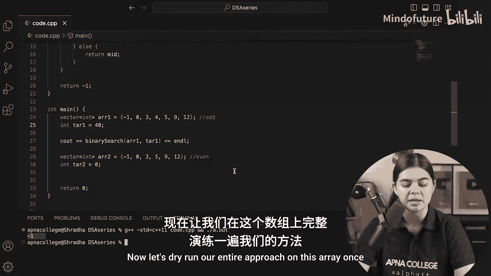

以下是迭代法实现的步骤：
1.  初始化 `start = 0`， `end = n-1`（n为数组长度）。
2.  当 `start <= end` 时，执行循环：
    a. 计算中间索引 `mid`。为避免整数溢出，使用公式 `mid = start + (end - start) / 2`。
    b. 比较 `target` 与 `arr[mid]`。
    c. 根据比较结果更新 `start` 或 `end`。
3.  如果循环结束仍未找到，返回 `-1` 表示未找到。

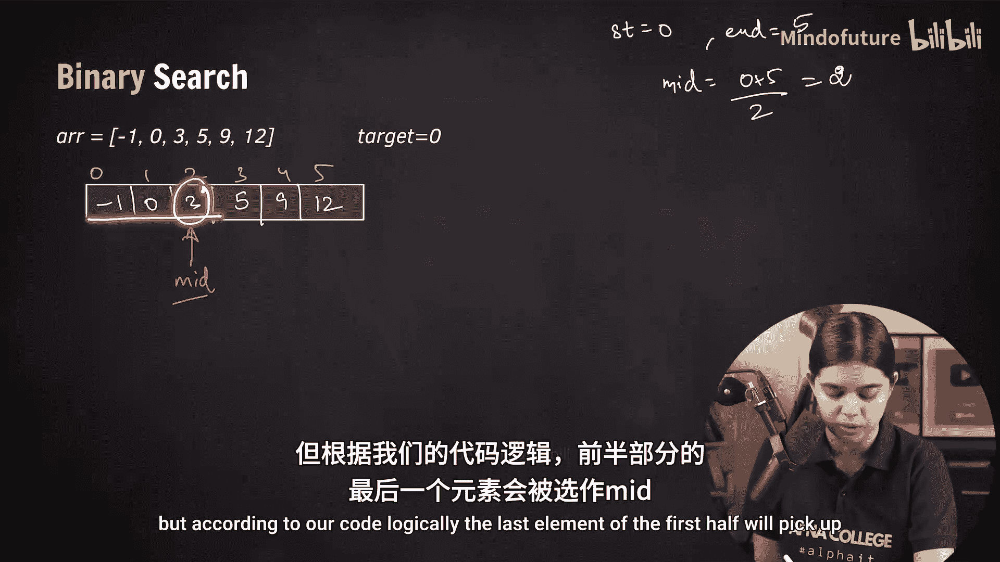

**迭代法代码示例：**
```cpp
int binarySearchIterative(vector<int>& arr, int target) {
    int start = 0;
    int end = arr.size() - 1;

    while (start <= end) {
        // 防止溢出的中间值计算
        int mid = start + (end - start) / 2;

        if (target > arr[mid]) {
            // 搜索右半部分
            start = mid + 1;
        } else if (target < arr[mid]) {
            // 搜索左半部分
            end = mid - 1;
        } else {
            // 找到目标
            return mid;
        }
    }
    // 未找到目标
    return -1;
}
```

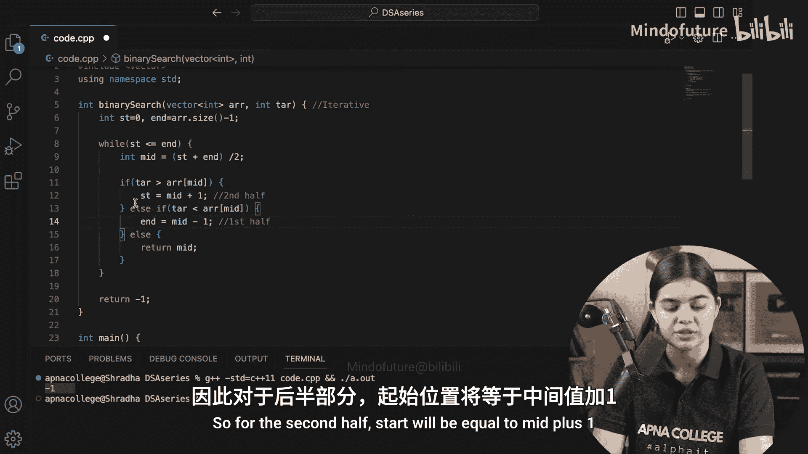

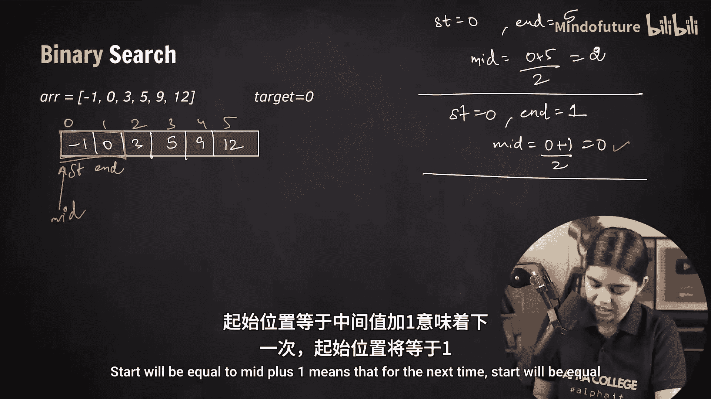

---

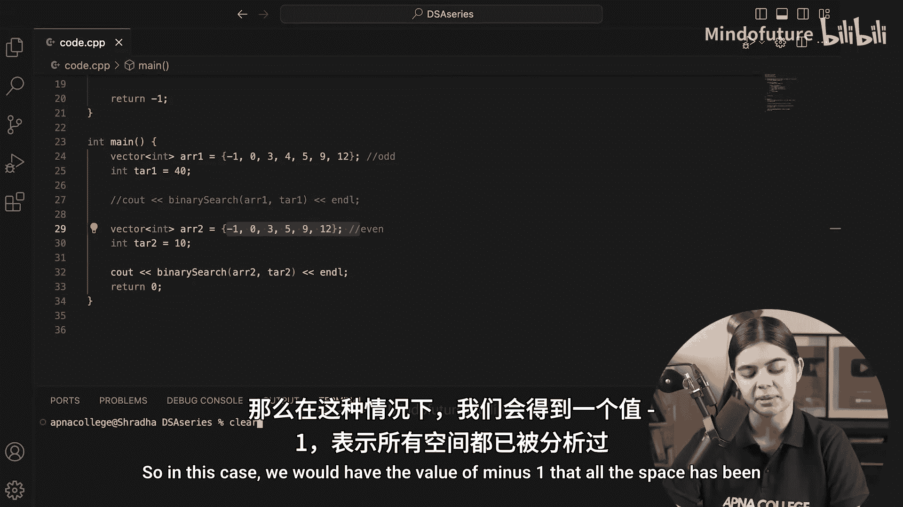

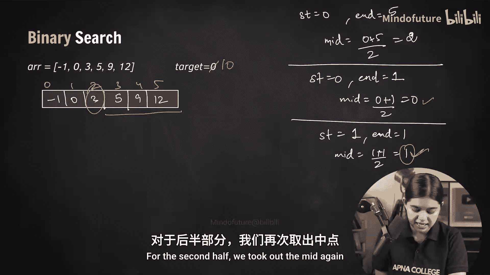

## 递归法实现二分查找

上一节我们使用循环实现了二分查找，本节中我们来看看如何用递归实现。递归方法将问题分解为更小的子问题。

递归实现的逻辑与迭代法类似，但通过函数自身调用来缩小搜索范围。

**递归法代码示例：**
```cpp
int binarySearchRecursive(vector<int>& arr, int target, int start, int end) {
    // 基准情况：搜索区间无效
    if (start > end) {
        return -1;
    }

    int mid = start + (end - start) / 2;

    if (target > arr[mid]) {
        // 在右半部分递归搜索
        return binarySearchRecursive(arr, target, mid + 1, end);
    } else if (target < arr[mid]) {
        // 在左半部分递归搜索
        return binarySearchRecursive(arr, target, start, mid - 1);
    } else {
        // 找到目标
        return mid;
    }
}
// 调用时：binarySearchRecursive(arr, target, 0, arr.size() - 1)
```

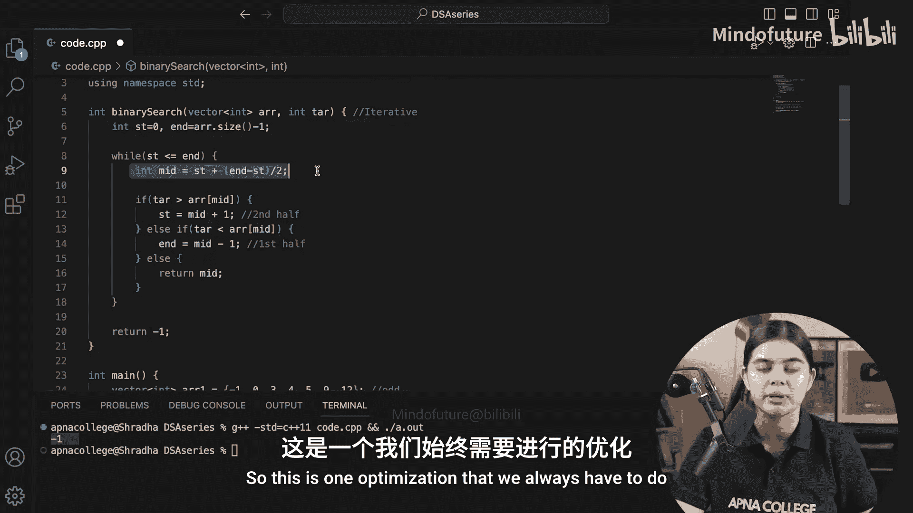

---

## 复杂度分析与优化

我们实现了两种方法的二分查找，现在来分析其效率。二分查找之所以高效，是因为它每一步都将数据规模减半。

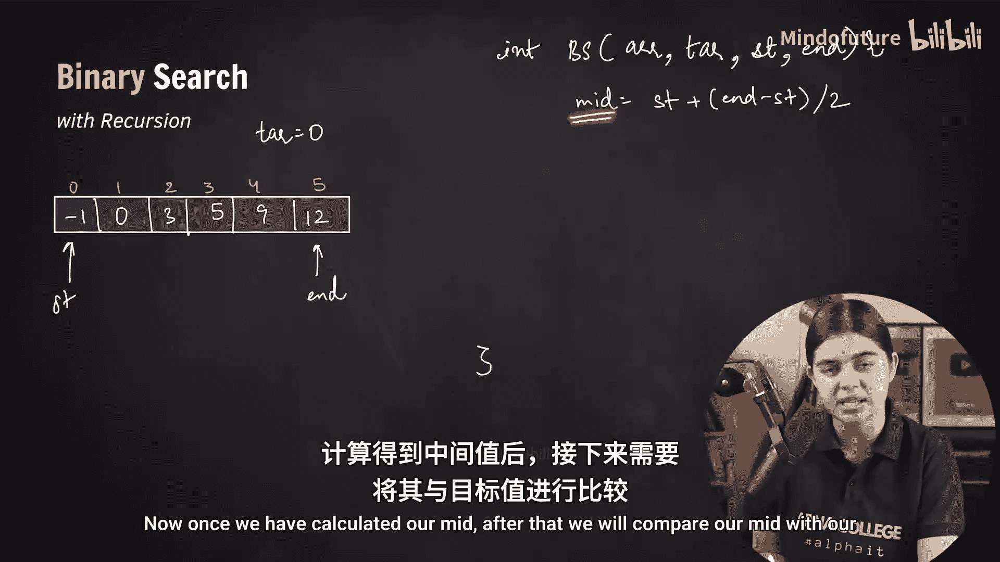

**时间复杂度分析：**
最坏情况下，二分查找需要执行的步骤次数是将数组长度 `n` 不断除以 2，直到结果为 1。这可以表示为 `log₂(n)`。
因此，二分查找的**时间复杂度是 O(log n)**。这远优于线性查找的 O(n)。

**空间复杂度分析：**
*   **迭代法**：只使用了固定的额外空间（几个变量），因此**空间复杂度是 O(1)**。
*   **递归法**：由于递归调用会在调用栈上占用空间，最大深度为 `log n`，因此**空间复杂度是 O(log n)**。

**重要优化点：**
计算中间索引 `mid` 时，使用 `mid = start + (end - start) / 2` 而不是 `(start + end) / 2`，可以防止 `start + end` 的值超过整数类型最大值时发生溢出。这是一个在处理大数据集时必须注意的优化。

---

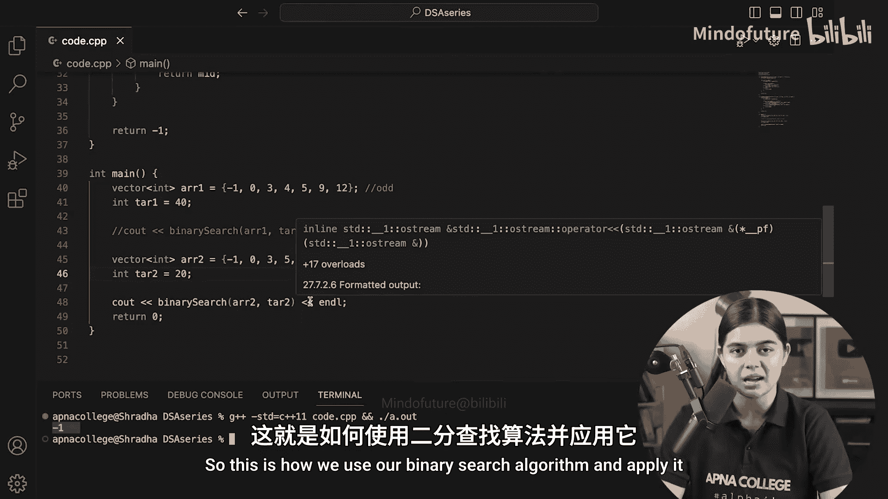

## 总结

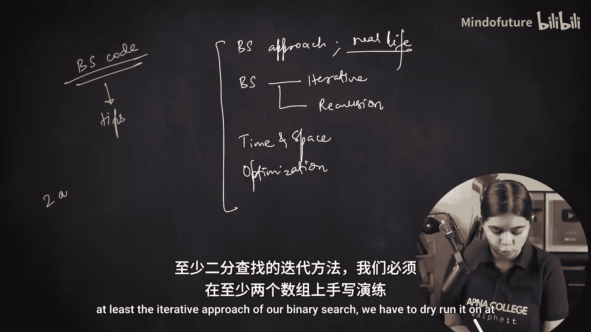

本节课中我们一起学习了二分查找算法。
我们首先了解了二分查找的应用前提是数组必须有序。
然后，我们深入探讨了其“折半查找”的核心工作原理。
接着，我们分别使用**迭代**和**递归**两种方法实现了二分查找，并提供了完整的代码示例。
最后，我们分析了算法的时间复杂度为 **O(log n)**，空间复杂度迭代法为 O(1)，递归法为 O(log n)，并强调了防止计算中间值时整数溢出的重要优化技巧。
二分查找是解决许多搜索问题的基础，理解并掌握它对于学习更复杂的数据结构和算法至关重要。