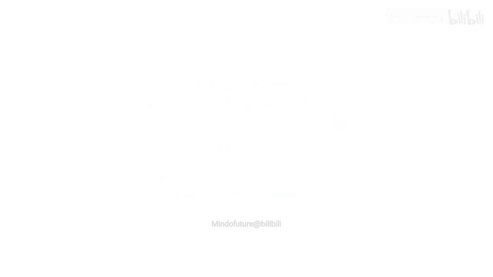
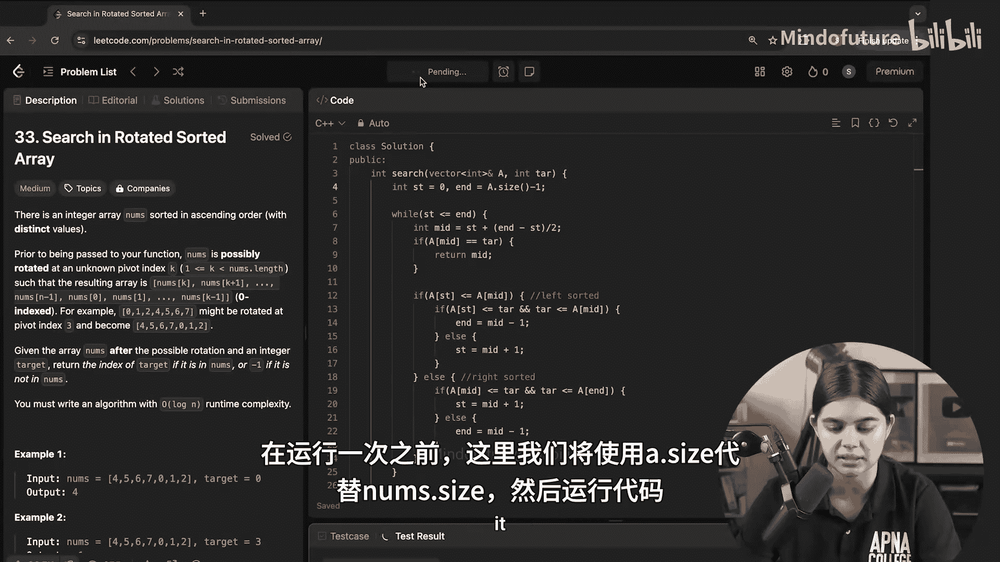

# C++-DSA课程-｜-数据结构-｜-leetcode-｜-Apna-College-｜--Complete-C++-Dsa-Course-p18-P18_搜索旋转排序数组-二分查找-Leetcode_33--BV18oUGBkEmV_p18-

everyone welcome to the complete important question which is search in let's talk about our question This question is called searchc12345 and。

😊。

this is going to be use and programming。😊，binary optimize log complexity as compared to exact problem3。

😊，s does。😊，A given is perm normal binary la to normal binary search first step to calculate calculate formula plus n minus divided by2 generally formula plus n divided by2 like E optimization is optimization called lecture or is this is going to be the start。

 This is going to be the end value sub simple step to Second step of equal。😊，is always true。

To sorted， like in year 3，4，5 to sorted hair to merajo binary search elbow voice is left half k per lu satai。

 The binary search conditions may use k women left half per use k。

 What Im trying to say is the Agarhamic rotated salted Ericrikibakaam。

 Those Ericri and the Yatohamra left half salted o。😊，Y Hammehamra， right half salted o example we。

 is Ericriki Ba toeraham rightmera halfed I seegar Eric， let's supposeia 60，70，1020，30，40 and 50。

 Yato。😊，value is going to be the and that is right isbb。is is basically than equal，right equal。

Let's suppose Ie isded e and value calling this is going to be the mid value next step to identify halfed right halfed mu is6。

7，0 to 2，3，4，5 sorted halfed halfed right halfed。😊。

K rotated sorted eri a left half sortedm value halfed is 6，7，0，1 6，7，8。

9 hammi9 valley elements single direction follow to left half sorted key condition array of star value less than array of as than equal to to yea condition half sort condition fall Ho。

😊，overall we are going to start with two values a kja 0 k equal a k njaga n minus1 k equal。😊。

Yma initialization caafa loop Chii y the star key value less than equal to n here the the subs polyop node mid calculate calling it mid is going to be start plus。

😊，And minus star divided by two Ferram compare Kligiki K Hamara array of mid。

Haari target equal area mid target case answer halfed half halfed halfed of value less than equal to area of equal to unique elements given But for the sake of simplicity equal condition left sort。

😊，Or Agaa toels value condition Hujaigiri， right half。

Agar left half sorted head to left Hu binary search apply Karinggi。

 left Ho binary Research apply Kaham Kringgi， Kikiia Hamari Eri of Stari。😊。

But target and less than equal to area of mid and search mid equal in normal binary search and I opposite right mid plus equal Similarlyly right second。

😊，And if of mid greater than equal to and less than equal to of n is to equal is this is not directly it is modified of function function。

😊，Start Lta initialized with 0 aa n Lta initialized with nus dot size minus-1。

Amed loop Chilan headju the kari star key value less than equal to n he subsopummed calculate calling here mid is going to be equal to start plus n minus start divided by2。

😊，Sub chkaariovni aof isqui in fact，me na this time we want Agar Hamari E of mediky value。

 Hamari target K equal。 let us rename it as target。

 Those case may answer already but medical return G Na me left half sorted right half sorted left half a sorted U to E of start key valueja less than equal to E of meat。

😊，The Yke Soaihamari left Soed Onika and Iika El vaque Sohamri。😊。

Right sorted onica left sorted valley casemate left by buying research applyering a Yaa array of start is less than equal to target and array of y。

Target is less than equal to E of mid A left Jalara and updateja to-1 and Iika right right starja mid plus1 equal Similarlyly。

 right half sorted to right half binary apply carrying it right half binary apply E of mid C greater than equal tohamra target and is target going to be less than equal to E of and A right right start is going to be equal to mid plus1。

😊，Else on my left J Yni end is going to be equal to mid-1。

Toaririkiri approaching upper Kamojagi Agar abi answer email that last my return calling a 1 value。

 So this is the entire code to apply modified binary search to search in a rotated sorted array justk time complexity log in K runness nus dot size8 or size and let's run it。

😊。

And submit it tomorrow solution， Joveo accept to gap lecture quagri is successfully complete career so we can mark our attendance in the comments。

 And you can also share your progress with me on Twitter just calling up Kniche descriptionscript box Cans Zigga。

 Ask your late time in the next video and tell them keep learning and keep it story。😊。

