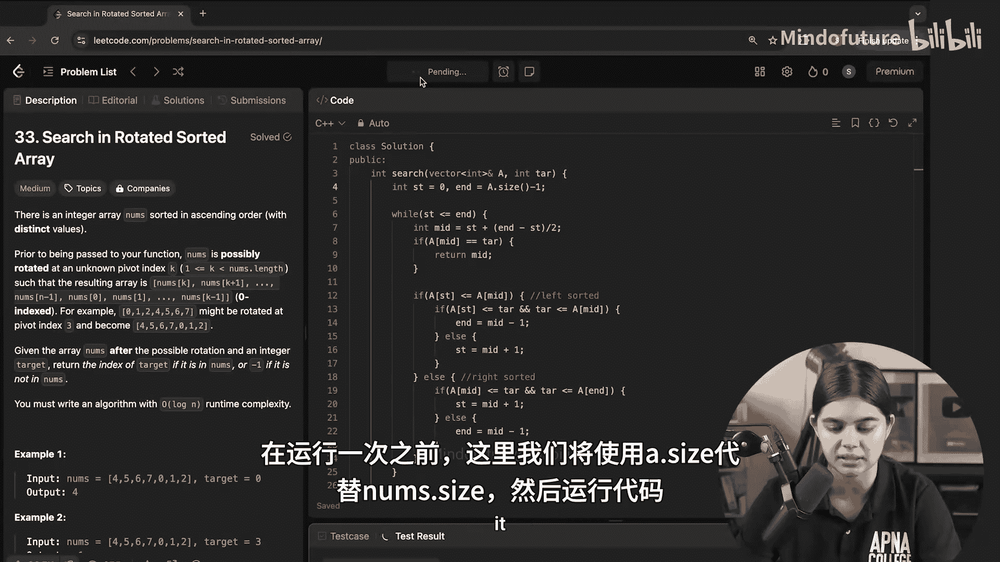

# C++ 数据结构与算法课程：P18：搜索旋转排序数组 - 二分查找


在本节课中，我们将学习如何在一个旋转过的有序数组中进行搜索。这是一个经典的面试问题，我们将使用一种修改过的二分查找算法来解决它，以达到 O(log n) 的时间复杂度。

---

## 问题描述

问题名为“搜索旋转排序数组”。给定一个在某个未知下标处旋转过的升序数组 `nums` 和一个目标值 `target`，如果目标值存在于数组中，则返回其下标，否则返回 `-1`。

例如，数组 `[4,5,6,7,0,1,2]` 是在下标 3 处旋转得到的。我们需要高效地搜索目标值。

## 核心思路：修改二分查找

普通的二分查找要求数组完全有序。对于旋转排序数组，虽然整体无序，但它的**一半总是有序的**。我们的策略是：
1.  找到中间元素 `mid`。
2.  判断左半部分 `[start, mid]` 或右半部分 `[mid, end]` 是否有序。
3.  检查目标值 `target` 是否位于有序的那一半范围内。
4.  根据判断结果，将搜索范围缩小到左半部分或右半部分。

以下是该算法的详细步骤。

### 算法步骤详解

以下是实现修改版二分查找的具体步骤：

1.  **初始化**：设置两个指针，`start = 0` 和 `end = nums.size() - 1`。
2.  **循环条件**：当 `start <= end` 时，执行循环。
3.  **计算中点**：使用公式 `mid = start + (end - start) / 2` 计算中点下标，防止整数溢出。
4.  **检查是否找到**：如果 `nums[mid] == target`，直接返回 `mid`。
5.  **判断有序部分**：
    *   如果 `nums[start] <= nums[mid]`，说明**左半部分是有序的**。
        *   接着检查 `target` 是否在这个有序的左半部分内：即 `nums[start] <= target && target < nums[mid]`。
        *   如果是，则将搜索范围缩小到左半部分：`end = mid - 1`。
        *   否则，目标值在右半部分：`start = mid + 1`。
    *   否则，说明**右半部分是有序的**。
        *   接着检查 `target` 是否在这个有序的右半部分内：即 `nums[mid] < target && target <= nums[end]`。
        *   如果是，则将搜索范围缩小到右半部分：`start = mid + 1`。
        *   否则，目标值在左半部分：`end = mid - 1`。
6.  **循环结束**：如果循环结束仍未找到目标值，则返回 `-1`。

### 代码实现

根据上述逻辑，我们可以写出如下 C++ 代码：

```cpp
class Solution {
public:
    int search(vector<int>& nums, int target) {
        int start = 0;
        int end = nums.size() - 1;

        while (start <= end) {
            int mid = start + (end - start) / 2;

            if (nums[mid] == target) {
                return mid;
            }

            // 判断左半部分是否有序
            if (nums[start] <= nums[mid]) {
                // 目标值是否在有序的左半部分内
                if (nums[start] <= target && target < nums[mid]) {
                    end = mid - 1; // 在左半部分搜索
                } else {
                    start = mid + 1; // 在右半部分搜索
                }
            } 
            // 否则，右半部分有序
            else {
                // 目标值是否在有序的右半部分内
                if (nums[mid] < target && target <= nums[end]) {
                    start = mid + 1; // 在右半部分搜索
                } else {
                    end = mid - 1; // 在左半部分搜索
                }
            }
        }
        return -1; // 未找到目标值
    }
};
```

### 复杂度分析

*   **时间复杂度**：O(log n)，其中 n 是数组长度。我们每次都将搜索范围减半。
*   **空间复杂度**：O(1)，只使用了常数级别的额外空间。

---



## 总结

本节课我们一起学习了如何解决“搜索旋转排序数组”问题。关键在于利用**旋转排序数组的一半总是有序的**这一特性，对标准二分查找进行修改。我们通过判断有序部分，并检查目标值是否落在该范围内，来高效地缩小搜索范围，最终在 O(log n) 时间内找到答案或确认其不存在。请务必理解并掌握这个算法的核心判断逻辑。