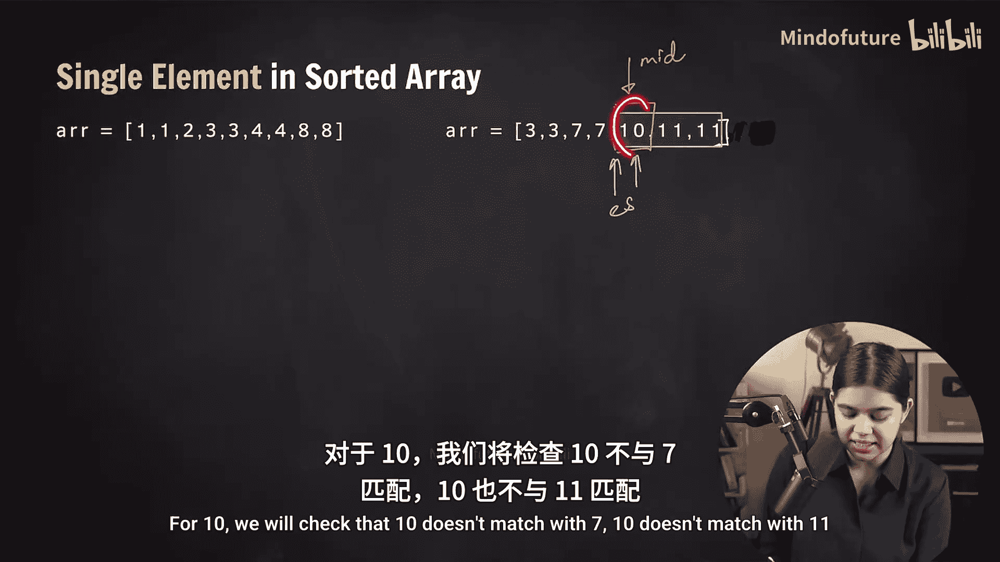

# C++-DSA课程-｜-数据结构-｜-leetcode-｜-Apna-College-｜--Complete-C++-Dsa-Course-p20-P20_有序数组中的单一元素-二分查找-DSA系列_第20讲--BV18oUGBkEmV_p20-

Hi everyone and welcome to the complete series important question。

 which is to find the single element in a sorted let's about the question element in a sorted This question is also problem 40 on twice we have to return from the order answer is to equal to similar should not。

😊，Per is may her a element exactly though by， but element attend egg bar。

 So our answer is going to be equal to 10。 So the a single element of sorted E ident herself this question solve k multiple approaches exist Kaari brute force project to linear。

😊，basically element solution。😊，Mus run in log complexity and divided by。

Start plus n by 25ta pers optimization here overflow could prevent kernel Gclum formula use cut there。

😊，And second value coaches target normal binding can mid value identify of of mid single element match mid value andgi mid this is pretty straightforward。

😊，Ey of mid。Is not equal to of1 and not equal to of。is the most important part in solving problem。😊。

important third step which is to pick。Or because of this extra single element example Ipa odd number of elements example2 I number of elements because it makes sense or B equal number of elements right side equal number of elements example is side equal number of elements right side may be equal number of elements which is equal to logical perfect duplicates exist perfect duplicate element or exactly a or duplicate。

😊，extra single value existlogical logical even number of right number of is number of right number of simply with its previous and。

😊，equal case part even number of elements is is number elements is right right number of of that is equal to of mid number of。

😊，that is logic we are trying to number，To caseari left right parts may even number of elementsb previousb right So this is the logic Jo right binary and right part even number of elements exist right part number of elements exist for example is2。

3，4，5，6，7 elements exist can draw the boundary it is going to be this value number of elements odd number of elements case second case very similar to this and right number of elements number of elements elements。

😊，E or even or right is absolutely true right right。😊，right。

and right number of elements right logical is equal and is not equal in。😊，second third。

To identify even number of elements right number of elements is equal to number of elements number of elements equal number right。

😊，Under and end updateing time carry start is mid is to be equal to2 element2 match right2 is the mid element or return not value but of single element return we are going a start value of 0 and an end value of n-1。

😊，Bil binary start less than equal to n is going to be equal to star plus n star divided by2 of is not equal to of and this is also not equal to m plus of number elements number elements mod2 is equal to0 number and odd number elements number of elements。

😊，equal。or right and that is how we are。is equal to0 k and0s supposepo elementb is not equal to case second case second case equal to and。

😊，Agar Yahihia， single element single element Valley Kek。😊，'s suppose value 7 k equal 66，554。

4 is not going to equal to n return more thing。😊，exist So this is the overall logic is am going to rename。

😊，This nus as a though sub up na nan， which is the size of R to a do s O and up subta base case handle n value10 those case key A start laying initial with0 a n lay initialized with n1。

😊，A Mac loop Chala thingy the kari star key value less than equal to n H sub to men nialing mid is going to be equal to start plus n minus start。

😊，Divided by two， here I'm check curlling it。😊，U inno co cases， Ka any other mid key value。

0 and array of 0 is not equal to array of 1。 Those case maham answer array of mid value E of0o key value sameto co case is co case A n-1 n-1 k case maym n-1 and n2 co compare Agar answer array of mid and third case。

😊，Which is this case， Ja may answer Miluk， whose case me I'm checking a U array of mid minus1 is not equal to array of mid。

😊，C al if this is not equal to and of mid is also not equal to array of mid plus case be case of mid is equal to previous may right。

😊，Lether of， left hitther of Johnny among the way and is equal to mid plus 1。

 I hope I me Ya even key condition head， even me Yama left v case。😊。

and this is the overall logic Jo to apply binary in log equal let us now run So this is how we solve our problem of single element in sort。

😊，right。😊，😊。

We have successfully completed the lecture I comment1 that we have successfully completed yet we are done with the lectureva you can also share your progress with me on Twitter regarding the DSS series justcom scan Bo questions are a concept on Twitter description Me experiment then keep learning and keep exploring。

😊。