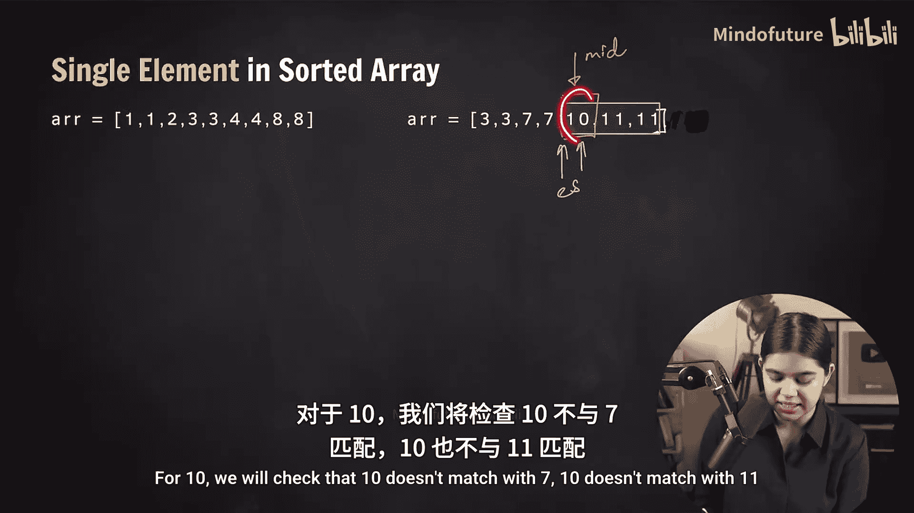

# C++ DSA课程：P20：有序数组中的单一元素 - 二分查找


在本节课中，我们将学习如何在一个有序数组中找到只出现一次的元素。这是一个常见的面试问题，要求我们设计一个时间复杂度为 O(log n) 的解决方案。

## 问题概述

给定一个有序数组，其中每个元素都出现两次，只有一个元素出现一次。我们需要找到这个单一元素。

例如，在数组 `[1, 1, 2, 3, 3, 4, 4, 8, 8]` 中，数字 `2` 只出现了一次，所以答案是 `2`。

## 解决方案思路

解决这个问题有多种方法。最直接的方法是使用线性搜索，但时间复杂度是 O(n)。为了满足 O(log n) 的要求，我们必须使用二分查找。

二分查找的核心在于每次将搜索范围减半。在这个特定问题中，关键在于观察单一元素如何破坏了数组的“成对”模式。

## 关键逻辑与步骤

以下是使用二分查找解决此问题的核心逻辑。

首先，我们定义搜索的起点和终点：
```cpp
int start = 0;
int end = n - 1; // n 是数组长度
```

在二分查找的循环中，我们计算中间索引 `mid`。为了防止整数溢出，推荐使用以下公式：
```cpp
int mid = start + (end - start) / 2;
```

接下来是最重要的部分：判断 `mid` 指向的元素是否是单一元素。单一元素的特征是它不等于它的前一个元素，也不等于它的后一个元素。
```cpp
if (nums[mid] != nums[mid-1] && nums[mid] != nums[mid+1]) {
    return nums[mid];
}
```

如果 `mid` 不是单一元素，我们需要决定是向左半部分还是右半部分继续搜索。这取决于单一元素位于哪一侧。

判断逻辑基于单一元素左右两侧元素数量的奇偶性。由于数组原本是成对出现的，单一元素的存在会使其一侧的元素数量为奇数，另一侧为偶数。

以下是决定搜索方向的逻辑：
1.  如果 `mid` 是偶数索引，并且 `nums[mid] == nums[mid+1]`，那么单一元素在右侧。否则，单一元素在左侧。
2.  如果 `mid` 是奇数索引，并且 `nums[mid] == nums[mid-1]`，那么单一元素在右侧。否则，单一元素在左侧。

这个逻辑可以简化为：检查 `mid` 与它配对元素的关系，从而确定被破坏的“成对”模式在哪一边。

## 边界情况处理

在实现时，需要特别注意数组的边界，即 `mid` 为第一个或最后一个元素的情况。

以下是处理边界情况的代码片段：
```cpp
// 检查 mid 是否为第一个元素
if (mid == 0 && nums[mid] != nums[mid+1]) {
    return nums[mid];
}
// 检查 mid 是否为最后一个元素
if (mid == n-1 && nums[mid] != nums[mid-1]) {
    return nums[mid];
}
```

## 完整算法流程

现在，让我们将以上步骤整合成一个完整的算法。

1.  初始化 `start = 0`, `end = n-1`。
2.  当 `start <= end` 时，执行循环：
    a. 计算中间索引 `mid = start + (end - start) / 2`。
    b. 检查 `mid` 是否为单一元素（处理边界情况）。
    c. 如果不是，则根据 `mid` 索引的奇偶性及其与相邻元素的关系，更新 `start` 或 `end` 以缩小搜索范围。
3.  循环结束后，返回找到的单一元素值。

## 总结



本节课我们一起学习了如何在有序数组中使用二分查找寻找单一元素。我们分析了问题的核心在于单一元素破坏了数组的成对结构，并据此设计了判断逻辑来指导二分搜索的方向。通过处理索引奇偶性和边界情况，我们实现了一个高效且健壮的 O(log n) 解决方案。


本节课程到此结束。建议大家动手实现代码，并尝试在 LeetCode 上提交练习。你可以将学习进度分享到 Twitter，描述中提供了相关链接。继续学习，继续探索。