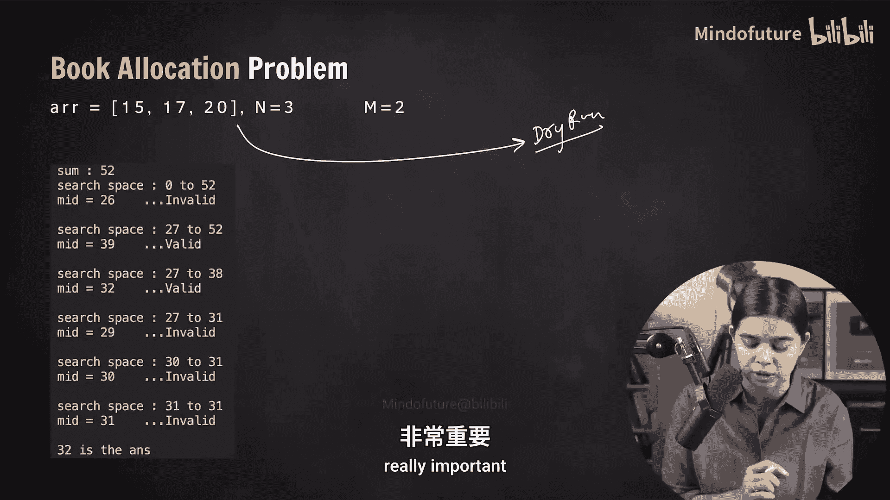

# C++-DSA课程-｜-数据结构-｜-leetcode-｜-Apna-College-｜--Complete-C++-Dsa-Course-p21-P21_书籍分配或分配书籍问题-DSA系列-二分查找--BV18oUGBkEmV_p21-

Hi everyone and welcome to the complete DS series important binary search question。

 which is called book allocation problem concept available placement common S sheet can if you want you can use that S sheet for placement internship preparation sheet description book is a very important problem based on binary search and this is a hard level interesting or number of pages or number of pages 10 pages in second 20 pages 3 pages 4 pages in books code。

😊。

number of students is equal to maximum number of pages allocate be single third。and。😊。

Suth casear the Marias M is equal to two students。😊。

Sub students first and equal1 plus3 plus4 equal escape number of pages 2 is number of pages 8ne second12 number of pages3 number pages 。

😊，Third the Rika allocation car， his student1 goham starting kitine books today。

And student2 last value total number of pages  total number of pages conditions main conditions satisfying maximum number of pages I first maximum number of pages  second maximum number of pages 7 third maximum number of pages  maximum number of pages minimum minimum possible maximum and minimum value that is going to equal to out。

number of greater than for one particular minimum possible maximum。

Pages value number of pages manner binary instead of directly applying to this problem possible。

minimum and maximum minimum number number。P caras sum。 So this is going to be equal to sum of。

All pages minimum number of maximum number of。1，2，3，4，5，6，7，8，9 and10 possible。

Se original binary search possible answer key per minimum and maximum valid and possible binary binary。

is then you'll be able to find out the answer value in。😊。

minimum pages value maximum value this is going to be the end。😊，number right。minimum。is equal。

Mar answer valid here invalid Val Ham medically check， I the mid valid or is it invalid。

 If Caques khoga， if Caqueshogahama valid Cacais and Ika El Cacashogahama。😊，Inval cookies。

b proper plus or answer which or。😊，function or。😊，Second with。plus maximum。Allloud。Bes。

number plus is equal to0 than n plus or。😊，So is this pages plus area of I I this less than equal to are allowed pages Agarier allowed pages say come。

 Those case me to allocation allocation student k value area of I value。Leking a的 힘。

number of pages plus which equal number of in't number of students。😊。

Equal to M whose case may answer return true valueuous allocation is function function important condition to find the valid answer allowed pages value pages。

😊，Individual page key value greater than Hoge maximum allowed pages C。Those。

In fact solution wrong solution solution or invalid。

Codepa already given he vector I n or M value andas function values available most probably it is going to give you all test cases minimum maximum minimum maximum sub I is equal to0 I less than n I plus。

😊，Mar is sum plus equal to area of ioigam。Toaratojaai 0 k equal Hamara n Hojaga Hamari sum K equal thearipa possible answerki I range Agae。

 This is a range of。Possible answers Ahammi range gave per binary such apply or give a possible answer to find out。

😊，Those scm loop Chiing ayptahamra start less than equal to n H thetak mid find out curl midkalam has start plus n minus start divided by2 Aam check carrying a ka Hamra mid a valid answer。

 here T function maning is just mayna every pass second justma up N M and upna midpa sec。

 And we can see if our mid is a valid answer。 Ari asked it true are。😊。

false or answer is to be equal is going to equal to answer answer equal1 answer equal important condition doing is greater than know return。

😊，K sum find out cur range find out colour and binary is valid function is complete kna say we create cur this is going to be a boolean function is valid。

 Just scan the yes parameter topa Sa May， we have an additional parameter called mid I see me change cur K value maximum allowed。

😊，Pages but a maximum allowed pages like the I By he a mid value maximum allowed pages kill a sub number of students they call equal to 0。

 her student capacity kidney pages equal to 0。 In fact。

 have8 student ca start shouldpa8 student in justcom pages allocate can in a contiguous manner。😊。

F loop。I equals 0 i less than n I plus less。Subse Abna coroner case Corroner case is basically this value。

 Ye important H case head Kigarbiaja E of I value greater than Hoja maximum out pages Those case may answer ho to false return By cases may ye value。

😊，K value less than equal to maximum allowed pagesgi pages can current value plus equal to area5 orza plus。

😊，In fact， for simplicity， I am going to call it students says students again there students who curdo plus less and pages go re initialize Kto to E Any near student a iscapacive area of I number of pages。

😊，JCaf for loop Kaboga La Meam Kingi， key Agar Hamari the number of students in Oski value greater than M H。

😊，operator if solution is correct or not。K time complexityja big of log n into n tohamari overall your code G time complexity here that is going to be big off log n into n jaer n key value the total number of books that we have and a capital n range U binary search like So this is how we compute the time complexity of our possible solutionbar save and run。

😊，Haapjo answer I ahead。 that is equal to 6 a very upper M K valueapus 5 k equal o T。

 Those case may answer aipas 1 k equal at a core possible E K isangam 1517 and 20。

 Ex me n is equal to 4 and M is going to be equal to 2。 Ex me Hamrajo answer Wche 32 k equal。😊。

So let us and the answer is equal to 32 problem3 to tricky that is is。

or finally maybeari values this is not just an individual question Bi same approach approach for complete you can write completed in the comments also share your progress with me on Twitter and。

😊。