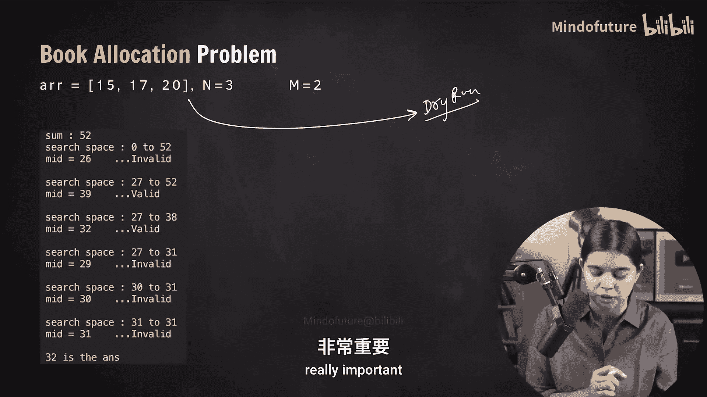

# C++ 数据结构与算法课程：P21：书籍分配问题（二分查找应用）

在本节课中，我们将学习一个基于二分查找算法的重要且常见的问题——书籍分配问题。这是一个在技术面试中频繁出现的难题，我们将一步步拆解其核心思想与实现方法。


## 概述

书籍分配问题的核心是：给定一个包含多本书页数的数组，以及一定数量的学生，我们需要以连续的方式将这些书分配给所有学生。目标是**最小化分配给任意一个学生的最大页数**。换句话说，我们希望最“忙碌”的学生所读的页数尽可能少。

## 问题理解与思路分析

假设我们有一个页数数组 `[10, 20, 30, 40]`，以及 `M = 2` 名学生。

我们需要将所有书连续地分配给这两名学生。例如：
*   分配方案1：学生1得到 `[10]`，学生2得到 `[20, 30, 40]`。此时，单个学生的最大页数是 `max(10, 90) = 90`。
*   分配方案2：学生1得到 `[10, 20]`，学生2得到 `[30, 40]`。此时，最大页数是 `max(30, 70) = 70`。
*   分配方案3：学生1得到 `[10, 20, 30]`，学生2得到 `[40]`。此时，最大页数是 `max(60, 40) = 60`。

我们的目标是找到所有可能分配方案中，这个“最大页数”的最小值。在这个例子中，答案就是 `60`。

直接遍历所有分配方案会非常低效。我们可以利用二分查找来优化。

**核心思路**：我们并非直接二分查找书籍的分配方式，而是二分查找“可能的最大页数”这个答案。

1.  **确定搜索范围**：
    *   **下限 (start)**：至少有一本书会被分配，所以下限是数组中的最大单本书页数。因为任何学生分配到的页数都不能少于他所拿到的最厚的那本书。
    *   **上限 (end)**：最坏情况下，所有书都分配给一个学生，所以上限是所有书页数的总和。

2.  **二分查找过程**：
    *   取中间值 `mid`，它代表我们当前假设的“允许分配给单个学生的最大页数”。
    *   我们需要验证：在每名学生分配到的页数不超过 `mid` 的前提下，能否用 `M` 名学生分配完所有书籍。
    *   如果能够分配完，说明 `mid` 是一个可行的上限，那么真正的答案可能等于或小于 `mid`。我们将搜索范围的上限 `end` 缩小到 `mid`。
    *   如果不能分配完，说明 `mid` 这个上限太严格了，我们需要放宽限制。我们将搜索范围的下限 `start` 提高到 `mid + 1`。
    *   重复此过程，直到找到最小的可行 `mid` 值，即为答案。

## 解决方案实现

以下是实现该算法的关键步骤与代码。

### 验证函数 `isValid`

这个函数用于判断在给定的“最大页数限制”下，能否完成分配。

```cpp
bool isValid(vector<int>& arr, int n, int m, int maxPages) {
    int studentsRequired = 1;
    int currentPageSum = 0;

    for (int i = 0; i < n; i++) {
        // 如果单本书页数已超过限制，直接不可能
        if (arr[i] > maxPages) {
            return false;
        }

        // 尝试将当前书加入当前学生的分配中
        if (currentPageSum + arr[i] <= maxPages) {
            currentPageSum += arr[i];
        } else {
            // 当前学生已达页数上限，需要新开一名学生
            studentsRequired++;
            currentPageSum = arr[i]; // 新学生从当前这本书开始

            // 如果所需学生数已超过给定人数 m，则分配失败
            if (studentsRequired > m) {
                return false;
            }
        }
    }
    return true; // 分配成功
}
```

### 主函数 `findPages`

这个函数执行二分查找，寻找最小的最大页数。

```cpp
int findPages(vector<int>& arr, int n, int m) {
    // 如果书少于学生数，无法分配
    if (n < m) return -1;

    int totalSum = 0;
    int maxElement = 0;

    // 计算搜索范围：下限和上限
    for (int i = 0; i < n; i++) {
        totalSum += arr[i];
        if (arr[i] > maxElement) {
            maxElement = arr[i];
        }
    }

    int start = maxElement; // 下限：最厚书的页数
    int end = totalSum;     // 上限：总页数
    int result = -1;

    while (start <= end) {
        int mid = start + (end - start) / 2; // 当前假设的“最大页数限制”

        // 检查 mid 是否是一个可行的分配方案
        if (isValid(arr, n, m, mid)) {
            // 可行，尝试寻找更小的限制（向左搜索）
            result = mid;
            end = mid - 1;
        } else {
            // 不可行，需要增大限制（向右搜索）
            start = mid + 1;
        }
    }
    return result; // 返回找到的最小可能的最大页数
}
```

### 复杂度分析

*   **时间复杂度**：`O(N * log(Sum))`。其中 `N` 是书籍数量，`Sum` 是所有书的总页数。二分查找的复杂度是 `O(log(Sum))`，每次验证需要 `O(N)` 时间。
*   **空间复杂度**：`O(1)`，只使用了常数级别的额外空间。

## 示例与测试

让我们用之前的例子 `[10, 20, 30, 40]`, `M=2` 来验证。
*   搜索范围：`start = 40`, `end = 100`。
*   二分查找会最终收敛到答案 `60`。

再考虑一个例子 `[12, 34, 67, 90]`, `M=2`。
*   最终答案应为 `113` (分配方案：`[12, 34, 67]` 和 `[90]`)。

## 总结



本节课我们一起学习了**书籍分配问题**。我们掌握了如何将这类“最小化最大值”的问题转化为对答案本身的二分查找。关键在于：
1.  确定答案的合理搜索范围（下限和上限）。
2.  编写一个高效的验证函数 `isValid`，用于判断某个中间值是否可行。
3.  利用二分查找框架不断缩小范围，直至找到最优解。

这种方法（对答案进行二分查找）是解决许多复杂优化问题的强大技巧，值得深入理解和掌握。