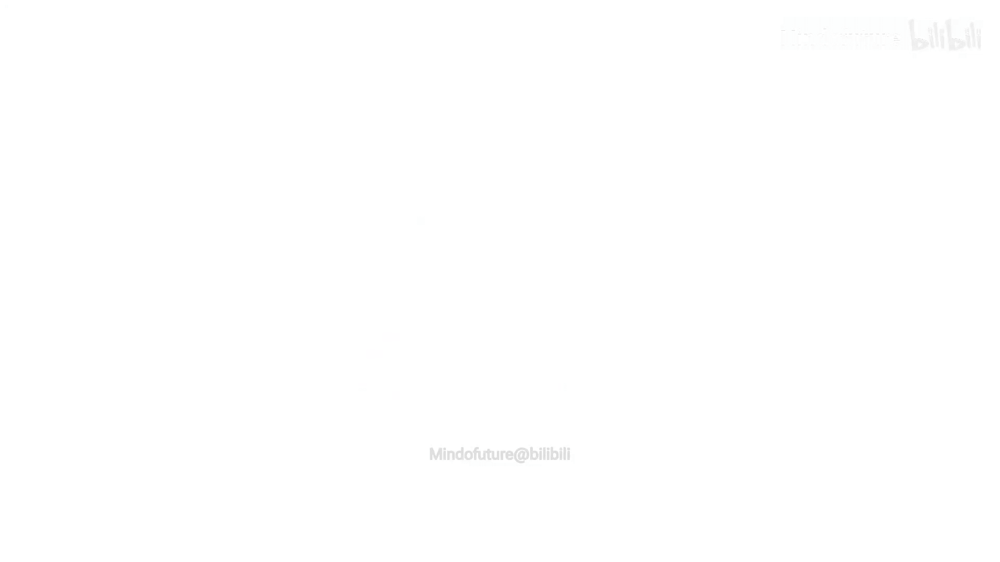
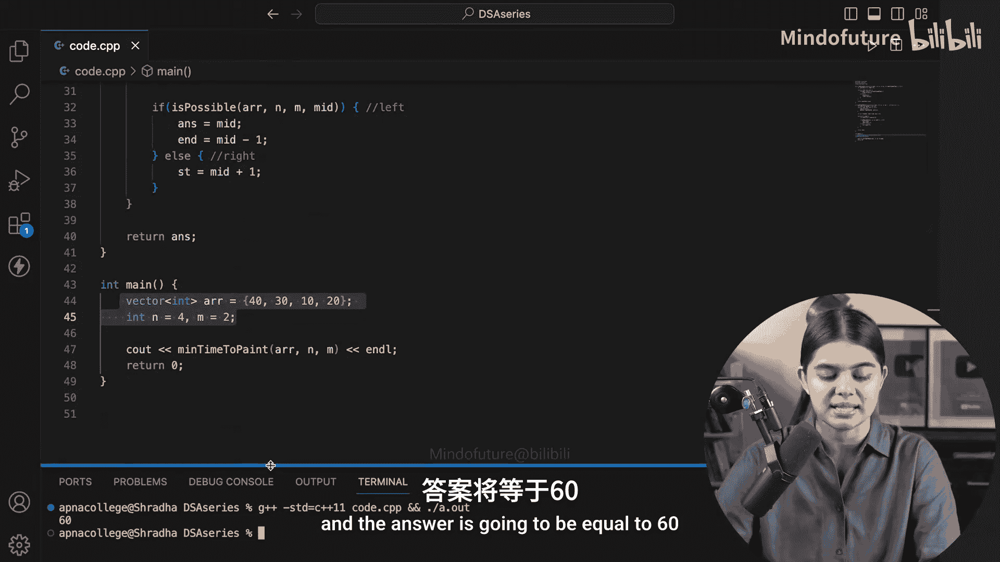

# C++-DSA课程-｜-数据结构-｜-leetcode-｜-Apna-College-｜--Complete-C++-Dsa-Course-p22-P22_油漆匠分区问题-DSA就业系列-二分查找-第22讲--BV18oUGBkEmV_p22-

Hi everyone and welcome to the complete important problem called the painters partition problem and also we have prepared along with let's start with problem is called partition is a direct of lecture So if you have watched the lecture given length in is equal example。

😊。

I caseak me we are given M painters or M painters a that said the guy has such that her painter a unit of time me a unit of Boko paint her time。

😊，examples suppose paint10 minutes equal The task is to minimum time paint using is equal to such will only paint continuous sections third continuous。

😊，paint second220 minutes minimum will equal to 20 is going to advise pause and to solve equal is equal to is not problem and task is all of。

Among these two painters of solution basically need to find time to paint the boards and is minimum value or units3 plus 1 20 equal6 units second first0 units second3 units second units20 units value minimum。

M6 second first case minimum。riari possible values given him。😊。

in paint minimum time or maximum time logical minimum and maximum time anyway maximum given maximum So what is the value of the maximum that is going to be 40 plus 30 plus 10 plus 20 equal to units maximum is also equal to the sum of all length says and minimum minimum time logical。

😊，Definitely hypothet say this is equal to maximum value of all length problem。😊。

minimum value and maximum value basically range given answer is my answer minimum time to paint these for example。

 minimum only two painters definitely this minimum time is not possible in this question or in this minimum value possible value to be。

708090 and is going to equal and is going to be equal sum rules by divided by。

is going to be equal to 40 plus0 divided by2 any equal 70 7 second step upon this is possible answer。

depending upon equal。come5 possible non right。😊，mid equal next search is but change to approximately this time time and that value is equal6262 and similarly2 is not applied applied on the range of possible find is to equal to。

Paximum ofa E and Hamjo ending value Hogi。 that is going to be equal to sum of E Sa kmic answer variable lay sec just to initialize minus1 k。

Ahammiabna loopstar Kanah Jeptk。Plain old binary is less than equal to n is equal to plus n divided by logic or and last as the answer。

value possible answer Jos is equal to 70 and 54 k value value painters use mid value is basically maximum allowed time。

😊，7。painter 20 minutes or continuous manner is possible。Allowed。

Time Kkihamni Cha is says other time I see time Coham identify Kna y a possible answer Hyan to subate tohamm variable laying it painter。

😊，A painters shouldat me Mariippa Iki painterer and is painter Nebijo time laier that is equal to 0 Hamek loop challinggi for I equals 0 I less than N I plus less Ham herba ch Klinggi A loop kner。

😊，K agarhamari painternejo already time Lagar Uky under Agarraham， current length Jo。

 current length Mulam， current time， Gney length of with night time let painter go agarvo value less than equal to maximum allowed time here。

😊，If that value is less than equal to M greater than false return solution not530 and equal。😊。

1 second painter paint definitely paint30 plus 10 is less than equal to54 or and is4 plus 20 is less than equal is equal to is equal2 less than equal than is not part main and second part。

problem solve partition binary search binary search answer key possible values So this is a very interesting problem visual Studio is going to work for partition function is called minimum time and and start n or maximum value is going to be equal to value is to be equal than n plus。

😊，S plus equal to area of I。And maximum value is equal to max of maximum value and。Edieoff。I Mr。

pa don no value Zgi my binary search killer start is going to be equal to max value and end is going to be equal to sum S make con variable Lita initialized with-1。

😊，Ahamra binary search of final loop star To gy start is less than equal to n。

 P tu sub a to mid calculate carrying in start plus end minus start divided by2。😊，U。

 I it a possible answer possible answer，M and mid copa Kingi a a possible answer He his answer go save Kle。

 If it is possible to midko's answer， save Kle and iscept20 value minimum value。

 find out Carnegieher kne dis endja mid-1 k equal or a possible answering in those case may second half mayha left k ofha right k of starja mid plus1 k equal and last mam return King possible answer A complete K bus function go。

 which is a boolean function。😊，Dan is possible。 ye functionme finally with aki k M Johe Vo possible answer he and A I see Mko maximum allowed time。

Ume painters my painters give value1 k equal he and Shiru myu painters cut time here。

 that is equal to 0。me equal loop Chilanahhe and I equal 0 say。😊。

I less thanari n I plus current paintariko paint。😊，e current painterna。

 is this value less than equal to maximum allowed time。

 If it is less than equal to maximum allowed time painter。😊。

Current board L painterers plus and time re initialitize K to the current board I lasters value less than equal to Mgar less than equal to M true return false return to simply So this is our overall code to solve the painters partition problem。

 is possible to function is function to his function。😊，So this function is big of。

Minimum time to paint value of function is function k is range range maximum values this is approximately equal to logari values values exist range to log of log of range for simplicity is log of ors binary is possible function co complexity is loop time complexity log of sum n2。

😊，And here Hoja a big O of log of sum into n。 And this is the overall time complexity。

 Jo Maris function Qho Jori code go overall time complexity La here。

 That is big of n into log of sum is say save Kium up knee value sc answer to find out carrying a。😊。

And the answer is going to be equal to 60。 So this is how we solve the paintest partition problem using binary or binary equationhamtzsche company sheetja linkche description boxja。

 If you have successfully completed the lecture。 you can mark your attendance in the comments and write completed and you can also share your progress with me on Twitter linkku description boxja Ask then keep learning and keep。

😊。

