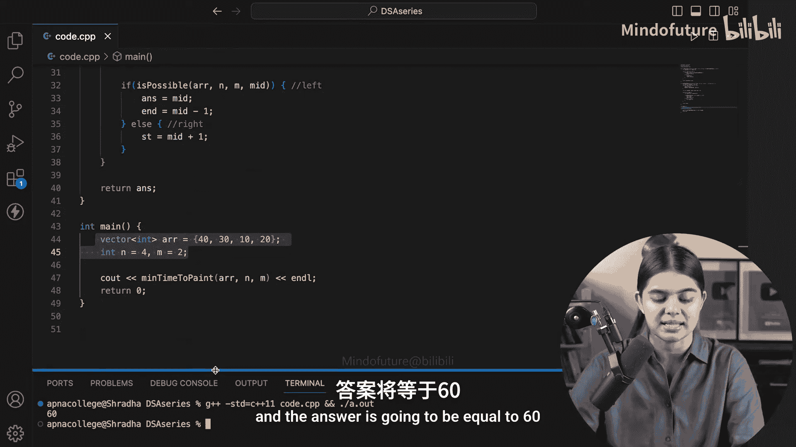

# C++ DSA课程：P22：油漆匠分区问题


在本节课中，我们将学习一个经典问题——油漆匠分区问题。我们将理解问题描述，分析其核心逻辑，并最终使用二分查找算法来高效地解决它。

## 问题概述

想象一个场景：有 `M` 位油漆匠需要粉刷 `N` 块木板。每块木板 `i` 有一个长度 `arr[i]`，这代表了粉刷它所需要的时间。所有油漆匠的工作效率相同，即粉刷一单位长度的木板需要一单位时间。

任务是将这些连续的木板分配给油漆匠，使得完成所有粉刷工作的**总时间最短**。分配规则是：
1.  一位油漆匠只能粉刷**连续**的木板段。
2.  所有油漆匠可以同时工作。

我们的目标是找到这个**最短的可能时间**。

## 核心概念与思路分析

上一节我们明确了问题，本节我们来分析解决它的核心思路。

### 理解时间范围

首先，我们需要确定答案（最短时间）可能存在的范围。
*   **最小可能时间**：即使有再多油漆匠，完成工作的时间也至少需要粉刷**最长的单块木板**所花的时间。因为这块木板必须由一位油漆匠单独完成。
    *   **公式**：`min_time = max(arr)`
*   **最大可能时间**：如果只有一位油漆匠，那么他必须粉刷所有木板，总时间就是所有木板长度之和。
    *   **公式**：`max_time = sum(arr)`

因此，答案一定在区间 `[max(arr), sum(arr)]` 之内。

### 二分查找的应用

我们无法直接计算出精确的最短时间，但可以**验证**一个给定的时间 `mid` 是否可行。
*   **可行性检查**：假设我们规定每个油漆匠最多工作 `mid` 单位时间。我们能否在 `M` 位油漆匠内，按照连续分配的规则，完成所有木板的粉刷？
    *   如果可以，说明 `mid` 是一个可行解，甚至可能存在更短的时间（在左侧区间）。
    *   如果不可以，说明 `mid` 时间太短，需要更长时间（在右侧区间）。

这正是**二分查找**的用武之地。我们在时间范围 `[max(arr), sum(arr)]` 内进行二分查找，不断猜测中间值 `mid` 并检查其可行性，从而逐步缩小范围，最终找到最小的可行时间。

## 算法步骤详解

基于以上分析，以下是解决问题的具体步骤。

### 1. 定义辅助函数：`isPossible`

这个函数用于检查在给定的最大允许时间 `mid` 和油漆匠数量 `M` 下，能否完成粉刷。

以下是 `isPossible` 函数的逻辑：
1.  初始化油漆匠计数 `painterCount = 1`，当前油漆匠已用时间 `currentTime = 0`。
2.  遍历每一块木板：
    *   如果 `currentTime + arr[i] <= mid`，说明当前油漆匠可以粉刷这块木板。更新 `currentTime += arr[i]`。
    *   否则，说明当前油漆匠时间已用尽，需要启用一位新油漆匠 (`painterCount++`)。新油漆匠从当前木板开始粉刷，所以 `currentTime = arr[i]`。
3.  遍历结束后，如果 `painterCount <= M`，说明在 `mid` 时间内用 `M` 位油漆匠可以完成任务，返回 `true`；否则返回 `false`。

### 2. 主函数：二分查找最小时间

在主函数中，我们执行标准的二分查找来寻找最小可行时间。

以下是主函数的执行流程：
1.  计算时间搜索范围的起点 `start = max(arr)`，终点 `end = sum(arr)`。初始化答案 `ans = -1`。
2.  当 `start <= end` 时，执行循环：
    *   计算中间值 `mid = start + (end - start) / 2`。
    *   调用 `isPossible(arr, N, M, mid)` 进行检查。
    *   如果返回 `true`，说明 `mid` 可行，记录 `ans = mid`，并尝试寻找更小的时间，将搜索范围向左移：`end = mid - 1`。
    *   如果返回 `false`，说明 `mid` 不可行，需要更长时间，将搜索范围向右移：`start = mid + 1`。
3.  循环结束后，返回记录的 `ans`，即为所求的最小时间。

## 代码实现

将上述逻辑转化为C++代码。

```cpp
#include <iostream>
#include <vector>
#include <algorithm>
#include <numeric>
using namespace std;

// 辅助函数：检查在给定最大时间限制下，M位油漆匠是否能完成工作
bool isPossible(vector<int>& boards, int n, int m, int mid) {
    int painterCount = 1;
    int currentTime = 0;

    for (int i = 0; i < n; i++) {
        if (currentTime + boards[i] <= mid) {
            // 当前油漆匠可以粉刷这块木板
            currentTime += boards[i];
        } else {
            // 需要一位新油漆匠
            painterCount++;
            if (painterCount > m || boards[i] > mid) {
                // 如果需要的油漆匠超过M，或单块木板时间已超限，则不可能
                return false;
            }
            currentTime = boards[i]; // 新油漆匠从当前木板开始
        }
    }
    return true;
}

// 主函数：使用二分查找求解最小时间
int findMinTimeToPaint(vector<int>& boards, int n, int m) {
    // 计算搜索范围
    int start = *max_element(boards.begin(), boards.end());
    int end = accumulate(boards.begin(), boards.end(), 0);
    int ans = -1;

    while (start <= end) {
        int mid = start + (end - start) / 2;

        if (isPossible(boards, n, m, mid)) {
            // 如果mid时间可行，尝试寻找更小的可行时间
            ans = mid;
            end = mid - 1;
        } else {
            // 如果mid时间不可行，需要更长时间
            start = mid + 1;
        }
    }
    return ans;
}

int main() {
    // 示例：木板长度数组，4块木板，2位油漆匠
    vector<int> boards = {40, 30, 10, 20};
    int n = boards.size();
    int m = 2;

    int minTime = findMinTimeToPaint(boards, n, m);
    cout << "完成所有粉刷工作的最短时间是: " << minTime << " 单位时间。" << endl;
    // 对于示例，输出应为 60
    return 0;
}
```

## 复杂度分析

*   **时间复杂度**：二分查找的时间复杂度为 **O(log(S))**，其中 `S` 是木板长度之和 `sum(arr)`。在每次查找中，`isPossible` 函数需要 **O(N)** 的时间来遍历所有木板。因此，总时间复杂度为 **O(N * log(S))**。
*   **空间复杂度**：**O(1)**，我们只使用了常数级别的额外空间。

## 总结



本节课我们一起学习了油漆匠分区问题。我们首先理解了问题背景和约束条件，然后分析了答案所在的时间范围。解决问题的核心在于将“求最小值”转化为“验证可行性”，并利用**二分查找算法**在可能的时间范围内高效搜索。我们定义了 `isPossible` 辅助函数来验证一个给定时间是否可行，最终通过二分查找找到了最小的可行时间。这种方法的时间复杂度为 **O(N * log(S))**，对于此类“最小化最大值”的问题非常有效。