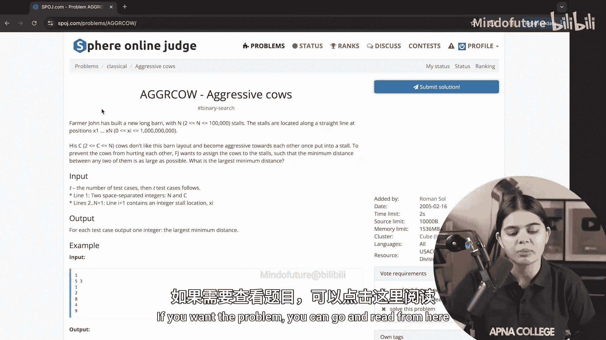
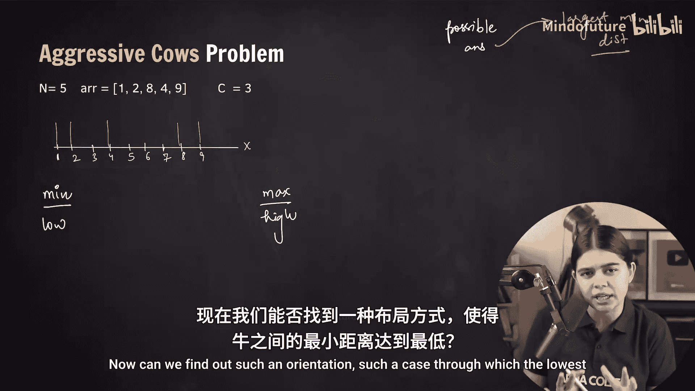
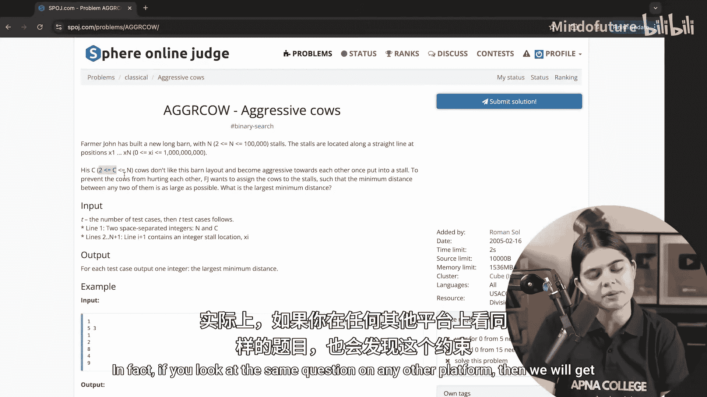
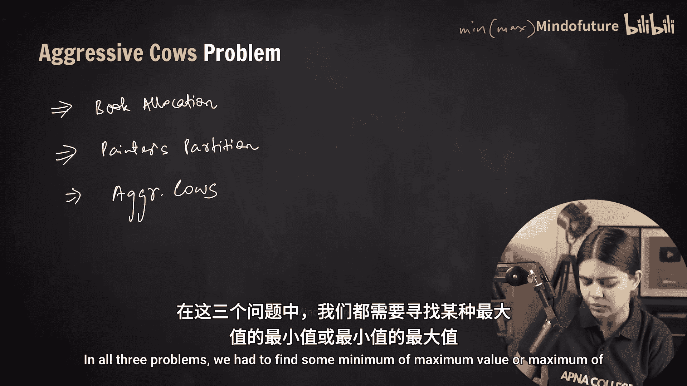

# C++-DSA课程-｜-数据结构-｜-leetcode-｜-Apna-College-｜--Complete-C++-Dsa-Course-p23-P23_暴躁的牛问题-DSA就业系列-二分查找-第23讲--BV18oUGBkEmV_p23-

everyone welcome to the complete important binary problem which is called aggressive is is classical positions。

😊。

maximum distance minimum equal minimum equal equal equal。

ist1 and3 distance is equal to3 minimum distance minimum distance of equal equal distance and equal equal and distance equal and in distance minimum distance。

3 equal minimum distance that is equal to3 or minimum distance that is cases minimum distance minimum distance value maximum value which is going to be in this particular minimum distance is of partition fact would advise to distance。

😊，To minimum distance possible value or largest value minimum distance value distance minimum distance minimum distance minimum and minimum distance value orientation lowest minimum distance。

😊。

minimum valuestrain giventrain value minimum distance is always going to be equal to1。

value minimum distance highest value number of largest distance or second given opposite smallest value distance possible distance possible minimum distance。

😊，Minus smallest in area。To minimum distance minimum minimum minimum。😊。

Have to find a possible answer in this range。answer possible answer minimum distance minimum distance。

😊，lowest value is equal to one highest value possible equal to234 value and value。😊。

possible and let minimize minimum。To find a smaller name next。equal，equal equal value。

Minus minimum value in E。Andological。is than equal to n right is equal perform binary in this。

answer basically minimumc basically the first step to is possible or not is to。position equal。

or minimum is not a possible，ham logic basically the first step is to and asc with equal to1 and equal i equal9 position。

Then say this should be greater than equal to mid。😊，To midica， basically， midhahama minimum。😮。

Allud distance greater than equal to equal。😊，Last position4 ko placed he up in next index foro definitely C3ja third kko or last stall positionjajako place place according to this mid possible answer is true toko or place k。

😊，Equal toja case return's write it given minimum distance equal is the first part of and is the second of visual is to。

😊，Going to pass all the test cases to function again the submi is start K start value say and n value start value value k equal n value kgiari e maximum minus e key minimum value B a bar co1 and a bar n equalium maximum value minus minimum value a maximum and minimum value find out those we find out K binary search loop is3 start is less than equal to n and sub cogi M is going to be equal to start plus n minus start divided by2。

😊，Check possible answer and equal equal or equal function possible function and additionally are going toname minimum allowed。

😊，Distance。And a step is possible first step to sort the a bar bar is function simplyju distance anyway is sorted value unsorted value is function distance function are to sort do and dot and or automatically minimum value valueja or minimum valueja minimum value possible function sort we will start with one and last stall position that is going to be equal to of。

😊，Z position by k place a loop for in teacherger I equals10 position with already place I less than n I plus plus of I minus last tall position is this greater than equal to minimum allowed distance。

 Any value value last tall position of equali case may or position to last tall positionjagi current position。

 which is area orari number of they become equal to This case may value Those case may last me return。

😊，False value go。 So this is the entire code for our aggressive cows problem this entire code kjo is possible vah functionme of n function ja total number of stalls distance sorting this is n logjo loop binary to binary binary to big of。

😊，Log range Joari range minimum maximum value key is possiblebar call to big log range n to time complexity basically n log range n log Jo value value complexity value complexity give example。

😊，And our answer is equal to 3。 You can also try to submit this code on any platform。

 Eedli successfully submit ojaga。 I hope kjo aggressive Kauswa problemo and caseme binary search problems a pattern we noticed Kanaga basically Ham theme problems Gh same pattern go follow Ame problem Kiti called book allocation。

😊，A Km Uskibar problem， Kity called painters。Partition。And Imni problem he had。

 this is called aggressive cows Tino problem can。 howmi which minimum of maximum value。

 a maximum of minimum value ni， just a book allocation problem can How minimum possible。

Maximum pages， Nikal paintest partition problem can there minimum possible。

Maximum tiny ni and aggressive cows cananderhoni maximum possible。

Minimum distance What is the pattern。 The pattern is minimum maximum minimum maximum maximum minimum value minimum and depending upon the question that。

Bas problem。Askky late night melt the next rhythm till them keep learning and keep exploring。😊。

