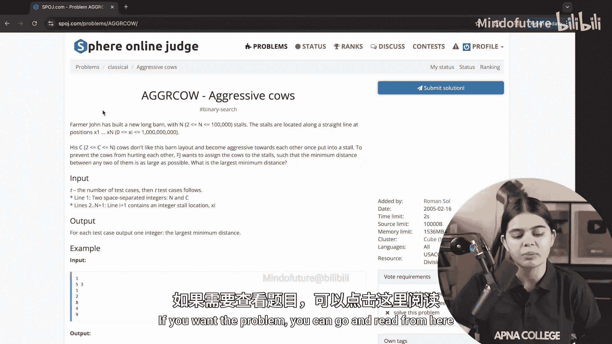
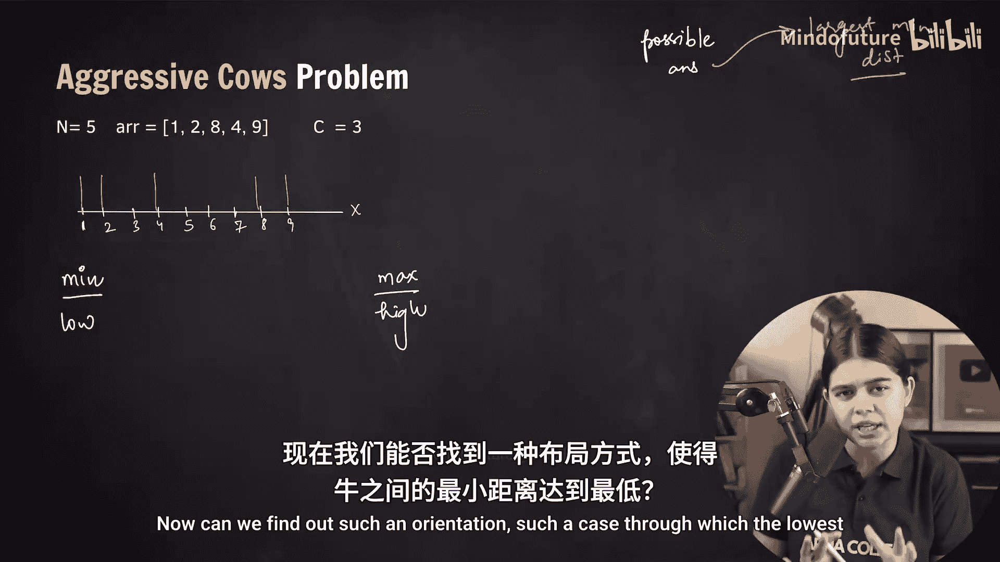
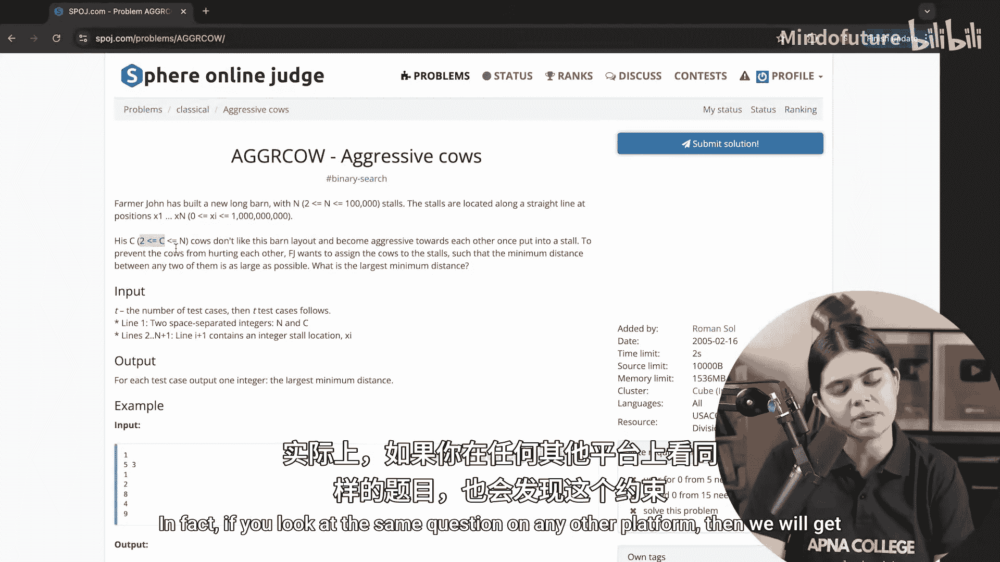
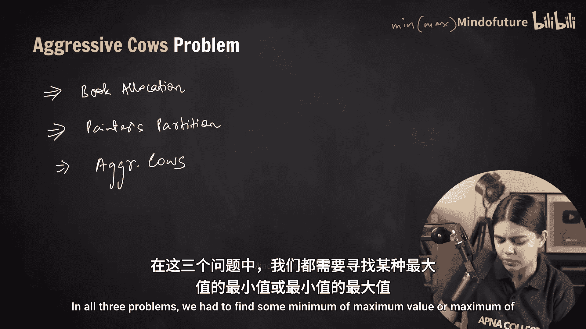

# C++ DSA课程：P23：暴躁的牛问题



在本节课中，我们将学习一个经典的二分查找应用问题——“暴躁的牛问题”。我们将理解问题定义，分析解题思路，并最终用代码实现解决方案。

## 问题概述

农场主有 `n` 个牛棚（stalls），其位置由一个整数数组 `stalls[]` 表示。农场主还有 `c` 头牛。为了防止牛之间争斗，需要将它们分配到牛棚中，使得任意两头牛之间的**最小距离尽可能大**。

我们的任务是找到这个**最大的最小距离**。



## 核心概念与思路



上一节我们介绍了问题的目标。本节中我们来看看如何将问题转化为可计算的模型。

问题的核心是：给定一个可能的最小距离 `mid`，判断是否能够将 `c` 头牛以至少 `mid` 的距离安置在牛棚中。这是一个典型的**可行性检查**问题。

我们可以通过**二分查找**在可能的答案范围内搜索。答案的最小可能值是 `1`，最大可能值是 `(最远牛棚坐标 - 最近牛棚坐标)`。

以下是解题的基本步骤：
1.  对牛棚位置数组 `stalls[]` 进行排序。
2.  设定二分查找的起点 `start = 1`，终点 `end = stalls[n-1] - stalls[0]`。
3.  在 `while(start <= end)` 循环中，计算中间值 `mid = start + (end - start) / 2`。
4.  调用函数 `isPossible(stalls, n, c, mid)` 检查距离 `mid` 是否可行。
5.  如果可行，说明可能存在更大的最小距离，我们记录 `mid` 为当前答案，并将搜索范围更新为 `[mid+1, end]`。
6.  如果不可行，说明距离太大，需要缩小距离，将搜索范围更新为 `[start, mid-1]`。
7.  循环结束后，记录的答案即为**最大的最小距离**。

## 可行性检查函数

上一节我们确定了二分搜索的框架，本节中我们详细看看核心的 `isPossible` 函数如何实现。

该函数的目的是判断在给定的最小允许距离 `minDist` 下，能否放下所有的 `c` 头牛。

以下是 `isPossible` 函数的逻辑：
1.  初始化已放置的牛数量 `count = 1`（第一头牛总是放在第一个牛棚 `stalls[0]`）。
2.  记录上一头牛放置的位置 `lastPos = stalls[0]`。
3.  从第二个牛棚开始遍历 (`i = 1` 到 `n-1`)。
4.  如果当前牛棚位置 `stalls[i]` 与 `lastPos` 的距离 `>= minDist`，则可以在当前位置放置一头牛。更新 `count++` 和 `lastPos = stalls[i]`。
5.  如果 `count` 达到 `c`，说明所有牛都已成功放置，函数返回 `true`。
6.  如果遍历结束 `count` 仍小于 `c`，则说明无法以 `minDist` 的距离放下所有牛，函数返回 `false`。

其代码逻辑如下：
```cpp
bool isPossible(vector<int> &stalls, int n, int c, int minDist) {
    int countCows = 1;
    int lastPlacedPos = stalls[0];
    
    for(int i = 1; i < n; i++) {
        if(stalls[i] - lastPlacedPos >= minDist) {
            countCows++;
            lastPlacedPos = stalls[i];
        }
        if(countCows >= c) return true;
    }
    return false;
}
```

## 整体解决方案与复杂度分析

理解了可行性检查后，我们现在可以组合出完整的解决方案。

完整的解决方案代码整合了排序、二分查找和可行性检查。

```cpp
#include <bits/stdc++.h>
using namespace std;

bool isPossible(vector<int> &stalls, int n, int c, int minDist) {
    int countCows = 1;
    int lastPos = stalls[0];
    
    for(int i = 1; i < n; i++) {
        if(stalls[i] - lastPos >= minDist) {
            countCows++;
            lastPos = stalls[i];
        }
        if(countCows >= c) return true;
    }
    return false;
}

int aggressiveCows(vector<int> &stalls, int n, int c) {
    // 1. 排序牛棚位置
    sort(stalls.begin(), stalls.end());
    
    // 2. 定义二分查找范围
    int start = 1;
    int end = stalls[n-1] - stalls[0];
    int ans = -1;
    
    // 3. 执行二分查找
    while(start <= end) {
        int mid = start + (end - start) / 2;
        
        if(isPossible(stalls, n, c, mid)) {
            // 如果mid距离可行，尝试寻找更大的距离
            ans = mid;
            start = mid + 1;
        } else {
            // 如果mid距离不可行，必须减小距离
            end = mid - 1;
        }
    }
    return ans;
}
```

**时间复杂度分析**：
*   排序：`O(n log n)`
*   二分查找：`O(log R)`，其中 `R` 是牛棚坐标的范围 (`end - start`)。
*   每次二分查找中的 `isPossible` 函数：`O(n)`。
*   总时间复杂度为 **`O(n log n + n log R)`**，通常简化为 `O(n log n)`，因为排序是主要开销。

**空间复杂度**：`O(1)`，除了输入数组，只使用了常数级别的额外空间。

## 模式总结与相关题目

本节课中我们一起学习了“暴躁的牛问题”及其二分查找解法。这是一个经典问题模式的代表。

我们注意到，这类问题的通用模式是寻找**最小值的最大值**或**最大值的最小值**。解题框架固定：
1.  确定答案的搜索范围 `[start, end]`。
2.  设计一个 `isPossible(mid)` 函数，用于判断 `mid` 值是否是一个可行的候选答案。
3.  使用二分查找在范围内寻找满足条件的**最优** `mid` 值。

掌握这个模式后，你可以解决一系列类似问题：
*   **书籍分配问题**：将 `n` 本书分给 `m` 个学生，使每个学生获得的总页数最大值最小化。
*   **画家分区问题**：将 `n` 块木板分给 `k` 个画家，使完成所有工作的总时间最小化。
*   **最小化最大负载问题**等。

它们的核心都是**二分答案 + 贪心验证**。



## 总结

在本节课中，我们深入探讨了“暴躁的牛问题”。
1.  我们明确了问题的目标是找到可以安置所有牛时，**两头牛之间最大的最小距离**。
2.  我们将问题转化为对“最小距离”进行二分查找，并设计了 `isPossible` 函数来验证某个距离是否可行。
3.  我们实现了完整的C++代码，并分析了其时间复杂度和空间复杂度。
4.  最后，我们总结了这类“最小化最大值”或“最大化最小值”问题的通用二分查找模式。

你可以尝试在在线判题系统上提交此代码进行练习。继续学习和探索吧！😊