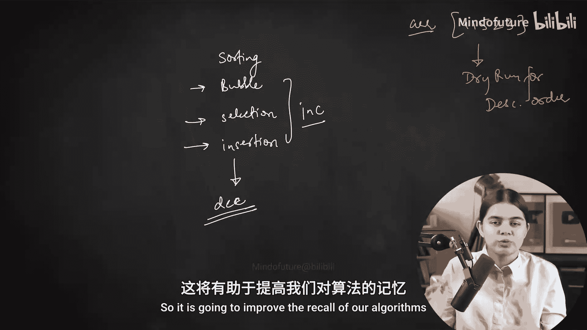

# C++-DSA课程-｜-数据结构-｜-leetcode-｜-Apna-College-｜--Complete-C++-Dsa-Course-p24-P24_排序算法-冒泡排序_选择排序_插入排序-DSA系列_由Shradha老师讲解--BV18oUGBkEmV_p24-

Hi everyone and welcome to the complete DSA series about sorting Ab sorting important sorting techniques who cover Ka。

 which is going to be bubble sort selection sort and insertion sort sorting techniquescom question link an interview point of view say important toari interview say sorting algorithm。

 And that is why we need to learn them concept channel playlist scanner available。 Now。

 let's start with sorting sorting is basically the process of arranging our data in a particular order。

😊。

Basically， aham random generallybi numbers examplepa numbers a 5，2。

3 and1 ascending order in and descending in decreasing fashion ascending descending order whose process sort n square inputs n So let's start with the first which is called n1 times n minus it compare or compare element pushne using swaps swap position。

😊，basically this is the basic， the basic logic on which works theoreticalicallys take an example of n-1 or n-1 second。

234 and5 or index1 and42 or firsteration。The second iteration exactly we start with this see This is 1。

4，2，3 and 5 or124 oreration largest with third iteration。😊，Let us remove this and I。

 So this is our third iteration。 Third iterationam 12，3，4 and 5 exactly n1 timess223452。

453 or iteration third iterationeration4 iteration will start with this particular12，3，4。

512 elementseration。😊，automatically this is basically the process that we follow in bubble to sort in an ascending order basically n is equal to for equal than n2 and number i equal1 number i is equal number。

2 and similarly I is equal to3 k total number of comparisons1 total number of comparisons definitely and this process of finding out comparison complex problems basically that4 is nothing but n1 n 1 is equal to4 Similarlyly3 is n1。

😊，511 equal to3。 This is also n i-1， and this is also n1 say basically j is equal to0 or j than n i1 or plus and of j。

array of j and array of j1 and in values pseudo logic elements elementsne n and our function in and。

😊，Bubble salt k I make loop Chilan I equal to0 so start with I less than n minus1 i plus plus。

Uusque Ame will start the second loop from J equals 0 J is than n minus I minus1 J plus less。

And herbarm Czech Karinggi Agahama E of G， greater than Huia E of G plus Muie。😊。

Those case Mihammed Swb Kanahi Ani area of Jeco with area of。G plus1。

And is time complexity time complexity I already analyzed outer loop n times on average loopa inner loop n times run loop n times runa inner loop n into n times So that is why the time complexity of bubble sort is n square。

😊，So it is going to be n square sorting algorithm n squareing algorithm n log n logortize quick definitely better sorting algorithm let us create one more function called print。

😊，Jky underham Ani Erio print Carvaika Kaam Guinggi。We are going to ride the same loop。

Less than n Herbarham C out Kingi upni area of Ico with some space。And see out end of like。

Let's save it。 And let's call bubble sort for and print for R Im definitely given issorted This is a sorted version of itja for example。

12，3，456 n7 is on n operations sort which is basically using a boolean variable。😊，I soap。

Iize with false value。 basically is s swap is swap is and is。

S it false value here Mat swaphu inner loop candle to Ika E。

Is already sorted or already sorted returned optimization I for particular rare cases。

 sortedme extra checks perform on average So this is how our works next selection selection is kind of the opposite of imagine into two parts parted and egg partsort and what do we do unsorted smallest element logically selection n one it1 times。

😊，one smallest element cone exactly， let's take an example of this E ，1，52。

3 given unsorted as or unsorted smallest element or which one of them is our smallest element one is the smallest element or ishi position index per smallest element0 index place swap with the index element and2。

3 eventuallyed andsorted is same process unsort smallest element or is smallest element。😊。

next time smallestest element eventually1，2，5，4 and3 equal and this is smallest first smallest element。

😊，1，2，3，4 and this becomes our sorted part and this becomes our unsortted part unsort smallest which is already equal to andest element or selection smallestest1 smallest1 times equal to0 than。

This one， i plus plus。unsort first element smallest element smallest Similarlyestest basically i is equal to equal equal second smallestestest is equalest。

😊，But elements kche Carne I plus17 loop star kna to j is equal to i plus 17 loop star curtainpt j is less than n Herba Khen j plus plus ham Hamishah compare Khenki agarhama array of j Ham is smallest element say And if this is less than equal to array of smallest I say smallest index co deta S I。

😊，Smallest index value elements say agahamari value Chos smallest index go update Kque King to G。

 let us。Remove this。And I。single loop unsorted smallest index and last smallest index last action perform we swap of i with array of smallest index unsorted start So this is how our selection is going to work the selection are going to create another function called selection function parameter and a selection loop i is equal to0 i less than n minus1 i plus and smallest element k index now smallest element index assume。

😊，Unsortted part car starting index over， which is equal to I。Ukebal。

 we are going to start our inner loop。 Je mam Sariari butway unsorted his traverse Kagi or smallest index for Czegi Yahi smallest element index the J is equal to I plus1 J less than n J plus plus。

😊，Agarbia area of jja just value less than area of smallest index those case j smallest index1 smallest index update equal to j and j smallest value or smallest value of i area of i unsorted smallest index orgar area of i smallest index basically area of i of So this is how the code for selection sort works loop n times loop on average loop n times and that is why the time complexity is equal to big n square will call selection lets save it and run。

😊，as output major。 it is asorted。 So this is how selection sort works in C。

 So the next that we are going to study is called insertion sort insertion comes from the idea of playing cards say for example。

bi card gamess suppose card14 and card number existing existing order2 definitely insert in the middle of1 and4 in card I similar logic insertion sorted。

😊，arrange at its correct position position will start with thiss supposepa 4，1，5，2。😊。

And yhamra unsorted part assume Kaara first element already hamra sorted part formai or definitely Kabibi single in teajau sorted in teajaki a element of unsorted hamringgi up a first element pick kringgi or Use sorted partahiper Kanegi kgi。

😊，take an external variable called。for example。Andehamra unsortted part unsortted part element which is equal to2。

 and up in a previous element， which is equal to5 definitely basicallyme repeatedly basicallyme repeatedlye of previous valueja elements of previous plus1 value assign of。

😊，Previous key， this is the entire logic that we are trying to follow Jesse Hamari given E K Hampa5pa2。

 this was my previous area of previous any5 greater than Ho current Tian to say thoseka is previous key value Mus A index Carneium。

😊，what is going to look like。third with12，4 So this is unsortted and this part is already and and and which is this after this iteration。

or equal equal equal pattern that we notice basically are going to is equal that is why。

current variable and previous or previous-1 and backwards greater than equal to0 and of is greater than my of。

😊，Upta do Gnet subseella up in an array of previous plus1co assign gardenihe value area of previous key。

1，4，5 and2 previous previous key value index and and of is equal logical insert So this what insert looks。

😊，To create a function called void insertion sort， insertion sort can a kpa Samra A Aga and ain teacher Nval。

Subse hammean loop run carrying a I is equal to1， say I less than n I plus this Herbar Itohamapna current element Lena here。

 which is going to be equal to area 5。 Sama， we are going to take a previous previous is going to be I-1 k equal for Hamapna Y looplan Jepta kara previous is greater than equal to 0。

 and Jepta kari array of previous key value is greater than。😊，干。

Youukije the carry of previous key value greater than a currentbigi Zru。

9 to K Se position for Al Ajuga， the Ya array of previous plus 1 co assign girlinge value area of previous。

😊，And previous co cardium minus minus Uskiba last my current company。

 Sahi Jga per Poonja K array of previous plus one is going to be equal to current。

 So we are basically placing the current element。😊，In its correct。不知识。

overall insertion outer loop n times on average n insert equal insert insert descend。😊。

Seelection sort kder comparison kra selection sort can comparison is if statement karra is co algorithmgrini greater than kmic convert kia or Yahaerni selection sort k kia。

😊，To caseismme Aga， Hamara A descending order kar arrange Uayga and similarly。

 bubble shot kandarbi is comparison go Agarhammni river Kthia。Or Yahapper， if we call。

Bubbleri descending orderque descending order same logic exactly sorting and sorting basic techniques Soium we completed we completed selection sort and we completed insertion sort we also saw in problem have to take an as an example。

 In fact given4，1。😊，52 and3 descending descend share progress with me on。

There is one more link for a company Vi DSSHH Just scan the Joham topic wise up questions。

 DSA questions go Joers solve time askate 9 melt video material and keep learning and keep exploring。

😊。