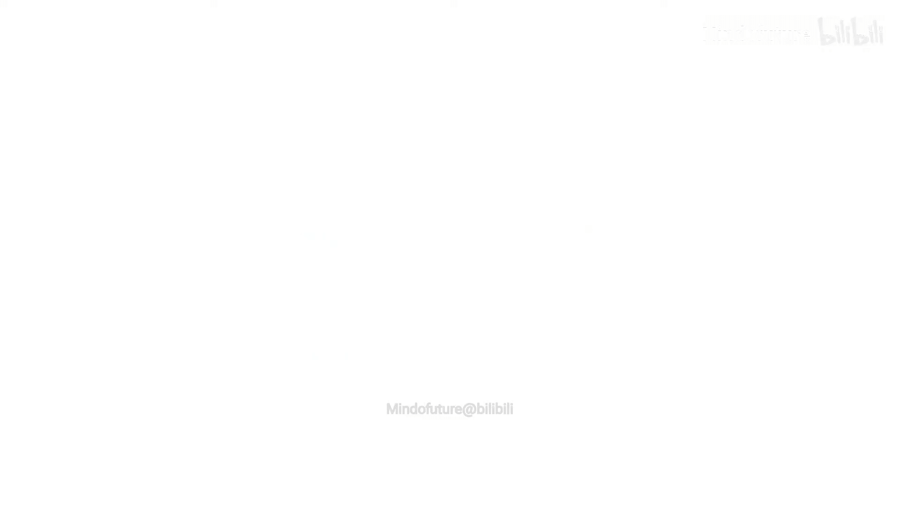
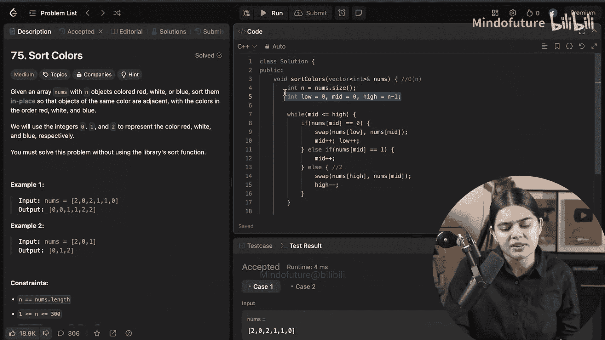

# C++-DSA课程-｜-数据结构-｜-leetcode-｜-Apna-College-｜--Complete-C++-Dsa-Course-p25-P25_排列0、1和2的数组-DNF排序算法-Leetcode_75--BV18oUGBkEmV_p25-

Hi， everyone and welcome to the complete series important question is called。😊。

So and fashion example number 75 given basically internallys suppose。😊。

Aaripa ballsky color him white， pink and red。White0 number pink1 the red2 the orval end balls given colornava placement k for internal logic Jovoga Ki numbers0。

1，2 orrisse is Savalki brute force， which is going to be very simple brute force brute。😊。

Using the library sort function。 but bru force approachna or implement Kana bother second approach key。

 which is going to be slightly more optimized。 slightly more optimized approach kgi Ya root force approach meari complexity I en optimizeim k complexityovgi basically already Pat0s1 andak count count of0ly count of one and count of two st。

So this is going to be equal to 4 similarly number of and number。😊。

Toari overall approach any value bo simple any value。 In fact。

 I would advise you to pause here and try to code it on your own。 Ibidini subnaname。

 which is equal to nus dot。😊，Size Ique Ame humapna equi variable laying a count 0 initialized with 0 count1 Iized with 0 and count of2 initialized with 0 Usque Ame subse Pella lulaar hum up knee numbers go count curling a I plus plus2。

😊，Agarhamari nus of 0 is equal to 0。 Those case may count of0 cocardingi plus less。If nus of I Yabi。

 we need to write I is equal to。1， those case may count of1 plus and L2 count of2 plus numbers count first loop is complexity equal over with0 first loop equals0 I than count of0 i plusme numbers of index plus0 Similarlyly values s count1 value s count s plus complexity that is also going to be equal to equal complexity will be eventually。

😊，successfully submit or opt which is at the end of this question can you come up with a one algorithm using only constant space second time second time overr optimized approach optimized approachza optimized approach optimal solutionov in and most optimal approach this is an existing algorithm called Dutch national algorithm Dutch algorithm。

😊，given in time complexity with single single and is exactly objective of objective andchange and。

N is algorithm can。 I teen pointers who use curme。Basically exactly pointer high pointer plus or basically a variable pointers may say a low pointer a midpointer and a objective objective vision low1 L1 position mid1 positionarine plus1 n1 index only in partitionsne orino partitions andne logical1。

😊，low say1 n key range key range mid1 k mid and high1 to mid and high make。😊，Basically。

 or starts from mid and which ends with or is unsort elementssort elements and or orsort or。

un visionsort and Dutch rules。Mid-1，ari Tukoka store kvaiari Tukoham store kvagi from high plus 1。😊。

2 n1 and unsort unsort part basically or equal equal than equal is basically。

We also start with a low which we initialize with a value of0 9 pointers li low mid and high mid element heater of point depending upon mid element heater of point decide use element cases at them let us minimize this。

😊，s issort partition is first partition partition partition we swap with this one。😊，basically and。😊。

L co many LCD higher and mid many MC higher and in fact。

 in element school hum Chahi to example k directly upper exc them。😊，1 partition partition。😊。

position in single partition that is why after swap we do low and we do mid algorithm of case and of and next iteration rules So this was our first case equal。

😊，Ha and mid andari is index index is rules basically second partition。😊。

This is basically the first partition。 This is the second partition， and this is the third partition。

's second partition second partition is partition and second partitionb second partition is fairlys This is basically the。

😊，And the upper Maripa value to equal。and for simplicitys third partition partition and and。😊。

me high value value swap can I to Yaber， we have to swap， let us keep it here。and partition。

First and that andtuition writing。😊，Equal to Hoge 0 k。

 those case may harm subse palletto sb kringgi Ane array of loco。With a of mid。

And Ukeath hamapne Medikoi plus and hamapne lo plus la Yaari condition Hoge yehamari。

0 k condition Hoge second case，raki Agarari E of mediki value。

 This is going to beel Agarari Mki value 1 k equalhoge those case mahammi simply Mko plus Yama vakge and third case。

 diskoham simplyel vak k Voki is caseham sb Knaem A E of hako。😊。

With array of mi and Ukeba ham K the Yamara2 in 0，1 and2 valley conditionsme K。

 So this is what the pseudo code of the algorithm looks like。

 A big bar or deeply subing and on this example。 We are going to start with aid value tojagarajaga and ara。

 So this is the low value。kirura0ra mid。😊，Is also equal to 0， and is equal to n-10，1，2，3，4。

5 or fact like andition。part equal。With a yellow or a different color and andsort and this is exactly the beauty of is equal this is to equal partition partition equal to position。

whichch is equal to this one the first partition is the second partition and third partition vision unfold and three partitions of and。

conver and left right Dutch national flag algorithm and are going to take n do and equal and with value of n1 value is less than equal to。

😊，T Kingi Agarhamari numbs off。Mid key value x to 0 k equal as T Yama first case Ojaga。

Second case else， if vac case Ojaga a nus of mid key value，1 k equally。

 this is the second case and third cases to vac case。The first case， ktaki swap Kdo。

Nums of lo with nus of meat。And phham medical Kdigi plus plus and up Ne lokubi Kinggi plus plus second case kai。

 he said from my me plus plus Kine and third case kai。😊，Kme sb knaai numbs of。hau。With numbs off。Met。

Andkivais throw some degrees Cal to yeari over algorithm hamek single single luni singleov and time complexity let us run this。

😊，And submit hundred percent time complexity solution which beats hundred。

 So this is how we apply the national complexity complexity complexity for the sake of not used vector or another or Q or any other complexity complexity。

😊。

third。N x equal over distance travel the total distance travel x plus n can I say this is nothing but operations perform distance travel and that is why the time complexity of and that is the beauty of Dutch national complete mark in。

😊，Unlike isalava。 you can also share your progress with me on Twitter just cu link to be up description boxja。

 And if you want to solve more DSA questions。 So there is a link for company vice DSA sheet in the description box Just scan topic list Jim come practice for a placement preparation Ask Mil learning and keep exploring。

😊。