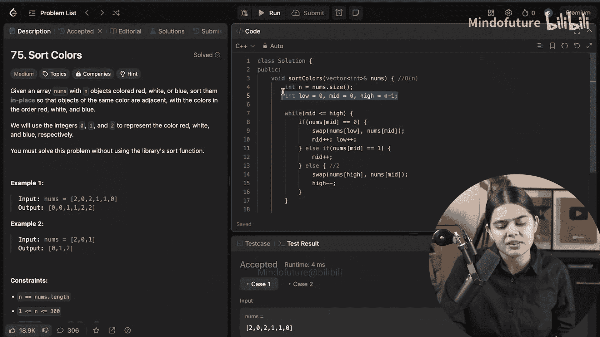

# C++数据结构与算法课程：P25：排列0、1和2的数组 - DNF排序算法 - Leetcode 75


在本节课中，我们将学习如何解决LeetCode第75题“颜色分类”。这是一个经典的数组排序问题，要求我们仅包含0、1、2的数组进行原地排序。我们将探讨多种解决方案，并重点学习一种名为“荷兰国旗问题”的高效算法。

## 问题概述

假设我们有一个数组，其元素只包含数字0、1和2。我们的目标是在不使用库函数排序的情况下，对这个数组进行原地排序。

一种简单的暴力方法是直接使用库排序函数。但我们将探索更优的解法。

## 方法一：计数排序

首先，我们来看一种略微优化的方法。其思路是遍历数组，分别统计0、1和2的个数。

以下是实现步骤：
1.  初始化三个计数器：`count0`、`count1`、`count2`。
2.  遍历数组，根据元素值增加对应计数器的值。
3.  根据计数器的值，按顺序（先0，再1，最后2）重新填充数组。

对应的伪代码如下：
```cpp
int count0 = 0, count1 = 0, count2 = 0;
for(int num : nums) {
    if(num == 0) count0++;
    else if(num == 1) count1++;
    else count2++;
}
int index = 0;
while(count0-- > 0) nums[index++] = 0;
while(count1-- > 0) nums[index++] = 1;
while(count2-- > 0) nums[index++] = 2;
```
这种方法需要遍历数组两次，时间复杂度为O(n)，空间复杂度为O(1)。虽然可以成功提交，但问题要求我们尝试仅用一次遍历和常数空间完成。

## 方法二：荷兰国旗算法 🚩

接下来，我们介绍最优解——荷兰国旗算法。这是一个经典的“三向切分”算法，仅用一次遍历和常数额外空间。

### 算法核心思想

我们使用三个指针来维护数组的四个逻辑分区：
*   `low`指针：指向最后一个0之后的位置。
*   `mid`指针：用于遍历数组，处理当前元素。
*   `high`指针：指向第一个2之前的位置。

初始时，`low`和`mid`指向数组开头，`high`指向数组末尾。`mid`指针从左向右移动，根据其指向的元素值进行不同的操作，直到`mid`超过`high`。

### 算法步骤详解

以下是算法的具体规则，根据`nums[mid]`的值分三种情况处理：

1.  **如果 `nums[mid] == 0`**
    *   将`nums[mid]`与`nums[low]`交换。
    *   将`low`指针和`mid`指针都向右移动一位。
    *   这样确保了`low`左侧（不含`low`）的元素都是0。

2.  **如果 `nums[mid] == 1`**
    *   这是正确的位置，只需将`mid`指针向右移动一位。
    *   `low`和`high`指针保持不变。

3.  **如果 `nums[mid] == 2`**
    *   将`nums[mid]`与`nums[high]`交换。
    *   将`high`指针向左移动一位。
    *   **注意**：此时`mid`指针不移动，因为从`high`位置交换过来的元素尚未检查。

### 算法伪代码

```cpp
int low = 0, mid = 0, high = nums.size() - 1;
while(mid <= high) {
    if(nums[mid] == 0) {
        swap(nums[low], nums[mid]);
        low++;
        mid++;
    } else if(nums[mid] == 1) {
        mid++;
    } else { // nums[mid] == 2
        swap(nums[mid], nums[high]);
        high--;
    }
}
```

### 算法演示

假设初始数组为 `[2, 0, 2, 1, 1, 0]`。
*   初始：low=0， mid=0， high=5。数组状态：[2,0,2,1,1,0]
*   `nums[mid]=2`，与`nums[high]`交换，high--。数组状态：[0,0,2,1,1,2]
*   `nums[mid]=0`，与`nums[low]`交换，low++，mid++。数组状态：[0,0,2,1,1,2]
*   `nums[mid]=0`，与`nums[low]`交换，low++，mid++。数组状态：[0,0,2,1,1,2]
*   `nums[mid]=2`，与`nums[high]`交换，high--。数组状态：[0,0,1,1,2,2]
*   `nums[mid]=1`，mid++。
*   `nums[mid]=1`，mid++。此时mid > high，循环结束。

最终得到排序后的数组 `[0, 0, 1, 1, 2, 2]`。

## 复杂度分析



荷兰国旗算法的时间复杂度是O(n)，因为`mid`和`high`指针总共移动的距离之和是n。空间复杂度是O(1)，因为我们只使用了三个指针变量。这是一种非常高效的原位排序算法。

## 总结

本节课我们一起学习了LeetCode第75题“颜色分类”的解决方案。
1.  我们首先介绍了基于计数的两遍扫描方法。
2.  然后，我们深入探讨了最优的**荷兰国旗算法**。该算法利用三个指针，在一次遍历内将数组划分为0、1、2三个区域，实现了时间O(n)和空间O(1)的高效排序。
3.  掌握这个算法对于理解双指针、三向切分等思想非常有帮助，是解决类似分区问题的经典模板。