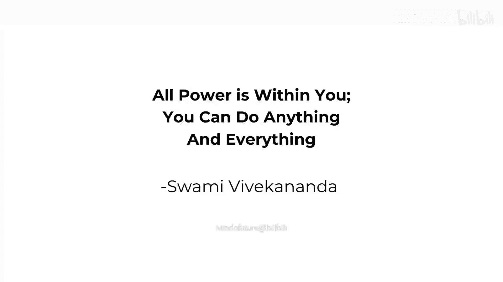
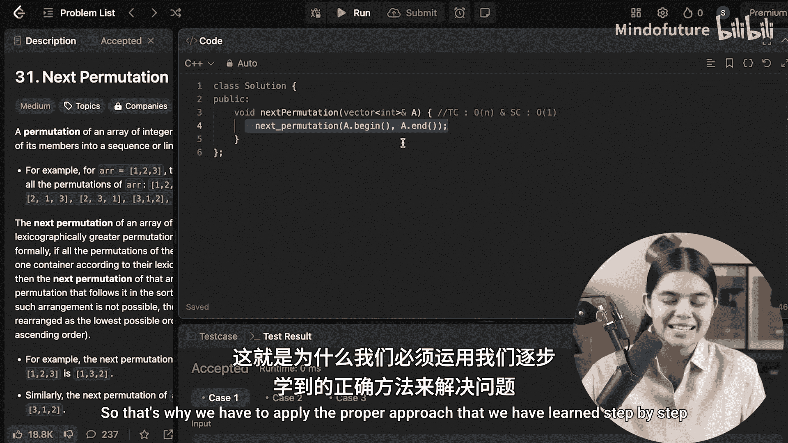

# C++-DSA课程-｜-数据结构-｜-leetcode-｜-Apna-College-｜--Complete-C++-Dsa-Course-p26-P26_合并有序数组问题和下一个排列问题-DSA系列--BV18oUGBkEmV_p26-

Hi everyone and welcome to the complete DS seriesja or E importing question conceptraja。

 Also there is a link for a company topic or practice a description box and we are trying a level best to make this series the best series on YouTube first question which is called merge to sorted this is an easy level question and it's going to be pretty easy。

 and this is problem number 88 on is given him in。😊。

In number of elements second number of elements or number of elements count is equal equal and and22 and equal is filled with。

😊，that is pretty easy already merge to merge merge perform is a very efficient sort algorithm。😊。

s and and and and。😊，output complexity and。given m plus n equal output m plus n What we can do is we can think about this problem in backward terms extra space given extra output forward backward is extra。

😊，What I exactly mean is available ascending。😊，rgest elements who compare3 or and instead of going forward in the question n highlight。

😊，and and and are and。😊，J minus minus step or time andnecess。

position and and and than than equal greater than equal。😊。

T then equal to 0 area the the comic aerine， the comic compare K9。A good hammatoada。

A at I greater than y equal toja at j Joe element greater index per index is going to be equal to and minus and minus and index value index minus less than less less than less than。

😊，less and。A be opera。 This is my eye， and this is myji。

Aham 6 and three co compare k obviously 66 to 6 aja index k U index co Iem compare k5 co3 k obviously55 toha5 coanggi and U index co and I Ph compare k4 co k4。

 case4anggi to4garha。😊，The next iteration index minus and I is per 45 and 6 12 original less than0 possible backwards loop greater than equal per。

😊，and we bring and index and。But Aham I value less than 0。

 I value less than 0 J greater than equal to 0 to let us write our code for this This question is the same problem on lead code scan the subham index。

 which is equal to M plus M-1 I initializering with M-1 k and J is going to be n-1 I is greater than equal to 0 and j is greater than equal to 0。

😊，Tup tu subseelium compared Kanaat larger element co to y in nus 1 co a Caty and nums 2 co B catheta。

 If our A of I is greater than equal to。😊，B of J。And Ya comparison K。

 we are going to use B of J the Ja B basically J variable use K B K index kia and I variableri a indexia Agar Ieth elementham a of index K assign K value a of I key index co K minus minus and I co B K minus minus A G co short me index minus minus is equal to I minus minus extra line Yadigi and I L v k Hoga gi a of index minus minus co assign K value B of J minus minus k。

😊，last me agarp value greater than equal to0 So this is the thing that we are going to repeat and complete extra news Nik constant of1 space complexity and complexity plus case index m plus n1 complexity that will be of m plus n complexity。

😊，And let us submit this。Theli successfully submit。

 So this is how we solve the problem of mergech to sorted areas。

 I see a key similar problemba merge sort while doing recurs merge is really optimized sorting algorithm N login time complexity E the next question that we are going to solve is called next permutation and it is problem number 31 on next permutation can E given him and is eriari elements。

 we have to return the lexxicoographically next Eribri。

 there are a lot of permutations elements formmutations arrangements orders just for example for this particular E 123 kia possible arrangements existthe First arrangement is 1。

2，3 second is 1，32pa 2，1，3jaga 2，3，1jaga 3，1，2jaga and 3 to1jaga。😊。

6 possible arrangementsmutations exist in arrangementutationsxiographic arrangementxi for example，1。

2，3 as number2132 as 213213 231 lexixi also be for string get similarly get and and arrangement212。

3 isxially next。😊，definitelyfin lexiographically nextutation 132 and that is32 Also in don't to use any brute what is brute brutexiation next。

😊，are to find allationsationsations orxixiation and in basicallyations something that we do using' to write the for brute for this question。

😊，value equalutationsmutation which is equal to nialcurmations allmations into equal minimum is as。😊。

Next permutations find out Kaneki k Kgi。 Let's suppose Hamippa elements here 1，2，3，5 and 4 k equall。

 Agar I Kahamme， nextmutation， find out Kmi iska nextmutation Hoah 1，2，4，3， and5 k equall。

 Similarlyly， Agarham lay 1，2，3，6，5， and 4 co。 This Ksmutationval 1，2，4，3，5， and 6 k equall。😊。

Similarly， for example e for the sake of discussion， Am1，2，5，4 and 3 nextutation。

 that is going to be 1，3，2，4 and 5。 differentutations similarities not2 that is completely unchanged。

 Similarly is1 me Similarlyly isham Can we say that this is some sort of。😊。

Andm inino examples kandar is special element Ka common characteristic backwards this is the first element fashion backwardm travel to5433。

5 backwards travel first elementcom next v Similarly backwards travel6 this is the first element that we are encountering next element Similarlyly Ya backwards travel5 is greater than4 2 is the first element next element and this is a special element。

se nextmutation。😊，characteristics first element encounter than and it also makes a lot of sense formutation suppose。

3 ormationation or。😊，m nextmation small which logical。

 and this is exactly the answer that we programmingly element need one more form is to。😊，Y， in fact。

 is a yahipoli them。The first step is to find， though。

P element ands largest number already and number is equal to step right right rightmost。😊。

Basically force backwards start my first element4ation Jes get to know that the nextation is going to start with。

 What we can do is we can swap 4 with the pivot4 swap basically step 1。

2 and as4 and beachhi this is what we can do。 We are going to swap this right element with the。😊。

Pivt element。12，4 6，5， smallest smallest number elements use smallest possible combination possible combination logical order6 were in decreasing order。

😊，elements which。Final answer the third step let us remove this andju third step that is basically to reverse elements from pivot plus one position to n- pivotki for decreasing fashion or decreasing increasing fashion logicallyit next digit programming concepts fixed rules is same processs suppose we start with 1。

2，5，4，31，2，5，4， logically43 number next numberit So two element this becomes basically the second step。

Pt any2 say S largest number already Bcho Abhammi is the next larger。

 the two say just your next larger value He， Any backwards。

 they it to3 is the just next larger value I say Tukiangra next number of3 says S the next step。😊。

2ja and54 and3。 So this was our pivot index and42 smallest possible arrangement next number smallest4 order2 decreasing order decreasing order12。

324 and next possibleation logical possiblemutation that will be 1。

32 and which is equal to our first step is to。😊，Fraic Lo andjo pivot backwardsa。😊。

elements already descendinging and that will backward I equals n in fact n with np is greater than equal to or of less than of is going to be equal to or and this is the。

😊，Behama elements have 5，4，3，2 and1 backward2324，4 tobi next elementmegi case decreasing order and decreasing order nextmationologically isconmutationki init number according to the question that we are going to solve I if such an arrangement is not possible the must be rearrange as the lowest possible order situation decreasing order case answer return 1。

2，3，4 and 5 to basicallyhi decreasing I。😊，decreasing function second step right。

E find outna of I value greater than who ofi orki backwards loop smallest possible valuegi next value  element equalham backwards loop inuring smallest valuegi in decreasing order value value which is equal to value of I becomes becomes greater than of want to swap both of those values and y correct value position per position we are going to swap。

😊，Ey of eye with E of。P and simply second part of the loop So this was the second part of the and third part of the。

 which is basically to reverse elements decreasing elements order is n is less than equal to and。😊。

is are third part of the pseudo step 1 step 2 and third step under we are going to reverse the decreasing order elements into increasing order elements and nextmutation example So this is the question that we are trying to solvename to the。

😊，Pivic。Pvot coine Carnicula a variable leliium pivot in each liescur a -1 caa F up night loop Chalangi backwards loop Pamaa va n -1。

😊，Let us also take n， which is a dot。Size I is equal to n -1。 I greater than equal to 0。

 and I Agarham pathal I K array of iq value， agar greater he， y。😊，Agar less than he E of I plus1。

Those case may be found our pivot and that is going to be equal to I andem exists in it is equal to-1 Those case additional function will is going to be very easy similar to beginning point and ending beginning and ending pointer function and in place。

😊，Changes key in place changes can come by Ui vector can the changes K without using additional extra space to Yamara first step complete Hoga。

 Our second step is to find the。Next， larger。Element。

To next larger element gi I first say a loop from I equals。嗯。N-1。

 I Je the kari Pi sbaai to connect larger element Pi kbaazi and I  。Agarhammi Sa element Milzaai。

 a of I， which is greater than a of pivot and Pi Hammishk valid index Hoga yoga Qki -1 v already tackle k So Yahaba Ham sb Kingi a of Ico with a of Pi。

😊，And simply Hamkaek Bancece B Uskeba Hamara， third step Hoe v。To basically， reverse elements。

From pivot plus1 to n minus-1。The third step kb， I'm trying to do variables lay I key value initialize King a pivot plus1 say and J K value initialize King a n minus1 s。

😊，To pointer approach usep I is less than equal to j simply swap of i with E of j and elements in fact。

 function alternate of and simply basically out and the。

And before we submit Hamrajuk Piki checkingbuhammepa n-2 says start here。 do we say submit K。😊。

And this is how we solve the problem of next permutation complexity first step This isov Second step and third step B complexity equal and space complexity is going to be equal to Now let us also the same approach on this exampleai basically to backwards first index has0。

1，2，3 and4 equal and equal pivot is not equal to-1 to next greater。😊，him。Ju 5 and 4 per Cheligga。

 If this is our pivot， the5 and 4 per hammaa loopelligga， dis me backwards。

 they can get to 4 is greater than 3。 Next step。 Can the swap Kaavval have 4 co 3 to Yaha perhama 4 Ajaga and Yahahammaa。

3 Ajaga。😊，third step。 we are going to reverse in reverse Finally the is to be124 and which is the correct answer next problem is also an interesting function called the next next underscore and and simply us and interview even though function exists interviewer is not expecting us to use this particular function to solve。

😊，bleThis is generally not allowed in interviews。 So Iriju proper approach here step by step See I apply K to solve the particular problem。

 I hope k we have found them interesting and you successfully solved themham complete chapter you can mark your attendance down in the comments You can write completed or you can write done in the comments。

 I can also share your progress with me on Twitter box， you can let me know in the comments。

 How are you liking the series if every you can also let me know what was your favorite part in today's lecture。

 Ask and keep exploring。😊。

