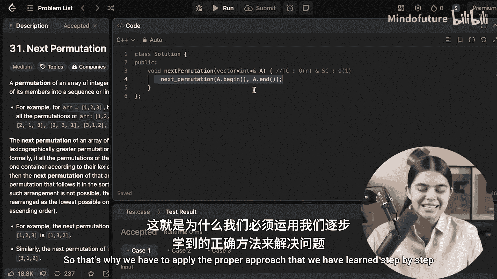

# C++ 数据结构与算法课程：P26：合并有序数组与下一个排列问题


## 概述
在本节课中，我们将学习两个经典的数组操作问题：**合并两个有序数组**和**寻找下一个排列**。我们将详细讲解问题的核心思路、解题步骤，并提供清晰的代码实现。

---

## 合并两个有序数组

上一节我们介绍了数组的基本操作，本节中我们来看看如何高效地合并两个有序数组。

### 问题描述
给定两个按**非递减顺序**排列的整数数组 `nums1` 和 `nums2`，以及两个整数 `m` 和 `n`，分别表示 `nums1` 和 `nums2` 中的元素数目。需要将 `nums2` 合并到 `nums1` 中，使合并后的数组同样按非递减顺序排列。`nums1` 的长度为 `m + n`，其中前 `m` 个元素是有效元素，后 `n` 个元素被初始化为 0，用于容纳 `nums2` 的元素。

### 核心思路
直接从前向后合并需要移动大量元素，效率低下。一个更高效的方法是**从后向前**填充 `nums1`。我们比较两个数组末尾的有效元素，将较大的那个放到 `nums1` 的末尾，然后向前移动指针。

以下是解题步骤：
1.  初始化三个指针：
    *   `i` 指向 `nums1` 的最后一个有效元素（索引 `m-1`）。
    *   `j` 指向 `nums2` 的最后一个元素（索引 `n-1`）。
    *   `k` 指向 `nums1` 数组的最后一个位置（索引 `m+n-1`）。
2.  当 `i >= 0` 且 `j >= 0` 时，循环比较 `nums1[i]` 和 `nums2[j]`：
    *   如果 `nums1[i] >= nums2[j]`，将 `nums1[i]` 放到 `nums1[k]`，然后 `i--` 和 `k--`。
    *   否则，将 `nums2[j]` 放到 `nums1[k]`，然后 `j--` 和 `k--`。
3.  循环结束后，如果 `nums2` 中还有剩余元素（即 `j >= 0`），则将这些剩余元素依次复制到 `nums1` 的前部。

### 代码实现
```cpp
void merge(vector<int>& nums1, int m, vector<int>& nums2, int n) {
    int i = m - 1; // nums1 有效元素末尾
    int j = n - 1; // nums2 末尾
    int k = m + n - 1; // 合并后数组的末尾

    // 从后向前比较并填充
    while (i >= 0 && j >= 0) {
        if (nums1[i] >= nums2[j]) {
            nums1[k] = nums1[i];
            i--;
        } else {
            nums1[k] = nums2[j];
            j--;
        }
        k--;
    }

    // 如果 nums2 还有剩余元素，直接复制到 nums1 前面
    while (j >= 0) {
        nums1[k] = nums2[j];
        j--;
        k--;
    }
}
```

### 复杂度分析
*   **时间复杂度**：`O(m + n)`。我们最多遍历 `nums1` 和 `nums2` 各一次。
*   **空间复杂度**：`O(1)`。我们只使用了常数级别的额外空间。

---

## 下一个排列

理解了数组合并后，我们来看一个更抽象的排列问题：如何找到给定序列的下一个字典序排列。

### 问题描述
实现获取数组 **下一个排列** 的函数。算法需要将给定数字序列重新排列成字典序中**下一个更大的排列**。如果不存在下一个更大的排列，则必须将数字重新排列成最小的排列（即升序排列）。

### 核心思路与步骤
寻找下一个排列有一个标准的三步法：

1.  **寻找“转折点”（Pivot）**：从数组末尾开始向前扫描，找到第一个满足 `nums[i] < nums[i+1]` 的索引 `i`。这个位置 `i` 就是需要被替换的“转折点”。如果找不到这样的 `i`，说明整个数组是降序排列，已经是最大排列，直接跳到第3步进行整体反转即可。
2.  **寻找交换元素**：再次从数组末尾开始向前扫描，找到第一个大于 `nums[i]` 的元素 `nums[j]`。将 `nums[i]` 与 `nums[j]` 交换。
3.  **反转后缀**：将位置 `i` 之后的所有元素（从 `i+1` 到末尾）反转。因为 `i` 之后的序列原本是降序的，反转后变为升序，从而得到最小的下一个排列。

### 代码实现
```cpp
void nextPermutation(vector<int>& nums) {
    int n = nums.size();
    int pivot = -1;

    // 步骤1：寻找转折点 (pivot)
    for (int i = n - 2; i >= 0; i--) {
        if (nums[i] < nums[i + 1]) {
            pivot = i;
            break;
        }
    }

    // 如果没找到转折点（整个数组降序），直接反转整个数组
    if (pivot == -1) {
        reverse(nums.begin(), nums.end());
        return;
    }

    // 步骤2：寻找大于 nums[pivot] 的最小元素并交换
    for (int i = n - 1; i > pivot; i--) {
        if (nums[i] > nums[pivot]) {
            swap(nums[i], nums[pivot]);
            break;
        }
    }

    // 步骤3：反转 pivot 之后的序列
    reverse(nums.begin() + pivot + 1, nums.end());
}
```

### 复杂度分析
*   **时间复杂度**：`O(n)`。我们最多对数组进行三次线性扫描。
*   **空间复杂度**：`O(1)`。所有操作都在原数组上进行。

---

## 总结
本节课中我们一起学习了两个重要的数组算法：
1.  **合并两个有序数组**：通过**从后向前**的双指针法，在 `O(m+n)` 时间复杂度和 `O(1)` 空间复杂度内高效完成合并。
2.  **下一个排列**：掌握了寻找字典序下一个排列的标准三步法：**找转折点、找交换元素、反转后缀**。这个方法高效且通用，是解决此类问题的关键。



理解并掌握这两个问题的解法，对于处理数组相关的面试题和算法挑战非常有帮助。