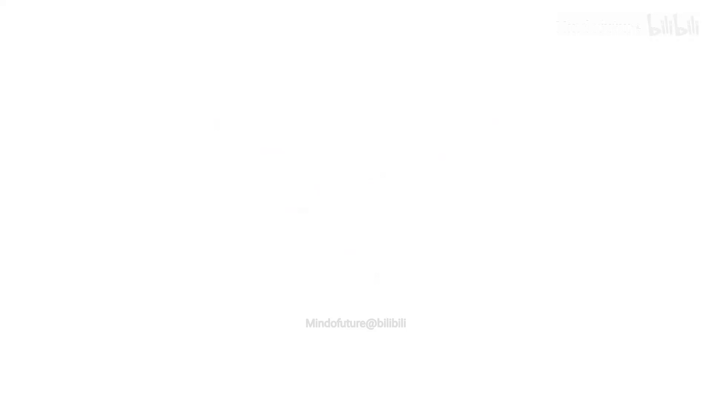
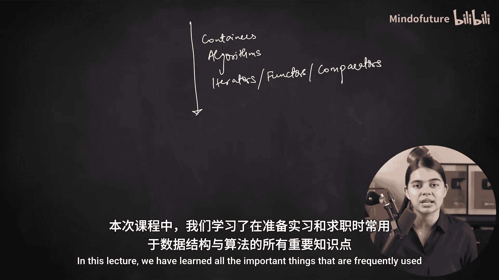

# C++-DSA课程-｜-数据结构-｜-leetcode-｜-Apna-College-｜--Complete-C++-Dsa-Course-p27-P27_C++_STL完整教程-标准模板库-一站式学习--BV18oUGBkEmV_p27-

I in college today we're going to learn about c Sl Now this is going to be one of the most detailed in depth lectures ofl on YouTube Now when we talk about stands for standard it is a special library containers and or for example we are sitting for function use and signal we get our be sorted implement we can simply use the able to save a lot of time。

That is why c Sl practical coding camera balls are a use k specifically when we talk about placements or internships online assessments coding can participatename Now when we talk aboutll comes in four parts dismisses sub important who engine sub are use these are containersk lecture can domain focus that will be on containers algorithms cover which is the second most important part will also learn about itators and we also cover few containers and algorithms use plus saari important placement point of you say important and practical day today coding can usek lecture cover So the first thing that we are going to study is our first container which is called vector。

A vector for this particular and vector is very similar to exist。😊。

Basically c schedule in size constant any a barham defined size3 run program size decrease basically constantham but we want it dynamic we want it be able to resize on runtime runtime vector is vector then vector we already written the simply vector vector can。

Wr vector in V and vector vector is initially that is equal to 0。 In fact。

 is size with the help of the size function。 we can write vector dot size and which is equal to0 vector sizeism that is very interesting Basically is vector vector size。

vectors multiple functions because functions simply。😊。

Vctor dot push underscore back ands suppose we inserted one into the vector here and data that is going to be most interestings suppose and next time。

And if process repeat which insert vector and and these are two very different properties basically number of elements equal I try to insert。

Or try to push back number 3 vector equal equal vector the number of elements that it can hold capacity capacity double any numbers is vector that is equal to 12。

3 and。To Yahaper Hamipas a core important function of the called capacity。

 just say Hamma vector key capacity Kobe B， So yas size。

 and if we try to print the capacity it is going to be equal to4。

verify lets push back two more elements。4 and5。A vector came loop shall and we can simply use a for each loop just scan how beta integer this is going to be the value in our vector and we are going to see out the value。

And ask me。s associated functions example if we vector elements2 is similar。

pushback and basically last making data under working This is really important Jo because you'll see that in lot YouTube this part this internal working of is not even important and it can even be asked as an interview question during。

I function ofback back vector can to last index v data to delete we can simply write vector dot popback and parameter last insert automatically back specific index vector basically value is associated with a particular index index algorithm vector。

And square bracket not case add up the index kernel Ya there is also an additional function called dot at dot at can of index except value could per you say for example。

 Yaha C out Kana value at index2。To is hum Victor。オフト？What。😮，Victor dot at。don he cases me。

 we are going to get the same value。 Let's clear this and The value at index 2 is3 or three3 y we3 y can generally dot at function the practical in is the other familiar And that is why we prefer the square notation any like notation vector elements co axis。

cal there are two more important functions called front and back the vector curve first element Ya last element use that the first element K Ham front function use and last element K back function use This is Yaha we can print the element at front we can write vector dot front。

With end of line。And similarly， harm of the last element printer using vector dot。Back。

Sp this and the frontpa element have equal backpa element have5 k equal So in functions could be only cover a vector could normally create scan elements could push back a lava because just directly vector initialize with some values normally E initialize use cur they say vector initialize cur can elements say for example let us remove all of this。

 And if we want to initialize a vector with some values simply 12，3，4 and5pa by the same values。

A printer。Let's save this and we get all of our values。

5 is linearia because we are popping back the last element。

Lets save ands suppose size same So instead of repeating that value again and again。

 basically3 value。点基管你物。The yaper， if I create a vector like that。아 threeさ vector 하点 해。

To elements we get 1 let's suppose10 s vector just value minus value those case10 times minus synax dynamic programming dynamic programming when we learn about tab generallypp initialize these array ores with some initial values memorization programming also we try to initialize our Dp vector or matrix with some initial valuesization is syntax but this is a really important syntax when we talk about is one more synax vector vector initial construct vector say。

 for example， we created a vector。Of inteia values called vector 1。

 just sayney initialized here with 1，2，3，4，5 values。 A is K Alva create or vector。

Which we call vector 2。 They say vector one values case initialize can on simply vector 2。

ctor2 vector or vector2 of elements vector elements different different ways to create a vector to initialize vector with some initial values and we also covered these functions functions all functions vector which are calleds and insert costly functions costly place and functions one time complexity constant complexity which is goods and insert function in and time complexity the case let us first talk about this function function as the name states is used to erase some element or a range of elements in the vector。

Yes for example， element simply pop uses suppose index number0 element do need to pass the position of this element position in terms of index position use a thing let us vectort vector do position beginning of vector index element position use vectort function。

We pass this and first elementary。 you completely era。 So say but right them。

 we have our vector this under we are doing vector dot eras and vector dot begin。

elements we won't be able to see Similarlyly， let's suppose next time the value index index basically do index do plus third do is pretty similar to already already made。

 but under the hood is not but is index lets and。To erase function gohammi starting me exstar past Kna Boga。

This is going to be the start and end pass the range sorry elements is range and start included here。

 but our end is not included。 say， for example，2 and 3 in numbers start position This position is basically equal to vector dot。

北京。Plus1 and the ending position， Qki is a delete is said just A value position and pass carrying Takeki element in Now So you the elements delete those pass vector dot begin plus。

To his statement， liquorari you don't numbers daily to， let us try to do this。

 we start Ja vector dot begin plus 2 and N Ja vector dot。

Be plus3 let's clear this and2 and So this is hows works function position vector vector number。

Dot begin plus2 to vector dot begin plus 2 co pass and value can00 copa to my final output because let us try this vector dot insert。

Victor dot2 and value equal output insert also have a function。 can simply write。めさ子。

Using vector dot size。And opening knee capacity goal。

Those case mehama size 0ga make can initially vector 5 capacity create other capacity a maybe 5 k co。

 Similarlyly， we also have another function called empty emptyium use vector empty simply print is。😊。

Emp啲。The Albert will try to print。Let's see it。Since we have cleared the vector， yes， it is empty。

 those print， which is equal to2 likeham elements could clear Those case maybe we are going to get a false value So these were the major functions which are associated with vector and era and insert function middle operations these are generally very costly operations Major functions use functions and functions Next we talk about vector vector can functions and Jo beginning and ending itatorator we can imagine it like a。

 say for example elements。😊，A vector dot begin return let's call it it itari memory exactly memory when we do vector dot already simply use the operator star operator operator vector do simply print I value vector dot begin0 index and core which is called vector do。

and common misconception of that students make last index actually dot n does not point to index n1 vector dot index n do random value depending important。

They said this is 1，2，3，4， and 5。 Let us do this。And Aham print Kvaana Cha vector dot begin。

Doncuse me。Victor dot begin up the a may iterator Maripa returnga and is key value is key that of point here。

Is key value point career bunki， Similarly Aham N Cur Yahaer， if we try to do vector dot n。

It's not going to give us 5。 It's going to give us 0。

 Q5 point5 kan last index last position just a value value point J begin J andai we have two more iterators a reverse begin。

And vector name。見てる。If we already have a vector。Let's suppose we have an itator calledk initial vectork or index equal to vector we can write runs on vector which vector。

We start at I equals vector dot begin。IP gp not equal to vector dot N。

 herbarmi I coconna Pless and herbarum C out Kanaium。

Haari I T G value I T codeator itator D reference Ya just keep of your point values to。

use the star operator and end up's this simple loop with the help it we are able to access the memory something on operating system example when I was working for Microsoft the project operating system using which allow us to directly access the memory it we use something called itator what is a write。

travel position position we get it through vector dot R and similarly vector R R position position is equal to R。

So let us this vector is equal to。Let us start with R begin， and Jep。

Is not equal to r will be printed in the reverse fashion the is not easy which basically。

Because of the helpful auto keyboard。 So this is all about the vector container。 Now。

 let us talk about the list container。 Now， list is also a sequential container like vector。

 but list Jo who internally implemented Jo as a doub linkist。

W link can key listja imagine to scan their elements go push from back me and push from front be。

 Similarlyly， elements go pop from back me and pop from front。

 We see that you say we have in place back and in place front。

 So this is the simple syntax for creating a list。 Let's come to our quote。

Lets go create sub include list who。 And then in our code， we create a list like this。

 We can create list in teacher L。D elements insert correctly we can use the pushback function。

 They say let's suppose pushback we are trying to push back to Similarlyly。

 Jpa pushback we have push front front elements insert insert let's suppose3 and then push front here。

喂以。Let's save it to print the elements。 We can simply create a for each loop。Integer values。

 e Anhe sea out ca of mis values go with some space。See out end of let's save it。

 Lets run elements is reasons this was list from the back and similarly that is why the order is 5，3。

1 and2 and similarly if we replace it that will be the same result and elements if I do list。

The popback andari elementsency equal to2 deleteo Zga。 And if we do list dot pop front。

2 Hamai element C5 delete to 0。 And you just get 3 and one。To is separate print curva。

 and we have3 and one in the output。 This the say Ya are major functions here。

 If we want to initialize the listmo assembly see same the initialize cur just empty C vector to initialize。

With some elements inri values print V these are all the values that we initialize the list with andva size clear R insert front function already vectorari list major difference vector sub vector is implemented as a dynamic list is implemented as a and because it behaves like a w front operations will next sequence container that is calledq is implemented as a double Q and it is very similar tool list we can imagine it just like a list any although operations push back to push front to front place back front or operations will。

This is the general syntax。 A B DQ wordham only。 There are two。

DQs in programming A D Q Q is spelling A D Q is spelling is D Q double ended Qp is D Q Q say element pop So in normal we confuse4Q that stands for a double ended Q。

 And this is a generic word that we used for popping or deleting elements from a normal Q。To DQ。

 we create。 BQ could create。 we need to en。Q。And create simply list say replace。

 we can just write here and So elements will call similar will internally it is internally with the help。

Of dynamic areas。And Q in key say D Q under random access possible list under random access possible random access possible D Q under Dq available just make elements randomly index key printer。

J say for example， algorithmhamm ni here d of2 to8 valid value movies on my plus printto I Jacky algorithmm carrying a list of two those case may we are not going to get any value so let us verify this if I try to see out d of any index。

To let us run it those case may valid value convert to list are to sequence containers cover sequence container and non we are going to talk about a special container or a special thing called。

U the pairs okay， they are part of the C utility library。pair directly pair value This is value1。

 This is value values different pair pair and then we need to define the types of both the values and we can name the pair anything and right for examples pair don't need to include anything and cur for example。

 my first value going to be second pair first and second value simply see out dot first value。

And Ukebalham like accept P dot second dis P， second value coor。

It's run topa 1 and 5 individually away。 The Ro pairs don no same values Sc。 If we want。

 we can create a pair of a string and integer value。 me have a string pass。

 Let's suppose I passed a string called shda topa。Don inger use inger is example， in in pair。

And second type may be a core pair bring of integer and integer values。

 This the case I as a pair as I my first value to integer A like in second value the up make pair。

The the pair of pairs we create a second。 The first value is going to be an integer and second value can pair of integer。

Indeed， you create having it。first value in teacher let us pass one and second value of in the form in teacher simplicity character and pair of pair first value do pair save and second second p do second do。

Second value of first element。 you could make pair。 This is going to be8 second element。

 This is going to be equal to。values vector of vector teacher of13。

3 and 4 and fair from China to loop till1 loop can theju her8 value。That is going to be equal to。

A pair to vector He value may see out carrying up a pair cuff first。With some space。And of the。

Second with end of line Sakiri values print and we can simply use the auto keywordri vector lets suppose insert。

if I want to insert to insert can use the pushback function to push function pair can pass and push and automatically pair in at the time of push insert objects for。

pushback if we in objects generally push all programming is simpler if talk about efficiency in place compared to push but push because it cannot convert to individual values into a pair but in can it So this is how pair nons is a last in。

visual visualize。Ha elements or elements or that is why it is called a last。

First out data structure Qki value last means easy first me only create we have a lot of important functions Sa create it is pretty easy simply stack of integer elements stack function we can also use in working say。

 for example， stack nott push1。To do push2 do push 33。

A top per element dot top function use top three element S dot top。The print I value you three。

Let us try and create a stack。Let's remove all of this stack could create con。

 We need to improve stack。The upper， we want to create a stack of images called S。

A scan hum pushush card gave1。And similarly， we are going to push to and。

The sea out cur a me of value。ToG I S dot top end off line。Let's save it。

The function function functions loop is not empty。is not empty top instead of give delete。

we also have a size function in stack size and we also have a swap function to8 stack values for for example。

 many teacher values called S initially stack one elements simply size。

Which is going to be S dark size。And of line and swap initially and were all the and is first this part is called and this part is called Q is syntax simply。

s suppose if I write do12 and back。Stack with O Q。 Let's write Q here to Ya Q call it Q。

 Ya Q calendar。 We can try to push elements。12 and3ham loop to same functions top front with some space and elements and let us see out end of let us save it and run order elements push in place front function size function and swap function Im not going to repeat Q detail next data structure that is called a priority。

A priority Q is a very special data structure internally what is actually happening under the but priority brief internal maxap structure useap max heap and complete binary internally even though we call it internally it is a binary internally structureap max minimum are also important properties which are related to when we talk about visual try to visualize it as a stack。

I scanari top with just topa highest priority element stone a basic is that priority create and highest priority element by default。

 Vo element just largest value largest value can come the highest。😊，Por。

But let's suppose priority value 5s push toki5 sub priority or3 lets10 to1 priority4 to4。

10 or five second priority to basically internally form that。

 So this is not exactly how it works visualize them priority priority usage of elements pop。

Pop carrying it to largest element pop for second largest third largest and for fourth largest This that marriage of elements。

 pop it was sorted order。 we can also verify it。 lets create a priority priority alna includena and if I try to include priority is elements5。

Then and4。And priority top elements could elementsed order largest element has priority。

 But if we want the smaller element to come in the top case reverse order priority build is the in along with the type vector of in and we have to pass this thing called greater in greater in Jo this is actually called a。

Funter is nothing but a function object Jo to greater in comparator compar basically which functions dual logic or comp ascending descending order can the automatic compar default reverse order Jo comp So if we want to build a reverse order priority Q scan vector。

 then we pass greater in。And and complexity is equal operations any concept of complexity created dedicated lecture time and complexity。

is a very interesting container。 It is called map。 Ma is specifically used to store key value pairs。

I like to visualize map as a table。 is the A table Imagine cr name。

 just my pass do columns first column can。 we have some key and second column calendar。

 we have some value。A map key special special is Iriari unique values There cannot be a duplicate key。

 The key can also be mal like a number。 say students number unique can name duplicate company employee I but employees employ 101 and 102ul So this is possible example let's go we have to design Amazon using C plus somehow we have to do it products。

products plus own products quantity productsss is equal to 50 second laptop equal third product headphone is also equal to 0 simply write laptop head string is equal value。

Insert connectul Ya values could changeul。 We can simply use this syntax or generally a syntax who use them。

 I'm simply like M of key。To say for example， of TV is equal to 50 value TVki of is equal can use this syntax let us try and。

Mapco and Yamic map create a of string and integer。 Let us call it M。M of。比喻。Can be equal to 100。

 We see that he can say M of Let's suppose laptop is also equal to 100 and M of。It this。Is it good。

This say map the data I'm trying to for each new data go verically to auto Since this data is a pair kind of a data。

 The auto pair P use this values it P dot first。With some space， we got。4点。Last and offline。

 let us save it and run This theari values sequence sequence K there is a very special thing。

 In fact， say or values a tablets tablet key。 Let's suppose quantity have 1，20 K equal。

 and let's suppose one item is watch watch quantity，50。

items print notice items ascending order sorted order sorted order keyssorted order Any headphones lexially string inki H L and headphone laptop tablet tablet or TVki tabletxi tablet default in ascending order。

Ascending order to main characteristics and sorted order associated or in function insert use value if I。

M dot insert to insert from k Iyaki value pair insert Yaura pair pass。 say。

 let's suppose my first value is camera and second value is equal to 25。

individual output next we count count basically returns the number of keys for example。

 count is equal。To print dot count scan count for laptop count basically return Ki key value laptop Q laptop key because there is a single key it does not return the value of laptop。

 It returns the number of count of instances。Laptop laptopptop corresponding value which is equal to 100 laptop is10 value the Next we have era value era we simply need to write let's suppose do and scan value。

This case me my poke。I says， we also have find fineari key value value if it is found。

 those case may return or。W key value pair Those case may we get M dot in map last value value my basics logic。

That if M dot。Fine， to see keyco search for second。

 Let's suppose some camera could search for them A camera exists with the M dot find。

Is not equal to M dot N。Those case， metal camera exist at time。To Fo print ver。

 and else Valley kiss me。Not。Let us save it。 Qkiri。B camera camera exists because those case。

 my mypa found print to Cara， but algorithm am do in place camera remove colium。Those case may。

 we are going to get。use similar manner size and empty function types multi and multi bracket multi let to multiap lets turn into multi。

There case say a multiple values operating。Let's suppose TV co here is about four times insert cur A map those case madeham t go four times insert a value multi here to we get four different values printed to us andham dot erari let us era。

ピ스코。Sear this， but TV of8 instance could delete it So I can write M dot fine。

So is TV it itator come actual location or ja TV value delete value delete value。

 So this is how a multi map internally。Next， sub important type of map sub are frequently that is called an unor map Je normal mapari sorted order un map random order for example。

 multi。Map to un ordereded map like this。 We have unored map just can values come insert here unorder map can values duplicate name print to a value print over。

Which is TV， but in values program change cutting。 Let's suppose we have laptop。 We have fridge。

 We have。Whatch。😮，Lets clear and data。 This is not a sorted data key sorteding here。

 So this is random data。 I mean map multi rarely use sub use use unor map and map sub in terms of that time complexity functions insert functions log in because internally map is implemented as a self。

Balancing。んでさりさりユニ。Values a or here unique values a particular sorted order can set create simply is the set can can the insert or the function。

 say for example， if we try to create a set those includena set。要不点。

Set of integer values call S the set inte values to value the set here。

 let's suppose herem trying to put our values be insert here2，3，4 and 5。

 set sorryri sorryri values go。 We can get them printed Ya let us get our values。With some space。

 any detail end off。duplicate values us2 unique in fact with the size of the set if we try to print the equal values order internally functions log very similar to how internally under the。

Sa disagree to similar side process scale though all additional functions functions rather frequently use。

 but Im going to cover them sub functions that is called lower bound。

Lower bound function canander Ham Jovi value pass。 Let's supposeari said canander values have one to。

4 and5 lower bounds suppose many four value set lower bound function minimum4 just value lower lower bound condition minimum lower minimum value just value for example。

 if we set3 and do lower。Bund is equal to lower bound basically itator return 44 say I'm trying to de referenceence4 already value equal and lower equal to set force just value value body value or4 those case measure value that is。

A set dot end value， basically， ending iterator any valid answering this me equal lets the lower is equal to 0 lower we have a function called upper simple example let's suppose we have an area of characters in characters A we have triple B。

 we have C And having get different different index available6 and 7。

's suppose pass it lower bound value， are it。Anic。Upper bound。法鱼或者。For the character。

 let's suppose be how many say be character task to lower key value should not。Be less。Then。

K value lower going to equal to value value greater than。

Equal to key greater than only greater than values case that is to be upper even though meaning and lower upper greater than lower lower and and this is how typical all multiple set basically。

Elements ordered may arrange random order elements print and that is why1 practically cases but practical cases is unor set unor optimize data structures equation say example let us remove this。

And you said Peter again。Let's suppose 1，2 multi elements or order。Fick。They say from Chinaとか。

ored set let's say that And run those case we are going to get unique values。

 but the unique values are not necessarily sorted descend order can values appear and Q unau set sorted issorted data lower bound and upper bound concept my sorted order can now by now we have covered a lot of containers。

 In fact， all of the important plus we have also covered the concept of and important concept those are our algorithms frequently programming basicallys sub equation。

This may say the first algorithm is for sorting sorting basic simple function of sort simply ands suppose this is elements and elements sort and position position n and value let us try to use sorts51。

It。读。So is a sort can， I'm simply accepting havena A and a plus N。

The upperhamari Nvalue is95 equal to a 5 feet laterer。

And I'm trying of values score for print P vname value of a。Let us see out。A value with some space。

Unfielded and off。Its the salted or Yahi same cheese。 we can do it for a vector。

 Ya vector of integer Those case may we have these values top me vector simply past vector beginning pointer。

Enending descend what callc if to。Basically， which value do you can，3，1。读完。I suppose we have  7，1。废。

Topa value vector is vector is vectorcom sort is vector auto。

And up pair key first value print orbar with some space up pair key second value print for wa after sorting and fair hum cuttingate end of line。

Let us save it。 clear and run。So order on the basis of the first parameter on the basis of the first value two value let suppose custom logic custom logic pair only on the basis of the second value second value basis pair and12 and1 have7 and1 and we and second value basis sort we need to define a custom comparator。

custom comparator comparators nothing but boole functions false value based upon comparisons custom comp let us call it comp name this function or custom compator comp instances pairator or pair it would be very easy to the same logic all pair pair pair and similarly。

on the basis of the second parameter on basis of the second value and second basisc asc。Any of good。

Haari ordered in P1 Pe P2 orki P1 second head。 That is less than P2 second。

Those case custom comp on the basis of second value value as second value basis。

second value basis asc second value same second value comparison basis logical。

P 1 dot second is less than P2 dot second。 T to ticket get up to return could do2。

L P1 dot second is greater than P P2 dot second。 Those case make value greater than less than cases but equal to equal to cases P1 first less than P first。

Those case return value or value case return false valuear logic sorting second parameter second parameter equal sort parameter could is second parameter sorted sorted value sort custom logic say in the form of custom comp define or sort function as a third vectors or important second important it is pretty easy。

You， for example， normal vectoropic create color，1，2，3，4， and 5。

I can mypa in teacherger values or aham reverse can vector。

 the reverse can simply up reverse function use This may have not beginning point of ask。

And Victor car ending point of basket。To Yaha on print advantage opinion value score So this is going to be a value。

It is run to mypa values， reverse order to A Cha to range K he values reverse。

You must see outculating it and offline。Let's suppose this range values score reverse year value range Ocal a vector dot begin plus1 and vector dot begin plus3 co pass。

and and we also have a function calledxi。ABC vector the vector beginning an ending past string here。

 Tom I'm trying to string copy be beginning an ending。They say， for example。

 let us comment this out For example， I have a string called ABC ABC come mean nextutation J come simply accept nextutation of string dot。

Begin answer stringing dot。And and Phil Ge out the Eco to Americapa Sama next returnga。

Here this in runpa AB canation any AB area nextation just say sayas a core function called previousutation just say。

 for example。previousation over let's turn it intos clear this And if you want to understand dedicated if you want to understand more about the logic of how you can functions Im of4 and5。

And mean of 6 and 10 the Jo minimum and maximum value functions return calculated It is pretty simple maximum minimum is6 swap is basically used to swap two values variable A equals 5 and。

Winow would values to swap can swap function to use Theem values to China to print carva a equals。え。

And if A verify， let us clear this in to a10 to B value automatically internally5 k。

 we have a few more functions such max element and element function vector minimum maximum value use let us clear this。

And。Let us uncom this part。Aham is the maximum value from this vector。To match。Victor dot。

Begin and vector dot end is the ETM past segmentname。

Andd offline function element I return and value could print ver simply say the reference。

 let's say it and runpa value5 k equal similar to you K say element get the minimum element equal to one。

Similarly， we have a function for binary research K let we have to perform binary research So sayra binary search here occupy interview scan most probablyra it is good to know binary search canal value comes simply binary function use we can pass the beginning ending itator and what target function of function of mu value false target exists and say Ya is if I want to perform binary。

Docus me。A Gham performed G other their binary search to search for a target。

 which is equal to let's say food。So case our output is going to be equal to one any4 exist kta。

 But if we want to search for 10， the 10 existing in case our output is going to。

It can equal through us a frequently use function gives function they're used to count set bits in a number。

 for example， I give you a number equal to 15 visual number if I know this is an inte number to internally memory latertes can come away 32 bitky J later memory32 bit come away it will start with a lot of zeros or zero skill last volumes taking it to 15。

Is equal to。This number number can set bit are basically bit value1 to operation generally competitive programming frequently use with a practically company scanner organization function。

 This is not a very frequently used function。 and this is not even very efficient of function this is built into the Gcc compiler and this is not compatible with all of the compile That is why practically industry This is not a very useful function if you do competitive programming useham number 15 set bit only count simply is number use value1。

23 and4 our answer will be equal to value。To say check because， let us here this。And。

Let us also delete this comparator。The upper， a girl passport queen number and is  equal to 5。

Do Sc out。B in。Op。Count and value equal to n or set that is equal to pop count teachers suppose long value long value long value function which stands for long long or long those case use。

Builting pop count。Double L。 So double L stands for long loan。 So we say N2 and N 3 ca。

 This is N 2 and。different data types we use the different built functions depending upon the data type。

 So these are all the important algorithms we have learned about a lot ofs we have about a lot of important algorithms we also and specifically how can we also create our own custom comp maps So I hope you have enjoyed today's lecture lecture important frequently we are preparing for our placements frequentlys and definitely cover lecture。

So if you have successfully completed today's lecture。 you can mark your ten down in the comments。

 You can just write completed C and you can also let me know the best part about the entire lecture。

 Concise apart lecture you can also share your progress with me on description So I hope that you have thoroughly completed C in today's lecture。

 and you enjoyed this lecture a lot。 I definitely enjoyed teaching this topic a lot。

 And this is one of my favorite concepts in C that I like to teach ask and keep exploring。😊。

