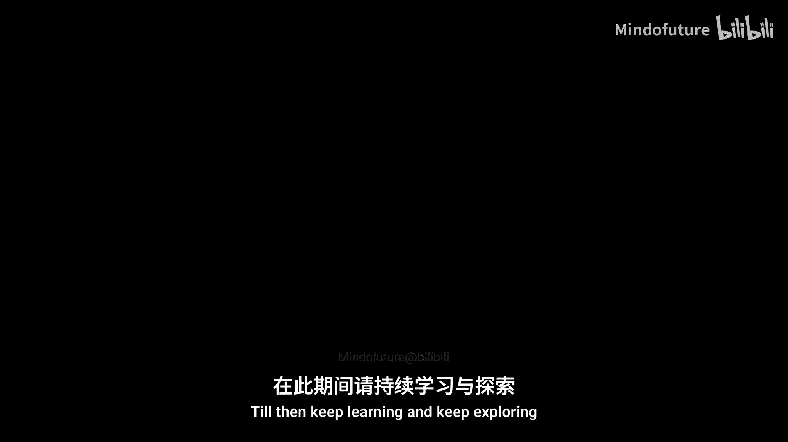

# C++-DSA课程-｜-数据结构-｜-leetcode-｜-Apna-College-｜--Complete-C++-Dsa-Course-p28-P28_如何在Mac上设置C++编译器-Mac用户软件安装指南--BV18oUGBkEmV_p28-

or system per set plus system system for terminal system to run this tools were also going to get tools tools and command per click license scroll。

😊，and the installation is going to start A installation it might take some time depending upon your network to bus some installation Kna Ja software downloadja or installation completeja installation verify we are going to run the same command installation commandne that the tools are already installed In fact version Ko hope after watching this video you were able to successfully set up C plus on your Mac system andk successfully Mil keep learning and keep exploring。

😊。

