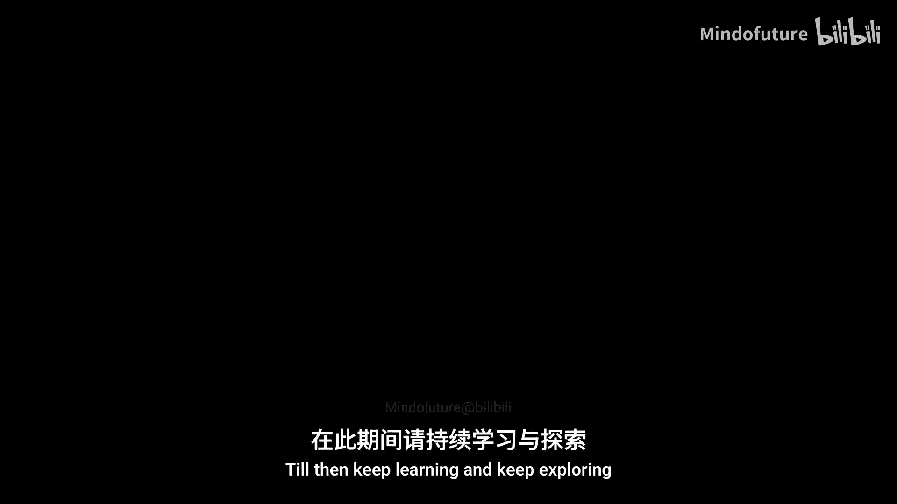

# C++ DSA课程：P28：如何在Mac上设置C++编译器 🍎

在本节课中，我们将学习如何在Mac系统上安装和配置C++编译器，以便能够运行和编译C++代码。整个过程主要涉及通过终端安装命令行开发者工具。

## 概述

要在Mac上编写和运行C++程序，我们需要一个编译器。最便捷的方式是安装Xcode Command Line Tools，它包含了必要的编译工具，如`g++`或`clang++`。

## 安装步骤

以下是安装C++开发环境的详细步骤。

### 1. 打开终端

首先，我们需要打开“终端”应用程序。你可以在“应用程序”文件夹的“实用工具”中找到它，或者使用Spotlight搜索（按下 `Command + 空格键`，然后输入“终端”）。

### 2. 安装命令行工具

在终端中，输入以下命令来触发命令行工具的安装：

```bash
xcode-select --install
```

执行此命令后，系统会弹出一个软件更新对话框。

### 3. 同意许可并开始安装

在弹出的对话框中，点击“安装”按钮以同意许可协议并开始下载安装程序。安装过程可能需要一些时间，具体时长取决于你的网络速度。

### 4. 验证安装

安装完成后，为了验证工具是否已成功安装，我们可以再次运行安装命令，或者检查编译器版本。在终端中输入：

```bash
g++ --version
```

或者

```bash
clang++ --version
```

如果命令返回了编译器的版本信息，例如 `Apple clang version 14.0.0...`，则表明安装成功。



## 总结

本节课中，我们一起学习了在Mac系统上设置C++编译环境。我们通过终端使用 `xcode-select --install` 命令安装了Xcode命令行工具，并验证了安装结果。现在，你的Mac已经准备好编译和运行C++程序了。希望你在观看本视频后能成功完成设置。请持续学习，不断探索。