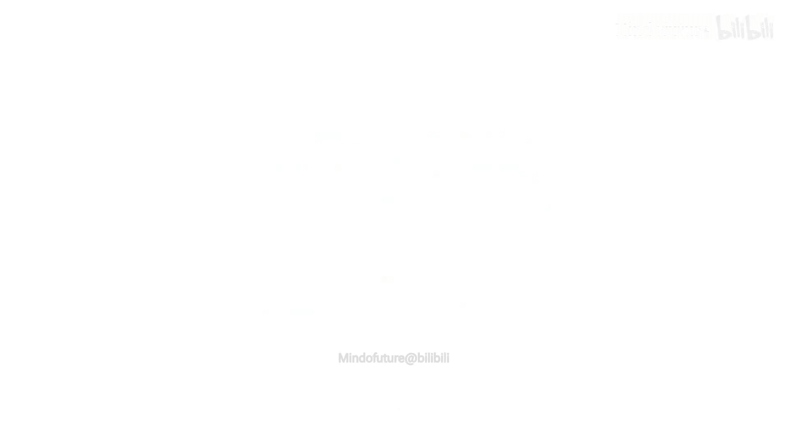
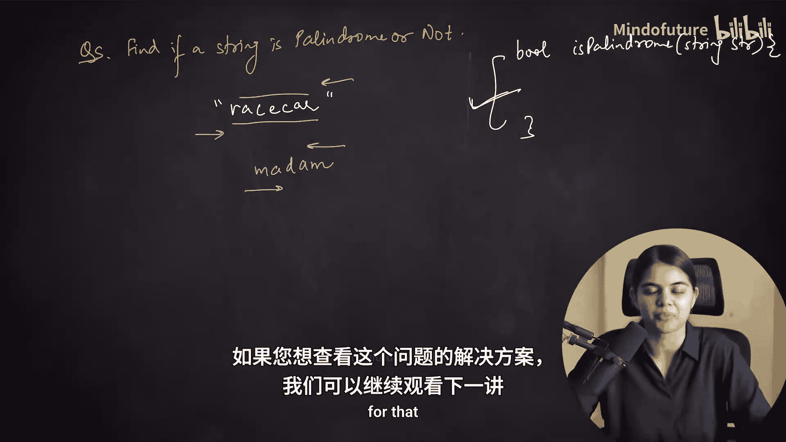

# C++-DSA课程-｜-数据结构-｜-leetcode-｜-Apna-College-｜--Complete-C++-Dsa-Course-p29-P29_C++中的字符串和字符数组-第一部分-DSA就业系列--BV18oUGBkEmV_p29-

Hi everyone and welcome to the complete D series important concept which is strings that will be upon introduction two strings there is also a company Now let us start with strings in programming in for example。

 I wrote and enclosed word in programming if something is enclosed in these quotes is string multiple sentence string is one important concept that we need to which are character string。

😊。

Chater basically character name am to。😊，Use them to store strings。

hamari double quotes may enclosed strings sentence character special character and hover which is called。

😊，Is associated with this null character and memory character a character character internally even though we a backlash and single character Similarlyly back character total character nu character basically and let us try to see out are constant have studied constant logical if I create in teacher。

😊，Elements stored him  one，2，3 or Yaham perham ARr co carva。😊。

wed remember print memory address butham we get something special。

 Let's clear this and run character characters to basically internally these characters are converted into ab set of characters nu using this function called string and the rest of the come together to form a string。

😊，character which is completely correct write。😊，individual characters last me we have this null character index yip string individual index let us replace this with hello if we try to print case should point to a null character as characteruous memory but character string to that character e is explicitly ended with this null character input generallyham input for example we created this characterham assign no。

😊，Initialization toqui size defined knaga let us supposeic character Ericika s 100 k equalanderku value input lena c in value andvo value directly string Gen character Erika Nausander assign and we can also see out。

😊，Our output output can I simply up SDR key value here say print carding here and let us also write。

Enter string。Yeah， in fact， enter character。Eddie。Let us save it and rerun。

To let's suppose character Eric Kenanderhamt Karaan Ja and hello。

But if I try to store somethings is because specifically and that is why specifically strings to use function number of we also have an optional called。

😊，Exactlys suppose or programming is something that stop which is and。World and D。

 we are going to write this dollarbaam world from here I sentence symbolri string say So this is how we take a string input in the form of a character characterri output k then the process is very similar to how we do it for a normal integer we can simply use a for each loop。

 Let's suppose her individual character output k So let us remove this D limit to make for each loop use a character in the string out k。

😊，With some space and let us see out end off。Like Tna character input cur let us supposemni upna college input Ki amamapa uppna college to print Oa per kkimney character erico size 00 create here that is why we have a lot of garbage characters I'm trying to we can specifically create it for 12 characters and let us。

😊，Try to output2 characters 11 characters 12 character and simplys we can run a and is equal to is not equal to。

😊，Our null character， Tta kamnes loop kranium， habarham icohargi plusus and let us take an integer variable called length is equal to 0 habar is loopkenderhamne v me lengthcocardgi plusus and last may hum out king length of string。

😊，Length and end of line。or basicallyari character e initial with values internally contiguous memory locations character E G and E and last special character is the null character basicallyator I equal and basically null character。

😊，So let us save it and run2 equal and definitely these are 11 characters plus1 is to be equal to 1 character is an advanced version of strings which are directly strings in and what are we talking about basically string and string string objects object。

😊，Characer C which is called string typethe primitive is actually a class data type string of string。

😊，valuealue assign kea to simply， let us suppose I'm licname up now college the my6 string create Ho and s value C out kea to simply STR licname。

😊，And let's run it toba value Prira tona normal simple processces I square bracket size def Kkiari dynamic in isco is reize can just assigno in thisari internally re orbu character string I This is dynamic in nature。

ki timeer。😊，R character for example， character let's call it C to charactersil and error expression must a modifiableifi value modifi or。

😊，To just a normal array x step amil can vectors mill character x step ame strings mill and that is why strings are really really useful cu kfi dynamic in natureium string underari characters your data storeai again just like character a conuous in natureai or conuous manner can theri stringsium ks are a normal operators who supporttheium just say for exampleri pass x string he up now。

😊，Though this is the first string that we have and we have another string STR2 called college Ahamme indonno strings who combine Gme。

 those callleham simply lexacne SR 3 is equal to STR 1 plus SR2 and ham C out kece Ane SR。😊。

3co using end of line， let's clear this and rerunappano strings combine and is stepcateation in terms of programming any strings readable character possible name lets strings string andno string equal simply out string1。

😊，Double equal to string 2。And whose case may we know。Let's clear this。 We are going to get one。

 which is equal to2 character or and equal equal which is mundane task programming and that is example。

😊，are going to get a0 because this value is false basicallyxi diction relational operator can directly access length of using with function。

😊，Input Carnele， the logic is very similar to how we input character areas simply SDR cur name lets suppose hum is stringco create curtheme without any initialization though hum is stringco input Carne v and then we see out our。

😊，Output。S T R and of like。Let us save it and run let's input with we pass string enter。😊。

Though high from Ana college enter anri string input k A plus stringerri itator based loop and kam。

 just say for example， if we have a string called Ana do itator based loop simply I is equal to0 start I less than string dot length i plus plus C outna SDR of I。

😊，With thereica say we can use the square bracket notation。

 just because atam Kafi familiar with that and this is pretty easy to use。😊。

Yeah say let us print it with a space and see out the the end of length。

So aK Kque Hamne a character could print vkname with a space。

 Ya here I'm trying to for each loop B U Kectname to4 character C in STR。😊。

We want to see out all of the characters with a simple space。

 Let us clear this and run same characters let us solve a very basic。

 very easy question based on strings introduction which is called for example。

s suppose we have an02030 and 30 201 basically we start wither and we start with an end to start swap1 with swap is and0。

😊，minus is 30 string with equal and。😊，And n1ja n is going to be equal to n1 loop simple plain loop is less than equal to is less than end and end position equal want to swap。

😊，of in fact， string string of withchan swap function functions if you want to study character is also available as probably solve this problem in two minutes on your own So this is problem number4 which is pretty much the same thing simply start with a start。

😊，Initialized with 0 and an ending pointer initialized with S dot size -1。

Toham start is less than R end， Hammi sb Kana S of startko with S of end。

And start quo humharanaem plus plus nhar minus minus U Gco short me single liner3。

 let us run our code and submit it。😊，Trikiako Johab was successfully submit O to yme putura process gear for a character Eri a string Ki caseme Ii same Chico Kna is very。

 very easy。 Agar meippaic stringhohi or Mujise Rivers Knata Uke mus simply function Lina rivers disma meapni string up beginning。

😊，And Ugar ending past Kadu to marry Purri Purri string River Su Caseogi， let us see this。😊。

Let's suppose we created a string called college and string simply function use which is called and functions and functions I youve already covered that lecture and。

😊，End off。Like let us save it and run string And this is how we can reverse a cl string。

 So for the hundredth time in this lecture characters programming strings basic introduction character different different simple operations as a homework problem I will give you this question which is to。

😊，If a string is。Pelin room。Or not。Pdros basically strings suppose I have a string called is to be the same string lets suppose if you have a stringcase English you have to identify if that string is a validrome or if it not validro which is boan function calledro and you have to complete this complete is homework So if you want to see the solution to this。

😊。

logical questions actually interview problems companies interview if you have successfully completed today's lecture can mark your attendance in the can write or you write have successfully completed or not also share progress with me on learning and keep exploring。

😊。