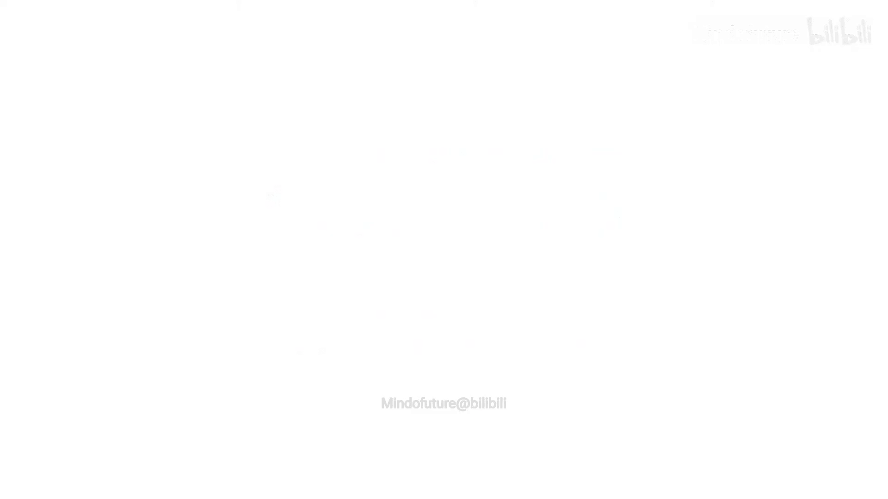
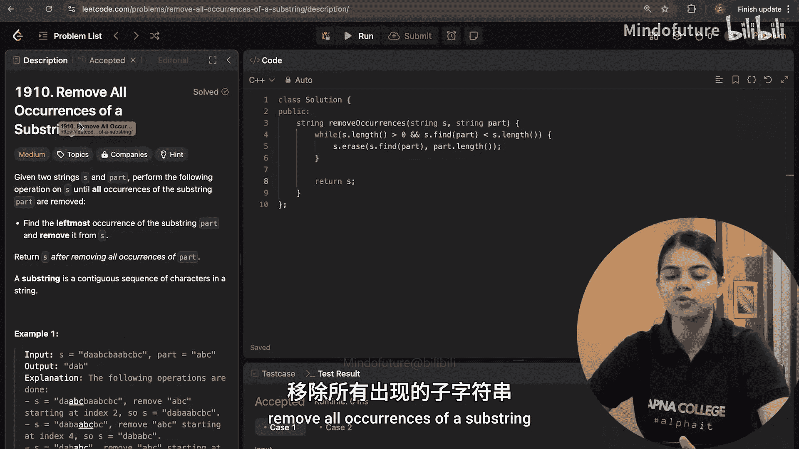

# C++-DSA课程-｜-数据结构-｜-leetcode-｜-Apna-College-｜--Complete-C++-Dsa-Course-p30-P30_有效回文_移除所有出现-字符串第二部分-DSA就业系列--BV18oUGBkEmV_p30-

Hi everyone and welcome to the complete DA series scan As from Knival has strings2 is scan though important string questions go cover Knival a co DSA concept per9 playlist scanner available in Z Also there is a link for the company wise DA sheet in the description box Ab have a first question which is called valid palindro。

😊，string given orro what exactly is going to the。So this is also a peendomic stringari question phrases Anum phrases if it's going to be a validdrome according to the questionicdomic string formic and digits likeic is question and a and E。

and basically equivalent and。Up isja general logic how are we going to check if it's adic string or notdrome which is basically the twororome character second second character and character compare to if it is a validdrome or not we can start with these strings and。

as case character compare compuls lower casemic convert vertical or c plus there is a small shortcut to do thatas egg functionai which is called2 lower。

😊，I function character character lower is not supposed to。

Start is pointing to this question mark A question mark is not alpha nu and finally part is matching part and is write it in the form of initial and。

I n minus loopran vp start is less than equal to my end。 In fact。

 equal toki and end a character give point anyway equal only equal to condition。😊。

And Ukeba subsetoli Ye Kawjaigaki Jinbi characters whom compare Kni who Al numeric characters He The Uks write a special function。

 Juchch Karigaki Jobi Hamra character in any start vara character here。😊。

Our string of star vor character。 I it alpha numeric， Ay Al numeric Na。

 those casemetoham startko kinggi plus kiss character cook comparingganna。 We are going to ignore it。

 And startko plusless kque。 We are going to continue Ya yhi same cheese we can do for the ending character。

😊，Agar ending character Stov string of end is not alpha numeric whosehamm end K minus minus and whose caseam continue Knebii operation perform character could change Kki。

 let's suppose Agarkii stringriari character special characters tora updateki next character I that could also be a special character。

 not part of the Al numeric group。 Those caseham continue Knakiaraham next character Kiki to update Kna Iba we are finally going to checkara string of start。

😊，Is equal to my string of end A string of star string of N D K equal Ne Agar Yahahamippa。

 not equal to other。 Those case mahamm Yahi say he falls return Kingi and agar normal casemtohammi simply start Koi plus plus enkona minus minus and Jese Ham Lukabu motherri stringni traversesap egg babyham misah Those case may we know that a string is a palendroomic string and Yaha Ham return Kni。

😊，猪挽留工。A her8 additional change of upper Kagi Yki Jaham characters could compare Kne Hamme basically only lower values could compare K。

 The lower values could basically compare Knelaki we are going to use the function to lower and Ucanander Hammani Donno characters could pass Karinggi。

 The starting ending Dono cohi to lower me convert kque。 We are going to。😊，Do the comparison。

This that is scale lower versionqui scale lower version case compare K uppercase and lowercase characters we match cur。

 So this is the entire logic in the form of the pseudo code is major is alpha numeric function head。

 This is going to be a very easy function。 justcom ch curte time Kinggi to up is barna time ch can this is the function that we have to completemic boolean value return Kringate This subop startta initialize with0na nta initialized with。

😊，S dot length。Mind this one。Then we have the loop。

 Jeptahamra start is less than equal to n Yeah equal to a remove curectam subo checkinggi is alpha numeric hea to Yaper equal boolean function 3 curlyham。

 Lets call it is alpha numeric gcanander Imkobi character C H Beijing Gcalpa2ia falsealga Tom Klinggi Agarhamara S of start。

 Is it alpha numeric。😊，Yeah， not alpha numeric。 Those case may start ktohamai plus plus and hamya Kingi continue Saham Yahi same cheese chze is Al numeric4 R S of end th Iabba false return hook Yahabi I false return hookta。

 Those case may enku Ki minus minus， and we are going to continue Na Czech Kine2 lower4 R。😊。

As of start。Is this value not equal to2 lower？😮，For S of n agar donno values come mismatch whose caseme we are going to return a false here he sayki a mismatchku nonindroomicname plus nname minus minus and lastmedroomicstrings and return2 value function completeic if it is greater than equal to0。

And C is less than equal to 9 Tvo alpha numeric character Oga yaffer second condition of Sca a x key agar U cut2 lower 2 lower agar capital a small a donno values cut lower version any small a agar of small a small zk range byga vvoic valid alpha numeric character Uga f2 lower of C。

Is greater than equal to small a and and to lower of C。Is less than equal to small Z。

In sari cases candle， we are going to return true value because it is going to be an alpha numeric character like in Iika false Sojaga Y opposite ojaga falses K equall muab Agaru ins a Tc range can any other then it is going to be a non alpha numeric characters This simple a function hence just home k ktan and let us run our code。

And let's try to submit it。Ahamraju is alpha numeric boolean function。

 This is a constant function cu simple condition in function code stringverse is the complexity of is linear complexity function we have one more additional function directly alpha numeric logic use problem that I'm giving you is to identify or to search for the function numeric and function can make the change with that small function and you can reex function solution function。

Now let us move on to the second problem， which is called remove all occurrences of a string。

Question can the Hamipasic string given here and Hamasic part given here。

 Hamipas of part valley string here， We can assume it to be a sub string。

 Is part cohammeni main stringian the duna orni Barbiehammem Atni Barhammeky occurrence coexistence go answer remove Kai。

 Just for example，ipas a string here， let us rewrite at once。😊。

I is answer is is also problem number and。And we have to find the leftmost occurrence of the sub part and remove it from S we tried to find the leftmost occurrence of and this is to be useful functions use find function。

😊，String dot find function k Ham the keyquis substr pass k of this given string or Jaha Purbiari main string kand substr exist k Hamra find functionme string key starting position returnta Jese。

 for example， Hamari pass string A AB and A D E ormi search kna for A B tohamect if this is equal toesttiaesttia dot find。

And if this is our， let's suppose let's call it part part search topmi string part A search find function first first position sub string and first starting position and that is going to be0。

 basicallybi part starting index is we are going to get0。

 let's supposeari partm search knegie X string X subhi case non valid value returnbi string dot valid position returnham simply check is my string dot substr less than my string dot length valid position return less than string dot length。

😊，To the v checkas Se position return second function， j use Khan。

 That is the string dot eras function。 string dot era scanander k B upneek starting position pass and upneek ending position pass sec in fact。

 ages second parameter instead of end。 this is basically the length of the upstr just come up main string say delete。

 just say example gi， let's supposeari string hereippa A B D， E。

 F G H N I K equal is Agarham S TR dot eras。😊，Hm starting position Lena Chaia 1 k equal and hum。

 let's suppose four length key string would delete Kna Chaem So Ha Guringgi， this is 1， this is 2。

 this is 3， this is 4。To first position is to start carrying any first indexes start carrying or length key string deletene2 delete3 delete delete。

 So basically these are the number of characters or the size of the sub that you are going to erase from the main to a cha characters key string So this is not exactly。

 but this is the length or the size of the sub that you are going to delete remove functions going to be very easy to solve this question。

 In fact， you can pause here and try to solve it on your own is going to be very easy is part leftmost first position。

😊，J position first position。Tomar those steps and subsequently to find part。

In string ce second step here to delete part in string delete tone first step we are going to use this function S dot or part string or valid positionippa return is this value less than equal to length Those case second part perform K。

 which is going to delete this part main delete to deletene S dot or deleteas values a starting value a ending value delete part main I he starting position。

😊，am starting position function work This function returns the valid position or can we say this function returns the starting position of sub inside the main starting position starting position or starting position position for position length main is simply going to be equal to part dot。

AndAnd theari stringra part exist。 So this is going to be the second condition。

 T tu is why loopander repeatedly k performval repeatedlyari string era So this is going to be the entire are going to start with this function main string。

Sca size is is greater than0 the B hammni partcode search curquet delete curname Fim search carrying a s dot find hamopni part which a fine current kpa valid value R is this less than s dot length a valid value R to Hammusus string is k is starting position past K prodigi which is equal to S dot find part andkepamal length pass K perdigi which is part dot。

Nit。This is going to be our dot， the repeated Li function。

 tabgapari string which valid values exist Katheier andp string part exist for time and Iranisip let us return this original string as Q changes original string let us run it。

And submitit。Tomar Jo was successfully submit and is3 amonic question remove all occurrences of a substr solve I string functions which are useful functions we got to learn some important concepts about how to solve string problems using existing functions or via writing our own custom functionsari if you have successfully completed today's lecture you can mark your attendance in the you can write there and today's date can also share your progress with me on Twitterku description lecture keep learning and keep exploring。

😊。

