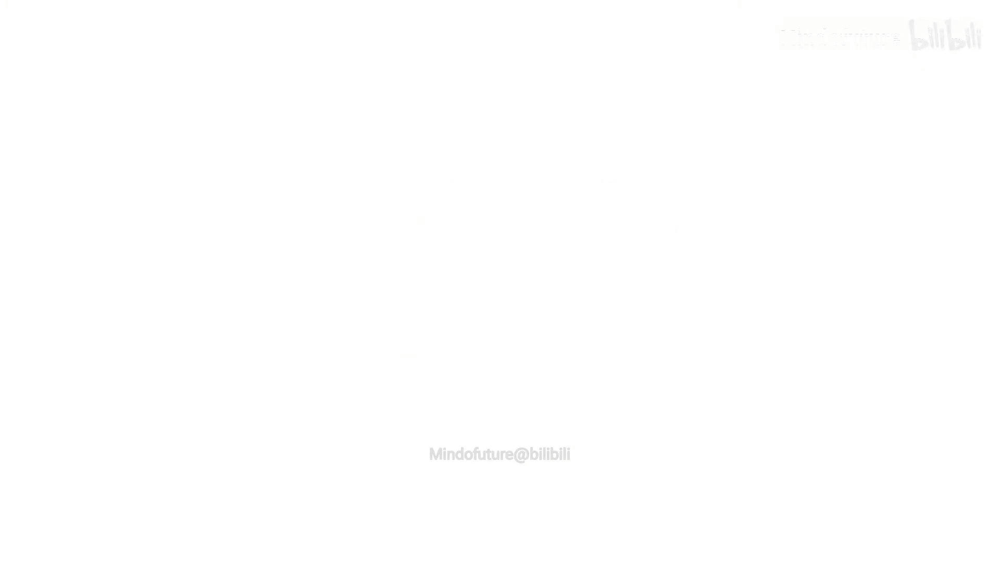
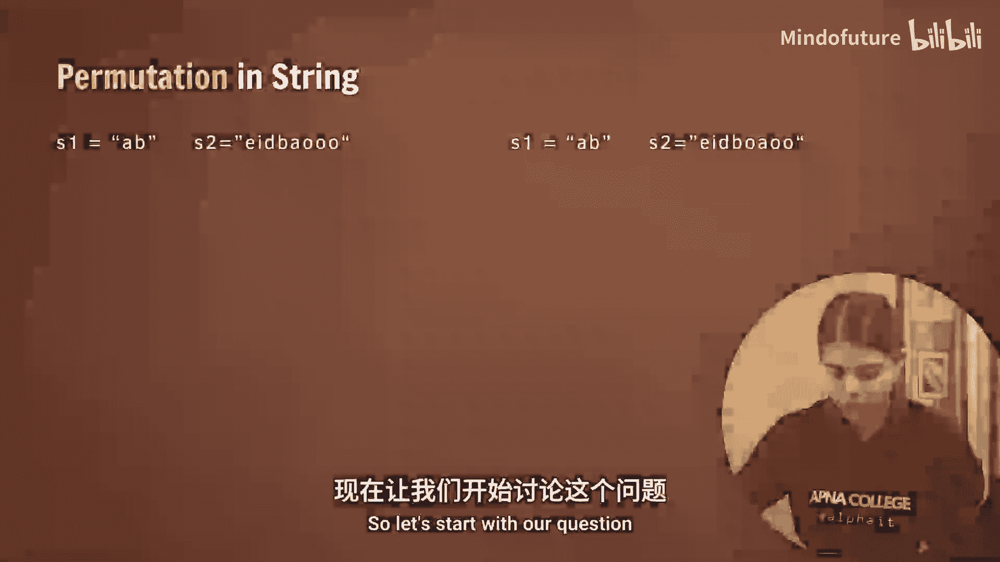
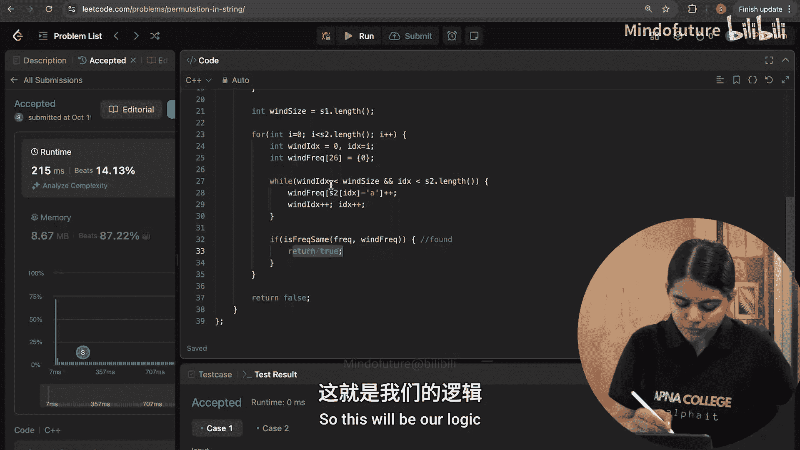

# C++-DSA课程-｜-数据结构-｜-leetcode-｜-Apna-College-｜--Complete-C++-Dsa-Course-p31-P31_字符串-第三部分-字符串的排列-DSA就业系列--BV18oUGBkEmV_p31-

Hi everyone and welcome to the complete D series string Ya string important problem discuss。

 which is called permutation in string This is an important concept。

 This question will discuss one more variation of the same question Also there is a link for in is calledmation string and number 567 string given and stringmation basically directly。

mutationmutationsmationsmutations are basically arrangements or different different orders of the same charactersmutmut foration false。

Character go。 you see those three string in the search can now there。

 Those skill is generally what we can do。😊，Is basically C Kihaari Pe Strander kka character Kki Cha Koimutation lily。

 for example， A example Chahe C A B Lily， Chi B C Lily Chiam B C Lily。

 Camm ka sari kari stringander number of characters or characters count same is stringander v A E bar B E bar C barni character is stringander v A E bar B E bar C E barni character to Jbi string permutations K permutations K under the count of characters。

😊，Yanni， the number of characters plus Kiny Barvo characters exist Cath count Kejugate more appropriate word would be the frequency of characters。

Is always。Same to basicallyham number of characters plus frequency of is also in first step would be or basically we are going to store frequency。

😊，Of characters。In S one。frequency variation important variation discuss constraint and constraint and S2 consists of lowercase English letters makes frequency count2 frequency2 frequency frequency frequency constraint。

English frequency stored teacher English。😊，Upper case we exist andas special characters exist digits may exist Those case may exactly special characters case instead of an integer frequency array likeas case to track the count unor in teacherger frequency inger instead of an integer we are going to use an basically concept constraint solution change solution variation。

😊，260 characters frequency tracker name to Qham in teacherli。

 lets call it int called frequency discuss isam 26 k equal and Icom initializeriri0 values to internallya frequency。

a key frequency of0th index goesang B frequency first index key frequency second index d third index andham index number 2 frequency or character character frequency frequency character character of minus value is also a character value character and。

😊，value same result0 equal small aq value this is equal to 97。

 this is equal to 9899 97 97 minus997 minus9997 minus minus index values convert frequency or frequency plus frequency。

and his firstju frequency。😊，Which is the most important step， Keep basically search。S1。

 you feel more appropriately， S1 permutation。In S 2。Orrisco search canula humke K game。

 hammic window based approach for use K game。😊，Basically is very similar toing。

Based approach exactly what mean to frequency paste frequency frequency。

frequency original S frequency。frequency casejo original frequency and frequency frequency charactersm in overall。

😊，First step basically s frequency equal second step s S。and this is finally the last window。

 they giveri string is sizeriari same same frequency case false value。

 So this is the overall logic that we are to use to solve this let us try to write is function complete which is named frequency in frequency 2 lowercase English characters initial with values。

😊，And for integer I equals0 i less than s1 dot length i plus plus hummi frequency can Pelettop  index ni callingling a index ojaga S1 you basically is said throw us all easy that you can say I'll try to show it to you。

ki multiple questions can use index frequency such character s of Now this minus internally can convert minus minus result and of similar frequency equal I am going to use the shorterki programming。

😊，Haari Windows size on S1 k size S1 dot。😊，Let take3이 kiss。

Aham second looplangi andhamraju S2ga S2 dot length herbar Iko Kingi plus and Ihammi window size Cuer search Kki K a variable mono。

 let us call it window index window index khamamia0 initialize Klangi and E Kojagahama original index Jaarium travel K I initialize Kingi with value I to have exactly kne k K。

 Lets suppose this is the current window。😊，Is current window window index  index window I have index0 and index1 condition is this less than my window size characters。

😊，Tohamic while loop Chalana internally to checkera is my window index is less than my window。

Size sub to P condition， how many check on yet。original original index string index should be less than。

L。Or Jepta kri windowham8 single window traverse currentpri windowgi window frequency to kran the window frequency Im biku is integer Eric and theran let us call it window frequency。

😊，Window frequencyander me index co minus a plus index。

 This is not string string indexote frequency frequency frequency are and frequencyut we have found themutation or true value frequency function。

Prequencies go compare because again， the function can let us create one more。

Boleion function called is frequency scene， just mehamomerippa， though。In teacher Ees Avalim。

Econum de theium， let's call it frequency1， Eome de deium frequency2。

And Ya baamic 26 size call luranna less than 26 plus thus Kabivigas Ohaki frequency1 of I is not equal to frequency 2 of5。

Those case me though Hamari windows come Mmat Ch， Missmat Chney come atla y Yahaper they are not equal to y same return Kingil upme false value。

Return false or ari values match to return function even though function loop age of4 loop 26 operations perform function complexity constant assume for practical cases neglig2 characters neglig in of million billion function。

So yapa check inclusion function can yahamra s1 do length loopla yamara S2 do length loopla just myharbar hamakmi windows go different different sizeki windows for check the worst case me age of4 loopra n squareq time complexity laser time per Qki S1 s2 do length is less than equal to 10 to the par4 to n squareq of time complexity is k that that is going to be allowed and big of n square code be Y successfully Ya sub to yahamaaa code let us run it。

😊，And summit。To successfully and I variations basically her character frequency2 characters is countless or and ins in the form of。

😊，able in the form of this map or frequency map frequency frequency successfullys lecture。

In the comments we can just write done or completed is case you can also share your progress with me on Twitter just calling up each description box canther mill Ja askate 9 multi next lecture can tell them keep learning and keep exploring。

😊。