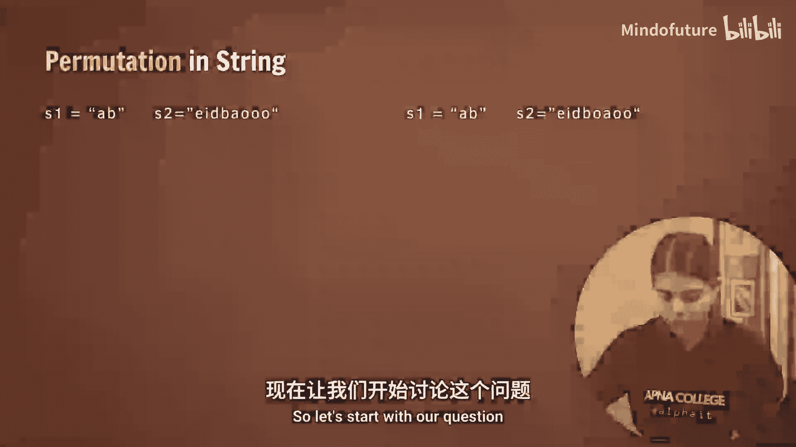
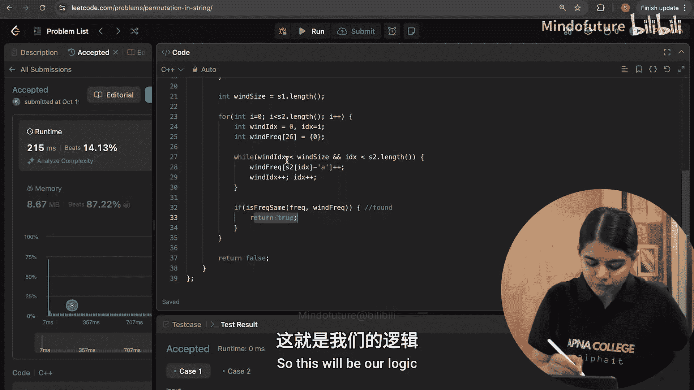

# C++ DSA课程：P31：字符串的排列




在本节课中，我们将学习一个重要的字符串问题：**字符串的排列**。我们将讨论其核心概念，并通过一个滑动窗口的解决方案来检查一个字符串的排列是否存在于另一个字符串中。课程内容简单直白，适合初学者理解。

## 概述

字符串的排列是指由相同字符组成的不同顺序的排列。例如，字符串 “ABC” 的排列包括 “ABC”, “ACB”, “BAC”, “BCA”, “CAB”, “CBA”。本节课的核心问题是：给定两个字符串 `s1` 和 `s2`，判断 `s2` 是否包含 `s1` 的排列。

解决这个问题的关键在于比较字符的频率。如果 `s2` 的某个子串的字符频率与 `s1` 的字符频率完全相同，那么这个子串就是 `s1` 的一个排列。

## 核心概念与约束

首先，我们需要理解问题的约束条件。题目说明字符串仅由小写英文字母组成。这个约束非常关键，因为它允许我们使用一个固定大小的数组来高效地统计字符频率。

我们可以创建一个大小为 **26** 的整数数组，因为英文字母有26个。数组的每个索引对应一个字母（例如，索引0对应’a’，索引1对应’b’，依此类推）。数组的值存储对应字符出现的次数，即**频率**。

**字符到索引的转换公式**：
对于一个字符 `ch`，其对应的数组索引可以通过 `ch - 'a'` 计算得出。因为小写字母’a’到’z’在ASCII码表中是连续的，所以 `'a' - 'a' = 0`, `'b' - 'a' = 1`，以此类推。

## 解决方案步骤

上一节我们介绍了使用频率数组的核心思想，本节中我们来看看具体的解决步骤。我们将采用滑动窗口的方法在 `s2` 中寻找与 `s1` 频率匹配的子串。

以下是解决此问题的详细步骤：

1.  **计算 `s1` 的频率**：首先，遍历字符串 `s1`，统计其中每个字符出现的次数，并存储到频率数组 `countS1` 中。
2.  **初始化滑动窗口**：在字符串 `s2` 上设置一个窗口，其大小等于 `s1` 的长度。
3.  **计算初始窗口的频率**：计算 `s2` 中第一个窗口（从索引0开始，长度为 `s1.length()`）的字符频率，存储到另一个数组 `countWindow` 中。
4.  **比较频率**：编写一个辅助函数 `isFrequencyEqual`，用于比较 `countS1` 和 `countWindow` 两个频率数组是否完全相同。
5.  **滑动窗口**：如果当前窗口的频率不匹配，则将窗口向右滑动一位。这意味着我们需要更新 `countWindow`：减少离开窗口的字符频率，增加新进入窗口的字符频率。
6.  **检查匹配**：每次更新窗口后，再次使用 `isFrequencyEqual` 函数比较频率。如果匹配，则返回 `true`。如果遍历完整个 `s2` 都没有找到匹配，则返回 `false`。

## 代码实现

让我们将上述逻辑转化为代码。以下是一个简单的C++函数实现：

```cpp
#include <string>
#include <vector>
using namespace std;

class Solution {
public:
    bool checkInclusion(string s1, string s2) {
        if (s1.length() > s2.length()) return false;

        vector<int> countS1(26, 0), countWindow(26, 0);

        // 步骤1: 计算 s1 的频率
        for (char ch : s1) {
            countS1[ch - 'a']++;
        }

        int windowSize = s1.length();

        // 步骤2 & 3: 初始化窗口并计算第一个窗口的频率
        for (int i = 0; i < windowSize; i++) {
            countWindow[s2[i] - 'a']++;
        }

        // 步骤5 & 6: 滑动窗口并检查
        for (int i = 0; i <= s2.length() - windowSize; i++) {
            // 步骤4: 比较当前窗口频率与 s1 频率
            if (isFrequencyEqual(countS1, countWindow)) {
                return true;
            }
            // 滑动窗口：更新频率数组
            if (i + windowSize < s2.length()) {
                countWindow[s2[i] - 'a']--;          // 移除窗口左端的字符
                countWindow[s2[i + windowSize] - 'a']++; // 添加窗口右端的新字符
            }
        }
        return false;
    }

private:
    // 辅助函数：比较两个频率数组是否相等
    bool isFrequencyEqual(const vector<int>& freq1, const vector<int>& freq2) {
        for (int i = 0; i < 26; i++) {
            if (freq1[i] != freq2[i]) {
                return false;
            }
        }
        return true;
    }
};
```

## 复杂度分析

*   **时间复杂度**：O(n)，其中 n 是字符串 `s2` 的长度。我们最多遍历 `s2` 一次，并且每次窗口滑动时更新频率数组的操作是常数时间 O(1)。频率比较函数也只需固定的26次操作。
*   **空间复杂度**：O(1)，因为我们只使用了两个固定大小（26）的数组，与输入字符串长度无关。

## 总结

本节课中我们一起学习了如何判断一个字符串是否包含另一个字符串的排列。我们掌握了以下关键点：
1.  利用**字符频率**作为排列的判定标准。
2.  针对小写字母的约束，使用**固定大小的数组**来高效统计频率。
3.  应用**滑动窗口**算法在长字符串中高效地寻找匹配的子串。
4.  实现了完整的解决方案，并分析了其时间和空间复杂度。



这是一个非常经典的滑动窗口应用问题，理解它对于解决其他类似的字符串匹配或子串搜索问题大有裨益。