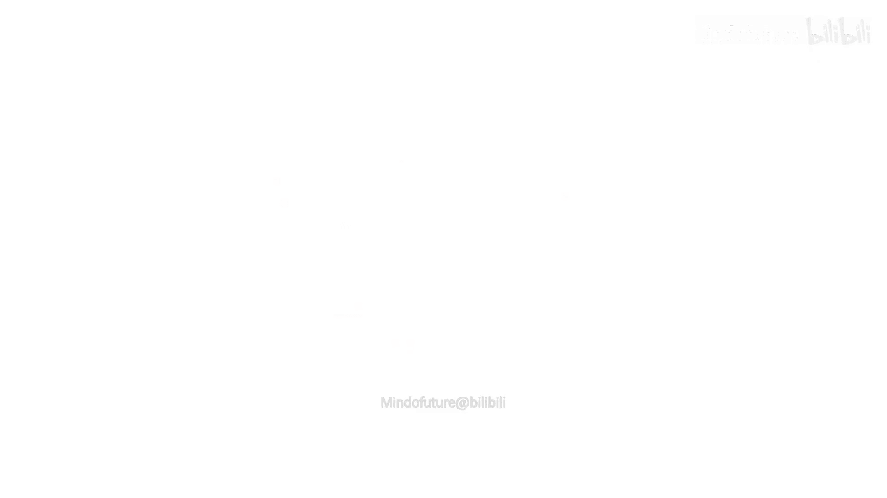
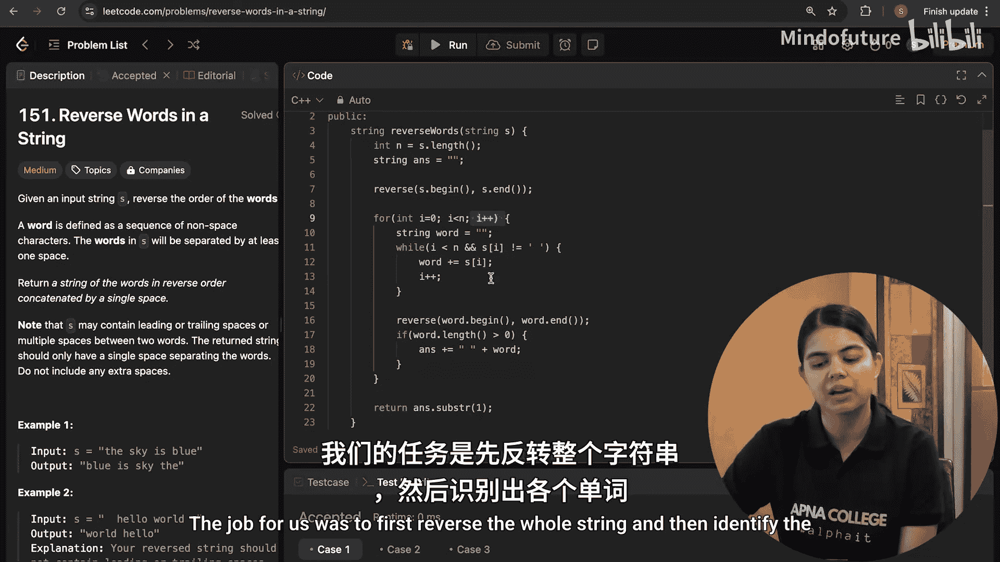

# C++-DSA课程-｜-数据结构-｜-leetcode-｜-Apna-College-｜--Complete-C++-Dsa-Course-p32-P32_字符串-第四部分-反转字符串中的单词-DSA就业系列--BV18oUGBkEmV_p32-

Hi Ju welcome to the complete D series or strings for based important question called reverse words in a string conceptless available Also there is a link for a company topic and company for and this question is reverse words in a string is problem number 151 on string string Al and we have digits0 to 9 plus string could also have a lot ofsme string only basically stringme string we have to create another stringander。

😊。

Agar a blue v word last method to is string and the blue word subsejaga Agar is second last per is a second paraja Agarpaga and the to twist me strings may just order me words a whose order cor reverse Kna。

 If we talk about this particular string。😊，To Yaha。

 if we have this worde a course special buthamari strings can do extra trailing spaces trailing spaces can Joari words a of extra spaces Ya words middle X is others removed say。

 for example， if I have a string called let's suppose hello。😊。

Or helloasas let's suppose thes and I world and then I have a single space to is stringco final output can convert to in remove k is extra space remove k and extra spaces remove k final output singlegi and then I'll my hello is convert what exact strategy we going to use let's supposepa string the pen name and string words final output can words mu。

😊，Bupai A Iga F Pe Iga and Phil I'll have hello。😊，To wheel get a string。

 which is something like this N， E P space， E， H， P。😊，first and second individual second。

So this is how we are going to reverse the words in the string and bring them to their correct order and correct position to process to basically function could be the first step。

Jo index I kibe word If we have started I with some valid character jo nonspace character word wordja sentence word characterja single word identifyb string of is not equal to word word string which we can call word and is empty word plus equal to character or So this is the programming logic to find out a single word in string index I i。

😊，another n。pa ending。0To answer can under the individual word code tab add kringgi。

 if my word dot length is going to be equal to greater than 0。

 So yea extra condition here j say apply kam topa word aja pen pen co answer can the adding topa cur pay plus we are going to include pen in the answer pen kba next time German word go track kinggi tomerpa word k under aga E H T。

Toas word kander E E reverse T already answeras pen to pencorjagi and then well add though。

 is3 case de de individual word reverse k we are going to build our reverse string to ejuural logic here let us also write it in our pseudocode。

So this entire logic is for one single word。 Parhamito is entire logic ofrikiurri Sari words for Sha Tuknihamm stringri luak for in teacherger I equals 0。

 I less than n I plus plus Harbarhamgibar Hammni string sake individual word Nialle Uwarko reverse Karingi individually and Usehamma answer Karraringgihamra answer Prega。

 Basically， if we have started with a string like， though。😊，notice end is。

have this starting function is basically is and。loops same to easily and that is why this is the this is the logic for linear time complexity convert length let us initialize answer with empty。

😊，About night loop gelathin， loop Chiella is we have to do the first part。😊。

Which is to reverse the entire string， to beginning iterator ending iterator this3ri string reverse so we is may individual words quite identify curm reverse carrying it to I is equal to 0 ci staria i less than n i plus plus。

Extingly word just scan the remove my words go track currentring here。

Japtak Hamari I key length is less than n and Jeptak stringarjuaih character that is not equal to a space Tmi Tp word kar from valid character quad according it to S of I is a valid character and for Ico Kingi plus plus。

Up jriic single word aa Hammiai， we have to reverse that word using word dot begin。And what that。

And and Ugar is wordky length is greater than 0。😊，To ham simply guarding a answer plus equal to some space with the。

Whator string and empty string add plus within additional space extra extra at the end because we have an extra space at index0 return answer do。

😊，Some string。Starting from index 1， this is the Rikikamaapura Kaura Corega。

 which is big of n time complexity is Segbar runga。And， let's submit it。

successfully submit is same coordinate extra spaces only case handle basically code logic continuously extras as well as you don't completely skip and loop automatically by doing this+ extra spaces remove automatically handle individual identify key question logic if we have successfully completed today's question you can mark attendance down in the comments can just write Also you can share your progress with me on Twitter lecture learning and keep exploring。

😊。

