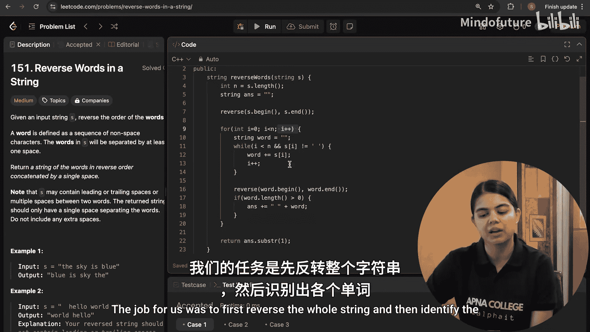

# C++ DSA课程：P32：字符串第四部分 - 反转字符串中的单词


在本节课中，我们将要学习一个基于字符串的重要问题：“反转字符串中的单词”。这个问题是LeetCode上的第151题，也是面试中的常见题目。我们将学习如何在不使用额外库函数的情况下，处理包含多余空格和单词顺序反转的字符串，并最终输出一个单词顺序正确、单词内部字符顺序也正确的字符串。

## 问题描述

给定一个字符串 `s`，其中可能包含前导空格、尾随空格以及单词间的多个空格。我们需要返回一个单词顺序反转后的字符串，同时单词内部字符的顺序也要反转，并且单词之间只用一个空格分隔。

例如，输入字符串 `"  hello world  "`，经过处理后，输出应为 `"world hello"`。注意，原字符串中的多余空格已被移除，单词顺序和单词内部的字符顺序都被反转。

## 核心思路

解决这个问题的核心思路可以分为三个主要步骤：
1.  反转整个字符串。
2.  识别并反转字符串中的每一个单词。
3.  在构建最终答案时，处理多余的空格。

上一节我们介绍了问题的基本要求，本节中我们来看看实现这一思路的具体策略。

## 算法步骤详解

以下是实现“反转字符串中的单词”功能的详细步骤：

1.  **预处理与整体反转**：首先，我们移除字符串开头和结尾的多余空格。然后，我们将整个字符串进行反转。这一步的目的是将单词顺序反转的任务，转化为后续逐个反转单词内部字符的任务。
2.  **识别并反转单个单词**：接着，我们遍历反转后的字符串。在遍历过程中，我们识别出每一个单词（即连续的、非空格的字符序列），并将这个单词单独进行反转，以恢复其内部字符的原始顺序。
3.  **构建结果并处理空格**：在反转每个单词后，我们将它们依次添加到一个新的结果字符串中，并在单词之间添加一个空格。通过控制添加空格的条件，我们可以自动处理原始字符串中可能存在的多个连续空格。

## 代码实现

以下是上述算法的C++实现代码。代码中包含了详细的注释，以帮助理解每一步的操作。

```cpp
class Solution {
public:
    string reverseWords(string s) {
        // 步骤1: 反转整个字符串
        reverse(s.begin(), s.end());

        int n = s.size();
        int idx = 0; // 用于构建最终结果字符串的索引
        for (int start = 0; start < n; ++start) {
            if (s[start] != ' ') { // 找到一个单词的开头
                // 在结果字符串中，如果不是第一个单词，则先添加一个空格
                if (idx != 0) s[idx++] = ' ';

                // 步骤2: 找到单词的结尾
                int end = start;
                while (end < n && s[end] != ' ') s[idx++] = s[end++];

                // 步骤3: 反转这个刚找到的单词（在结果字符串中的部分）
                // 单词的范围是 [idx - (end-start), idx)
                reverse(s.begin() + idx - (end - start), s.begin() + idx);

                // 移动start到当前单词的末尾，继续寻找下一个单词
                start = end;
            }
        }
        // 擦除末尾可能多余的空格（由于我们精确控制添加，这里通常idx就是新长度）
        s.erase(s.begin() + idx, s.end());
        return s;
    }
};
```

## 复杂度分析

*   **时间复杂度**：O(n)。我们遍历了整个字符串常数次（整体反转一次，识别单词遍历一次，反转每个单词一次），因此总时间复杂度是线性的。
*   **空间复杂度**：O(1)。我们直接在输入的字符串上进行修改，没有使用额外的、与输入规模成比例的空间（除了几个整型变量）。

## 总结



本节课中我们一起学习了如何解决“反转字符串中的单词”这个问题。我们掌握了分步处理的策略：先整体反转字符串以交换单词顺序，再逐个识别并反转单词以恢复其内部顺序，最后在构建结果时巧妙地处理多余空格。这种方法高效且节省空间，是解决此类字符串处理问题的经典思路。理解并掌握这个算法，将有助于你应对面试中类似的字符串操作题目。