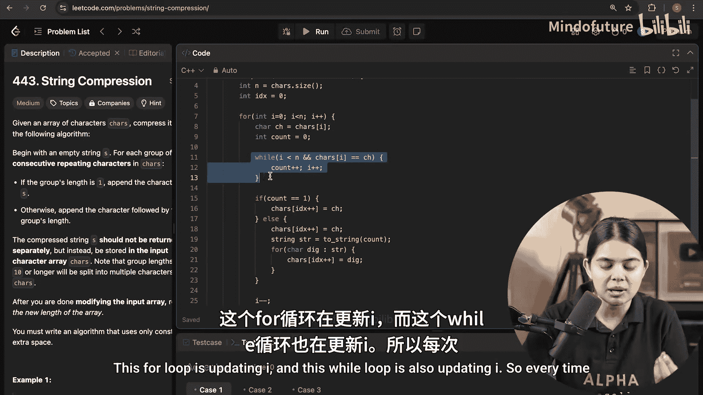

# C++-DSA课程-｜-数据结构-｜-leetcode-｜-Apna-College-｜--Complete-C++-Dsa-Course-p33-P33_字符串压缩问题-第32讲-Leetcode_443--BV18oUGBkEmV_p33-

I have drawn in welcome to the complete DA seriesja or coffee important interview problem。

 which is called string compression Also there is a link to the company sheet if you want to practice questions for placements and internships description question is called string compression and this is problem number 4。

4 character of very similar to the character basically runtime character sequence English that we are trying to reduce the rules first rule multiple times other Jese let suppose。

😊。

is a replace with a but will be writing the character and characters only have a those case y rules to compress let us take this example。

 and this is how we are going to compress ourne in in the same character is original character replace with a。

😊，2。B2 and C3 final characterri and returned character which is going to be 1，2，3，4。

5 and6s suppose character is set of。😊，Charac is and equal character。😊。

which is going to be equal to equal are going to replace characters with equal n plus。😊。

character say let's suppose to character at index and count variable the number of of the same character character count for example。

 character stringp the same character which is equal to is less than n and character is equal to。😊。

equal is than equal equal and。😊，Characctor B B is definitely not equal to8 to Yaha Hamra Lu Johevo stopjaga or Abhamaripaari count K value。

 which is equal to 2 up next come， Hamari yehamari questionrukiara Jobi count he。

If that is equal to one those case character replacegar count greater than case character orse original character example another replacement replacement is with original character and original character。

😊，original changes character changes will need a separate index to separate index take another variable which is called accordingly greater than let us。

Those case simply character index per or index per C and j index C So this is the first case of let us minimize case。

😊，At index assign value in in trick use and that ins suppose in22 function in string sometimes we need to convert。

😊，are not able to solve the problem properly。 this is an important function call itit myit pass。

Digit。In my string and index variable per character original index variable per are going to use the same logic plus we are going to store the minus an next time logic。

😊，Jisky helps em of me twin compress Kneval Ebar is logical harmful full dryron theval Drron can let us create our character E。

😊，character this is our index variable index index variable which is going to start from here。😊。

fi is count2 co string convert digit code next index for to index change plus next index per original string replace a next time doing minus i plus i value character which is equal to next time character is going to equal to index is going to equal to and in fact index value is index automatically index。

😊，with count of index value replace indexja is be equal to2 index minus and character are is equal to and than and is greater than is index value character which is also equal to which is equal to and string。

😊，Chaact compressed use a function called is equal equal2 and equal equal。9 character。

 Ericica size we return。😊，Simply if we choose to return the index value that is also fine to yhama final answer Rojaga the say we solve our problem of string compression Ibaris k J coe codeander。

 we have to complete this compress function is my subic index value Lilite that is going to start from 0atovna nlite just make character k size calculate k ofn loop Chiakpt I is 0 I is less than n I plus less。

😊，Herbarmi kna subip to character Lina C H Jseham initialize Kingi Cas of I andme count Linase initialize King Phham similar characters count calculate Ki tokyp I is less than n andptari Cas of I is equal to my current character。

mi count Kona plus less Sami Ikui。😊，Plus thus， Jessie niel sub check a camera count 1 k equal a girl count 1 k equalmeto original index canander count tonis character Co else Wal case meli character count to count Co。

 we are going to create a string S T R。😊，Hm upne in teacher count Co string and convert carrying in Fic for each loop bganni v for each individual digit in our string SDR。

😊，And her individual digit co Ane her a index perjaar update Kthiari digit Sageni character plus digit Coia last me is plus theco counterne。

 I am just going to write an I minus minus and string La me muji resize Knaperga to Jobi mirrorra character。

 say hum resize Kingi to this index value。😊，And last May， I'm Cha， too。

Return giia of me index value go say bar run Garthe and let us submit it。

So this is how we can solve a string compression problem complexity Tom noticeki even though complexity n iterator this loop is updating eye and this loop is also updating stringham and that is why the complexity is going to be equal to linear complexity complete mark down in the comments also share progress with me on learning and exploring。

😊。

