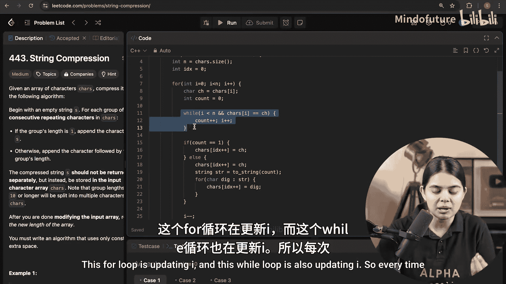

# C++ 数据结构与算法课程：P33：字符串压缩问题（Leetcode 443）

在本节课中，我们将学习一个重要的面试问题：字符串压缩。我们将详细解析问题，并一步步构建解决方案。


## 概述

字符串压缩的目标是减少字符串的存储空间。基本规则是：将连续出现的相同字符替换为该字符本身加上其出现的次数。如果某个字符只出现一次，则只保留字符本身。我们将在一个字符数组上原地完成这个操作，并返回压缩后新数组的长度。

## 问题解析

假设我们有一个字符数组 `chars`，例如 `[‘a‘, ‘a‘, ‘b‘, ‘b‘, ‘c‘, ‘c‘, ‘c‘]`。

压缩过程如下：
*   字符 `‘a‘` 连续出现 2 次，压缩为 `[‘a‘, ‘2‘]`。
*   字符 `‘b‘` 连续出现 2 次，压缩为 `[‘b‘, ‘2‘]`。
*   字符 `‘c‘` 连续出现 3 次，压缩为 `[‘c‘, ‘3‘]`。

最终，原数组应被修改为 `[‘a‘, ‘2‘, ‘b‘, ‘2‘, ‘c‘, ‘3‘]`，并返回新长度 6。

核心挑战在于我们需要在**原地**修改输入数组，并使用一个索引来跟踪压缩后字符应该放置的位置。

## 算法思路

上一节我们明确了问题，本节中我们来看看具体的解决思路。

我们将使用双指针（索引）法：
1.  一个指针 `i` 用于遍历原数组。
2.  另一个指针 `index` 用于指向下一个压缩后字符应该存放的位置。

以下是算法的核心步骤：

1.  **初始化**：设置 `index = 0`，`n = chars` 数组的长度。
2.  **遍历数组**：使用 `i` 从 `0` 遍历到 `n-1`。
    *   记录当前字符 `currentChar = chars[i]`。
    *   初始化计数器 `count = 0`。
3.  **统计连续字符**：使用一个 `while` 循环，当 `i < n` 且 `chars[i] == currentChar` 时，增加 `i` 和 `count`。
4.  **写入压缩结果**：
    *   首先，将字符本身写入 `chars[index]`，然后 `index` 加 1。
    *   接着，如果 `count > 1`，需要将计数转换为字符串，并将每个数字字符依次写入数组，同时更新 `index`。
5.  **循环继续**：外层 `for` 循环继续，处理下一个不同的字符序列。
6.  **返回结果**：循环结束后，`index` 的值就是压缩后数组的新长度。

## 代码实现

理解了算法步骤后，现在让我们将其转化为具体的 C++ 代码。

```cpp
class Solution {
public:
    int compress(vector<char>& chars) {
        int n = chars.size();
        int index = 0; // 指向压缩后数组的写入位置
        
        for (int i = 0; i < n; i++) {
            char currentChar = chars[i];
            int count = 0;
            
            // 统计相同字符连续出现的次数
            while (i < n && chars[i] == currentChar) {
                i++;
                count++;
            }
            i--; // 因为for循环本身会i++，这里需要回退一步
            
            // 写入字符
            chars[index] = currentChar;
            index++;
            
            // 如果计数大于1，写入数字
            if (count > 1) {
                string countStr = to_string(count);
                for (char digit : countStr) {
                    chars[index] = digit;
                    index++;
                }
            }
        }
        // 返回压缩后数组的新长度
        return index;
    }
};
```

## 复杂度分析

最后，我们来分析一下解决方案的效率。

*   **时间复杂度**：O(n)。尽管代码中有嵌套循环，但每个字符只被访问常数次（外层 `for` 循环和内层 `while` 循环共同推进 `i`），因此总体是线性复杂度。
*   **空间复杂度**：O(1)。除了几个变量，我们只使用了常数额外空间。注意，`to_string` 可能会创建临时字符串，但其最大长度由 `count` 的位数决定，对于字符数组长度 `n`，这可以视为常数空间。

## 总结



本节课中我们一起学习了 Leetcode 第 443 题——字符串压缩。我们掌握了如何通过双指针法在原地修改数组，将连续字符及其出现次数进行压缩编码，并返回新数组的长度。这是一个考察数组操作和编码思维的经典问题。