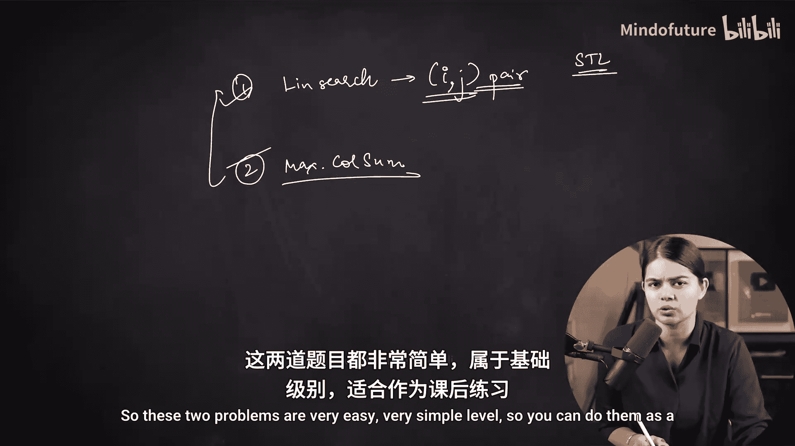

# C++-DSA课程-｜-数据结构-｜-leetcode-｜-Apna-College-｜--Complete-C++-Dsa-Course-p34-P35_C++中的二维数组-第一部分-DSA系列_由Shradha老师讲解--BV18oUGBkEmV_p34-

Hi everyone and welcome to the complete DSS series。

 And today we're going to learn about one more important DSA concept called  two dimensional or 2D arrays。

 biva AhamAco or concept channel Q play scanner available Also there is a link for a company DSA sheet in the description box of already C scan we have learned extensively about one dimensional or are normal simple plane arrays and we have done countless questions of simple areass Arch chapter can。

 we are going to explore the concept of 2 d arrays。

 which is rarely important in terms of DSA concepts。2D arrays。😊。

Co generally programming together， we also call them matrix or matrices A 2D arrays is basically like a two dimensional table。

 A gramic kabate table can form data co store Knalasmehamaripa which particular row and which particular columns those data co store Kle we use the concept of two dimensional arrays。

 For example， is3keka data of Necode can the store Ki where we have some rows and some columns。😊。

table like format is a matrix v2 or table like format rose and column row horizontal So this becomes a row 0 this becomes a row 1 this becomes a row2 and this becomes a row3 column column0 this is my column 1。

 This is my column 2 and rows and column2 matrix is total number of rows and column row key 12，3。

44 row and column key 12，33 column plus is matrix create in teacherger and we can call this a matrix square bracket sub total number of rows and total number of columns。

😊，Normally， aham e define curkiander one dimensional single linear but2 matrix andas columns easily we have to use two square brackets internally memory example lets suppose number。

😊，Which is the theari number the2 matrix the If we want。

 we can also initialize our matrix with some initial data。

 just like we do for a simple array thebaric matrix could create R code。

 This is a plain boiler platelate C plus code scan algorithmmic matrix co define Kna2 cod K to sec matrix and I scan size defineme4 rowcheche andmi。

😊，T columns 2 matrix who defineium up generallymm2 Eco createthemeus total number of rows and total number of columns co betheme normal function E pass Euss saym matrix function copa2 E thoseusk total number of rows and columns co be pass onthe And if we wantm matrix in sari values k I C format may initialize vthe initializenese normal Eco initialize in teacher E of size 5 is equal to1。

2，3。😊，4 and 5， though normal Eika initialization Eai。

 similar wayari 2 matrix initializationai initializationne。

 basically ofne parenthesis a parenthesis under individual roku individual e first Joari Ro is Ca initialization athesiskeba second roque elements kparinggi。

 then third ro elements kas and so on。 e or pair of parenthesisanggina 1，2，3，keba4，5，6。

 And we have 7，8 and 9。😊，And 1011，12。This theari four different row card data individuallyme pass on。

 So this is basically how we create a 2 d array2 create initialize k to elements elements co basically cell track2 cell normal e simply of index matrix2 and column coaxna say for example。

2 row columnm is this is000 key row number v0 and column number0 row this is00 is1 and3 column this is column 0 is column 1。

 this is column 2 position find outna that is a combination of our row and the column number for example。

😊，Con helper exist k to8 k rhjagi2 and columnja1 to is matrix of2a1pa 8to if I simply try to see out matrix of rh which is2 and column which is1pa is given matrix k value each k equal and we are getting index co x value co say8 lets suppose replace K with 8 simply say operation perform performs clear this and 8to normal cube we can run a lot of loops say2 Q majority operations loop co use loops co use sub output example for example。

 if we have this given2 d。😊，26，78，9 and 101112 number outer outer than a total number of rows and i is basically equal to this is number column。

😊，First column perja second perja is the birthday languagesari columnsverse upne is loop k acor nested loop use kneal just made J value co0 star k J less than a total number of columns and jco Caringi plus less。

😊，And is theju evaluate that is going to be equal to the column numberne elements printva simply see out matrix of I comma J I is my row and j is my column number logic bo in fact Jo logic nest loop logic implement v chapter。

 Then this is really a super easy level loop for you printva4 in teacher I equals0 I less than my total number of rows I plus。

😊，And4 in teacheria J equals 0 J less than my total number of columns J plus plus hame Pame C out Knaha Ani matrix of I comma J co。

And with some space。 and jri elements end of line。 Let us save it Andran elements We want to give next line elements or or inner of elements that is also very simple to end of。

😊，Let's save it And run her roque elements I different line per Bto2 elements output kia。

 similar way2 elements input k input Le loopki8，8，8 element input K。

 the loop out is the let us copy this loop Ya。😊，Yjo2 I Am initializeing IK El School Aham input Le Val。

😊，RM 2 D array define Kia， Yahaperju looppe is input K use current it。😊，And Hamaraju's second Lupe。

 I sayhe， output Keus Carnevalle。Let us clear this input Hee Yahaur， Hamhar Basi in Gnevallem。

Mattrix of I comma Jco。 and we don't need to use this end of line。

 Let's save it and let's run our code。Let's suppose were he same elements saying Joopni Eri Kander。

2 input andhi same2。 So this is how we traverse on our 2 d arrays with the help of loops2 arraysri normal arrays normal array can linear for example。

 array of size 5 element 12 3 A And if the size of integer is equal to 4 bys1041，08，1，1，2 and 1，1。

6 is elements linear2 arrays memory under linearly and is linear k though possible elements have row major and column major。

😊，Internally，ju2 the row major me column major as a programmer controlling automatic process system row major2 internally a me first elements。

😊，next to56 last78 fashion elements next memory address104108，1，1，2，1，1，6， and finally1。

2124128 and2 column elements column1，4，7。😊，Yanira first column yes linear fashion meari。

 Then second column， which is2 and8。 then third column， which is 3。

6 and9 memory addresses linear majority cases generally that is major form of in。

 but depending upon the system next about the concept of linear search in linear linear search Lets suppose。

s suppose we have to search for8 basically index concept。😊，he。😊。

And upne matrix so I'm trying to reinitialize cursect name。😊，With the same values。Let us remove this。

Abami， Ahammi Iq function Manai， let us call it bully。

And linear search a linear search can sub matrix copa though matrix which matrix here rh and columns copa matrix co functionpa row number skip kmi matrix schedule column number define this is the compulsory format of c plus linear search a core parameter。

 which is equal to the key search loop4 in teacherger I equals0 I less than our rows。😊。

I plus thus and nested form me Ammni a K column pajagi J less than columns。J plus Ve， Agart Kahibi。

 Hamari Mitrix of I comma J。 Ki K Eojaib， those case made Toham Yahii return Gerstan true。

And Nahito Luka Kamononic kbaham return Gneevni false Val go， though let us try to see out。

Linear search for my matrix， rose。Columns and isvaqui co11， let's suppose 8。😊。

Let's save it and runpa answerjaga cuki 8 exist ktai。

 but agam20 coparipa and false as problemki Agararnitri。😊。

and combination if you have not watched that onen that's simple。

Exari 1 plus2 plus 3 equal to 6ari 4 plus 5 plus 6， which is equal to 15 7 plus8 plus 9。

 which is equal to 2424 is the highest value and third or and let us clearre。

Will be three comma 3 size matrix。Yer E functionality。

Let's call this integer max get max sum get max sum can the8 tohammi matrix copa9。

Iskeame Hamabne Ro and Colimkopaska Ne Val Yaha Bham call Karinggi Aneget Mac Samko Ikar Pasaramriri valuesus。

A let us create a variable called maximum rose sum。 Jem initialize k in teacher Minkaa。

 So basically Jo maximum ros sum calculate K a process that is pretty similar to Jess I make linearly ay E can there's a minimum of a maximum value ni call u biical same logic Reg。

 but is bar。😊，E co linear traverse they egg bar single going， like in2 matrix for traverse Kme whona。

😊，Though， let us create。Our nested loop， I is equal to 0。 I less than rows I plus this。

For integer J equals 0 J less than columns。G plusless。Harbar homic variable Lacine。

 Let us call this variable row sum。 Gise initialize kctine 0 kat。

To her sum column value plus equal to matrix of i voice sum In fact。

 I sum sum or max sum is equal to max of。😊，Max room and。아예 들어올까？

Some and last me hum returned Garacabna Max roseam。 Let's save it。 And let's run our code。

 Tomapa output Ajaga 24 k equal。 But let's suppose Hamari first Ro3 co hum replace called the 30 kat。

 Those case may we are going to get 33 as our answer。

 Toari first Ro a sum sub other Max Mojaga Jse Ham name Max row sum could calculate Ki We say he a as a homework problem here that you have to write the code。

😊，Fall maximum。个林湿。The first columnaraeja， second columneja。

 third columneja aco column sum print Knae sum subis other the maximum to J say ani matrix quo row vice traverse a as homework problemgico column viceni matrix quo traverse Kna or Ieth to be more specific J columns sum calculateja or maximum value extract K。

😊，Next， Ham about an interesting problem called a diagonal sum diagonal sum question2ic matrix given under the number of rows is equal to the number of columns instead of two different values of rows and columns n and given square matrix andagonal sumagonal is right bottom and bottom rightagonagonal I primaryagonal and second。

😊，secondaryagon primaryagon values1 plus 6 plus 11 plus16 equal is equal to 34 and plus7 plus1 plus 3 equal3 equal6 plus equal is equal to 5 plus7 which is also equal to 5 andagon。

will will equal 15 plus15 equal2agon。😊，Matri let us resize it a bit primaryagonal is this is cell is2 and is primaryagon primaryagonal primaryagon of i and secondaryagonal secondaryagon。

😊，and three secondaryagon numberagon and n column equal to n equal。

That will be n minus1 minus I Jori minus i v logicaluraura the first value n minus1 k n minus1 say minus i co minus and sends i is equal to 0 to 3 Similarlyly。

 let's suppose am is a calculate K i value 2 to J value kja j valueja。N Yni4-2-1。

 This is going to be equal to 1。 And that is why the column number is equal to 1 to yera logic secondary diagonal kel ja matrix of i comma J K sum co calculate to primary diagonal k logicra I j equal secondary diagonal k Kra j and minus I1 k equal In fact。

 Ya I opposite for simplicity j value I value k equal sum find out simply loop outer loop I is equal to0 say I less than n I plus ja。

😊，And her to j less than n j plus and logicalagon primary and secondaryagon cohe of n minus case ofagon secondary for common。

😊，equal and case J n minus1 satisfy condition satisfy and condition primary elements n is equal to primary and primary have created this which is calledagon us take a variable called sum is equal to0。

😊，Aal loop Chilanni v I is equal to 0， I less than n i plus thus Ya but rows and columns key value same here to humef nus Ca Donokeli and for integer。

😊，J equals 0， J less than nj plus less。Agarhama I is equal to G。

The Tom kkering is some can the add Kingi epi matrix of I comma j。

Else if Ugahama J is equal to n minus I -1。Those case may Hamra element secondary diagonal cap to Usebiard Kingevne some canander。

 and last may Hammed return Kinggi。U now。Some of the entire diagonal will be 34 plus 3466 and。

Dagonnal logicvo j value i equal and secondary diagonal logic j value n minus i1 k equal j loop primaryagonal value calculate and common values i value is not equal to。

😊，N I1 v case me matrix of Ia n I1 cross Bagon calculate same answer return and we are getting 6 answer which is big。

 So this is a big optimization that we have doneagonalagon are going to learn about the concept of2s replace2 replace22 vectors just like plain vectors d。

😊，Run time per res o， and they are more efficient。 In fact。

 generally Jo Saval taking a 2 D erak Umer 2 D vectors he use A 2 D vector co defing Knic hum simply similar s logic use k Joham8 normal vector use k。

😊，To the vector gave define Carneulaham simply lihe vector of vector。

Of integer and I say hamam they set matrix This the re say hammneic 2 D vector define U include curleium。

😊，Hash include。😔，A vector and theripa Samra vector Raja a vector Ker Zari operations I initialization of as perform K normal 2 Derthe Anyha Ahami initialize K I starting values kat initialize K 4。

5，6 and 7，8 and9， Ahami particular index E value Jham C out k matrix of 0 0。😊。

So Hamaripa first element Ajaga， which is equal to 1 togbarran Guan。

To was1 print Oja I'm try to 2 d vectors per v nested loopaz1 just m normal 2 d per Yaha4 in teacherger I equals 0。

😊，I less than Hamme pataihamney3 cross 3 s key ofne matrix1 I toby K Iq value equal less than 3 rectname4 integer J equals 0。

 J less than 3。😊，And J plus plus Hamharbar C out Cas matrix of I commajco with some space and her line kbal。

 we want an end of line， let's save it And runpa theri Hamari matrix Ariar elementsra ahamper。

 let's suppose I made dynamically size calculate Kki matrix s fixedtohanni Risari vectors to run timeer to dynamically size co calculate Kaari Ki B。

2 D vector kander Johamari total number of rows Vo Hamra Jo B matrix H。😊。

Dot size equal equal Joviari matrix A Yahamra2 vectorjos valueari total number of rows only the Ya I replace kak with matrix dot size andarijo total number of columns O Now we know the total number of columns is equal to Hamari ao and Kiany elements value k equalse Agaham example2 vector to internallyra2 vector yku y is 2 vector K Agahamim to Yaha this1 row is equal tora matrix dot size。

😊，Or Hamari number of columns Kijagi number of columns Ojagi Ki I matrixander Matla kiss matrix of I k under johama s he elementsca that will be equal to the number of columns Yaari I value which。

 Lets suppose Iq value0 to Ya V elements Bohampa toja。

 Let's suppose Iq value0 toari pass0 k T elements valuejagi to column valuejagi3 k equal the rows go hamhe matrix dot s k equal and columns go hamhe matrix of I dot s k equal Ya is3 co Ham replace k matrix of I dot s let us save it。

😊，And clear and 2 comparison may 2 matrix advantage and that advantage is 28 particular elements lets suppose all elements co10 or 11 co22 dynamic sizing different size is I is equal to 03 and is I is equal to 15gar 4。

5610 and 11 co that is completely possible。😊，And a of problems we prefer to use 2s instead of 2 and aspects have given you two homework problems second two dimension dimension thoroughly lecture。

😊。

To learn a lot of new concepts if you have successfully completed this lecture。

 then you can mark your attendance down in the comments。

 you can also share your progress with me on Twitter discing Kauniche description box caner Mil Jaga Askate night Milese lecture cannda tell and keep learning and keep exploring。

😊。