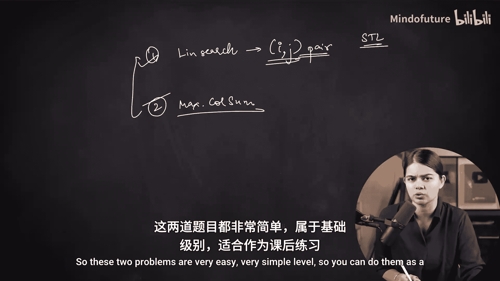

# C++ DSA课程：P34：二维数组（第一部分）🚀

在本节课中，我们将学习数据结构与算法中一个重要的概念：二维数组。我们将了解其定义、内存表示、基本操作，并通过代码示例学习如何创建、初始化和遍历二维数组。


---

## 什么是二维数组？📊

上一节我们深入探讨了一维数组。本节中，我们来看看二维数组。

二维数组，在编程中通常被称为矩阵。它本质上是一个二维表格，我们可以通过特定的行和列来存储数据。例如，我们可以用它来存储一个3x3表格的数据。

一个矩阵或类表格格式包含行和列。行是水平的。例如，一个4行3列的矩阵，我们称之为 `matrix[4][3]`。

在C++中，我们使用两个方括号来定义二维数组：`int matrix[rows][columns];`。

---

## 如何创建和初始化二维数组？🔧

与一维数组类似，我们也可以在创建时为二维数组初始化数据。

以下是一个基础的C++代码模板，用于定义和初始化一个矩阵：

```cpp
// 定义一个4行3列的矩阵
int matrix[4][3];

// 初始化一个3行3列的矩阵
int matrix[3][3] = {
    {1, 2, 3},
    {4, 5, 6},
    {7, 8, 9}
};
```

初始化时，我们使用多组花括号，每组对应一行数据。

---

## 如何访问二维数组的元素？🎯

要访问二维数组中的特定元素，我们需要行索引和列索引的组合。

例如，在 `matrix[3][3]` 中：
*   `matrix[0][0]` 是第0行第0列的元素（值为1）。
*   `matrix[2][1]` 是第2行第1列的元素（值为8）。

我们可以通过 `matrix[row][column]` 来读取或修改该位置的值。

---

## 如何遍历二维数组？🔄

对二维数组进行大多数操作（如输入、输出、搜索）都需要使用循环。我们通常使用嵌套循环来遍历。

外层循环遍历行，内层循环遍历列。

以下是打印矩阵所有元素的代码示例：

```cpp
for(int i = 0; i < rows; i++) {
    for(int j = 0; j < columns; j++) {
        cout << matrix[i][j] << " ";
    }
    cout << endl; // 每行结束后换行
}
```

类似地，我们可以用嵌套循环来输入矩阵的元素：

```cpp
for(int i = 0; i < rows; i++) {
    for(int j = 0; j < columns; j++) {
        cin >> matrix[i][j];
    }
}
```

---

## 二维数组在内存中如何存储？💾

一维数组在内存中是线性连续存储的。二维数组在内存中也是线性存储的，但有两种主要方式：**行主序**和**列主序**。

*   **行主序**：系统先存储第一行的所有元素，接着是第二行，以此类推。这是大多数情况下的存储方式。
*   **列主序**：系统先存储第一列的所有元素，接着是第二列，以此类推。

作为程序员，我们通常不需要控制这个过程，系统会自动处理。

---

## 在二维数组中实现线性搜索🔍

线性搜索的逻辑是遍历每个元素，与目标值进行比较。

以下是实现线性搜索的函数：

```cpp
bool linearSearch(int matrix[][3], int rows, int cols, int key) {
    for(int i = 0; i < rows; i++) {
        for(int j = 0; j < cols; j++) {
            if(matrix[i][j] == key) {
                return true;
            }
        }
    }
    return false;
}
```

---

## 计算矩阵的行最大和📈

假设我们需要找出矩阵中所有行里，元素和最大的那一行的和。

思路是遍历每一行，计算该行元素的和，并与当前记录的最大行和进行比较。

以下是计算最大行和的函数：

```cpp
int getMaxRowSum(int matrix[][3], int rows, int cols) {
    int maxRowSum = INT_MIN; // 初始化为最小整数值
    for(int i = 0; i < rows; i++) {
        int rowSum = 0;
        for(int j = 0; j < cols; j++) {
            rowSum += matrix[i][j];
        }
        maxRowSum = max(maxRowSum, rowSum);
    }
    return maxRowSum;
}
```

**课后练习**：请尝试编写代码，计算并打印矩阵中每一列的元素和，并找出最大的列和。

---

## 计算方阵的对角线之和➗

对于一个 `n x n` 的方阵，存在两条对角线：主对角线和次对角线。

*   **主对角线**：元素的行索引等于列索引，即 `i == j`。
*   **次对角线**：元素满足 `j == n - i - 1`。

一个直观的方法是遍历所有元素，判断其是否在对角线上并累加。但更高效的方法是直接遍历对角线元素。

以下是计算两条对角线总和的优化代码：

```cpp
int diagonalSum(int matrix[][3], int n) {
    int sum = 0;
    for(int i = 0; i < n; i++) {
        // 主对角线元素
        sum += matrix[i][i];
        // 次对角线元素（避免中心元素被重复计算）
        if(i != n - i - 1) {
            sum += matrix[i][n - i - 1];
        }
    }
    return sum;
}
```

---

## 二维向量：动态的二维数组⚡

与一维向量类似，C++也提供了二维向量 `vector<vector<int>>`。它在运行时可以调整大小，通常比原生二维数组更灵活高效。

以下是定义和使用二维向量的示例：

```cpp
#include <iostream>
#include <vector>
using namespace std;

int main() {
    // 定义并初始化一个3x3的二维向量
    vector<vector<int>> matrix = {
        {1, 2, 3},
        {4, 5, 6},
        {7, 8, 9}
    };

    // 访问元素
    cout << matrix[0][0] << endl; // 输出 1

    // 遍历二维向量
    for(int i = 0; i < matrix.size(); i++) { // matrix.size() 是行数
        for(int j = 0; j < matrix[i].size(); j++) { // matrix[i].size() 是第i行的列数
            cout << matrix[i][j] << " ";
        }
        cout << endl;
    }

    // 二维向量的优势：每行可以有不同数量的列
    vector<vector<int>> jaggedMatrix = {
        {1, 2, 3},
        {4, 5},
        {6, 7, 8, 9}
    };
    return 0;
}
```

二维向量的主要优势在于其动态大小和每行长度可以不同（锯齿数组），这使其能更好地适应多种问题场景。

---



## 总结✨

本节课中我们一起学习了二维数组的核心概念。我们掌握了如何创建、初始化、访问和遍历二维数组，理解了其在内存中的存储方式，并实践了线性搜索、计算行和与对角线之和等基本算法。最后，我们还介绍了更灵活的二维向量。掌握这些知识是解决更复杂矩阵问题的基础。