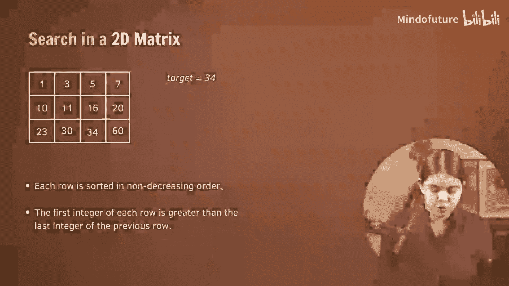
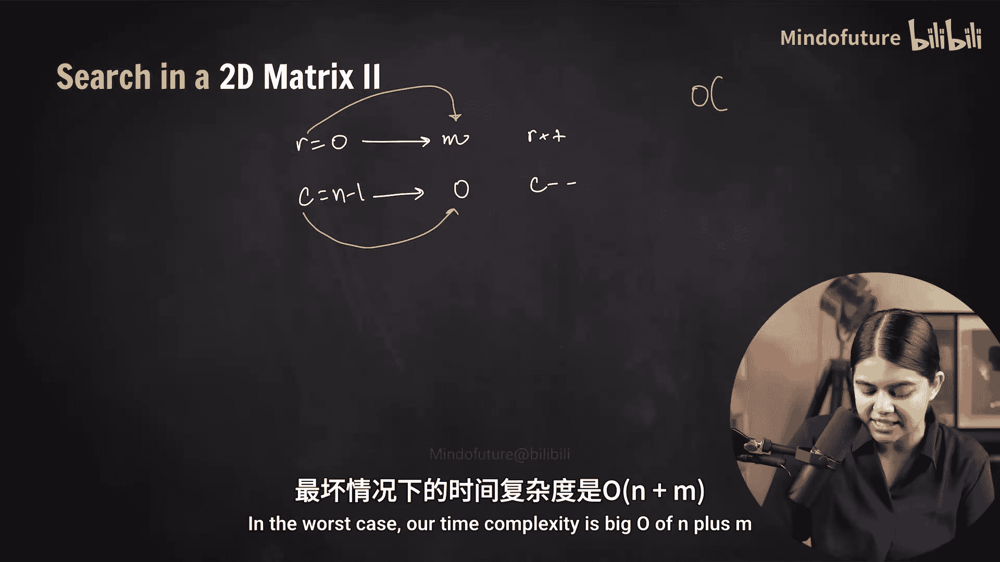

# C++-DSA课程-｜-数据结构-｜-leetcode-｜-Apna-College-｜--Complete-C++-Dsa-Course-p35-P36_搜索二维矩阵-变体I_II-二维数组-第二部分-DSA系列_由Shradha老师讲解--BV18oUGBkEmV_p35-

Everyone and welcome to the complete series or important2 based question concept9 Also there is a link for a company sheet in the description because and and is to search in2 matrixs M cross and column for example。

2 equal and equal So is a cross associated this problem is also problem number 74 on and special properties。

😊。

matrix is sorted in non decreasing order non decreasing order order first is greater than the for example。

 if we have to search for 34 to34。ne brute34 brute write the for must n and is into。😊。

log generally which is fact。a special type of sorting that is happening in terms of columns Second condition second11 second binary。

Exactly3 matrix and that is33。first and last value10 or 22 and334 and that is because。😊，overlap。

non overlappinggi in terms of range In fact is11633 and2。

Optimized way to write it as star plus n star divided by2 is theri k in rose Krara target is andari Miro。

😊，Vhiper， Hamara target exists， Kaai。is greater than equal and column column columnward second。😊。

Haari matrix of midro and n-1 gig。😊，Opppoite case third is and and this is only part part3。

starting equal2 and32。34。Jed in non order equal。or So this is going to be the second part of the problem and we are to analyze binary on total number of calculate number rows which is matrix number of。

Johamari M -1 g kojagi in Donokua hammne binary search for start carrying Jeptahamari starting row is less than equal to my ending row。

 Taptahammiecttopmi mero calculate kir to merojaga start。😊，拉。End minus。

Start divided by two I the Rige Imamari Miromri up check Kna Yahamra Ta Miroopri exists curthe Tukleche Klinggi。

 if target is greater than equal to my matrix of y， in fact。

 let me replace it with mat my matrix of Jobiham Mirop per chqueri and Oscarcar 0th index and and target。

😊，Is less than equal to Yahi same value buses my last column。

 Yanihamra and -1eth column Aga Yahaur is roy range made mid roy range my target exists Kaai Tto Yahihamme Ana answered Mila Malaviev found the rule。

onwardss call this function search。😊，which is also supposed to be boolean function。

Those skillis of and coffee him。Isbar binary search hstartojaga 0。

 Hamra n Hojaga n -1 binary search T tu Hamran kinggi Jep tu start is less than equal to my end。

 Herbal checkkaai subseid calculate kgi methojaga start plus。😊，And minus star divided by 2。

Hmchering a ka Hamrajo target here。 If the target is equal to Hamari matrix K under Jobi particular Rohe Gcom Al Juier and Abijo Hamra midch Mmla Abijo column number。

 mid perham here Bahaa target exists k， whose case may have return guardingi2 value。😊。

Nto binary search the same logic apply carrying a a Hamari target key value greater than Hojati Hamari matrix of row。

😊，And case right is going to be equal to equal333 is。😊。

if you want to understand that in depth dedicated lecture false。

 So this is what the entire logic is going to look like main function convert becausenamed is supposed to be So this is what the entire logic is to look like。

s run it and lets submit it。Solution Baarga up time complexity。

 he termss me Ibar revise Kli them subelto hummni function run here Samraju main function。

 He is scan the Jomari time complexity Lae。 that is big of log M。😊。

G function Q a particular condition a particular condition P function co call time complexity big of log n equal overall complexity that is big of log m plus log n and log log m plus log n change log of common m into n that is how we achieved the time complexity of of log m n M n log m log n functions binary to search a target in a sorted2 d matrix with some search2 matrix and it is kind of a variation of the first problem a variation2 matrix given is matrix ca m cross N equal say for example if we are talking about this matrix。

😊，five columns then this is a cross matrix all in single row sorted in ascending order from to right and in column are also sorted in ascending order from top bottom are in is this and is this different from the。

Specific Ra Valley Road only is the range kander，1 say 15 key range kder V5 exist Kakta。

2 say 19 kander V5 exist curatan，3 say 22 kder v5 exist Kai。

 The last Saval Valley approach Saham I Savalcool Nehi K， Yuki Yaha Hamrijo rose。😊。

They are overlapping in terms of range are to a and and second。😊，1 n1 solution。

Tms of position position M1 n1 position or。😊，Basically extreme number of options direction15 third fourth1s right direction possibilities。

😊，of logical1。U next time next time111111111 next time is solution position or。😊。

compare 67171611177ward next third。😊，of column equal equal logical number possibilities in。

ra column ya columnbar minus minus minus minus minus kpari column valuetheier greater than equal to0 and row co row row increasep R value thanari R value less than and in the conditions basis binary search So this is the overall logic matrix search we have to complete this function called Boolean search matrix sub n and m calculate which lets call it is matrix dot size and in fact M is matrix dot size and n is the total number of columns n matrix of0。

😊，Size ham in teacherger R liring0 kssat and C then-1 ks Jeptari R G value is less than our total number of rows andptahamra column is greater than equal to 0。

 lu Her mid valueid value Rpa already The checkring kra target is equal to matrix of R。😊。

Agar here this case may return Kingi a true value。😊，Else。

 Hamchk Kringgi agarhamara target less than Hamari matrix of R coasuja。

 Those Cames column canander to whomilganni Tom column going a - and Iscabiel vaquehoga。😊。

equality less greater than return let us and successfully logical case logically and with similar using is n plus。

😊。

n complexity complexity log n compared to n compared very interesting。

differences in the and also the differences in that mark in tell me in the What is the new thing that you learned in today's lecture You can share your progress on。

😊。