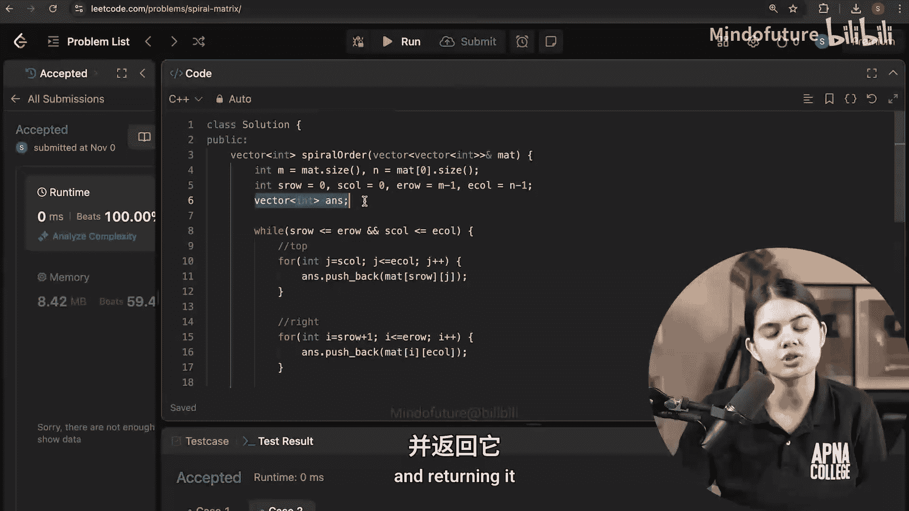

# C++-DSA课程-｜-数据结构-｜-leetcode-｜-Apna-College-｜--Complete-C++-Dsa-Course-p36-P37_螺旋矩阵-二维数组-第三部分-Leetcode_54-DSA系列_由Shradha老师讲解--BV18oUGBkEmV_p36-

Hi everyone and welcome to the complete DA series to Kandarrajajune have one more important question of2D called spiral Ma。

 Now， this is a very classical question of2bar interviews Raja Ijam detailne I concept toham Cha available。

 this problem is also problem number 54 available on lead。😊。

matrix given equal and rose column is given travel topja3ja12 and 16 coverja114 and 13 andja cover cover。

😊，F and will be7 11 will be 10 and for example。Layer ofari top boundaryeth column n number right column number fixed which is n1ham bottom boundary is andham1 column which is equal to0 top bottom number column and right column number。

We can make use of four variables different different rows and column bottom Similarly column and column top column is equal to m1 and ending column is equal to nverse top top。

😊，Jo J is equal to 0 stoga I coham generalized to cam k is 0 K starting column here starting column say J B ending column the kmeja k top boundary re J is equal to 0 k starting column s a ending column the ja and her barham act k a matrix of。

😊，Starting row。Coma j。 I hope your top boundary logic majority code E similar logic Any may pass starting column ending column value So k top boundary loop was starting column ending column the justari starting row fixed the starting row fixed and J starting column ending column the click a top boundary similar pattern say right boundary print。

😊，So let us write right here。Rightite boundary k Hamme but ye Ali Se to already top boundary can cover Rouki。

 the camme ani is Rore uppne last Rojai And what is this row。 This is starting row plus1。

 the starting row plus1 sreham ending Roangay or herbahama ending column is right boundary k fixra。

 the hammic loop shallasak that starts from I is equal to starting row plus1 to ending row。😊。

And her barham axis kectam， print kvac answered in the store kect tape， upne row。

 comma ending column go。😊，This theriki Samari right boundary print tojagi。

 Similarlyly Agar bottom boundary Kbaquene to bottom boundary may give ael already cover Uchokoga tohamme。

 basically Yahalejane。 What is this place， This is ending column-1。

 and this is the starting column or herbarhama ending Rofixparreta to Agarhamme up me bottom boundary k。

😊，Value s print kvai tohamra loop Cheligga j is equal to this is ending column 1。

 the Yaperhamra ending column 1 sre ham upni starting column the loop Cheanggi and her bar axis carrying a matrix of Yukihamari last row here to ending row。

😊，And J value。This one set ofni bottom boundary co print And similarly。

 agarham left boundary cova to left boundary may y value to He y valueki in already top and bottom boundary scan the printva basically。

 What is this value。 This is ending row-1 and what is this value。

 This is starting row plus1 let us minimize this left boundary co basically I is equal tori ending row。

😊，-1ari starting row plus1 and bar is matrix column column So set of top set of right set of bottom and8 set ofs suppose set of top right and next next starting top boundary is row is top plusme starting rowco。

😊，Plus plus Ki Oque A me， can we also say a bottom boundary any ending rowco to already print carvacho came I a bottom boundary equal8 level Uer la up the ending rowco minus minus knadega。

 So similarly， we do ending row minus minus。😊，A column k to column my right boundary print a last column ending column coverse my ending column co minus minus knaga right boundaryra and first time my left boundaryyahi to next barri kle left boundaryra to ke starting column Ko be a plus Knaga。

😊，basically column column operations set。😊，set of second step top right bottom and and third step for specific。

Sam M and ng values Li M is the total number of rows。

 So say matrix dot size and let us change it to matrix。

 and I can teacher n columns size starting row0jagi starting column B Shiwa k ending rowjagipa M minus1 k equal and ending column will be equal to n minus1 loopi equal y loopp loop k condition here sayam per vi loop basically barbar barbarro boundary sub top then right。

😊，Then， bottom。And forari left boundary。 top boundary cori Knemeraju starting column J less than equal to my ending column j plus Herbar in this question。

 we have to return the spiral orderak returnnele called answerse initialize to simply answerush value。

 which is matrix of starting row。😊，G。This the ri say Hamra top boundaryhamara right boundary right boundary loop I valueru carrying a starting row plus1 say I is less than equal to ending row isri conditions I already discussed Cur matrix of I comma Hamara ending column same。

😊，Fairhamari bottom boundary kb， bottom boundary kb hum ending column minus1 z start kongi Jeptahama J is greater than equal to our starting column j coham herbaaringi minus minus Yahamari ending growwajagi and will have J。

😊，Isas Ame Hamari left boundaryundary Kib。H kringgi I equalsari ending row minus1 crep I is greater than equal to our starting row plus 1 I minus minuski row and values boundary and。

😊，To herbarum print Kvani v I， along with our starting column。

 this is therique a charo boundaries commni print Kvaier and Charroco print Kvaniba starting Roku Kgi plus less。

😊，Ending rowham Ki minus minus starting column co Kgi plus this and ending column co minus minus。

 So this is what the entire code looks like。 And J Jippa answer K values push back Ojagi ch K end mayhem return K answer value Major Jo figure out K Tmin boundaries code traverse K ordermi per the traverse。

 What will be the y condition while condition K。😊，E logically exactly starting ro plus minus minus and similar and elements overlap next value greater than elements elements。

😊，Similar case column equal。is the matrix example total number of row M value even number whose case perfectly columns value matrixham is matrix number of rows number columnss24。

5， and9ham top boundary and bottom boundary next and in that case and and that is equal equal。😊。

odd equales equal equal than equal to ending column is my starting column is my ending column same number of elements and in common elements is starting is less than equal to ending and column is less than equal logical reasons suppose which is。

rows and column second is logical third which is basically。just for example。

 odd size matrix example starting row and ending ro。 So this is my starting row。

 and this is my ending row bar starting row and ending top boundary cover bottom boundary cover next odd size starting row and ending equal or equal Both of them are pointing to the same number of elementspa1。

2，3，4，5，6，7，8，9，101112。😊，13，14 and 15 he。T starting row ending row ya Shirame starting column ya ending column ya。

 but starting column of ending column ofari top boundary kari top boundary starting columns is ending column theia or starting row valley Roia this is 7。

8，9 kari top boundary Aham bottom boundary k toari bottom boundary ending Ro The bottom boundary is also the same number of elements to yapa notice Kme cheesekibbiari starting roki valueari ending roki value k equalier。

 whose case meari top boundary is equal to my bottom boundary。😊。

top boundary elements print bottom boundary only same elements elements repeat In fact。

 problem are going to get a wrong solution in one of the test cases and test case element top boundary print bottom bottom is why we want to break out of this bottom boundary same case column number rightetition if the starting column is equal to my ending column those case may we want to break。

😊，Out of the loop， Akihamari， right boundary， Hamari left boundary。

 say overlap Naka orari was duplicate elements Ne to yeea a specialial coroner casehead。

 Johomi consider Gnaaddiga for odd size matrices。 say B Ebarab Bra Garhen。😊。

And successfully run basically starting right and all less than equal than equal top and right and and simply。

😊，D。successfully is equal to m nverse equal to number of cells which is equal to to print order begin。

😊。

。Successfully completed the lecture。 you can mark your attendance down in the comments。

 Ex case you can also share your progress with me on Twitter justkuche description box and also lecture programming next lecture keep learning and keep exploring。

😊。