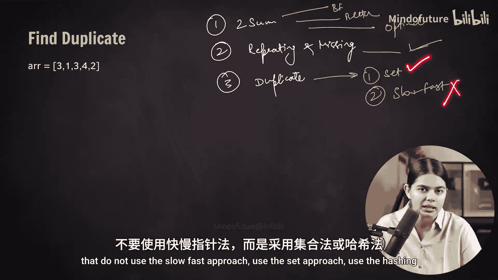

# C++-DSA课程-｜-数据结构-｜-leetcode-｜-Apna-College-｜--Complete-C++-Dsa-Course-p37-P38_两数之和-查找重复项-查找重复和缺失值-哈希问题--BV18oUGBkEmV_p37-

Hi everyone and welcome to the complete or important question which are related to hashing in programming lectures are available in this playlist is a link to company in the box preparing will be is called and it classical which is related to and and。

😊。

this is going to be our first problem and given a target in this numbers numbers for。

 is and7 and7 returnjaja and is also the first problem2 or79 and4 solutions exist single solution and you may not use the same element twice。

😊，same element and can the in any brute second and thirdd interview brute because't directly jumpd we with the basic of brute jumpd to during the interviews。

😊，Except them。basically brute equal。Get that special pair。

 just make though no numbers kam is going to be equal to target。

 though bruteful approachander subse outer I is equal to 0 to first element and the first element is going to be E of I inner j is equal to I plus1 I plus pair we don't get a lot of repetition just second number that will be of j and finally that will be our first number plus our second number and If this becomes equal to the target。

ra answered toera。😊，Inner logic and this is my outer loop mini。

 So this is the entire logic n loop on average n times and start thinking are going to。😊。

The Jesseriko ascending order canas arrange elements ascending order can arrange to smaller elements initially a and larger elementsariri to better approachrikiuna sub smallest and sub largest element sum calculate Hoia。

 than this is going to be the smallest value， and this is going to be the。😊。

Lrgest valuesatringgi smallest plus largest smallest plus17 17 a if this is greater than the target value I smallest I or next time1 next timeest and instead of calling them smallest and and。

😊，Minus minus cardia。And some Hamara Hojaga start plus ending value Jo Hamre Okeel。 Next time。

 Hamrajo Samhevo Orchojaga Yni 2 plus 112 plus 11， Hamaripa Hojaga 13 gay equalel。😊。

133 and plus equal for reason programming have already done basic techniques second step equal。😊。

technical plus。4 step plus biggoov n second step in body valueov n That is why better2 isov nto brute force and better approach better approach that is the mostd approach and that approach uses the concept of hashing。

😊，Haashingko already Etl kander k Hani maps， Se K programming kandermei maps and sets kam programming kander Val time complexity practical cases of Cons Bab。

 That is the one special thing that we have learnt in the Etl lecture and U practically basicallyme Alme。

😊，target equalki first value and second valueari equal that is the general problem statement。

ki first valueham as the first value second valuegi first value to basically first value I equal0 first value。

 which will be。😊，I。Theboha logical C cheese， a buger Yaha perham specifically Ani is equation quo they came is equation can the Hamapna target Al Pa Hamapni first value Al Pa Qq k Kuchque to ca k second the value to Hamipas automatically calculated to Jaki。

😊，I see equation kar path correct Can we say that our second is always equal to target minus the first value。

ab 9 or and or and index is return as answer first value or second。😊。

in need searching of value caseder order use。An unordered map。

Jcaanderham integer and integer cap to Ka， to unordered maps Svalku guesses all Karaoni。

 Let's suppose Hammnik unordered map create Ka， which is therii。

 I like to imagine unordered map as a table， though Hambikuchii Tari create khamara unordered。😊。

Map integer and integer valueja andkaja ordered pair value value duplicatemegi or asika element1 index valuese let us suppose。

 and this becomes my first value first value I Ija might target。😊，First value。

 which is equal to 9-5 to basically unorder map isorder map element search complement second value and second which is also first value in。

Tman Bjaga，2 other first element Bnia to Iskiia。ara secondja 9-27 equalor77 and with its index。

 which is equal to1 111111 again111111 with is equal to 77。😊，Complement calculate carrying。

 It will be 9-7 equals to2 code andme tola is complement exist k j complement second value pair 7 index7 index 3 k equal and2 k index store which is equal to1 pair3 and1 and this will be equal to answer value map use to solve the to sum problem sum problem。

 and then we are going to proceed to the code。😊，Sse unauder map create kna integer and integer and I M K equalke。

 we are going to start a loop my bar bar array of Iqui first value Picking first value K second。

 So second will be equal to target minus the first value up second unorder map can the simply function。

 which is M dot find。😊，M dot second value M dot is not equal to M dot end case basically map dot or return which is equal to M dot basically return M dot current index equal and map second index notation and。

😊，Urbanaz are answered return or U value name be return those case may hammic current element co storeang map current element quo is theang。

😊，Basically， upname map canander。Uponny first value K corresponding add Kna Chae index I to map kic table Kander。

 first Hamari kbujagi and I Hamari Valjagi Jesse upper 11 Hamari key here Ika index 2 Hamari Val to map kand theri element quo aba is particular code cam timeity cculator K Tsmahamari outer loop Jubiov n times run Kaai。

😊，To out complexity equal y constant operation constant operation sub important map practical cases complexity function key constant and this is the most thing about map brute function practically scenario scenario complexity is equal to and that is why this is the most optimized approach says optimize。

😊，Isvalgo and Yahi solution saym codinghi same solution take particular problem。

 We are given this function。 we have the nus vector。

 Let me rename this nus to E and target I T A R Ya hamm unaued set create sub to unaued。😊。

Map create carrying it map of integer and integer values。 Let's call it M。 I case me。

 I'm also going to create a vector of integer called answer。

 Just scan them me Don don no index goesal circuit return value up9 loop Chi 4 integer I equals 0 I less than n。

😊，Or array dot size I plus less。Haipas， Hamara first Hojaga， E of I k equall， Hamipas。

 Hama secondin Hojaga target minus first K equal Hamme upni second code duai map can the tomche Kring a map dot find our secondin is not equal to M dot。

And。😔，Agahammi mildjaai successfully。 Those case may answer Ki Ham subse to。

Push back Kaingi up now eye。kibal answer Kander and pushushba Kanival our second index。

 which is equal to M of。Second。And Yai， I am trying to break me Kak， here directly return me Kak。

 let us do break， break Kaya me for Lu kba Im directly Aki Kaam Kaingi。

 which is to return the answer。😊，And Aga first value go with its index。

 which is equal to y This the logicky helps。 Now， let us run our code。😊。

And submitted this theri we solve our to some problem to some problem Ka next Sval。

 which is also based on hashing discomne。 It is called fine missing and repeating values。

 This is also problem number 2，9，6，5 on lead code he has a easy level question Aham already sets and mapski understanding to set logic use isgo and try to solve this question on your own the question k we have an n cross n gridpa n and n column for this example。

 my n is equal to3pa 3 cross 3 key grid matrix So this is the grid that we have gridpa number from1 to n square key range and is grid kandander 1 Se9 key range numbers available but those special numbers。

😊，Which are called a and B， A S a number H Oari grid mate two times aer kai and B S a number H1 a acre n square key range can a missing value H。

To basically a is our repeating number and B is our missing values。

me elements and we have to find the missing value as well as the repeating value it has1，2，3，4。

 it doesn't have5 B equal and repeating and and as answer or in numbers。

 which is the repeating value return and， which is the missing value return in easy identify the repeating value repeating value。

😊，number my repeat repeat easy is to be very easy of。😊，Answerme。

 we are going to create an unaued set。Of integer， let's call it S。

 A make loop chaalingniurrikiurri grid per I less than N key value calculate Klera。

 which is grid dot size I less than n I plus plus。4 integer J equals 0。

 J less than n J plus less Sa K Sahamdu integer values lay setting a and b K equal。

Yabar herbhamzekaratgi， Agarhamari saidkander。Dot find Hamra grid of I comma J already Agar exists K up this is not equal to S dot N。

 Those case is simply Hamra a Hojaga Hamari grid of I comma J K equal。

 and we are going to break out of the slope。 Agarta to simply up set kar insert Knena grid of I comma J value go。

 So this is the entire logic to find out this particular a many repeating value。 In fact。

 E a co find Kne Kba Hamapne answer kar。Push back B as our partial answer problem next step find the missing value repeating which is the repeating and ideal situation this is fact out。

calculate general formula That is the general formula of arithmetic progression Jo basically agarippa1 n inri numbers range sum calculate formula n n plus1 divided by2 Similarlyly。

 Apa1 n squaredari numbers range to in n square multiplied by n square plus1 divided by2 to y basically mera expected sumasta Agar coi repeating or coi missing value nowu。

😊，L in actual sumka。 Act Samav is grid Knipa Valkabu sum deja。

 So that sum is basically ytohamara ideal Samhoge 5 plus 6 plus 7 plus 8 plus 9。😊。

which a and is or and。square values a or or sum equation sum which is equal to this formula identify repeat should be very easy formula is basically。

😊，Kihaari Joe expected some key value here plus a minus b is equal to actual sum value to I C equation sum case。

 then that our B is equal to my expected sum plus a minus my actual sum。

Hame basically is equation canander in thin parameters who calculate herque add Kna orpaari missing value Ajagi。

 Casi is gridi missing Val Ajagi Voig birthday them I gridhamara expected some kojaga。

 Hamara expected some hojaga and square。😊，Into n square plus1 divided by 2ejagan 9 into 10 divided by 2。

 which is equal to 45pa expected sum can value 45 k equal plus isham a co additionally add a identify co or actual sum co minusme already calculateme basically in sari values co add sari values sum 49 k equal minus K 49 co and this value should be equal to my B equation cos B valueja5 k equal and5 is the missing value in this particular grid basically a expected sum and actual sum co or is formula co calculate R variables1 is expected sum initialize K and one is actual sum grid can exist I initial K sum co calculate。

😊，calculate grid and in repeat and。😊，Some coggger calculate current。

 so that will be equal to n square。In2 n squared plus 1。Divided by2。Tohamari By valuejagi。

 my expected some。Plus， a minus the actualism。The Bjse Agaham answered k dot pushed back Kingi A Nebiko。

 and we are going to return， though。riari calculations perform to track the repeating value。

 repeating arithmetic progression and sum using this formula ands sum So this is how we solve the problem of finding the missing and repeating values in a particularari equations use or basicallyverse the overall of the solution。

 which is， which is also based on the concept ofhings called。😊。

Find duplicate basically N plus1 s I range is minimum for example values I value or this question is also available as problem87 are given intes containing n1 in where in is in the range1 to n inclusive or included there is only one repeating number in return this repeating number for example。

 which is suppose。😊，previous multiple multiples of the same number。

Cases that will be big of no space complexitygibigi kki unaued set use first case mate Hamari elements set the to set extra space occupy say unordered maps be extra space occupy to space complexity big of n So this is the first approach justcom use k is approach aham code we can create an unaudered set of integer values S loop for all integer values in nus。

😊，This is a4 each loop synax vice， Hamharbach kcee， Agarhamari， Ekander， Hamne Al upne。

Value codeunier Matlaab， this is not equal to S dot end。 Those case me Im answer return ksta。

 which is equal to my value， which is the repeating value and Herba S k insert kecte upni value and Ko be repeated value how many mi those case mayhamm return k-1。

 but y statement S Eov be execute Ni yogi youki most probably a solution exists Kaai tomi solution Mijaga is code km runri。

To code successfully runbija submitja Lake invapa condition must solve the problem without modifying thes and using only constant extra spaceaued setov N space complexity Igo one space complexity generally additional data structure。

 mathematical formula constant space complexity with there is a special approach that we use proof。

 which is called slow and fast pointer approach。😊，or basically concept or continue the question as is basically similar to the elements of。

😊，J1 element per。 this could be22 per33 per4 per a different elements collection collection concept reim as basically number134 and2 and her number index0。

1，2，3 and4 can imagine basically imaginegi index indexari and is index that is basically going to become the next node。

😊，Kga to 0 indextora nodedga and 0 uglyva per point，0 uglybar3 v node per point。😊。

To yea node here and yea next to Joe point Kare voice 3 co point kre to 0 is pointing to 3。

 Similarly for Agaram 3 Braai， Agaram Yaha Bai to 3 Agar node hair to 3 next time point k 4 co。😊。

Tri Hamaripa4 Ajaah， Agaraham4 parai， the Yahapaai，4 Agar Nord him to4 point Kaai Ahaari2o。

 the4 is now going to point2tu， Agarham Yahapa2 parai。is now going to point towards3 is。

Kgiki E S C node Hammea Ho find G， which is the duplicate value to yeari S C duplicate value Ho the a node point andky the doi node v pointga that this is the duplicate value to slow fast pointer approach co basically Ane linkist K under Ani is joint co I cycle join here This is basically that point Jaari cycle star with E scanander is point co find S fast pointer approach who useari elements may a node。

 which is this node Jaari node have k equal。😊，And next pointer calculationse imaginena。😊。

As a link list justca under Hamari Eicajo element here， that is going to become the next node。

 And Hamari Eicajo index here。 That is going to become the original node of the link list。

 This Sam a P slow fast pointer approach who use a slow fast pointer approach。 exactly Hohiku。😊。

Low fast pointer approach， Hee， let us remove all of this。 Hamari's low fast pointer approach， Heier。

Agarhamari List Krakuwi cycle exist Ka。 Thoselingless Kleham though pointers later。

Aer and aerin basically case and for the sake simplicity multiple dismiss or next。😊。

fasterp121212 step of。😊，Jesie ye conditionipas Ri Jo， Usqueamar， Usham， second Stepai。

K and v of and andb or finallyb or I or But this is how works。😊，Inepartco， let us cut from here。

And let us copy it here。 to in meetingbu plus plus1 plus1 fast plus1 value per。

 which is the starting point for the cycle in the second time This is going to be the answer。

 and this is going to be the duplicate value to basically， which is going to be nus of0 and pointer。

 which is also going to be nus of0 part let us create do。😊，s take the example of。

Mla Sloki Jovi Val Ei value perja to next value Tom Chaloki value Agarja toham King Sko S is equal to E of S the Ya Sloko plus1 update Ka this is going to become E of。

😊，S plus similarly fast co is of and plus1 plusb my is not equal to my fast value So this is my first part of second part starting value of and because we are expecting both of them to be at different placesb is not equal to my fast pointer is equal to of and。

😊，The fast is equal to my array。Of fast to Ya B plus plus Jse don meet Kajagi。

Yra second part of the pseudo let us minimize this a bit。

 j whose case me value return value return equal values that is our duplicate value approach here complexity logically loop basically second approach can loop overall fast time complexity that is twice approach we get a time complexity of and we get a space complexity of1 additional use Nik in teacher variables use fast or inki values called logically that is why we achieve the same time complexity with the help of this approach。

 but with an added benefit of getting a space complexity of which is constant and very goodbar is。😊。

Approach is pseudo code K。 I' now code like them。Code canander。

 we are going to start with two pointers。 One is going to be the slow pointer。

 nus of0 say and a kas pointerjaga nus of0 saym0 start sub updatering by one value the slow is equal to a of slow。

So here how many plus one update here， let's rename this to E。Se Bhamna  educatedated him。

And a Kna fast liithium， which is going to be updated as E of fast。To y say plus 2 called year。

Jept or slow is not equal to our fast value。Oskeva jse he Lu and Banialt donu equal him the sloko reinishize Kingge to array of 0 and Oskevak Lu Chiin。

gypk my slow is not equal to my fast value。Hamehaba Slokuto update Kai by1。

 fast Ko update Kem by one。And finally， last mayhem return girling me S value。

 So this is the entire logic for constant space complexity。 Ya semi Lagaka ranem。

 and let us submit it。 tomarakor successfully sum O。

 And this is how we solve the problem of finding the duplicate number。rajo Eta Ukarjo initialization。

 Yahabi， we can make the initialization with E values andjuri initialize K Ibiham E initialize Kam。

 by hope kki lecture Karju T important problem。 sum me cover K。 First was the to sum problem。

 Second was the repeating。😊，And missing value problem。And third was a duplicate problem。and give。

And that is something that I specifically focus on。

 So I hope he ask lecture how me successfully complete K。 If you have completed it。

 you can mark your attendance now in the comments。 O me you can also let me know your progress on Twitter Justcal linkku description box Ja Also for the new version of the DSA sheetcal link Bel update K to ask9 Mil video doesn keep learning and keep exploring。

😊。