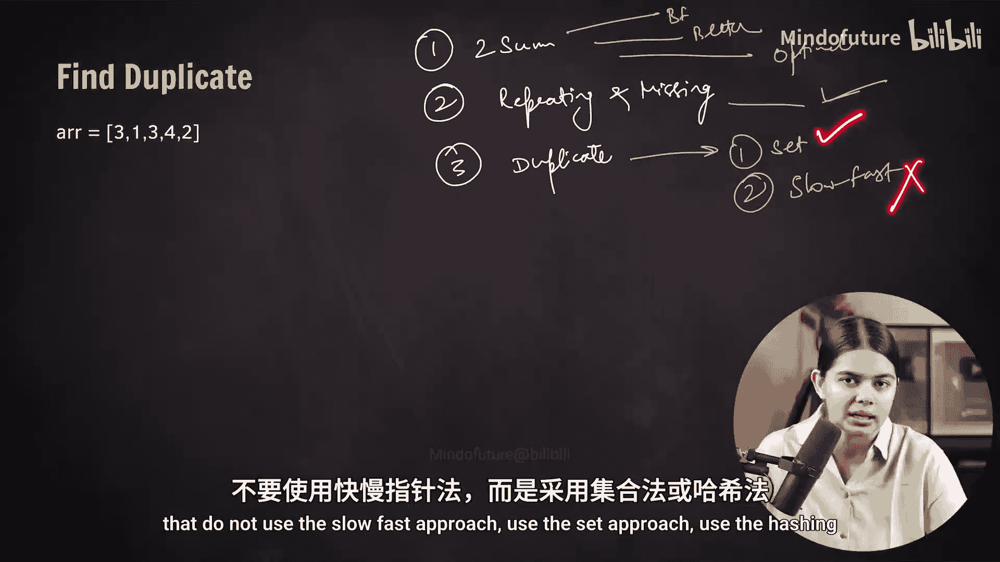

# C++ 数据结构与算法课程：P37-P38：哈希表应用问题详解


在本节课中，我们将学习哈希表在解决实际问题中的应用。我们将通过三个经典的LeetCode问题来深入理解哈希表的使用技巧，包括两数之和、查找重复与缺失值以及查找重复项。课程将从暴力解法开始，逐步过渡到使用哈希表的最优解，并介绍一种巧妙的常数空间解法。

## 两数之和问题 🎯

给定一个整数数组 `nums` 和一个整数目标值 `target`，请在数组中找出**和**为目标值 `target` 的那**两个**整数，并返回它们的数组下标。你可以假设每种输入只会对应一个答案，并且你不能重复使用相同的元素。

### 暴力解法

首先，我们来看最直接的解法。思路是遍历数组中的每一个元素，并查找是否存在另一个元素，使得它们的和等于目标值。

以下是暴力解法的步骤：
1.  使用一个外层循环，索引 `i` 从 `0` 遍历到 `n-1`，选取第一个数字 `nums[i]`。
2.  使用一个内层循环，索引 `j` 从 `i+1` 遍历到 `n-1`，选取第二个数字 `nums[j]`。
3.  检查 `nums[i] + nums[j]` 是否等于 `target`。如果相等，则返回 `{i, j}`。

**代码描述：**
```cpp
for (int i = 0; i < n; i++) {
    for (int j = i + 1; j < n; j++) {
        if (nums[i] + nums[j] == target) {
            return {i, j};
        }
    }
}
```
这种方法的时间复杂度是 **O(n²)**，在数据量较大时效率较低。

### 哈希表优化解法

上一节我们介绍了暴力解法，本节中我们来看看如何使用哈希表进行优化。核心思路是：当我们遍历数组时，对于当前元素 `nums[i]`（我们称之为 `first`），我们只需要知道互补数 `second = target - first` 是否在之前已经出现过。

我们可以使用一个哈希表（在C++中通常使用 `unordered_map`）来存储已经遍历过的数字及其索引。这样，检查一个数是否存在的时间复杂度可以降低到平均 **O(1)**。

**解题步骤：**
1.  创建一个 `unordered_map<int, int>`，用于存储 `元素值 -> 索引` 的映射。
2.  遍历数组 `nums`，对于每个元素 `nums[i]`：
    *   计算其互补数 `complement = target - nums[i]`。
    *   检查 `complement` 是否存在于哈希表中。
    *   如果存在，则我们找到了答案：`{ map[complement], i }`。
    *   如果不存在，则将当前元素 `nums[i]` 及其索引 `i` 存入哈希表，以便后续查找。

**代码描述：**
```cpp
unordered_map<int, int> numMap;
for (int i = 0; i < nums.size(); i++) {
    int complement = target - nums[i];
    if (numMap.find(complement) != numMap.end()) {
        return {numMap[complement], i};
    }
    numMap[nums[i]] = i;
}
```
这种方法的时间复杂度是 **O(n)**，空间复杂度也是 **O(n)**，是解决此问题的最优方法之一。

---

## 查找重复与缺失值 🔍

给定一个 `n x n` 的矩阵，其中包含从 `1` 到 `n²` 的所有整数，但恰好有一个数字重复，一个数字缺失。我们需要找出这个重复的数字 `A` 和缺失的数字 `B`。

### 使用集合查找重复值

解决这个问题的第一步是找出重复的数字。我们可以利用集合（`unordered_set`）中元素唯一的特性。

以下是查找重复值的步骤：
1.  创建一个空的 `unordered_set<int>`。
2.  遍历矩阵中的每一个元素。
3.  对于每个元素，检查它是否已经存在于集合中。
4.  如果存在，则该元素就是重复的数字 `A`。
5.  如果不存在，则将该元素插入集合。

### 利用数学公式查找缺失值

找到重复值 `A` 后，我们可以通过数学计算来找到缺失值 `B`。关键思路是利用从 `1` 到 `n²` 的等差数列和。

**计算公式：**
*   **期望总和（Expected Sum）**：从1到n²的所有整数之和。
    `expected_sum = n² * (n² + 1) / 2`
*   **实际总和（Actual Sum）**：矩阵中所有元素之和。
*   它们之间的关系是：`expected_sum + A - B = actual_sum`
*   因此，缺失值 `B = expected_sum + A - actual_sum`

**解题步骤：**
1.  使用集合找到重复值 `A`。
2.  计算矩阵所有元素的 `actual_sum`。
3.  利用上述公式计算 `expected_sum`。
4.  代入公式 `B = expected_sum + A - actual_sum` 得到缺失值。

这种方法的时间复杂度为 **O(n²)**（遍历矩阵），空间复杂度为 **O(n²)**（最坏情况下集合存储所有元素）。

---

## 查找重复项（常数空间） 🐢🐇

给定一个包含 `n + 1` 个整数的数组 `nums`，其数字都在 `1` 到 `n` 之间（包括 `1` 和 `n`），可知至少存在一个重复的整数。假设只有一个重复的整数，找出它。要求不能修改原数组，并且只能使用常数级的额外空间。

### 链表环检测法（快慢指针）

这个问题可以巧妙地转化为链表中的环检测问题。我们将数组索引和值视为链表节点：`索引 i` 指向 `值 nums[i]`（即下一个节点的索引）。

由于数组中有重复数字，那么这个“链表”中必然存在一个环，而环的入口节点索引对应的值就是重复的数字。我们可以使用快慢指针（Floyd判圈算法）来找到这个入口。

**算法步骤：**
1.  **第一阶段：检测环**
    *   初始化两个指针 `slow` 和 `fast`，都指向“链表”头（索引0，即 `nums[0]`）。
    *   `slow` 每次移动一步（`slow = nums[slow]`）。
    *   `fast` 每次移动两步（`fast = nums[nums[fast]]`）。
    *   当 `slow` 和 `fast` 相遇时，说明链表中存在环。
2.  **第二阶段：寻找环入口（重复数字）**
    *   将 `slow` 重新置回起点（`nums[0]`）。
    *   `slow` 和 `fast` 现在每次都只移动一步。
    *   当它们再次相遇时，相遇点就是环的入口。该点对应的数组值 `nums[slow]` 就是重复的数字。

**代码描述：**
```cpp
int slow = nums[0];
int fast = nums[0];
// 第一阶段：寻找相遇点
do {
    slow = nums[slow];
    fast = nums[nums[fast]];
} while (slow != fast);
// 第二阶段：寻找环入口
slow = nums[0];
while (slow != fast) {
    slow = nums[slow];
    fast = nums[fast];
}
return slow; // 或 fast
```
这种方法的时间复杂度是 **O(n)**，空间复杂度是 **O(1)**，完美满足了题目的要求。

---

## 总结 📚

本节课中我们一起学习了哈希表的三个重要应用场景：
1.  **两数之和**：通过哈希表将查找时间降至 O(1)，从而在 O(n) 时间内解决问题。
2.  **查找重复与缺失值**：结合哈希集合与数学公式，有效处理了矩阵中的特殊数字问题。
3.  **查找重复项（常数空间）**：通过将数组抽象成链表，并运用快慢指针算法，在不开辟额外空间的情况下找到了重复数字。



这些问题的解法展示了数据结构知识如何灵活运用于实际问题解决中，从暴力枚举到哈希优化，再到巧妙的数学与指针技巧，每一步优化都加深了我们对算法效率的理解。