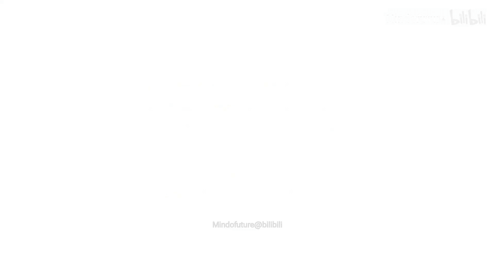
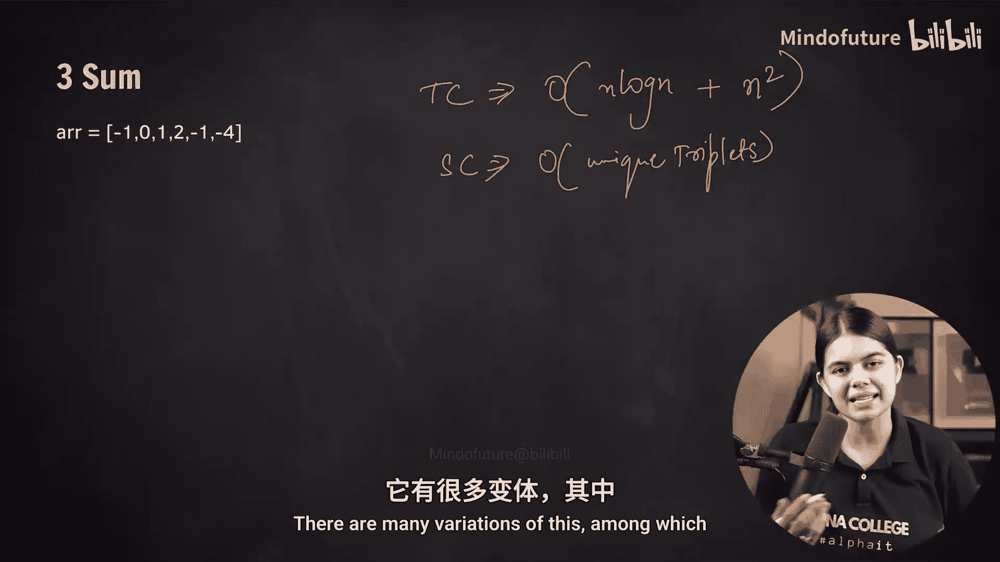

# C++-DSA课程-｜-数据结构-｜-leetcode-｜-Apna-College-｜--Complete-C++-Dsa-Course-p38-P39_三数之和-暴力_更好优化方法附代码-Leetcode_15--BV18oUGBkEmV_p38-

I drawn welcome to the complete series and today we're going to solve one more important question called the threesome problem Also there is a link for company sheet in the description box this problem is called sum problem and this is problem number 15 multiple numbers numbers should be equal to is and10 and。

Iskva， if we think about a different combination，2 is2 is1 k and is say equal1 K the sum will also be equal to 0 or unique combination who2-1 and-1ari is particular or unique combination of numbers existing。

Any other harm is -1co is 0 and is one sat here is 1 Pickingki logic because we are going to get the same triplet。

combination we are calling it triple and we have to find out all the unique multiple variations exist。

optimize better solution we are going to useh well optimized approach which will be the most optimized use is of the optimize solution for this already familiar with the question skip tod eventually coding basically optimized but sake the problem as well as the different to solving problem。

combination number equal equal second second。I make you see do index value of。

 So as part of the solution of my first number co ni I'm basically kac lu from 0 to n justma first numberja numbs of。

equal will be equal to the first number。second number as my second number iss suppose my second number third number third number number similar make third is equal to j in this manner are going let us。

So basically 18 loops just say numbers my first number will be numbers of My second number will be numbers of j and my third number will be of is loop plus plus key value equal to triple but this is pretty much the entire logic logic iste in loop or depending upon the of question just to print these unique。

Those case me print any sea out statementhamari unique triple stole whose case vector banana of vector of intesarique in the form of。

Definitely several sub difficult deviation And that is to store the unique triplets and return them as our answer。

 So E code above codeneval。 the sub roof force approach looking it just made definitely a Maripa steel。

So， this is。My quote is and have also created a vector vector integer say answer is equal to0 I less than n plus plus loop equals plus1 J less than n j plus plus and loop k equals j plus1。

K less than N K plus。Aomaop condition liniki Ahama， nus of I plus nus of J。Plus， nos of cake。

K value of0 equals those case triple J unique triple we can actually make use of a set just go up multiple of。

 That is why explain value。The trick is。s suppose single element use to be more precise character string is unique basically。

Unly2 combination combination0 and1 or what can。Hung J upne triplet， Ko ya pe up set can theto karu。

0itive compared which can get pretty tricky。And the important piece of information and that is why Ive put a special emphasis on this part。

 not use it given to is better is because we are not going to write custom and this is something which is important to。

 In fact， your interviewer can ask you this don't think it is mentioned anywhere。Cronically。

 you basically need to create a set。Which will store vector of inte And is say they S。 basicallyari。

 you just said， hey， yeah，ari Yeahari， unique triplets。こ workかな니까頑えて。Upset can。

 Uni triplet sold Carid tripletve of indija banana Bura。

 Let us call it trip is can Moino values goes stored it。Theino values go adequateally。

 Let us separate them。おっかの？And is a stool kranis is a sort the sort conulate let us use this sort function。

 trip dot begin iterator and trip dot and iterator。So this is my sort function。

 And we can check said already triplet He exists to dot find if this value is equal to n triple already exists and also answer。

アリチプテバ。So this is how we are going to add it to our answer。 And finally。

 after the completion of these loops， we are going to return our answer as the final solution to let us fix this one thing and is。

And let's submit it to successfully majority of the questions。

 but this solution is going to give us a complexity are we doing n complexity complexity is cube multipl because basically set basically wouldor set that is why。

Uet log complexity multiplied log of log and this will be the overall time complexity of this group force solution space complexity output vector vector basically the complexity is equal to all the unique triples。

Multipliied by two， but all the smart people ignore this too。

 as it is a constant in terms of space complexity to bego constant who ignore basically overall complexity in So this is how we solve this problem using approach Next use hasing to solve the same problem Now to actually use hashing in our approach question revisit Al。

 we are given1 numbers triplet find out nus of I plus nus of j plus nus of k some0 k。

So a plus b plus C value 0 k equalhaa root force approach。

 we are using this first loop to find out the a value The second loop to find out the B value and the third loop to find out the value logically first loop second loop C equal select is equation triplet to find out we don't need to run a separate third loop equal equalki is equation K according C key value A minus a plus。

To simply minus a plus value value or said data structure maps same given or numberss call them。

To equal same logic minus minus pair。The Ts sum valley of Akiter harm basically up enough force loop parameter from I is equal to 0 to n。

Just target my target is going to be minus of numbers of target value numbers is equal。

So in a first number to pick definitely j and j i plus1 because again。

 we want non overlap value I value j equal equal target to j1 is equation which is second loop which is equal to by target。

us my basically number that is equal to my target minus and in teacher in teacher let us call it which is equal to。

If we are able to find this value in the set which is and which is in unique is equal to number third number。

numbers of j next time search let us write a quote for this approach to briefly selecting number number will basically equal us call it。

The bits。结识点。Yeah， it's called unique。This is the second loop just of my second number to selecting is starting from i plus1 less than n J plus plus。

aripa first number， second number， which is numberss of J third numberjaga， we can call it third。

 or we can call it too fine。 third numberja basically target minus nus of J value。

Up third number co S can to will use the fine function。 A third Hamari said can exists time。

This is not equal to S start case a triplet createval let us call it triplet or S K under ofino values co。

 which is nus of I nus of j and our third value， which is basically equal to nus of k。

 So is value co sort value So let us sort triplet dot begin。And triplet dot end。

And is unique triplets Nam set said stored differentutations for storedja unique sortedutation setja The unique triplets dot insert are。

Current triple third this is logic and equivalent。H Cha to up me answer go。

 instead of creating it here， I say I last my initialized garden with the unique triplet。Do unique。

The bootss。Dot begin。And unique triple do N basically unique triples said Kriri values and youre going to return the answer to is approach。

And let's try to submit it。 A solution here。 This is also going to submit for most of the test cases。

 but it will still give us most optimized formula most optimized formula third let us try to dry our basically number number let us suppose minus1 equal second number basically second also created a set s this is my set of integer values called s number second is equal to0 third number that is equal to target minus second target0。

to third number number which is equal second equal1 and second。

exist simply and we are going to proceed to the next value。

 next time J second value and third value1 which is equal to two second value is equal to which is our selected and third which is equal to are going to get the same triplet and this is the second solution the second number second number third number So this is the that are going to repeat for all the different numbers available as our Soari is approach。

The time complexity keeps me。outer loop n times inner loop n times here big n square multiplied out which is equal to log all the complexity complexity and also complexity is equal to unique plus complexity unique is going。

the time complexity So this was the second approach or is made definitely root4 comparison time complexity n square convert and it is definitely more optimized for better is the two Now let us talk about our third approach which is the most optimal approach to solve this problem third complexity and complexity last approach complexity basically n square multiplied log of the number of unique triple that exist log complexity data structure we are able to remove this set data structure from our complexity or optimize extra factor complexity multiply。

basically unique order and unique one thing that we doing in the previous sub in terms of for example to implement the two for what we are going to is。

Yeah let us call it and order111 and number as first number equation iteration different combinations and。

number equation sub subed conditions basically。If this is the rest of the， in fact。

 let us draw the sorted say calculate that is equal to4 plus1 plus2 which is equal to the value in sum increase。

minus equal or increase minus minus equal second number smallest。

should not be equal to j order maintain and n is than equal equal less than equal equal or。

Poin and less similarly greater than。E to some key value greater than 0 those case minus minusga some key value less than0 case J plusga and perfect case This is basically the perfect case Ja some value equal to overall important logic for the question。

 So let us remove this。😊，Re。-1 to J C I value1 movie J K is -1 K and J K R。

J or K K Hamju3ja to currently some key valueja minus1-12 k equal-1。Plus-1 plus 2。

 which is equal to0 or are considering。pe greater。And a we don't matter current number in any nus of I T value A nus of I minus1 k equals。

Basically or or and is equal1 which equal1 and。answer。condition name。

Jpt Hamari J K value less than K ratio and Jept Hamari numbs off。JP value is equal to。My numb off。

J1 equal calculate。We are going to go towards a unique value of G duplicate values special convert。

Code can then， we are going to start with our initial loop。 I is equal to0 silire n。

I plus plus J start carrying I plus1 c and k start carrying n minus1 c looppari J value less than k sub sum calculate cur some key value value nus of I。

Less nus of J。 less nus of T equal。And is some sub Williamium Jing， if my son。Is less than 0。

There be some less than0 is case me simply G plus S scan9。Ahamari some key value is greater than 0。

W case me minus minus and answer key value equal to0 this case some value equal to0 case answer。

We are going to insert our。Value are answer， merit triplelate， which is numza 5 nu of J。谂唔做。

For answer can the value co push k it by j co card deta plus plus and k co card deta minus minus approximately though optimizations quite additionally look themari first optimization I repeated value scality any other Iq value greater than0 here and Hamari nus of I key value becomes equal to。

Numbs of I-1。 Those case may Yahase Kjagi continue or I bar or I plus plusk next position facial same optimization of answer Milba Ypta Kari J value is less than K。

And my nus of j becomes equal to nus of j-1 case me I'm jco repeatedly pluspta。

 So this is the entire logic to solve our problem of3 sum just my me answer value is say first step upper repeat which was to sort the array initially。

To numberss dot begin and nus dot n。Erico So let us run our code， and our code has successfully。

Pass the test cases and is a submit。 So you code submit K is a time complexity It me about to basically sub step is the sorting step。

 Soing time complexity is n loggan。To time complexity n minus on average n times loop on n square complexity constant equal complexity which complexity。

output consider unique triple this is the time and space complexity most optimal and in fact to know are to solve problem which is a and will discuss one more of the same because those things the internal of。

data structure important interviewer definitely was I hope that youve successfully completeds lecture can share progress with description and also our team is working to build a optimaler version of the company future learning and keep exploring。

