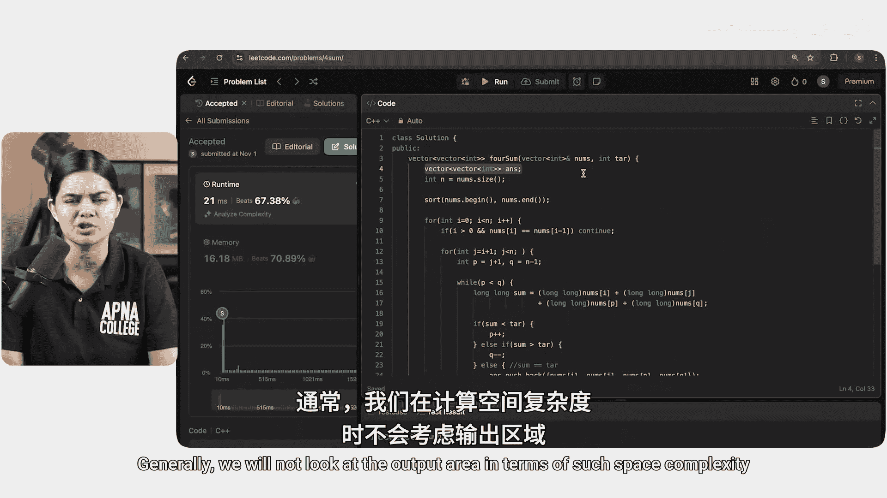

# C++-DSA课程-｜-数据结构-｜-leetcode-｜-Apna-College-｜--Complete-C++-Dsa-Course-p39-P40_四数之和问题-最优方法-DSA系列_由Shradha老师讲解--BV18oUGBkEmV_p39-

to the complete important question called thesome problem complete have done two problem and problem in our past lecture understanding is a for in is not that basically groups of numbers。

😊。

Equal g just say a number， let's suppose Hamak I index per exist k a numberak j index per exist k a numberak k index and a number index per exist cur in charo numbers sum given target k equal Also can this is given thatri I should not be equal to my j j should not be equal to k and should not be equal to anyro number index per sro values group return unique combinations on just say our example agarham is is if we consider these four values in values-1 plus-1 plus 1 plus1 equal to0 a pair group111 and-1 I or values target k equaliumgarham2。

case individual pair112 and straightforward is some problem and problem in basically overlap as。

hamra num of hi minus1 k equally fair backy valueoscopic carrying is such that our condition me to So is the re is a bar bar we are going to update our Ih pointer and pick different combinations of nus of  I so that we can find a group of numbers j some Hamari target equal to I。

 So let us convert this entire array into the diagram form。😊。

and this is the condition that we have to meet we are going to use the classical twoer approach use is already sort ascending with equal。

😊，is equal to 0 to n second is equal to。I plus1 k and I update I plus1 logic overlapping values given I value J value value value non overlap should not be equal to each other insorted I plus1 index or J valueium time time different different combinations。

😊，Though j B jaha for j is equal to I plus1 enham or different different values of j I or of I of all numberska in values output equal in values2 pointer approach k and this L value and for the sake of simplicity is kna P and is L Q because this is easier to use as pointers to p or Q basically values andko I or j。

😊，to form the required sum interesting piece of information is also sorted。

 This is also sorted or sorted numbers pointer approach easier efficient approach basically numbers appropriate with the smallest value。

😊，Andq the largest value of say equal。plus1 or calculate sign calculate next will be or is equal to and basically what we are doing andest and smaller value。

Basically be equal to j plus1。 So Hamari of peakca initialization H Vo J plus1 say Ho v and Qca n1 say。

 because that is the last value。 Phraic loop run Kringgi Jepta Hamari peaky value less than Q。😊。

Y p less than  Q Q basically p Q s should equal to P or L basically Q be equal less than what will basically equal p Q And depending upon depending upon sum minus。

Those case may either or smaller value And finally third case is equal to equal to answer the。😊。

Next and logic is basically the ending of and solve which。That me in teacherger N lata。

 which is nus dot size。And Uskiatmi， let us sort our numbers E to start with。

To nus dot begin and nus dot and Tommara Eri Soto jaar first loop outer loop from Chiang gap my icoelectronically to I less than n i plus plus。

Okeba E see format me I up second loop Chi Jco select。 The4 in teacherger J is equal to I plus 1。

Let us maximize it a bit。My J less than n and my J plus less。So yehammara， second loop Hojaga。

 Ukebal Hammni P and Qco select Kne v， P Hojaga J plus1 k equal and  Q hojaga and minus-1 k equal。😊。

Am loop Chilangi internally， Jepta kri Piy value less than cunyrateti Tt subsetome some calculate Kna some cukiek bodyddy value wasier。

 though I sayham initialize carrying at long long。😊，Though let us take it。

Itohamara nus of I Ujaga plus similar format me Hama nus of G。Numbs of J。 nus of P。And nusov Q。

 thero valuesaripajagi Abham someki value co compare K Agar Hamari someki value becomes less than equal to the target。

 Those case me totayame P equal plus。Legaraki someki values is greater than the target U casememiko minus minus K and else vak Voga just case me Hamra sum becomes equal to the target。

 This case me sum target equal answerush group of values nu of I of js of Pco。😊，And Inamov cugo。

To Iaiam Sa Kvalingi answered kander， Ukeba Pico Kgi plus less and upneco Kdii minus minus to y overall logic just may last May at the end。

😊，Of all of the loops， I return Guneval may answer。

 So this is the entire logic I his logic and the the optimizations missing him。

Y optimizations cook Knika K yhem。 Ki lets suppose Hamari le shouldwa me Hamari。

 Ivalue him minus to k I the Ri say Hamara I Hamari has already given him。Or is，s suppose or。

 which was2 is equal to0 or is2b time time i is equal to。

equal i is equal repeat greater than is equal than equal。😊。

Kjucheuraura v Iam skip orbarnedigi yea first optimization， I Yahi same optimization。

 let's supposehamarari-2 E barne number co as-2。 This is myza。😊。

Or1 iss next time basically logic completing。😊，We are going to do this。

 Tuki Kisbi unique value of I Kile J Kalo， at least takebarran Ho Kkiwa unique pair manjaga。

 Lake in Jesehi J vlupa Mariipas Ka Moraa， Yahaur。Yea， Hamapura for Jo Yahaiekre。

 or as for Kaamho said just Hamabbtaari J value less than N。

T the key kringi is nus of J equal to nus of j -1 agapani value k equal to simply j codo plus plus about the end of this whilelune duplicate J skip Carga Leium plus plus a condition plusga Tomkringi is plus plus poly condition inner j v4 loop completely Hani v and I am just going to write it here。

😊，Tki herbar vju J plus laavo automatically Hoay and fairhammni condition Koham's second optimization A Jekoni in terms of J Ika car third optimization exists Kai。

 Third optimization basically is Ki Ebarhamme-2-1 K value lockly yums ofs of J Yoga vhaper Agar Hamari Py value A B1。

 Qki value A B2。 On next time， J P increase O1 Ozaga。😊。

To211 and2 answer already calculate to p same value Those case may be duplicate values to in duplicate values orp value less than andp of p value is equal to mys of p1 value skip unique unique group So this was the entire logic first second j and third is p optimization to fourth number to automatically change value and then let's calculate the time complexity of the solution。

😊，successfully run and let's submit it to successfully submit let us remove this because of the first step of sort plus n times on loop n times and less on to basically n complexity is the complexity in terms of output as such complexity complexity is equal to unique groups So this is the time complexity given solution。

😊。

And this is one of the most optimal approaches set of variations problem different variationste better my completed also working on share your progress with me on。

😊，🎼Sri box can mijagon， askulate9 multi the next lecture material then keep learning and keep exploring。

🎼。

